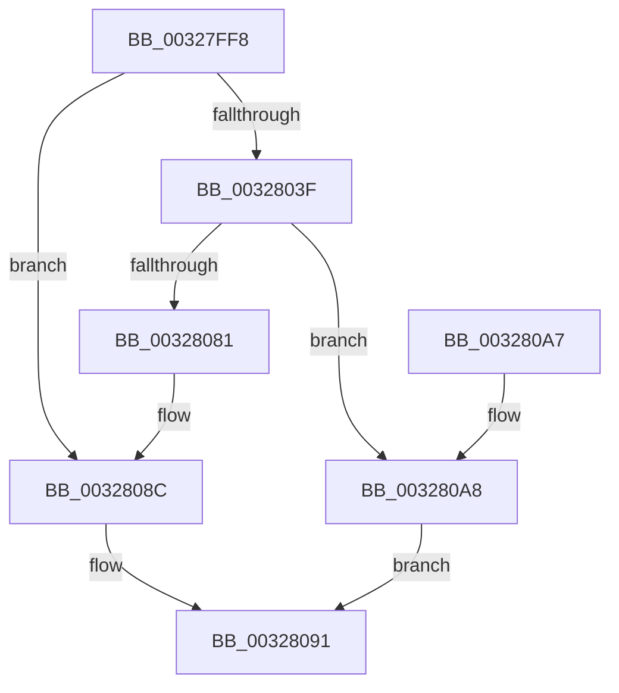

# MiGetLargePoolPages

- RVA: `0x00327FF8`–`0x003280AC` (길이 `180` bytes)
- VA: `0x0000000140327FF8`
- 실행 섹션: `.text`
- PDB 이름 있음: `예`; PDB Function 태그: `아니요`
- unwind 정보 RVA: `0x00075EA0`
- 디코드: `46`개 명령, `180/180` bytes 표시
- 미해석 바이트: `0` (있으면 어셈블리에 `.byte`로 보존)

> 이 문서는 커널 이미지의 기계어와 PDB 기호를 분석해 생성했습니다. 4번과 5번은 함수 원형과 자료형을 바이너리 사용 방식에서 추정한 C 해석이며 원본 소스 복구 결과는 아닙니다.

## 1. Dependencies

- 직접 호출 지점: **5**; 고유 호출 대상: **5**
- 직접 호출자로 확인된 함수: **1**
- RIP 상대 이미지 참조: **1**

### Outgoing calls
- `0x00328036` → [MiObtainPoolCharges](../46/MiObtainPoolCharges_function_00460AD8.md) (function, `0x00460AD8`)
- `0x00328057` → [MiInitializeDemandCoalesceContext](../3D/MiInitializeDemandCoalesceContext_function_003D3350.md) (function, `0x003D3350`)
- `0x00328075` → [MiGetLargePageChain](../3B/MiGetLargePageChain_function_003B82D0.md) (function, `0x003B82D0`)
- `0x00328087` → [MiReturnExcessPoolCharges](../36/MiReturnExcessPoolCharges_function_00367C8C.md) (function, `0x00367C8C`)
- `0x00328099` → [_security_check_cookie](../6A/_security_check_cookie_function_006AC640.md) (function, `0x006AC640`)

### Direct callers
- [sub_00328FA3](Unknown_function_00328FA3.md) at `0x0032921E`

### Static image references
- `0x00328001` → RVA `0x00E0A740` (`.data`; read)

## 2. Other-region calls and transfers

- 다른 실행 섹션으로 향하는 call: **0**
- 별도 외부 분기/꼬리 이동을 확인하지 못했습니다.

## 3. Assembly (complete function range)

```asm
00327FF8  40 53                           push rbx
00327FFA  48 81 EC 80 00 00 00            sub rsp, 0x80
00328001  48 8B 05 38 27 AE 00            mov rax, qword ptr [rip + 0xae2738]
00328008  48 33 C4                        xor rax, rsp
0032800B  48 89 44 24 70                  mov qword ptr [rsp + 0x70], rax
00328010  0F 57 C0                        xorps xmm0, xmm0
00328013  33 C0                           xor eax, eax
00328015  48 8B D9                        mov rbx, rcx
00328018  48 89 44 24 60                  mov qword ptr [rsp + 0x60], rax
0032801D  48 8B 49 08                     mov rcx, qword ptr [rcx + 8]
00328021  33 D2                           xor edx, edx
00328023  0F 11 44 24 30                  movups xmmword ptr [rsp + 0x30], xmm0
00328028  89 44 24 68                     mov dword ptr [rsp + 0x68], eax
0032802C  0F 11 44 24 40                  movups xmmword ptr [rsp + 0x40], xmm0
00328031  0F 11 44 24 50                  movups xmmword ptr [rsp + 0x50], xmm0
00328036  E8 9D 8A 13 00                  call 0x140460ad8
0032803B  85 C0                           test eax, eax
0032803D  74 4D                           je 0x14032808c
0032803F  4C 8B 43 08                     mov r8, qword ptr [rbx + 8]
00328043  48 8D 4C 24 30                  lea rcx, [rsp + 0x30]
00328048  49 C1 E8 09                     shr r8, 9
0032804C  BA 00 02 00 00                  mov edx, 0x200
00328051  41 B9 01 00 00 00               mov r9d, 1
00328057  E8 F4 B2 0A 00                  call 0x1403d3350
0032805C  48 8B 53 08                     mov rdx, qword ptr [rbx + 8]
00328060  4C 8D 43 10                     lea r8, [rbx + 0x10]
00328064  8B 4B 60                        mov ecx, dword ptr [rbx + 0x60]
00328067  4C 8D 4C 24 30                  lea r9, [rsp + 0x30]
0032806C  4C 89 44 24 20                  mov qword ptr [rsp + 0x20], r8
00328071  44 8A 43 66                     mov r8b, byte ptr [rbx + 0x66]
00328075  E8 56 02 09 00                  call 0x1403b82d0
0032807A  48 83 7B 20 00                  cmp qword ptr [rbx + 0x20], 0
0032807F  75 27                           jne 0x1403280a8
00328081  48 8B 4B 08                     mov rcx, qword ptr [rbx + 8]
00328085  33 D2                           xor edx, edx
00328087  E8 00 FC 03 00                  call 0x140367c8c
0032808C  B8 9A 00 00 C0                  mov eax, 0xc000009a
00328091  48 8B 4C 24 70                  mov rcx, qword ptr [rsp + 0x70]
00328096  48 33 CC                        xor rcx, rsp
00328099  E8 A2 45 38 00                  call 0x1406ac640
0032809E  48 81 C4 80 00 00 00            add rsp, 0x80
003280A5  5B                              pop rbx
003280A6  C3                              ret
003280A7  CC                              int3
003280A8  33 C0                           xor eax, eax
003280AA  EB E5                           jmp 0x140328091
```

## 4. C-style interpretation (structured pseudocode)

```c
__int64 __fastcall MiGetLargePoolPages(__int64 a1, int a2)
{
    __int64 result;
    __int64 v_rsp;
    unsigned __int64 v_stack_m18;
    unsigned int v_stack_m20;
    unsigned __int64 v_stack_m28;
    unsigned __int64 v_stack_m38;
    unsigned __int64 v_stack_m48;
    unsigned __int64 v_stack_m58;
    unsigned __int64 v_stack_m68;

    v_rsp = (v_rsp) - (128);
    result = (*(unsigned __int64 *)(v_rip + 11413304)) ^ (v_rsp);
    v_stack_m18 = result;
    result = 0;
    v_stack_m28 = 0;
    a2 = 0;
    v_stack_m58 = v_xmm0;
    v_stack_m20 = 0;
    v_stack_m48 = v_xmm0;
    v_stack_m38 = v_xmm0;
    result = MiObtainPoolCharges(*(unsigned __int64 *)(a1 + 8), a2, a3, a4);
    if ((unsigned int)(result) == 0) goto loc_0032808C;
    a3 = (*(unsigned __int64 *)(a1 + 8)) >> (9);
    result = MiInitializeDemandCoalesceContext(v_stack_m58, 512, a3, 1);
    v_stack_m68 = a1 + 16;
    result = MiGetLargePageChain((unsigned int)(*(unsigned int *)(a1 + 96)), *(unsigned __int64 *)(a1 + 8), *(unsigned __int8 *)(a1 + 102), v_stack_m58);
    if ((*(unsigned __int64 *)(a1 + 32)) != 0) goto loc_003280A8;
    a2 = 0;
    result = MiReturnExcessPoolCharges(*(unsigned __int64 *)(a1 + 8), a2, *(unsigned __int8 *)(a1 + 102), v_stack_m58);
loc_0032808C:
loc_00328091:
    a1 = (v_stack_m18) ^ (v_rsp);
    result = _security_check_cookie(a1, a2, *(unsigned __int8 *)(a1 + 102), v_stack_m58);
    v_rsp = (v_rsp) + (128);
    return result;
loc_003280A8:
    result = 0;
    goto loc_00328091;
}
```

## 5. (Beta) C Style

```c
int64_t MiGetLargePoolPages(void *Arg1, int32_t Arg2)
{
    uint8_t *arg1 = (uint8_t *)Arg1;

    int64_t result;
    int64_t local_rsp;
    uint64_t v_stack_m18;
    uint32_t v_stack_m20;
    uint64_t v_stack_m28;
    uint64_t v_stack_m38;
    uint64_t v_stack_m48;
    uint64_t v_stack_m58;
    uint64_t v_stack_m68;

    local_rsp = (local_rsp) - (128);
    result = (*(uint64_t *)(v_rip + 0xAE2738)) ^ (local_rsp);
    v_stack_m18 = result;
    result = 0;
    v_stack_m28 = 0;
    Arg2 = 0;
    v_stack_m58 = v_xmm0;
    v_stack_m20 = 0;
    v_stack_m48 = v_xmm0;
    v_stack_m38 = v_xmm0;
    result = MiObtainPoolCharges(*(uint64_t *)(arg1 + 0x8), Arg2, a3, a4);
    if ((uint32_t)(result) == 0) goto loc_0032808C;
    a3 = (*(uint64_t *)(arg1 + 0x8)) >> (9);
    result = MiInitializeDemandCoalesceContext(v_stack_m58, 512, a3, 1);
    v_stack_m68 = Arg1 + 16;
    result = MiGetLargePageChain((uint32_t)(*(uint32_t *)(arg1 + 0x60)), *(uint64_t *)(arg1 + 0x8), *(uint8_t *)(arg1 + 0x66), v_stack_m58);
    if ((*(uint64_t *)(arg1 + 0x20)) != 0) goto loc_003280A8;
    Arg2 = 0;
    result = MiReturnExcessPoolCharges(*(uint64_t *)(arg1 + 0x8), Arg2, *(uint8_t *)(arg1 + 0x66), v_stack_m58);
loc_0032808C:
loc_00328091:
    Arg1 = (v_stack_m18) ^ (local_rsp);
    result = _security_check_cookie(Arg1, Arg2, *(uint8_t *)(arg1 + 0x66), v_stack_m58);
    local_rsp = (local_rsp) + (128);
    return result;
loc_003280A8:
    result = 0;
    goto loc_00328091;
}
```

### 관측된 메모리 오프셋

구조체 형식이 확인되지 않은 접근은 인자 기준의 오프셋으로만 기록했습니다.

| 기준 인자 | 오프셋 표현 | 폭 (bit) | 접근 |
|---|---:|---:|---|
| `Arg1` | `+ 0x8` | `64` | `R` |
| `Arg1` | `+ 0x10` | `64` | `R` |
| `Arg1` | `+ 0x20` | `64` | `R` |
| `Arg1` | `+ 0x60` | `32` | `R` |
| `Arg1` | `+ 0x66` | `8` | `R` |

## 6. Execution-region graph

[열기: 2D/3D 그래프와 함수 탐색 컨트롤 패널](../../../control-panel.html?section=text&rva=0x00327FF8&view=graph)

- 2D 그래프는 위에서 아래로 흐르고, 3D 그래프는 빈 공간을 드래그해 회전합니다. Shift+드래그는 이동, 휠은 확대·축소, 함수 노드 선택은 대상 보고서 이동입니다.

### Static fallback


