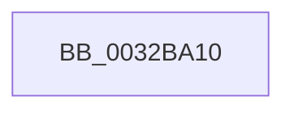

# MiGetPageProtection

- RVA: `0x0032BA10`–`0x0032BA64` (길이 `84` bytes)
- VA: `0x000000014032BA10`
- 실행 섹션: `.text`
- PDB 이름 있음: `예`; PDB Function 태그: `예`
- unwind 정보 RVA: `0x00076128`
- 디코드: `27`개 명령, `84/84` bytes 표시
- 미해석 바이트: `0` (있으면 어셈블리에 `.byte`로 보존)

> 이 문서는 커널 이미지의 기계어와 PDB 기호를 분석해 생성했습니다. 4번과 5번은 함수 원형과 자료형을 바이너리 사용 방식에서 추정한 C 해석이며 원본 소스 복구 결과는 아닙니다.

## 1. Dependencies

- 직접 호출 지점: **0**; 고유 호출 대상: **0**
- 직접 호출자로 확인된 함수: **3**
- RIP 상대 이미지 참조: **0**

### Outgoing calls
- 직접 디코드된 call 명령이 없습니다.

### Direct callers
- [MiProtectPrivateMemory](../2C/MiProtectPrivateMemory_function_002C45B0.md) at `0x002C478C`
- [MiCommitExistingVad](MiCommitExistingVad_function_0032A860.md) at `0x0032AF06`
- [MiQueryAddressState](MiQueryAddressState_function_0032C380.md) at `0x0032C81B`

### Static image references
- 디코드된 RIP-relative 메모리 참조가 없습니다.

## 2. Other-region calls and transfers

- 다른 실행 섹션으로 향하는 call: **0**
- call이 아닌 외부 분기/꼬리 이동: **1**
  - `0x0032BA5E` → [sub_0032BCD2](Unknown_function_0032BCD2.md) (`tail-transfer`)

## 3. Assembly (complete function range)

```asm
0032BA10  48 8B C4                        mov rax, rsp
0032BA13  53                              push rbx
0032BA14  55                              push rbp
0032BA15  56                              push rsi
0032BA16  57                              push rdi
0032BA17  41 54                           push r12
0032BA19  41 56                           push r14
0032BA1B  41 57                           push r15
0032BA1D  48 83 EC 40                     sub rsp, 0x40
0032BA21  48 8B 3A                        mov rdi, qword ptr [rdx]
0032BA24  45 33 D2                        xor r10d, r10d
0032BA27  4C 8B BC 24 A0 00 00 00         mov r15, qword ptr [rsp + 0xa0]
0032BA2F  49 8B D8                        mov rbx, r8
0032BA32  4C 89 50 20                     mov qword ptr [rax + 0x20], r10
0032BA36  4D 8B E1                        mov r12, r9
0032BA39  4C 89 50 18                     mov qword ptr [rax + 0x18], r10
0032BA3D  48 8B F2                        mov rsi, rdx
0032BA40  4D 89 10                        mov qword ptr [r8], r10
0032BA43  48 8B E9                        mov rbp, rcx
0032BA46  44 8B 41 30                     mov r8d, dword ptr [rcx + 0x30]
0032BA4A  41 8B C0                        mov eax, r8d
0032BA4D  83 E0 70                        and eax, 0x70
0032BA50  45 89 11                        mov dword ptr [r9], r10d
0032BA53  66 45 89 17                     mov word ptr [r15], r10w
0032BA57  4C 8D 49 30                     lea r9, [rcx + 0x30]
0032BA5B  83 F8 30                        cmp eax, 0x30
0032BA5E  0F 84 6E 02 00 00               je 0x14032bcd2
```

## 4. C-style interpretation (structured pseudocode)

```c
__int64 __fastcall MiGetPageProtection(__int64 a1, __int64 a2, __int64 a3, __int64 a4, __int64 a5)
{
    __int64 result;
    __int64 v_r10;
    __int64 v_rsp;

    v_rsp = (v_rsp) - (64);
    v_r10 = 0;
    *(unsigned __int64 *)(v_rsp + 32) = 0;
    *(unsigned __int64 *)(v_rsp + 24) = 0;
    *(unsigned __int64 *)(a3) = 0;
    result = (unsigned int)(((unsigned int)((unsigned int)((unsigned int)(*(unsigned int *)(a1 + 48))))) & (112));
    *(unsigned int *)(a4) = 0;
    *(unsigned __int16 *)(a5) = 0;
}
```

## 5. (Beta) C Style

```c
int64_t MiGetPageProtection(void *Arg1, void *Arg2, void *Arg3, void *Arg4, void *Arg5)
{
    uint8_t *arg1 = (uint8_t *)Arg1;
    uint8_t *arg2 = (uint8_t *)Arg2;
    uint8_t *arg3 = (uint8_t *)Arg3;
    uint8_t *arg4 = (uint8_t *)Arg4;
    uint8_t *arg5 = (uint8_t *)Arg5;

    int64_t result;
    int64_t local_r10;
    int64_t local_rsp;

    local_rsp = (local_rsp) - (64);
    local_r10 = 0;
    *(uint64_t *)(local_rsp + 0x20) = 0;
    *(uint64_t *)(local_rsp + 0x18) = 0;
    *(uint64_t *)(arg3) = 0;
    result = (uint32_t)(((uint32_t)((uint32_t)((uint32_t)(*(uint32_t *)(arg1 + 0x30))))) & (112));
    *(uint32_t *)(arg4) = 0;
    *(uint16_t *)(arg5) = 0;
}
```

### 관측된 메모리 오프셋

구조체 형식이 확인되지 않은 접근은 인자 기준의 오프셋으로만 기록했습니다.

| 기준 인자 | 오프셋 표현 | 폭 (bit) | 접근 |
|---|---:|---:|---|
| `Arg1` | `+ 0x30` | `32` | `R` |
| `Arg1` | `+ 0x30` | `64` | `R` |
| `Arg2` | `+ 0x0` | `64` | `R` |
| `Arg3` | `+ 0x0` | `64` | `W` |
| `Arg4` | `+ 0x0` | `32` | `W` |
| `Arg5` | `+ 0x0` | `16` | `W` |

## 6. Execution-region graph

[열기: 2D/3D 그래프와 함수 탐색 컨트롤 패널](../../../control-panel.html?section=text&rva=0x0032BA10&view=graph)

- 2D 그래프는 위에서 아래로 흐르고, 3D 그래프는 빈 공간을 드래그해 회전합니다. Shift+드래그는 이동, 휠은 확대·축소, 함수 노드 선택은 대상 보고서 이동입니다.

### Static fallback


