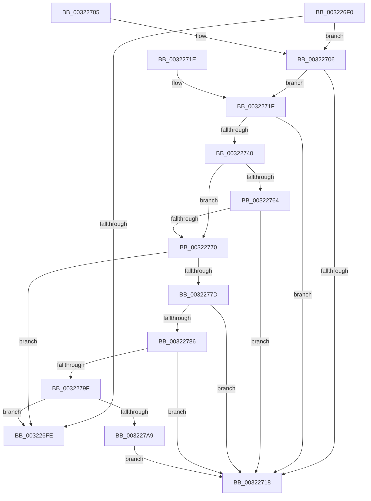

# MiGetPfnPriority

- RVA: `0x003226F0`–`0x003227AE` (길이 `190` bytes)
- VA: `0x00000001403226F0`
- 실행 섹션: `.text`
- PDB 이름 있음: `예`; PDB Function 태그: `아니요`
- unwind 정보 RVA: `0x000DB714`
- 디코드: `49`개 명령, `190/190` bytes 표시
- 미해석 바이트: `0` (있으면 어셈블리에 `.byte`로 보존)

> 이 문서는 커널 이미지의 기계어와 PDB 기호를 분석해 생성했습니다. 4번과 5번은 함수 원형과 자료형을 바이너리 사용 방식에서 추정한 C 해석이며 원본 소스 복구 결과는 아닙니다.

## 1. Dependencies

- 직접 호출 지점: **0**; 고유 호출 대상: **0**
- 직접 호출자로 확인된 함수: **34**
- RIP 상대 이미지 참조: **4**

### Outgoing calls
- 직접 디코드된 call 명령이 없습니다.

### Direct callers
- [MiResetAccessBitPteWorker](../22/MiResetAccessBitPteWorker_function_0022A6B8.md) at `0x0022A7DF`
- [MiCombineWithExisting](../22/MiCombineWithExisting_function_0022B4B8.md) at `0x0022B64B`
- [MiCombineInitialInstance](../22/MiCombineInitialInstance_function_0022BC0C.md) at `0x0022C164`
- [MiWsleFree](../28/MiWsleFree_function_00284600.md) at `0x002851F0`
- [sub_00287607](../28/Unknown_function_00287607.md) at `0x002876FB`
- [sub_00287607](../28/Unknown_function_00287607.md) at `0x0028780C`
- [sub_00287607](../28/Unknown_function_00287607.md) at `0x00287851`
- [sub_00287E84](../28/Unknown_function_00287E84.md) at `0x00288073`
- [sub_00287E84](../28/Unknown_function_00287E84.md) at `0x002880A3`
- [MiTrimThisWsle](../29/MiTrimThisWsle_function_002932E4.md) at `0x0029339E`
- [MiTrimThisWsle](../29/MiTrimThisWsle_function_002932E4.md) at `0x002934ED`
- [sub_00293F76](../29/Unknown_function_00293F76.md) at `0x00294174`
- [sub_00293F76](../29/Unknown_function_00293F76.md) at `0x00294185`
- [MiStandbyPageContentsIntact](../2A/MiStandbyPageContentsIntact_function_002AF0D4.md) at `0x002AF130`
- [MiGetWorkingSetInfoList](../2A/MiGetWorkingSetInfoList_function_002AF770.md) at `0x002AFCD1`
- [MiGetWorkingSetInfoList](../2A/MiGetWorkingSetInfoList_function_002AF770.md) at `0x002B0700`
- [MiReplaceTransitionPage](../2B/MiReplaceTransitionPage_function_002B1120.md) at `0x002B1315`
- [MiReplaceTransitionPage](../2B/MiReplaceTransitionPage_function_002B1120.md) at `0x002B1AB5`
- [MiStoreCheckCandidatePage](../2B/MiStoreCheckCandidatePage_function_002B54E8.md) at `0x002B5602`
- [MiMakePageAvoidRead](../2B/MiMakePageAvoidRead_function_002B7DE0.md) at `0x002B8319`
- [MiInsertPageInList](../2B/MiInsertPageInList_function_002BA000.md) at `0x002BA4C7`
- [MiUnlinkStandbyPfn](../2C/MiUnlinkStandbyPfn_function_002C3510.md) at `0x002C367E`
- [sub_0031CB02](../31/Unknown_function_0031CB02.md) at `0x0031CB83`
- [MmSetPfnListInfo](../31/MmSetPfnListInfo_function_0031D61C.md) at `0x0031D764`
- [MiUpdatePfnForPrefetchByPte](MiUpdatePfnForPrefetchByPte_function_00321210.md) at `0x00321345`
- [MiResolveProtoPteFault](MiResolveProtoPteFault_function_00321750.md) at `0x00321F61`
- [MiPfnShareCountIsZero](../33/MiPfnShareCountIsZero_function_00330930.md) at `0x00330C29`
- [sub_003341DB](../33/Unknown_function_003341DB.md) at `0x003342DE`
- [MiSharedInsertPfnChainInList](../33/MiSharedInsertPfnChainInList_function_0033CA70.md) at `0x0033D2A7`
- [MiSharedInsertPfnChainInList](../33/MiSharedInsertPfnChainInList_function_0033CA70.md) at `0x0033D2F1`
- [MiRestoreTransitionPte](../33/MiRestoreTransitionPte_function_0033DD90.md) at `0x0033DFE8`
- [sub_0033EABD](../33/Unknown_function_0033EABD.md) at `0x0033ED29`
- [MiDecommitSharedPageTail](../37/MiDecommitSharedPageTail_function_00370240.md) at `0x003706A7`
- [MiDecommitSharedPageTail](../37/MiDecommitSharedPageTail_function_00370240.md) at `0x00370768`
- [sub_00370B5B](../37/Unknown_function_00370B5B.md) at `0x00370CDE`
- [MiDuplicateCloneLeaf](../38/MiDuplicateCloneLeaf_function_003825F0.md) at `0x003826E3`
- [sub_003D53C8](../3D/Unknown_function_003D53C8.md) at `0x003D53F4`
- [MiUpdatePrefetchPriority](../40/MiUpdatePrefetchPriority_function_00402CB0.md) at `0x00402DB9`
- [MiDeprioritizeVirtualAddresses](../42/MiDeprioritizeVirtualAddresses_function_0042AD1C.md) at `0x0042AE9B`
- [MiQueryPfn](../44/MiQueryPfn_function_0044EEC8.md) at `0x0044EF01`
- [MiUpdatePageAttributeStamp](../48/MiUpdatePageAttributeStamp_function_00482364.md) at `0x00482408`
- [MiUpdateOldPteWorker](../49/MiUpdateOldPteWorker_function_0049CFD4.md) at `0x0049D000`
- [sub_006D7070](../6D/Unknown_function_006D7070.md) at `0x006D7088`

### Static image references
- `0x0032271F` → RVA `0x00E2DCE0` (`.data`; read)
- `0x00322758` → RVA `0x00E35C00` (`.data`; read)
- `0x0032277D` → RVA `0x00E3CBE6` (`.data`; read)
- `0x00322786` → RVA `0x00E3D240` (`.data`; read)

## 2. Other-region calls and transfers

- 다른 실행 섹션으로 향하는 call: **0**
- 별도 외부 분기/꼬리 이동을 확인하지 못했습니다.

## 3. Assembly (complete function range)

```asm
003226F0  8B 41 20                        mov eax, dword ptr [rcx + 0x20]
003226F3  8B 51 20                        mov edx, dword ptr [rcx + 0x20]
003226F6  C1 EA 18                        shr edx, 0x18
003226F9  F6 C2 08                        test dl, 8
003226FC  75 08                           jne 0x140322706
003226FE  C1 E8 18                        shr eax, 0x18
00322701  83 E0 07                        and eax, 7
00322704  C3                              ret
00322705  CC                              int3
00322706  49 B9 00 00 00 00 00 DE FF FF   movabs r9, 0xffffde0000000000
00322710  49 8B D1                        mov rdx, r9
00322713  48 3B CA                        cmp rcx, rdx
00322716  73 07                           jae 0x14032271f
00322718  B8 05 00 00 00                  mov eax, 5
0032271D  C3                              ret
0032271E  CC                              int3
0032271F  48 8B 15 BA B5 B0 00            mov rdx, qword ptr [rip + 0xb0b5ba]
00322726  4C 8D 04 52                     lea r8, [rdx + rdx*2]
0032272A  49 C1 E0 04                     shl r8, 4
0032272E  48 BA 30 00 00 00 00 DE FF FF   movabs rdx, 0xffffde0000000030
00322738  4C 03 C2                        add r8, rdx
0032273B  49 3B C8                        cmp rcx, r8
0032273E  73 D8                           jae 0x140322718
00322740  49 8B D1                        mov rdx, r9
00322743  48 2B CA                        sub rcx, rdx
00322746  48 BA AB AA AA AA AA AA AA AA   movabs rdx, 0xaaaaaaaaaaaaaaab
00322750  48 C1 F9 04                     sar rcx, 4
00322754  48 0F AF CA                     imul rcx, rdx
00322758  48 8B 15 A1 34 B1 00            mov rdx, qword ptr [rip + 0xb134a1]
0032275F  48 3B CA                        cmp rcx, rdx
00322762  72 0C                           jb 0x140322770
00322764  48 81 C2 00 08 00 00            add rdx, 0x800
0032276B  48 3B CA                        cmp rcx, rdx
0032276E  72 A8                           jb 0x140322718
00322770  8B D0                           mov edx, eax
00322772  C1 EA 10                        shr edx, 0x10
00322775  80 E2 07                        and dl, 7
00322778  80 FA 06                        cmp dl, 6
0032277B  74 81                           je 0x1403226fe
0032277D  80 3D 62 A4 B1 00 00            cmp byte ptr [rip + 0xb1a462], 0
00322784  74 92                           je 0x140322718
00322786  48 8B 15 B3 AA B1 00            mov rdx, qword ptr [rip + 0xb1aab3]
0032278D  48 C1 E9 09                     shr rcx, 9
00322791  44 0F B6 04 4A                  movzx r8d, byte ptr [rdx + rcx*2]
00322796  45 85 C0                        test r8d, r8d
00322799  0F 84 79 FF FF FF               je 0x140322718
0032279F  41 83 F8 0A                     cmp r8d, 0xa
003227A3  0F 85 55 FF FF FF               jne 0x1403226fe
003227A9  E9 6A FF FF FF                  jmp 0x140322718
```

## 4. C-style interpretation (structured pseudocode)

```c
__int64 __fastcall MiGetPfnPriority(__int64 a1)
{
    __int64 result;

    a2 = (unsigned int)(((unsigned int)(*(unsigned int *)(a1 + 32))) >> (24));
    if ((((unsigned __int8)(a2)) & (8)) != 0) goto loc_00322706;
loc_003226FE:
    result = (unsigned int)(((unsigned int)(*(unsigned int *)(a1 + 32))) >> (24));
    result = (unsigned int)((result) & (7));
    return result;
loc_00322706:
    if (a1 >= a4) goto loc_0032271F;
loc_00322718:
    return 5;
loc_0032271F:
    a3 = (*(unsigned __int64 *)(v_rip + 11580858) + *(unsigned __int64 *)(v_rip + 11580858) * 2) << (4);
    a3 = (a3) + (*(unsigned __int64 *)(v_rip + 11580858));
    if (a1 >= a3) goto loc_00322718;
    a1 = (a1) - (a4);
    a1 = (a1) >> (4);
    a1 = (a1) * (a4);
    if (a1 < (*(unsigned __int64 *)(v_rip + 11613345))) goto loc_00322770;
    a2 = (*(unsigned __int64 *)(v_rip + 11613345)) + (0x800ULL);
    if (a1 < a2) goto loc_00322718;
loc_00322770:
    a2 = (unsigned int)((5) >> (16));
    a2 = (unsigned __int8)((a2) & (7));
    if (((unsigned __int8)(a2)) == 6) goto loc_003226FE;
    if ((*(unsigned __int8 *)(v_rip + 11641954)) == 0) goto loc_00322718;
    a1 = (a1) >> (9);
    if ((unsigned int)(*(unsigned __int8 *)(*(unsigned __int64 *)(v_rip + 11643571) + a1 * 2)) == 0) goto loc_00322718;
    if (((unsigned int)(*(unsigned __int8 *)(*(unsigned __int64 *)(v_rip + 11643571) + a1 * 2))) != 10) goto loc_003226FE;
    goto loc_00322718;
}
```

## 5. (Beta) C Style

```c
int64_t MiGetPfnPriority(void *Arg1)
{
    uint8_t *arg1 = (uint8_t *)Arg1;

    int64_t result;

    a2 = (uint32_t)(((uint32_t)(*(uint32_t *)(arg1 + 0x20))) >> (24));
    if ((((uint8_t)(a2)) & (8)) != 0) goto loc_00322706;
loc_003226FE:
    result = (uint32_t)(((uint32_t)(*(uint32_t *)(arg1 + 0x20))) >> (24));
    result = (uint32_t)((result) & (7));
    return result;
loc_00322706:
    if (Arg1 >= a4) goto loc_0032271F;
loc_00322718:
    return 5;
loc_0032271F:
    a3 = (*(uint64_t *)(v_rip + 0xB0B5BA) + *(uint64_t *)(v_rip + 0xB0B5BA) * 2) << (4);
    a3 = (a3) + (*(uint64_t *)(v_rip + 0xB0B5BA));
    if (Arg1 >= a3) goto loc_00322718;
    Arg1 = (Arg1) - (a4);
    Arg1 = (Arg1) >> (4);
    Arg1 = (Arg1) * (a4);
    if (Arg1 < (*(uint64_t *)(v_rip + 0xB134A1))) goto loc_00322770;
    a2 = (*(uint64_t *)(v_rip + 0xB134A1)) + (0x800ULL);
    if (Arg1 < a2) goto loc_00322718;
loc_00322770:
    a2 = (uint32_t)((5) >> (16));
    a2 = (uint8_t)((a2) & (7));
    if (((uint8_t)(a2)) == 6) goto loc_003226FE;
    if ((*(uint8_t *)(v_rip + 0xB1A462)) == 0) goto loc_00322718;
    Arg1 = (Arg1) >> (9);
    if ((uint32_t)(*(uint8_t *)(*(uint64_t *)(v_rip + 0xB1AAB3) + arg1 * 2)) == 0) goto loc_00322718;
    if (((uint32_t)(*(uint8_t *)(*(uint64_t *)(v_rip + 0xB1AAB3) + arg1 * 2))) != 10) goto loc_003226FE;
    goto loc_00322718;
}
```

### 관측된 메모리 오프셋

구조체 형식이 확인되지 않은 접근은 인자 기준의 오프셋으로만 기록했습니다.

| 기준 인자 | 오프셋 표현 | 폭 (bit) | 접근 |
|---|---:|---:|---|
| `Arg1` | `+ 0x20` | `32` | `R` |

## 6. Execution-region graph

[열기: 2D/3D 그래프와 함수 탐색 컨트롤 패널](../../../control-panel.html?section=text&rva=0x003226F0&view=graph)

- 2D 그래프는 위에서 아래로 흐르고, 3D 그래프는 빈 공간을 드래그해 회전합니다. Shift+드래그는 이동, 휠은 확대·축소, 함수 노드 선택은 대상 보고서 이동입니다.

### Static fallback


