# MiGetPfnProtection

- RVA: `0x0032A650`–`0x0032A855` (길이 `517` bytes)
- VA: `0x000000014032A650`
- 실행 섹션: `.text`
- PDB 이름 있음: `예`; PDB Function 태그: `아니요`
- unwind 정보 RVA: `0x00076098`
- 디코드: `134`개 명령, `517/517` bytes 표시
- 미해석 바이트: `0` (있으면 어셈블리에 `.byte`로 보존)

> 이 문서는 커널 이미지의 기계어와 PDB 기호를 분석해 생성했습니다. 4번과 5번은 함수 원형과 자료형을 바이너리 사용 방식에서 추정한 C 해석이며 원본 소스 복구 결과는 아닙니다.

## 1. Dependencies

- 직접 호출 지점: **3**; 고유 호출 대상: **2**
- 직접 호출자로 확인된 함수: **3**
- RIP 상대 이미지 참조: **1**

### Outgoing calls
- `0x0032A750` → [MiLocateCloneAddress](../3D/MiLocateCloneAddress_function_003D26B4.md) (function, `0x003D26B4`)
- `0x0032A767` → [MiPteHasShadow](MiPteHasShadow_function_0032B998.md) (function, `0x0032B998`)
- `0x0032A7AE` → [MiPteHasShadow](MiPteHasShadow_function_0032B998.md) (function, `0x0032B998`)

### Direct callers
- [MiGetWorkingSetInfoList](../2A/MiGetWorkingSetInfoList_function_002AF770.md) at `0x002B01BE`
- [sub_002C3A7C](../2C/Unknown_function_002C3A7C.md) at `0x002C3ED9`
- [MiRevokeExecutePte](../46/MiRevokeExecutePte_function_00460BA0.md) at `0x00460C29`

### Static image references
- `0x0032A81B` → RVA `0x00011070` (`.rdata`; read)

## 2. Other-region calls and transfers

- 다른 실행 섹션으로 향하는 call: **0**
- 별도 외부 분기/꼬리 이동을 확인하지 못했습니다.

## 3. Assembly (complete function range)

```asm
0032A650  48 83 EC 28                     sub rsp, 0x28
0032A654  48 C1 EA 09                     shr rdx, 9
0032A658  49 BA F8 FF FF FF 7F 00 00 00   movabs r10, 0x7ffffffff8
0032A662  4C 23 D2                        and r10, rdx
0032A665  4D 8B D8                        mov r11, r8
0032A668  48 B8 00 00 00 00 80 F6 FF FF   movabs rax, 0xfffff68000000000
0032A672  4C 03 D0                        add r10, rax
0032A675  49 B9 00 D0 BE 7D FB F6 FF FF   movabs r9, 0xfffff6fb7dbed000
0032A67F  49 8B 12                        mov rdx, qword ptr [r10]
0032A682  49 8B C1                        mov rax, r9
0032A685  48 B9 F8 D7 BE 7D FB F6 FF FF   movabs rcx, 0xfffff6fb7dbed7f8
0032A68F  4C 3B D0                        cmp r10, rax
0032A692  72 2A                           jb 0x14032a6be
0032A694  48 8B C1                        mov rax, rcx
0032A697  4C 3B D0                        cmp r10, rax
0032A69A  77 22                           ja 0x14032a6be
0032A69C  F6 C2 01                        test dl, 1
0032A69F  74 14                           je 0x14032a6b5
0032A6A1  F6 C2 42                        test dl, 0x42
0032A6A4  0F 95 C1                        setne cl
0032A6A7  F6 C2 20                        test dl, 0x20
0032A6AA  0F 95 C0                        setne al
0032A6AD  84 C8                           test al, cl
0032A6AF  0F 84 F9 00 00 00               je 0x14032a7ae
0032A6B5  4D 8B 02                        mov r8, qword ptr [r10]
0032A6B8  48 C1 EA 3C                     shr rdx, 0x3c
0032A6BC  EB 17                           jmp 0x14032a6d5
0032A6BE  4D 8B 02                        mov r8, qword ptr [r10]
0032A6C1  48 C1 EA 3C                     shr rdx, 0x3c
0032A6C5  49 8B C1                        mov rax, r9
0032A6C8  4C 3B D0                        cmp r10, rax
0032A6CB  72 23                           jb 0x14032a6f0
0032A6CD  48 8B C1                        mov rax, rcx
0032A6D0  4C 3B D0                        cmp r10, rax
0032A6D3  77 1B                           ja 0x14032a6f0
0032A6D5  4D 8B C8                        mov r9, r8
0032A6D8  41 F6 C0 01                     test r8b, 1
0032A6DC  74 12                           je 0x14032a6f0
0032A6DE  41 F6 C0 42                     test r8b, 0x42
0032A6E2  0F 95 C1                        setne cl
0032A6E5  41 F6 C0 20                     test r8b, 0x20
0032A6E9  0F 95 C0                        setne al
0032A6EC  84 C8                           test al, cl
0032A6EE  74 77                           je 0x14032a767
0032A6F0  83 E2 07                        and edx, 7
0032A6F3  0F 85 00 01 00 00               jne 0x14032a7f9
0032A6F9  85 D2                           test edx, edx
0032A6FB  0F 85 31 01 00 00               jne 0x14032a832
0032A701  45 8B 43 10                     mov r8d, dword ptr [r11 + 0x10]
0032A705  49 8B 43 28                     mov rax, qword ptr [r11 + 0x28]
0032A709  49 C1 E8 05                     shr r8, 5
0032A70D  41 83 E0 1F                     and r8d, 0x1f
0032A711  48 0F BA E0 28                  bt rax, 0x28
0032A716  72 0D                           jb 0x14032a725
0032A718  49 8B 43 08                     mov rax, qword ptr [r11 + 8]
0032A71C  48 85 C0                        test rax, rax
0032A71F  0F 89 E6 00 00 00               jns 0x14032a80b
0032A725  65 48 8B 04 25 88 01 00 00      mov rax, qword ptr gs:[0x188]
0032A72E  48 8B 88 B8 00 00 00            mov rcx, qword ptr [rax + 0xb8]
0032A735  48 83 B9 80 02 00 00 00         cmp qword ptr [rcx + 0x280], 0
0032A73D  74 1F                           je 0x14032a75e
0032A73F  49 8B 53 08                     mov rdx, qword ptr [r11 + 8]
0032A743  48 B8 00 00 00 00 00 00 00 80   movabs rax, 0x8000000000000000
0032A74D  48 0B D0                        or rdx, rax
0032A750  E8 5F 7F 0A 00                  call 0x1403d26b4
0032A755  48 85 C0                        test rax, rax
0032A758  0F 85 DC 00 00 00               jne 0x14032a83a
0032A75E  41 8B C0                        mov eax, r8d
0032A761  48 83 C4 28                     add rsp, 0x28
0032A765  C3                              ret
0032A766  CC                              int3
0032A767  E8 2C 12 00 00                  call 0x14032b998
0032A76C  48 85 C0                        test rax, rax
0032A76F  0F 84 7B FF FF FF               je 0x14032a6f0
0032A775  48 8B 80 08 05 00 00            mov rax, qword ptr [rax + 0x508]
0032A77C  48 85 C0                        test rax, rax
0032A77F  0F 84 6B FF FF FF               je 0x14032a6f0
0032A785  49 C1 EA 03                     shr r10, 3
0032A789  41 81 E2 FF 01 00 00            and r10d, 0x1ff
0032A790  4A 8B 04 D0                     mov rax, qword ptr [rax + r10*8]
0032A794  A8 20                           test al, 0x20
0032A796  74 04                           je 0x14032a79c
0032A798  49 83 C9 20                     or r9, 0x20
0032A79C  4D 8B C1                        mov r8, r9
0032A79F  49 83 C8 42                     or r8, 0x42
0032A7A3  A8 42                           test al, 0x42
0032A7A5  4D 0F 44 C1                     cmove r8, r9
0032A7A9  E9 42 FF FF FF                  jmp 0x14032a6f0
0032A7AE  E8 E5 11 00 00                  call 0x14032b998
0032A7B3  48 85 C0                        test rax, rax
0032A7B6  0F 84 F9 FE FF FF               je 0x14032a6b5
0032A7BC  48 8B 88 08 05 00 00            mov rcx, qword ptr [rax + 0x508]
0032A7C3  48 85 C9                        test rcx, rcx
0032A7C6  0F 84 E9 FE FF FF               je 0x14032a6b5
0032A7CC  49 8B C2                        mov rax, r10
0032A7CF  48 C1 E8 03                     shr rax, 3
0032A7D3  25 FF 01 00 00                  and eax, 0x1ff
0032A7D8  48 8B 04 C1                     mov rax, qword ptr [rcx + rax*8]
0032A7DC  A8 20                           test al, 0x20
0032A7DE  74 04                           je 0x14032a7e4
0032A7E0  48 83 CA 20                     or rdx, 0x20
0032A7E4  48 8B CA                        mov rcx, rdx
0032A7E7  48 83 C9 42                     or rcx, 0x42
0032A7EB  A8 42                           test al, 0x42
0032A7ED  48 0F 44 CA                     cmove rcx, rdx
0032A7F1  48 8B D1                        mov rdx, rcx
0032A7F4  E9 BC FE FF FF                  jmp 0x14032a6b5
0032A7F9  41 0F B6 C0                     movzx eax, r8b
0032A7FD  24 18                           and al, 0x18
0032A7FF  3C 08                           cmp al, 8
0032A801  75 29                           jne 0x14032a82c
0032A803  83 CA 18                        or edx, 0x18
0032A806  E9 EE FE FF FF                  jmp 0x14032a6f9
0032A80B  49 8B 43 08                     mov rax, qword ptr [r11 + 8]
0032A80F  48 85 C0                        test rax, rax
0032A812  0F 84 0D FF FF FF               je 0x14032a725
0032A818  41 8B C0                        mov eax, r8d
0032A81B  4C 8D 05 4E 68 CE FF            lea r8, [rip - 0x3197b2]
0032A822  41 8B 04 80                     mov eax, dword ptr [r8 + rax*4]
0032A826  48 83 C4 28                     add rsp, 0x28
0032A82A  C3                              ret
0032A82B  CC                              int3
0032A82C  41 F6 C0 10                     test r8b, 0x10
0032A830  75 1B                           jne 0x14032a84d
0032A832  8B C2                           mov eax, edx
0032A834  48 83 C4 28                     add rsp, 0x28
0032A838  C3                              ret
0032A839  CC                              int3
0032A83A  41 8B C0                        mov eax, r8d
0032A83D  4C 8D 05 2C 68 CE FF            lea r8, [rip - 0x3197d4]
0032A844  45 8B 04 80                     mov r8d, dword ptr [r8 + rax*4]
0032A848  E9 11 FF FF FF                  jmp 0x14032a75e
0032A84D  83 CA 08                        or edx, 8
0032A850  E9 A4 FE FF FF                  jmp 0x14032a6f9
```

## 4. C-style interpretation (structured pseudocode)

```c
__int64 __fastcall MiGetPfnProtection(__int64 a1, __int64 a2, __int64 a3)
{
    __int64 result;
    __int64 v_r10;
    __int64 v_rsp;

    v_rsp = (v_rsp) - (40);
    a2 = (a2) >> (9);
    v_r10 = (v_r10) & (a2);
    v_r10 = (v_r10) + (result);
    if (v_r10 < a4) goto loc_0032A6BE;
    if (v_r10 > a1) goto loc_0032A6BE;
    if ((((unsigned __int8)(*(unsigned __int64 *)(v_r10))) & (1)) == 0) goto loc_0032A6B5;
    a1 = ((((unsigned __int8)(*(unsigned __int64 *)(v_r10))) & (66)) != 0) ? 1 : 0;
    result = ((((unsigned __int8)(*(unsigned __int64 *)(v_r10))) & (32)) != 0) ? 1 : 0;
    if ((((unsigned __int8)(result)) & ((unsigned __int8)(a1))) == 0) goto loc_0032A7AE;
loc_0032A6B5:
    a2 = (*(unsigned __int64 *)(v_r10)) >> (60);
    goto loc_0032A6D5;
loc_0032A6BE:
    a2 = (a2) >> (60);
    if (v_r10 < a4) goto loc_0032A6F0;
    if (v_r10 > a1) goto loc_0032A6F0;
loc_0032A6D5:
    if ((((unsigned __int8)(*(unsigned __int64 *)(v_r10))) & (1)) == 0) goto loc_0032A6F0;
    a1 = ((((unsigned __int8)(*(unsigned __int64 *)(v_r10))) & (66)) != 0) ? 1 : 0;
    result = ((((unsigned __int8)(*(unsigned __int64 *)(v_r10))) & (32)) != 0) ? 1 : 0;
    if ((((unsigned __int8)(result)) & ((unsigned __int8)(a1))) == 0) goto loc_0032A767;
loc_0032A6F0:
    a2 = (unsigned int)((a2) & (7));
    if (condition_is_not_equal) goto loc_0032A7F9;
loc_0032A6F9:
    if ((unsigned int)(a2) != 0) goto loc_0032A832;
    a3 = ((unsigned int)(*(unsigned int *)(a3 + 16))) >> (5);
    a3 = (unsigned int)((a3) & (31));
    if (condition_is_below) goto loc_0032A725;
    if (!sign_flag) goto loc_0032A80B;
loc_0032A725:
    if ((*(unsigned __int64 *)(*(unsigned __int64 *)(*(unsigned __int64 *)(gs_base + (0 + 392)) + 184) + 640)) == 0) goto loc_0032A75E;
    a2 = (*(unsigned __int64 *)(a3 + 8)) | (*(unsigned __int64 *)(gs_base + (0 + 392)));
    result = MiLocateCloneAddress(*(unsigned __int64 *)(*(unsigned __int64 *)(gs_base + (0 + 392)) + 184), a2, a3, *(unsigned __int64 *)(v_r10));
    if (result != 0) goto loc_0032A83A;
loc_0032A75E:
    v_rsp = (v_rsp) + (40);
    return (unsigned int)((unsigned int)(a3));
loc_0032A767:
    result = MiPteHasShadow(*(unsigned __int64 *)(*(unsigned __int64 *)(gs_base + (0 + 392)) + 184), a2, a3, *(unsigned __int64 *)(v_r10));
    if (result == 0) goto loc_0032A6F0;
    if (*(unsigned __int64 *)(result + 1288) == 0) goto loc_0032A6F0;
    v_r10 = (v_r10) >> (3);
    v_r10 = (unsigned int)((v_r10) & (511));
    if ((((unsigned __int8)(*(unsigned __int64 *)(*(unsigned __int64 *)(result + 1288) + v_r10 * 8))) & (32)) != 0) {
        a4 = (*(unsigned __int64 *)(v_r10)) | (32);
    }
    a3 = (a4) | (66);
    if ((((unsigned __int8)(*(unsigned __int64 *)(*(unsigned __int64 *)(result + 1288) + v_r10 * 8))) & (66)) == 0) { a3 = a4; }
    goto loc_0032A6F0;
loc_0032A7AE:
    result = MiPteHasShadow(*(unsigned __int64 *)(*(unsigned __int64 *)(gs_base + (0 + 392)) + 184), a2, a3, a4);
    if (result == 0) goto loc_0032A6B5;
    if (*(unsigned __int64 *)(result + 1288) == 0) goto loc_0032A6B5;
    result = (v_r10) >> (3);
    result = (unsigned int)((result) & (511));
    if ((((unsigned __int8)(*(unsigned __int64 *)(*(unsigned __int64 *)(result + 1288) + result * 8))) & (32)) != 0) {
        a2 = (a2) | (32);
    }
    a1 = (a2) | (66);
    if ((((unsigned __int8)(*(unsigned __int64 *)(*(unsigned __int64 *)(result + 1288) + result * 8))) & (66)) == 0) { a1 = a2; }
    goto loc_0032A6B5;
loc_0032A7F9:
    result = (unsigned __int8)(((unsigned __int8)(a3)) & (24));
    if (((unsigned __int8)(result)) != 8) goto loc_0032A82C;
    a2 = (unsigned int)((a1) | (24));
    goto loc_0032A6F9;
loc_0032A80B:
    if (*(unsigned __int64 *)(a3 + 8) == 0) goto loc_0032A725;
    v_rsp = (v_rsp) + (40);
    return (unsigned int)(*(unsigned int *)(v_rip - 3250098 + (unsigned int)((unsigned int)(a3)) * 4));
loc_0032A82C:
    if ((((unsigned __int8)(v_rip - 3250098)) & (16)) != 0) goto loc_0032A84D;
loc_0032A832:
    v_rsp = (v_rsp) + (40);
    return (unsigned int)((unsigned int)(a2));
loc_0032A83A:
    goto loc_0032A75E;
loc_0032A84D:
    a2 = (unsigned int)((a2) | (8));
    goto loc_0032A6F9;
}
```

## 5. (Beta) C Style

```c
int64_t MiGetPfnProtection(int64_t Arg1, int64_t Arg2, int64_t Arg3)
{
    int64_t result;
    int64_t local_r10;
    int64_t local_rsp;

    local_rsp = (local_rsp) - (40);
    Arg2 = (Arg2) >> (9);
    local_r10 = (local_r10) & (Arg2);
    local_r10 = (local_r10) + (result);
    if (local_r10 < a4) goto loc_0032A6BE;
    if (local_r10 > Arg1) goto loc_0032A6BE;
    if ((((uint8_t)(*(uint64_t *)(local_r10))) & (1)) == 0) goto loc_0032A6B5;
    Arg1 = ((((uint8_t)(*(uint64_t *)(local_r10))) & (66)) != 0) ? 1 : 0;
    result = ((((uint8_t)(*(uint64_t *)(local_r10))) & (32)) != 0) ? 1 : 0;
    if ((((uint8_t)(result)) & ((uint8_t)(Arg1))) == 0) goto loc_0032A7AE;
loc_0032A6B5:
    Arg2 = (*(uint64_t *)(local_r10)) >> (60);
    goto loc_0032A6D5;
loc_0032A6BE:
    Arg2 = (Arg2) >> (60);
    if (local_r10 < a4) goto loc_0032A6F0;
    if (local_r10 > Arg1) goto loc_0032A6F0;
loc_0032A6D5:
    if ((((uint8_t)(*(uint64_t *)(local_r10))) & (1)) == 0) goto loc_0032A6F0;
    Arg1 = ((((uint8_t)(*(uint64_t *)(local_r10))) & (66)) != 0) ? 1 : 0;
    result = ((((uint8_t)(*(uint64_t *)(local_r10))) & (32)) != 0) ? 1 : 0;
    if ((((uint8_t)(result)) & ((uint8_t)(Arg1))) == 0) goto loc_0032A767;
loc_0032A6F0:
    Arg2 = (uint32_t)((Arg2) & (7));
    if (condition_is_not_equal) goto loc_0032A7F9;
loc_0032A6F9:
    if ((uint32_t)(Arg2) != 0) goto loc_0032A832;
    Arg3 = ((uint32_t)(*(uint32_t *)(Arg3 + 0x10))) >> (5);
    Arg3 = (uint32_t)((Arg3) & (31));
    if (condition_is_below) goto loc_0032A725;
    if (!sign_flag) goto loc_0032A80B;
loc_0032A725:
    if ((*(uint64_t *)(*(uint64_t *)(*(uint64_t *)(gs_base + (0 + 0x188)) + 0xB8) + 0x280)) == 0) goto loc_0032A75E;
    Arg2 = (*(uint64_t *)(Arg3 + 0x8)) | (*(uint64_t *)(gs_base + (0 + 0x188)));
    result = MiLocateCloneAddress(*(uint64_t *)(*(uint64_t *)(gs_base + (0 + 0x188)) + 0xB8), Arg2, Arg3, *(uint64_t *)(local_r10));
    if (result != 0) goto loc_0032A83A;
loc_0032A75E:
    local_rsp = (local_rsp) + (40);
    return (uint32_t)((uint32_t)(Arg3));
loc_0032A767:
    result = MiPteHasShadow(*(uint64_t *)(*(uint64_t *)(gs_base + (0 + 0x188)) + 0xB8), Arg2, Arg3, *(uint64_t *)(local_r10));
    if (result == 0) goto loc_0032A6F0;
    if (*(uint64_t *)(result + 0x508) == 0) goto loc_0032A6F0;
    local_r10 = (local_r10) >> (3);
    local_r10 = (uint32_t)((local_r10) & (511));
    if ((((uint8_t)(*(uint64_t *)(*(uint64_t *)(result + 0x508) + local_r10 * 8))) & (32)) != 0) {
        a4 = (*(uint64_t *)(local_r10)) | (32);
    }
    Arg3 = (a4) | (66);
    if ((((uint8_t)(*(uint64_t *)(*(uint64_t *)(result + 0x508) + local_r10 * 8))) & (66)) == 0) { Arg3 = a4; }
    goto loc_0032A6F0;
loc_0032A7AE:
    result = MiPteHasShadow(*(uint64_t *)(*(uint64_t *)(gs_base + (0 + 0x188)) + 0xB8), Arg2, Arg3, a4);
    if (result == 0) goto loc_0032A6B5;
    if (*(uint64_t *)(result + 0x508) == 0) goto loc_0032A6B5;
    result = (local_r10) >> (3);
    result = (uint32_t)((result) & (511));
    if ((((uint8_t)(*(uint64_t *)(*(uint64_t *)(result + 0x508) + result * 8))) & (32)) != 0) {
        Arg2 = (Arg2) | (32);
    }
    Arg1 = (Arg2) | (66);
    if ((((uint8_t)(*(uint64_t *)(*(uint64_t *)(result + 0x508) + result * 8))) & (66)) == 0) { Arg1 = Arg2; }
    goto loc_0032A6B5;
loc_0032A7F9:
    result = (uint8_t)(((uint8_t)(Arg3)) & (24));
    if (((uint8_t)(result)) != 8) goto loc_0032A82C;
    Arg2 = (uint32_t)((Arg1) | (24));
    goto loc_0032A6F9;
loc_0032A80B:
    if (*(uint64_t *)(Arg3 + 0x8) == 0) goto loc_0032A725;
    local_rsp = (local_rsp) + (40);
    return (uint32_t)(*(uint32_t *)(v_rip - 0x3197B2 + (uint32_t)((uint32_t)(Arg3)) * 4));
loc_0032A82C:
    if ((((uint8_t)(v_rip - 3250098)) & (16)) != 0) goto loc_0032A84D;
loc_0032A832:
    local_rsp = (local_rsp) + (40);
    return (uint32_t)((uint32_t)(Arg2));
loc_0032A83A:
    goto loc_0032A75E;
loc_0032A84D:
    Arg2 = (uint32_t)((Arg2) | (8));
    goto loc_0032A6F9;
}
```

## 6. Execution-region graph

[열기: 2D/3D 그래프와 함수 탐색 컨트롤 패널](../../../control-panel.html?section=text&rva=0x0032A650&view=graph)

- 2D 그래프는 위에서 아래로 흐르고, 3D 그래프는 빈 공간을 드래그해 회전합니다. Shift+드래그는 이동, 휠은 확대·축소, 함수 노드 선택은 대상 보고서 이동입니다.

### Static fallback

```mermaid
flowchart TD
  bb_0032A650[BB_0032A650]
  bb_0032A694[BB_0032A694]
  bb_0032A69C[BB_0032A69C]
  bb_0032A6A1[BB_0032A6A1]
  bb_0032A6B5[BB_0032A6B5]
  bb_0032A6BE[BB_0032A6BE]
  bb_0032A6CD[BB_0032A6CD]
  bb_0032A6D5[BB_0032A6D5]
  bb_0032A6DE[BB_0032A6DE]
  bb_0032A6F0[BB_0032A6F0]
  bb_0032A6F9[BB_0032A6F9]
  bb_0032A701[BB_0032A701]
  bb_0032A718[BB_0032A718]
  bb_0032A725[BB_0032A725]
  bb_0032A73F[BB_0032A73F]
  bb_0032A75E[BB_0032A75E]
  bb_0032A766[BB_0032A766]
  bb_0032A767[BB_0032A767]
  bb_0032A775[BB_0032A775]
  bb_0032A785[BB_0032A785]
  bb_0032A798[BB_0032A798]
  bb_0032A79C[BB_0032A79C]
  bb_0032A7AE[BB_0032A7AE]
  bb_0032A7BC[BB_0032A7BC]
  bb_0032A7CC[BB_0032A7CC]
  bb_0032A7E0[BB_0032A7E0]
  bb_0032A7E4[BB_0032A7E4]
  bb_0032A7F9[BB_0032A7F9]
  bb_0032A803[BB_0032A803]
  bb_0032A80B[BB_0032A80B]
  bb_0032A818[BB_0032A818]
  bb_0032A82B[BB_0032A82B]
  bb_0032A82C[BB_0032A82C]
  bb_0032A832[BB_0032A832]
  bb_0032A839[BB_0032A839]
  bb_0032A83A[BB_0032A83A]
  bb_0032A84D[BB_0032A84D]
  bb_0032A650 -->|branch| bb_0032A6BE
  bb_0032A650 -->|fallthrough| bb_0032A694
  bb_0032A694 -->|branch| bb_0032A6BE
  bb_0032A694 -->|fallthrough| bb_0032A69C
  bb_0032A69C -->|branch| bb_0032A6B5
  bb_0032A69C -->|fallthrough| bb_0032A6A1
  bb_0032A6A1 -->|branch| bb_0032A7AE
  bb_0032A6A1 -->|fallthrough| bb_0032A6B5
  bb_0032A6B5 -->|branch| bb_0032A6D5
  bb_0032A6BE -->|branch| bb_0032A6F0
  bb_0032A6BE -->|fallthrough| bb_0032A6CD
  bb_0032A6CD -->|branch| bb_0032A6F0
  bb_0032A6CD -->|fallthrough| bb_0032A6D5
  bb_0032A6D5 -->|branch| bb_0032A6F0
  bb_0032A6D5 -->|fallthrough| bb_0032A6DE
  bb_0032A6DE -->|branch| bb_0032A767
  bb_0032A6DE -->|fallthrough| bb_0032A6F0
  bb_0032A6F0 -->|branch| bb_0032A7F9
  bb_0032A6F0 -->|fallthrough| bb_0032A6F9
  bb_0032A6F9 -->|branch| bb_0032A832
  bb_0032A6F9 -->|fallthrough| bb_0032A701
  bb_0032A701 -->|branch| bb_0032A725
  bb_0032A701 -->|fallthrough| bb_0032A718
  bb_0032A718 -->|branch| bb_0032A80B
  bb_0032A718 -->|fallthrough| bb_0032A725
  bb_0032A725 -->|branch| bb_0032A75E
  bb_0032A725 -->|fallthrough| bb_0032A73F
  bb_0032A73F -->|branch| bb_0032A83A
  bb_0032A73F -->|fallthrough| bb_0032A75E
  bb_0032A766 -->|flow| bb_0032A767
  bb_0032A767 -->|branch| bb_0032A6F0
  bb_0032A767 -->|fallthrough| bb_0032A775
  bb_0032A775 -->|branch| bb_0032A6F0
  bb_0032A775 -->|fallthrough| bb_0032A785
  bb_0032A785 -->|branch| bb_0032A79C
  bb_0032A785 -->|fallthrough| bb_0032A798
  bb_0032A798 -->|flow| bb_0032A79C
  bb_0032A79C -->|branch| bb_0032A6F0
  bb_0032A7AE -->|branch| bb_0032A6B5
  bb_0032A7AE -->|fallthrough| bb_0032A7BC
  bb_0032A7BC -->|branch| bb_0032A6B5
  bb_0032A7BC -->|fallthrough| bb_0032A7CC
  bb_0032A7CC -->|branch| bb_0032A7E4
  bb_0032A7CC -->|fallthrough| bb_0032A7E0
  bb_0032A7E0 -->|flow| bb_0032A7E4
  bb_0032A7E4 -->|branch| bb_0032A6B5
  bb_0032A7F9 -->|branch| bb_0032A82C
  bb_0032A7F9 -->|fallthrough| bb_0032A803
  bb_0032A803 -->|branch| bb_0032A6F9
  bb_0032A80B -->|branch| bb_0032A725
  bb_0032A80B -->|fallthrough| bb_0032A818
  bb_0032A82B -->|flow| bb_0032A82C
  bb_0032A82C -->|branch| bb_0032A84D
  bb_0032A82C -->|fallthrough| bb_0032A832
  bb_0032A839 -->|flow| bb_0032A83A
  bb_0032A83A -->|branch| bb_0032A75E
  bb_0032A84D -->|branch| bb_0032A6F9
```


