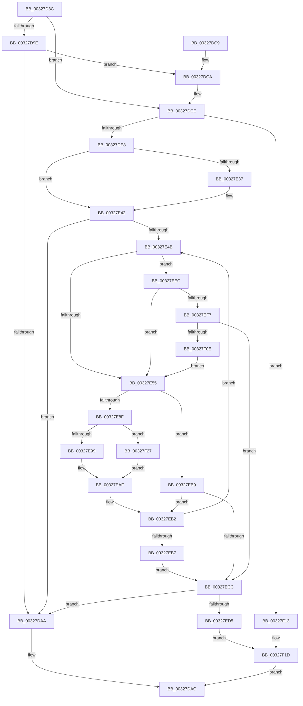

# MiGetPoolPages

- RVA: `0x00327D3C`–`0x00327F48` (길이 `524` bytes)
- VA: `0x0000000140327D3C`
- 실행 섹션: `.text`
- PDB 이름 있음: `예`; PDB Function 태그: `아니요`
- unwind 정보 RVA: `0x00075E50`
- 디코드: `135`개 명령, `524/524` bytes 표시
- 미해석 바이트: `0` (있으면 어셈블리에 `.byte`로 보존)

> 이 문서는 커널 이미지의 기계어와 PDB 기호를 분석해 생성했습니다. 4번과 5번은 함수 원형과 자료형을 바이너리 사용 방식에서 추정한 C 해석이며 원본 소스 복구 결과는 아닙니다.

## 1. Dependencies

- 직접 호출 지점: **11**; 고유 호출 대상: **9**
- 직접 호출자로 확인된 함수: **1**
- RIP 상대 이미지 참조: **2**

### Outgoing calls
- `0x00327D65` → [memset](../6C/memset_function_006C6C40.md) (function, `0x006C6C40`)
- `0x00327DA1` → [MiGetCachedPoolPages](../4A/MiGetCachedPoolPages_function_004A9324.md) (function, `0x004A9324`)
- `0x00327DDB` → [MiObtainPoolCharges](../46/MiObtainPoolCharges_function_00460AD8.md) (function, `0x00460AD8`)
- `0x00327E5F` → [MiRetryNonPagedAllocation](../48/MiRetryNonPagedAllocation_function_0048C100.md) (function, `0x0048C100`)
- `0x00327E73` → [MiInitializePoolPageChainPacket](../43/MiInitializePoolPageChainPacket_function_00436760.md) (function, `0x00436760`)
- `0x00327E7D` → [MiGetPageChain](../33/MiGetPageChain_function_00330130.md) (function, `0x00330130`)
- `0x00327EC3` → [MiRetryNonPagedAllocation](../48/MiRetryNonPagedAllocation_function_0048C100.md) (function, `0x0048C100`)
- `0x00327EDB` → [MiReturnPhysicalPoolPages](MiReturnPhysicalPoolPages_function_00328568.md) (function, `0x00328568`)
- `0x00327EE5` → [MiReturnExcessPoolCharges](../36/MiReturnExcessPoolCharges_function_00367C8C.md) (function, `0x00367C8C`)
- `0x00327F05` → [MiSufficientAvailablePages](../36/MiSufficientAvailablePages_function_0036D0B0.md) (function, `0x0036D0B0`)
- `0x00327F18` → [MiReturnPhysicalPoolPages](MiReturnPhysicalPoolPages_function_00328568.md) (function, `0x00328568`)

### Direct callers
- [sub_00328FA3](Unknown_function_00328FA3.md) at `0x0032923A`

### Static image references
- `0x00327D84` → RVA `0x00E2DBF8` (`.data`; read)
- `0x00327EFE` → RVA `0x00E38D00` (`.data`; read)

## 2. Other-region calls and transfers

- 다른 실행 섹션으로 향하는 call: **0**
- 별도 외부 분기/꼬리 이동을 확인하지 못했습니다.

## 3. Assembly (complete function range)

```asm
00327D3C  48 89 5C 24 08                  mov qword ptr [rsp + 8], rbx
00327D41  48 89 6C 24 10                  mov qword ptr [rsp + 0x10], rbp
00327D46  48 89 74 24 18                  mov qword ptr [rsp + 0x18], rsi
00327D4B  57                              push rdi
00327D4C  41 56                           push r14
00327D4E  41 57                           push r15
00327D50  48 81 EC 90 00 00 00            sub rsp, 0x90
00327D57  33 D2                           xor edx, edx
00327D59  48 8B F9                        mov rdi, rcx
00327D5C  48 8D 4C 24 20                  lea rcx, [rsp + 0x20]
00327D61  44 8D 42 70                     lea r8d, [rdx + 0x70]
00327D65  E8 D6 EE 39 00                  call 0x1406c6c40
00327D6A  33 C0                           xor eax, eax
00327D6C  48 8D 77 10                     lea rsi, [rdi + 0x10]
00327D70  0F 57 C0                        xorps xmm0, xmm0
00327D73  48 8B EE                        mov rbp, rsi
00327D76  0F 11 06                        movups xmmword ptr [rsi], xmm0
00327D79  48 89 46 10                     mov qword ptr [rsi + 0x10], rax
00327D7D  8B 47 60                        mov eax, dword ptr [rdi + 0x60]
00327D80  48 8D 0C 40                     lea rcx, [rax + rax*2]
00327D84  48 8B 05 6D 5E B0 00            mov rax, qword ptr [rip + 0xb05e6d]
00327D8B  48 C1 E1 07                     shl rcx, 7
00327D8F  48 8B 54 01 60                  mov rdx, qword ptr [rcx + rax + 0x60]
00327D94  48 89 54 24 70                  mov qword ptr [rsp + 0x70], rdx
00327D99  48 85 D2                        test rdx, rdx
00327D9C  74 30                           je 0x140327dce
00327D9E  48 8B CF                        mov rcx, rdi
00327DA1  E8 7E 15 18 00                  call 0x1404a9324
00327DA6  85 C0                           test eax, eax
00327DA8  74 20                           je 0x140327dca
00327DAA  33 C0                           xor eax, eax
00327DAC  4C 8D 9C 24 90 00 00 00         lea r11, [rsp + 0x90]
00327DB4  49 8B 5B 20                     mov rbx, qword ptr [r11 + 0x20]
00327DB8  49 8B 6B 28                     mov rbp, qword ptr [r11 + 0x28]
00327DBC  49 8B 73 30                     mov rsi, qword ptr [r11 + 0x30]
00327DC0  49 8B E3                        mov rsp, r11
00327DC3  41 5F                           pop r15
00327DC5  41 5E                           pop r14
00327DC7  5F                              pop rdi
00327DC8  C3                              ret
00327DC9  CC                              int3
00327DCA  48 8D 6F 10                     lea rbp, [rdi + 0x10]
00327DCE  48 8B 5F 08                     mov rbx, qword ptr [rdi + 8]
00327DD2  33 D2                           xor edx, edx
00327DD4  48 2B 5F 20                     sub rbx, qword ptr [rdi + 0x20]
00327DD8  48 8B CB                        mov rcx, rbx
00327DDB  E8 F8 8C 13 00                  call 0x140460ad8
00327DE0  85 C0                           test eax, eax
00327DE2  0F 84 2B 01 00 00               je 0x140327f13
00327DE8  8B 47 60                        mov eax, dword ptr [rdi + 0x60]
00327DEB  B9 00 02 00 00                  mov ecx, 0x200
00327DF0  0F B7 57 64                     movzx edx, word ptr [rdi + 0x64]
00327DF4  FF C0                           inc eax
00327DF6  89 44 24 38                     mov dword ptr [rsp + 0x38], eax
00327DFA  41 BF 00 04 00 00               mov r15d, 0x400
00327E00  0F B7 C2                        movzx eax, dx
00327E03  66 23 C1                        and ax, cx
00327E06  66 F7 D8                        neg ax
00327E09  65 48 8B 04 25 88 01 00 00      mov rax, qword ptr gs:[0x188]
00327E12  1B C9                           sbb ecx, ecx
00327E14  83 E1 30                        and ecx, 0x30
00327E17  81 C1 80 02 00 00               add ecx, 0x280
00327E1D  44 8B F1                        mov r14d, ecx
00327E20  41 83 CE 01                     or r14d, 1
00327E24  80 7F 66 02                     cmp byte ptr [rdi + 0x66], 2
00327E28  44 0F 45 F1                     cmovne r14d, ecx
00327E2C  8B 88 A4 05 00 00               mov ecx, dword ptr [rax + 0x5a4]
00327E32  F6 C1 02                        test cl, 2
00327E35  74 0B                           je 0x140327e42
00327E37  66 41 0B D7                     or dx, r15w
00327E3B  48 8B F5                        mov rsi, rbp
00327E3E  66 89 57 64                     mov word ptr [rdi + 0x64], dx
00327E42  48 85 DB                        test rbx, rbx
00327E45  0F 84 5F FF FF FF               je 0x140327daa
00327E4B  48 83 FB 01                     cmp rbx, 1
00327E4F  0F 85 97 00 00 00               jne 0x140327eec
00327E55  0F B7 4F 64                     movzx ecx, word ptr [rdi + 0x64]
00327E59  C1 E9 0A                        shr ecx, 0xa
00327E5C  83 E1 01                        and ecx, 1
00327E5F  E8 9C 42 16 00                  call 0x14048c100
00327E64  8B 4C 24 38                     mov ecx, dword ptr [rsp + 0x38]
00327E68  4C 8D 4C 24 20                  lea r9, [rsp + 0x20]
00327E6D  4C 8B C3                        mov r8, rbx
00327E70  41 8B D6                        mov edx, r14d
00327E73  E8 E8 E8 10 00                  call 0x140436760
00327E78  48 8D 4C 24 20                  lea rcx, [rsp + 0x20]
00327E7D  E8 AE 82 00 00                  call 0x140330130
00327E82  48 8B 94 24 88 00 00 00         mov rdx, qword ptr [rsp + 0x88]
00327E8A  48 85 D2                        test rdx, rdx
00327E8D  74 2A                           je 0x140327eb9
00327E8F  48 83 3E 00                     cmp qword ptr [rsi], 0
00327E93  0F 85 8E 00 00 00               jne 0x140327f27
00327E99  0F 10 44 24 78                  movups xmm0, xmmword ptr [rsp + 0x78]
00327E9E  F2 0F 10 8C 24 88 00 00 00      movsd xmm1, qword ptr [rsp + 0x88]
00327EA7  0F 11 06                        movups xmmword ptr [rsi], xmm0
00327EAA  F2 0F 11 4E 10                  movsd qword ptr [rsi + 0x10], xmm1
00327EAF  48 2B DA                        sub rbx, rdx
00327EB2  48 85 DB                        test rbx, rbx
00327EB5  75 94                           jne 0x140327e4b
00327EB7  EB 13                           jmp 0x140327ecc
00327EB9  0F B7 4F 64                     movzx ecx, word ptr [rdi + 0x64]
00327EBD  C1 E9 0A                        shr ecx, 0xa
00327EC0  83 E1 01                        and ecx, 1
00327EC3  E8 38 42 16 00                  call 0x14048c100
00327EC8  85 C0                           test eax, eax
00327ECA  75 E6                           jne 0x140327eb2
00327ECC  48 85 DB                        test rbx, rbx
00327ECF  0F 84 D5 FE FF FF               je 0x140327daa
00327ED5  48 8D 4F 10                     lea rcx, [rdi + 0x10]
00327ED9  33 D2                           xor edx, edx
00327EDB  E8 88 06 00 00                  call 0x140328568
00327EE0  33 D2                           xor edx, edx
00327EE2  48 8B CB                        mov rcx, rbx
00327EE5  E8 A2 FD 03 00                  call 0x140367c8c
00327EEA  EB 31                           jmp 0x140327f1d
00327EEC  66 44 85 7F 64                  test word ptr [rdi + 0x64], r15w
00327EF1  0F 84 5E FF FF FF               je 0x140327e55
00327EF7  48 8D 93 A0 00 00 00            lea rdx, [rbx + 0xa0]
00327EFE  48 8D 0D FB 0D B1 00            lea rcx, [rip + 0xb10dfb]
00327F05  E8 A6 51 04 00                  call 0x14036d0b0
00327F0A  85 C0                           test eax, eax
00327F0C  74 BE                           je 0x140327ecc
00327F0E  E9 42 FF FF FF                  jmp 0x140327e55
00327F13  33 D2                           xor edx, edx
00327F15  48 8B CE                        mov rcx, rsi
00327F18  E8 4B 06 00 00                  call 0x140328568
00327F1D  B8 9A 00 00 C0                  mov eax, 0xc000009a
00327F22  E9 85 FE FF FF                  jmp 0x140327dac
00327F27  48 8B 4E 08                     mov rcx, qword ptr [rsi + 8]
00327F2B  48 8B 44 24 78                  mov rax, qword ptr [rsp + 0x78]
00327F30  48 89 01                        mov qword ptr [rcx], rax
00327F33  48 8B 84 24 80 00 00 00         mov rax, qword ptr [rsp + 0x80]
00327F3B  48 01 56 10                     add qword ptr [rsi + 0x10], rdx
00327F3F  48 89 46 08                     mov qword ptr [rsi + 8], rax
00327F43  E9 67 FF FF FF                  jmp 0x140327eaf
```

## 4. C-style interpretation (structured pseudocode)

```c
__int64 __fastcall MiGetPoolPages(__int64 a1, int a2)
{
    __int64 result;
    __int64 v_r14;
    __int64 v_rbx;
    __int64 v_rsi;
    __int64 v_rsp;
    unsigned __int64 v_stack_m10;
    unsigned __int64 v_stack_m18;
    unsigned __int64 v_stack_m38;
    unsigned int v_stack_m58;
    unsigned __int64 v_stack_m70;
    unsigned __int64 v_stack_m8;
    unsigned __int64 v_stack_m88;
    unsigned __int64 v_stack_p10;
    unsigned __int64 v_stack_p18;
    unsigned __int64 v_stack_p8;

    v_stack_p8 = v_rbx;
    v_stack_p10 = v_rbp;
    v_stack_p18 = v_rsi;
    v_rsp = (v_rsp) - (144);
    a2 = 0;
    result = memset(v_stack_m88, a2, a2 + 112, a4);
    result = 0;
    *(unsigned __int64 *)(a1 + 16) = v_xmm0;
    *(unsigned __int64 *)(a1 + 16 + 16) = 0;
    a1 = ((unsigned int)(*(unsigned int *)(a1 + 96)) + (unsigned int)(*(unsigned int *)(a1 + 96)) * 2) << (7);
    v_stack_m38 = *(unsigned __int64 *)(a1 + *(unsigned __int64 *)(v_rip + 11558509) * 1 + 96);
    if (*(unsigned __int64 *)(a1 + *(unsigned __int64 *)(v_rip + 11558509) * 1 + 96) == 0) goto loc_00327DCE;
    result = MiGetCachedPoolPages(a1, *(unsigned __int64 *)(a1 + *(unsigned __int64 *)(v_rip + 11558509) * 1 + 96), a2 + 112, a4);
    if ((unsigned int)(result) == 0) goto loc_00327DCA;
loc_00327DAA:
    result = 0;
loc_00327DAC:
    return result;
loc_00327DCA:
loc_00327DCE:
    a2 = 0;
    v_rbx = (*(unsigned __int64 *)(a1 + 8)) - (*(unsigned __int64 *)(a1 + 32));
    result = MiObtainPoolCharges(v_rbx, a2, a2 + 112, a4);
    if ((unsigned int)(result) == 0) goto loc_00327F13;
    result = (unsigned int)(((unsigned int)(*(unsigned int *)(a1 + 96))) + 1);
    v_stack_m58 = (unsigned int)(result);
    result = (unsigned __int16)(((unsigned __int16)(*(unsigned __int16 *)(a1 + 100))) & (512));
    result = (unsigned __int16)(-(result));
    a1 = (unsigned int)((512) & (48));
    a1 = (unsigned int)((a1) + (640));
    v_r14 = (unsigned int)(((unsigned int)((unsigned int)(a1))) | (1));
    if ((*(unsigned __int8 *)(a1 + 102)) != 2) { v_r14 = (unsigned int)(a1); }
    v_rsi = *(unsigned __int64 *)(v_stack_m18 + 48);
    if ((((unsigned __int8)((unsigned int)(*(unsigned int *)(*(unsigned __int64 *)(gs_base + (0 + 392)) + 1444)))) & (2)) != 0) {
        a2 = (unsigned __int16)((*(unsigned __int16 *)(a1 + 100)) | ((unsigned __int16)((unsigned int)(0x400ULL))));
        v_rsi = a1 + 16;
        *(unsigned __int16 *)(a1 + 100) = (unsigned __int16)(a2);
    }
    if (v_rbx == 0) goto loc_00327DAA;
loc_00327E4B:
    if (v_rbx != 1) goto loc_00327EEC;
loc_00327E55:
    a1 = (unsigned int)((*(unsigned __int16 *)(a1 + 100)) >> (10));
    a1 = (unsigned int)((a1) & (1));
    result = MiRetryNonPagedAllocation(a1, a2, a2 + 112, a4);
    result = MiInitializePoolPageChainPacket((unsigned int)(v_stack_m58), (unsigned int)((unsigned int)(v_r14)), v_rbx, v_stack_m70);
    result = MiGetPageChain(v_stack_m70, (unsigned int)((unsigned int)(v_r14)), v_rbx, v_stack_m70);
    if (v_stack_m8 == 0) goto loc_00327EB9;
    if ((*(unsigned __int64 *)(v_rsi)) != 0) goto loc_00327F27;
    *(unsigned __int64 *)(v_rsi) = v_xmm0;
    *(unsigned __int64 *)(v_rsi + 16) = v_xmm1;
loc_00327EAF:
    v_rbx = (v_rbx) - (v_stack_m8);
loc_00327EB2:
    if (v_rbx != 0) goto loc_00327E4B;
    goto loc_00327ECC;
loc_00327EB9:
    a1 = (unsigned int)((*(unsigned __int16 *)(a1 + 100)) >> (10));
    a1 = (unsigned int)((a1) & (1));
    result = MiRetryNonPagedAllocation(a1, v_stack_m8, v_rbx, v_stack_m70);
    if ((unsigned int)(result) != 0) goto loc_00327EB2;
loc_00327ECC:
    if (v_rbx == 0) goto loc_00327DAA;
    a2 = 0;
    result = MiReturnPhysicalPoolPages(a1 + 16, a2, v_rbx, v_stack_m70);
    a2 = 0;
    result = MiReturnExcessPoolCharges(v_rbx, a2, v_rbx, v_stack_m70);
    goto loc_00327F1D;
loc_00327EEC:
    if (((*(unsigned __int16 *)(a1 + 100)) & ((unsigned __int16)((unsigned int)(0x400ULL)))) == 0) goto loc_00327E55;
    result = MiSufficientAvailablePages(v_rip + 11603451, v_rbx + 160, v_rbx, v_stack_m70);
    if ((unsigned int)(result) == 0) goto loc_00327ECC;
    goto loc_00327E55;
loc_00327F13:
    a2 = 0;
    result = MiReturnPhysicalPoolPages(v_rsi, a2, v_rbx, v_stack_m70);
loc_00327F1D:
    goto loc_00327DAC;
loc_00327F27:
    *(unsigned __int64 *)(*(unsigned __int64 *)(v_rsi + 8)) = v_stack_m18;
    *(unsigned __int64 *)(v_rsi + 8) = v_stack_m10;
    goto loc_00327EAF;
}
```

## 5. (Beta) C Style

```c
int64_t MiGetPoolPages(void *Arg1, int32_t Arg2)
{
    uint8_t *arg1 = (uint8_t *)Arg1;

    int64_t result;
    int64_t local_r14;
    int64_t local_rbx;
    int64_t local_rsi;
    int64_t local_rsp;
    uint64_t v_stack_m10;
    uint64_t v_stack_m18;
    uint64_t v_stack_m38;
    uint32_t v_stack_m58;
    uint64_t v_stack_m70;
    uint64_t v_stack_m8;
    uint64_t v_stack_m88;
    uint64_t v_stack_p10;
    uint64_t v_stack_p18;
    uint64_t v_stack_p8;

    v_stack_p8 = local_rbx;
    v_stack_p10 = local_rbp;
    v_stack_p18 = local_rsi;
    local_rsp = (local_rsp) - (144);
    Arg2 = 0;
    result = memset(v_stack_m88, Arg2, Arg2 + 112, a4);
    result = 0;
    *(uint64_t *)(arg1 + 0x10) = v_xmm0;
    *(uint64_t *)(arg1 + 0x10 + 0x10) = 0;
    Arg1 = ((uint32_t)(*(uint32_t *)(arg1 + 0x60)) + (uint32_t)(*(uint32_t *)(arg1 + 0x60)) * 2) << (7);
    v_stack_m38 = *(uint64_t *)(arg1 + *(uint64_t *)(v_rip + 0xB05E6D) * 1 + 0x60);
    if (*(uint64_t *)(arg1 + *(uint64_t *)(v_rip + 0xB05E6D) * 1 + 0x60) == 0) goto loc_00327DCE;
    result = MiGetCachedPoolPages(Arg1, *(uint64_t *)(arg1 + *(uint64_t *)(v_rip + 0xB05E6D) * 1 + 0x60), Arg2 + 112, a4);
    if ((uint32_t)(result) == 0) goto loc_00327DCA;
loc_00327DAA:
    result = 0;
loc_00327DAC:
    return result;
loc_00327DCA:
loc_00327DCE:
    Arg2 = 0;
    local_rbx = (*(uint64_t *)(arg1 + 0x8)) - (*(uint64_t *)(arg1 + 0x20));
    result = MiObtainPoolCharges(local_rbx, Arg2, Arg2 + 112, a4);
    if ((uint32_t)(result) == 0) goto loc_00327F13;
    result = (uint32_t)(((uint32_t)(*(uint32_t *)(arg1 + 0x60))) + 1);
    v_stack_m58 = (uint32_t)(result);
    result = (uint16_t)(((uint16_t)(*(uint16_t *)(arg1 + 0x64))) & (512));
    result = (uint16_t)(-(result));
    Arg1 = (uint32_t)((512) & (48));
    Arg1 = (uint32_t)((Arg1) + (640));
    local_r14 = (uint32_t)(((uint32_t)((uint32_t)(Arg1))) | (1));
    if ((*(uint8_t *)(arg1 + 0x66)) != 2) { local_r14 = (uint32_t)(Arg1); }
    local_rsi = *(uint64_t *)(v_stack_m18 + 0x30);
    if ((((uint8_t)((uint32_t)(*(uint32_t *)(*(uint64_t *)(gs_base + (0 + 0x188)) + 0x5A4)))) & (2)) != 0) {
        Arg2 = (uint16_t)((*(uint16_t *)(arg1 + 0x64)) | ((uint16_t)((uint32_t)(0x400ULL))));
        local_rsi = Arg1 + 16;
        *(uint16_t *)(arg1 + 0x64) = (uint16_t)(Arg2);
    }
    if (local_rbx == 0) goto loc_00327DAA;
loc_00327E4B:
    if (local_rbx != 1) goto loc_00327EEC;
loc_00327E55:
    Arg1 = (uint32_t)((*(uint16_t *)(arg1 + 0x64)) >> (10));
    Arg1 = (uint32_t)((Arg1) & (1));
    result = MiRetryNonPagedAllocation(Arg1, Arg2, Arg2 + 112, a4);
    result = MiInitializePoolPageChainPacket((uint32_t)(v_stack_m58), (uint32_t)((uint32_t)(local_r14)), local_rbx, v_stack_m70);
    result = MiGetPageChain(v_stack_m70, (uint32_t)((uint32_t)(local_r14)), local_rbx, v_stack_m70);
    if (v_stack_m8 == 0) goto loc_00327EB9;
    if ((*(uint64_t *)(local_rsi)) != 0) goto loc_00327F27;
    *(uint64_t *)(local_rsi) = v_xmm0;
    *(uint64_t *)(local_rsi + 0x10) = v_xmm1;
loc_00327EAF:
    local_rbx = (local_rbx) - (v_stack_m8);
loc_00327EB2:
    if (local_rbx != 0) goto loc_00327E4B;
    goto loc_00327ECC;
loc_00327EB9:
    Arg1 = (uint32_t)((*(uint16_t *)(arg1 + 0x64)) >> (10));
    Arg1 = (uint32_t)((Arg1) & (1));
    result = MiRetryNonPagedAllocation(Arg1, v_stack_m8, local_rbx, v_stack_m70);
    if ((uint32_t)(result) != 0) goto loc_00327EB2;
loc_00327ECC:
    if (local_rbx == 0) goto loc_00327DAA;
    Arg2 = 0;
    result = MiReturnPhysicalPoolPages(Arg1 + 16, Arg2, local_rbx, v_stack_m70);
    Arg2 = 0;
    result = MiReturnExcessPoolCharges(local_rbx, Arg2, local_rbx, v_stack_m70);
    goto loc_00327F1D;
loc_00327EEC:
    if (((*(uint16_t *)(arg1 + 0x64)) & ((uint16_t)((uint32_t)(0x400ULL)))) == 0) goto loc_00327E55;
    result = MiSufficientAvailablePages(v_rip + 11603451, local_rbx + 160, local_rbx, v_stack_m70);
    if ((uint32_t)(result) == 0) goto loc_00327ECC;
    goto loc_00327E55;
loc_00327F13:
    Arg2 = 0;
    result = MiReturnPhysicalPoolPages(local_rsi, Arg2, local_rbx, v_stack_m70);
loc_00327F1D:
    goto loc_00327DAC;
loc_00327F27:
    *(uint64_t *)(*(uint64_t *)(local_rsi + 0x8)) = v_stack_m18;
    *(uint64_t *)(local_rsi + 0x8) = v_stack_m10;
    goto loc_00327EAF;
}
```

### 관측된 메모리 오프셋

구조체 형식이 확인되지 않은 접근은 인자 기준의 오프셋으로만 기록했습니다.

| 기준 인자 | 오프셋 표현 | 폭 (bit) | 접근 |
|---|---:|---:|---|
| `Arg1` | `+ 0x0` | `64` | `R` |
| `Arg1` | `+ 0x0` | `128` | `R` |
| `Arg1` | `+ 0x8` | `64` | `R` |
| `Arg1` | `+ 0x8` | `64` | `W` |
| `Arg1` | `+ 0x10` | `64` | `R` |
| `Arg1` | `+ 0x10` | `64` | `R/W` |
| `Arg1` | `+ 0x10` | `64` | `W` |
| `Arg1` | `+ 0x20` | `64` | `R` |
| `Arg1` | `+ 0x60` | `32` | `R` |
| `Arg1` | `+ 0x64` | `16` | `R` |
| `Arg1` | `+ 0x64` | `16` | `W` |
| `Arg1` | `+ 0x66` | `8` | `R` |

## 6. Execution-region graph

[열기: 2D/3D 그래프와 함수 탐색 컨트롤 패널](../../../control-panel.html?section=text&rva=0x00327D3C&view=graph)

- 2D 그래프는 위에서 아래로 흐르고, 3D 그래프는 빈 공간을 드래그해 회전합니다. Shift+드래그는 이동, 휠은 확대·축소, 함수 노드 선택은 대상 보고서 이동입니다.

### Static fallback


