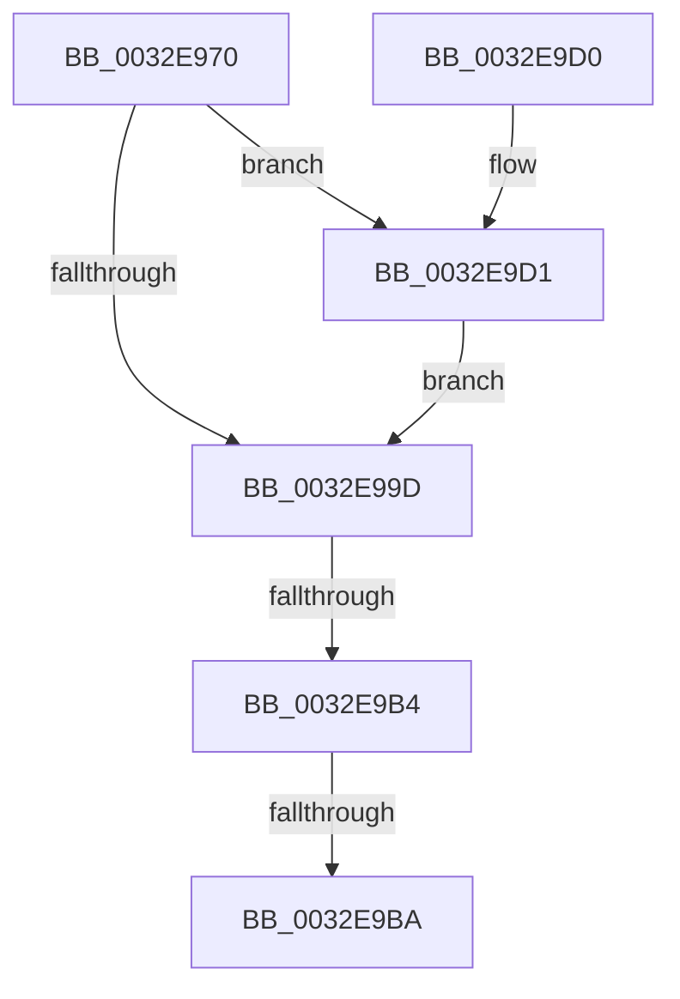

# MiGetProtoPteAddress

- RVA: `0x0032E970`–`0x0032E9E0` (길이 `112` bytes)
- VA: `0x000000014032E970`
- 실행 섹션: `.text`
- PDB 이름 있음: `예`; PDB Function 태그: `아니요`
- unwind 정보 RVA: `0x000763B0`
- 디코드: `39`개 명령, `112/112` bytes 표시
- 미해석 바이트: `0` (있으면 어셈블리에 `.byte`로 보존)

> 이 문서는 커널 이미지의 기계어와 PDB 기호를 분석해 생성했습니다. 4번과 5번은 함수 원형과 자료형을 바이너리 사용 방식에서 추정한 C 해석이며 원본 소스 복구 결과는 아닙니다.

## 1. Dependencies

- 직접 호출 지점: **0**; 고유 호출 대상: **0**
- 직접 호출자로 확인된 함수: **37**
- RIP 상대 이미지 참조: **0**

### Outgoing calls
- 직접 디코드된 call 명령이 없습니다.

### Direct callers
- [MiMakePerSessionProtoPte](../22/MiMakePerSessionProtoPte_function_0022F7EC.md) at `0x0022F867`
- [MiWalkVaRange](../24/MiWalkVaRange_function_00243BF0.md) at `0x0024409D`
- [MiWalkVaRange](../24/MiWalkVaRange_function_00243BF0.md) at `0x0024493A`
- [MiWalkVaRange](../24/MiWalkVaRange_function_00243BF0.md) at `0x00244B59`
- [sub_0027F36E](../27/Unknown_function_0027F36E.md) at `0x0027F406`
- [MiSetReadOnlyOnSectionView](../29/MiSetReadOnlyOnSectionView_function_00294538.md) at `0x00294699`
- [MiSplitPrivatePage](../2A/MiSplitPrivatePage_function_002A6210.md) at `0x002A633D`
- [MiGetWorkingSetInfoList](../2A/MiGetWorkingSetInfoList_function_002AF770.md) at `0x002B0231`
- [MiGetWorkingSetInfoList](../2A/MiGetWorkingSetInfoList_function_002AF770.md) at `0x002B0530`
- [MiIsCfgBitMapPageShared](../2C/MiIsCfgBitMapPageShared_function_002C1200.md) at `0x002C12F5`
- [MiPteNeedsCommitCharge](../2C/MiPteNeedsCommitCharge_function_002C13B0.md) at `0x002C1426`
- [MiCountSharedPages](../2C/MiCountSharedPages_function_002C30A4.md) at `0x002C3297`
- [sub_002C3A7C](../2C/Unknown_function_002C3A7C.md) at `0x002C3E98`
- [sub_002C3A7C](../2C/Unknown_function_002C3A7C.md) at `0x002C447B`
- [MiTrimSharedPageFromViews](../2E/MiTrimSharedPageFromViews_function_002E16F8.md) at `0x002E1D74`
- [sub_0032BD21](Unknown_function_0032BD21.md) at `0x0032BFF4`
- [MiQueryAddressState](MiQueryAddressState_function_0032C380.md) at `0x0032C6D6`
- [sub_0032D782](Unknown_function_0032D782.md) at `0x0032D9A5`
- [sub_0032E02E](Unknown_function_0032E02E.md) at `0x0032E251`
- [MiCheckVirtualAddress](MiCheckVirtualAddress_function_0032E4F0.md) at `0x0032E6D2`
- [MiResolveSharedZeroFault](MiResolveSharedZeroFault_function_0032EF20.md) at `0x0032F23F`
- [MiResolvePageFileFault](../36/MiResolvePageFileFault_function_0036D968.md) at `0x0036EA6A`
- [MiExpandSharedZeroCluster](../36/MiExpandSharedZeroCluster_function_0036F20C.md) at `0x0036F38A`
- [MiUpControlAreaRefs](../3B/MiUpControlAreaRefs_function_003B2BF0.md) at `0x003B2CDD`
- [MiUpControlAreaRefs](../3B/MiUpControlAreaRefs_function_003B2BF0.md) at `0x003B2DD8`
- [MiCheckUserVirtualAddress](../48/MiCheckUserVirtualAddress_function_00488834.md) at `0x004888DD`
- [MiUpdatePrivateDemandZeroView](../4C/MiUpdatePrivateDemandZeroView_function_004CCC2C.md) at `0x004CCC88`
- [MiIdealClusterPage](../4D/MiIdealClusterPage_function_004DB964.md) at `0x004DBA60`
- [MiGetClusterPage](../4D/MiGetClusterPage_function_004DC57C.md) at `0x004DC726`
- [MiGetLargeVadMappingIndex](../4F/MiGetLargeVadMappingIndex_function_004F94D0.md) at `0x004F953D`
- [MiGetLargeVadMappingIndex](../4F/MiGetLargeVadMappingIndex_function_004F94D0.md) at `0x004F9565`
- [MiComputeImageVadCommitCharge](../66/MiComputeImageVadCommitCharge_function_0066F054.md) at `0x0066F078`
- [MiPrepareImagePagesForHotPatch](../68/MiPrepareImagePagesForHotPatch_function_00683800.md) at `0x00683A45`
- [sub_006DC3C4](../6D/Unknown_function_006DC3C4.md) at `0x006DC3DD`
- [MiCloneLargeFileOnlyVad](../../page/80/MiCloneLargeFileOnlyVad_function_00800A64.md) at `0x00800A92`
- [MiCloneLargeFileOnlyVad](../../page/80/MiCloneLargeFileOnlyVad_function_00800A64.md) at `0x00800AB0`
- [MiDeletePartialCloneVads](../../page/81/MiDeletePartialCloneVads_function_008116E4.md) at `0x008117AA`
- [MiDeletePartialCloneVads](../../page/81/MiDeletePartialCloneVads_function_008116E4.md) at `0x008117C8`
- [MiIsRangeFullyCommitted](../../page/88/MiIsRangeFullyCommitted_function_00881E24.md) at `0x00881E5B`
- [MiIsRangeFullyCommitted](../../page/88/MiIsRangeFullyCommitted_function_00881E24.md) at `0x00881E7E`
- [MiDeleteVad](../../page/88/MiDeleteVad_function_00888C80.md) at `0x00888E57`
- [MiDeleteVad](../../page/88/MiDeleteVad_function_00888C80.md) at `0x00888E81`
- [MiDeleteVad](../../page/88/MiDeleteVad_function_00888C80.md) at `0x00889056`
- [MiDeleteVad](../../page/88/MiDeleteVad_function_00888C80.md) at `0x00889073`
- [MiCommitPagefileBackedSection](../../page/8C/MiCommitPagefileBackedSection_function_008CECC0.md) at `0x008CED3C`
- [MiCommitPagefileBackedSection](../../page/8C/MiCommitPagefileBackedSection_function_008CECC0.md) at `0x008CED55`
- [MiFillMapFileInfo](../../page/97/MiFillMapFileInfo_function_0097E15C.md) at `0x0097E2A2`
- [MmFlushVirtualMemory](../../page/9D/MmFlushVirtualMemory_function_009D6F5C.md) at `0x009D70BC`
- [MmFlushVirtualMemory](../../page/9D/MmFlushVirtualMemory_function_009D6F5C.md) at `0x009D70D2`
- [MmFlushVirtualMemory](../../page/9D/MmFlushVirtualMemory_function_009D6F5C.md) at `0x009D70FD`
- [sub_00B1B86E](../../page/B1/Unknown_function_00B1B86E.md) at `0x00B1B8AD`
- [sub_00B314C0](../../page/B3/Unknown_function_00B314C0.md) at `0x00B3153A`

### Static image references
- 디코드된 RIP-relative 메모리 참조가 없습니다.

## 2. Other-region calls and transfers

- 다른 실행 섹션으로 향하는 call: **0**
- call이 아닌 외부 분기/꼬리 이동: **2**
  - `0x0032E9B2` → [sub_0032E9E0](Unknown_function_0032E9E0.md) (`tail-transfer`)
  - `0x0032E9B8` → [sub_0032E9E0](Unknown_function_0032E9E0.md) (`tail-transfer`)

## 3. Assembly (complete function range)

```asm
0032E970  40 53                           push rbx
0032E972  55                              push rbp
0032E973  56                              push rsi
0032E974  48 83 EC 20                     sub rsp, 0x20
0032E978  8B 41 18                        mov eax, dword ptr [rcx + 0x18]
0032E97B  48 8D 59 48                     lea rbx, [rcx + 0x48]
0032E97F  44 0F B6 51 20                  movzx r10d, byte ptr [rcx + 0x20]
0032E984  49 8B F1                        mov rsi, r9
0032E987  49 C1 E2 20                     shl r10, 0x20
0032E98B  41 8B E8                        mov ebp, r8d
0032E98E  4C 0B D0                        or r10, rax
0032E991  4C 8B CA                        mov r9, rdx
0032E994  8B 41 30                        mov eax, dword ptr [rcx + 0x30]
0032E997  24 70                           and al, 0x70
0032E999  3C 20                           cmp al, 0x20
0032E99B  74 34                           je 0x14032e9d1
0032E99D  48 8B 51 58                     mov rdx, qword ptr [rcx + 0x58]
0032E9A1  4D 8B C1                        mov r8, r9
0032E9A4  48 2B 51 50                     sub rdx, qword ptr [rcx + 0x50]
0032E9A8  4D 2B C2                        sub r8, r10
0032E9AB  48 C1 FA 03                     sar rdx, 3
0032E9AF  49 3B D0                        cmp rdx, r8
0032E9B2  72 2C                           jb 0x14032e9e0
0032E9B4  40 F6 C5 04                     test bpl, 4
0032E9B8  75 26                           jne 0x14032e9e0
0032E9BA  48 8B 03                        mov rax, qword ptr [rbx]
0032E9BD  48 89 06                        mov qword ptr [rsi], rax
0032E9C0  48 8B 41 50                     mov rax, qword ptr [rcx + 0x50]
0032E9C4  4A 8D 04 C0                     lea rax, [rax + r8*8]
0032E9C8  48 83 C4 20                     add rsp, 0x20
0032E9CC  5E                              pop rsi
0032E9CD  5D                              pop rbp
0032E9CE  5B                              pop rbx
0032E9CF  C3                              ret
0032E9D0  CC                              int3
0032E9D1  48 8B 03                        mov rax, qword ptr [rbx]
0032E9D4  48 8B 10                        mov rdx, qword ptr [rax]
0032E9D7  F7 42 38 00 00 00 08            test dword ptr [rdx + 0x38], 0x8000000
0032E9DE  74 BD                           je 0x14032e99d
```

## 4. C-style interpretation (structured pseudocode)

```c
__int64 __fastcall MiGetProtoPteAddress(__int64 a1, __int64 a2, int a3, __int64 a4)
{
    __int64 result;
    __int64 v_r10;
    __int64 v_rsp;

    v_rsp = (v_rsp) - (32);
    v_r10 = (*(unsigned __int8 *)(a1 + 32)) << (32);
    v_r10 = (v_r10) | ((unsigned int)(*(unsigned int *)(a1 + 24)));
    result = (unsigned __int8)(((unsigned int)(*(unsigned int *)(a1 + 48))) & (112));
    if (((unsigned __int8)(result)) == 32) goto loc_0032E9D1;
loc_0032E99D:
    a2 = (*(unsigned __int64 *)(a1 + 88)) - (*(unsigned __int64 *)(a1 + 80));
    a3 = (a2) - (v_r10);
    a2 = (a2) >> (3);
    *(unsigned __int64 *)(a4) = *(unsigned __int64 *)(a1 + 72);
    v_rsp = (v_rsp) + (32);
    return *(unsigned __int64 *)(a1 + 80) + a3 * 8;
loc_0032E9D1:
    if (((*(unsigned int *)(*(unsigned __int64 *)(*(unsigned __int64 *)(a1 + 72)) + 56)) & (0x8000000ULL)) == 0) goto loc_0032E99D;
}
```

## 5. (Beta) C Style

```c
int64_t MiGetProtoPteAddress(void *Arg1, int64_t Arg2, int32_t Arg3, void *Arg4)
{
    uint8_t *arg1 = (uint8_t *)Arg1;
    uint8_t *arg4 = (uint8_t *)Arg4;

    int64_t result;
    int64_t local_r10;
    int64_t local_rsp;

    local_rsp = (local_rsp) - (32);
    local_r10 = (*(uint8_t *)(arg1 + 0x20)) << (32);
    local_r10 = (local_r10) | ((uint32_t)(*(uint32_t *)(arg1 + 0x18)));
    result = (uint8_t)(((uint32_t)(*(uint32_t *)(arg1 + 0x30))) & (112));
    if (((uint8_t)(result)) == 32) goto loc_0032E9D1;
loc_0032E99D:
    Arg2 = (*(uint64_t *)(arg1 + 0x58)) - (*(uint64_t *)(arg1 + 0x50));
    Arg3 = (Arg2) - (local_r10);
    Arg2 = (Arg2) >> (3);
    *(uint64_t *)(arg4) = *(uint64_t *)(arg1 + 0x48);
    local_rsp = (local_rsp) + (32);
    return *(uint64_t *)(arg1 + 0x50) + Arg3 * 8;
loc_0032E9D1:
    if (((*(uint32_t *)(*(uint64_t *)(*(uint64_t *)(arg1 + 0x48)) + 0x38)) & (0x8000000ULL)) == 0) goto loc_0032E99D;
}
```

### 관측된 메모리 오프셋

구조체 형식이 확인되지 않은 접근은 인자 기준의 오프셋으로만 기록했습니다.

| 기준 인자 | 오프셋 표현 | 폭 (bit) | 접근 |
|---|---:|---:|---|
| `Arg1` | `+ 0x0` | `64` | `R` |
| `Arg1` | `+ 0x18` | `32` | `R` |
| `Arg1` | `+ 0x20` | `8` | `R` |
| `Arg1` | `+ 0x30` | `32` | `R` |
| `Arg1` | `+ 0x48` | `64` | `R` |
| `Arg1` | `+ 0x50` | `64` | `R` |
| `Arg1` | `+ 0x58` | `64` | `R` |
| `Arg4` | `+ 0x0` | `64` | `W` |

## 6. Execution-region graph

[열기: 2D/3D 그래프와 함수 탐색 컨트롤 패널](../../../control-panel.html?section=text&rva=0x0032E970&view=graph)

- 2D 그래프는 위에서 아래로 흐르고, 3D 그래프는 빈 공간을 드래그해 회전합니다. Shift+드래그는 이동, 휠은 확대·축소, 함수 노드 선택은 대상 보고서 이동입니다.

### Static fallback


