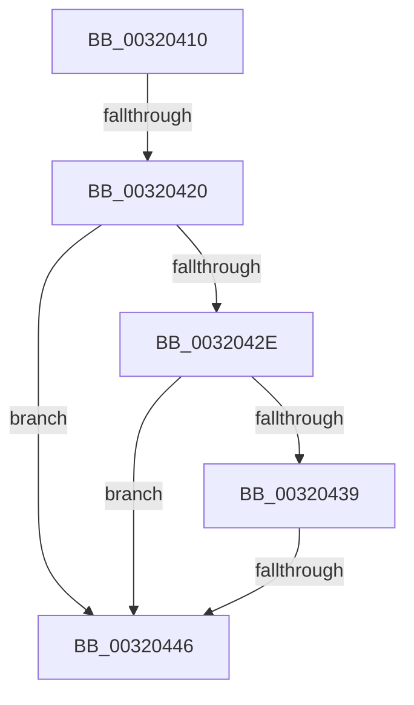

# MiInitializePageColorBase

- RVA: `0x00320410`–`0x00320467` (길이 `87` bytes)
- VA: `0x0000000140320410`
- 실행 섹션: `.text`
- PDB 이름 있음: `예`; PDB Function 태그: `예`
- unwind 정보 RVA: `0x000755D4`
- 디코드: `18`개 명령, `87/87` bytes 표시
- 미해석 바이트: `0` (있으면 어셈블리에 `.byte`로 보존)

> 이 문서는 커널 이미지의 기계어와 PDB 기호를 분석해 생성했습니다. 4번과 5번은 함수 원형과 자료형을 바이너리 사용 방식에서 추정한 C 해석이며 원본 소스 복구 결과는 아닙니다.

## 1. Dependencies

- 직접 호출 지점: **0**; 고유 호출 대상: **0**
- 직접 호출자로 확인된 함수: **52**
- RIP 상대 이미지 참조: **1**

### Outgoing calls
- 직접 디코드된 call 명령이 없습니다.

### Direct callers
- [MiHandleForkTransitionPte](../22/MiHandleForkTransitionPte_function_0022D34C.md) at `0x0022D96B`
- [MiBuildForkPte](../22/MiBuildForkPte_function_0022E32C.md) at `0x0022EA96`
- [MiFindContiguousPagesEx](../28/MiFindContiguousPagesEx_function_0028BDE0.md) at `0x0028BFBD`
- [MiMigratePfn](../28/MiMigratePfn_function_0028DBB0.md) at `0x0028DC76`
- [MiGetPageForHeader](../2A/MiGetPageForHeader_function_002AC120.md) at `0x002AC184`
- [MiCreateSharedZeroPages](../2B/MiCreateSharedZeroPages_function_002B6318.md) at `0x002B63EA`
- [MmAllocateNonChargedSecurePages](../2C/MmAllocateNonChargedSecurePages_function_002C886C.md) at `0x002C88FC`
- [MiReplenishUltraPageTables](../2C/MiReplenishUltraPageTables_function_002CB4EC.md) at `0x002CB523`
- [sub_002F6E32](../2F/Unknown_function_002F6E32.md) at `0x002F71D5`
- [MiSharePages](../31/MiSharePages_function_00315110.md) at `0x003151AD`
- [MiBackgroundZeroLocalPages](../31/MiBackgroundZeroLocalPages_function_0031EF30.md) at `0x0031F1CA`
- [MiRemoveLowestPriorityStandbyPage](../33/MiRemoveLowestPriorityStandbyPage_function_00334600.md) at `0x0033476D`
- [MiCopyOnWrite](../36/MiCopyOnWrite_function_00362A0C.md) at `0x00362C79`
- [MiPfPutPagesInTransition](../36/MiPfPutPagesInTransition_function_003640EC.md) at `0x003641F3`
- [MiWalkEntireImage](../36/MiWalkEntireImage_function_00365D70.md) at `0x003666B0`
- [MiResolveMappedFileFault](../36/MiResolveMappedFileFault_function_0036B640.md) at `0x0036B904`
- [MiAllocateMostlyContiguousPagesForMdl](../37/MiAllocateMostlyContiguousPagesForMdl_function_003769B0.md) at `0x00376A27`
- [MiInitializeColorBase](../3B/MiInitializeColorBase_function_003B5E38.md) at `0x003B5E70`
- [MiAllocateMdlPagesByLists](../3B/MiAllocateMdlPagesByLists_function_003B7898.md) at `0x003B78E2`
- [MiGetLargePageDemoteAsNeeded](../3B/MiGetLargePageDemoteAsNeeded_function_003B8440.md) at `0x003B85CE`
- [MiPruneStandbyPages](../3B/MiPruneStandbyPages_function_003BC0E4.md) at `0x003BC2D7`
- [MiInitializeNewUltraHugeContext](../3F/MiInitializeNewUltraHugeContext_function_003FB974.md) at `0x003FBA36`
- [MiMakeOutswappedPageResident](../43/MiMakeOutswappedPageResident_function_00431AD0.md) at `0x00431CF1`
- [MiHandleSpecialPurposeMemoryCachedFault](../44/MiHandleSpecialPurposeMemoryCachedFault_function_0044C740.md) at `0x0044C7FE`
- [MiGetSinglePageToZero](../48/MiGetSinglePageToZero_function_00486724.md) at `0x00486780`
- [MiMapPageFileHash](../49/MiMapPageFileHash_function_004921E0.md) at `0x00492243`
- [MiSwitchToTransition](../4C/MiSwitchToTransition_function_004C0F5C.md) at `0x004C1049`
- [MiIdealClusterPage](../4D/MiIdealClusterPage_function_004DB964.md) at `0x004DBC50`
- [MiGetClusterPage](../4D/MiGetClusterPage_function_004DC57C.md) at `0x004DC6A6`
- [MiGetSingleHugeRangeToZero](../4D/MiGetSingleHugeRangeToZero_function_004DD034.md) at `0x004DD098`
- [MiHugePageOperation](../68/MiHugePageOperation_function_0068C490.md) at `0x0068C50A`
- [MiDefragmentSlabWorker](../68/MiDefragmentSlabWorker_function_0068D730.md) at `0x0068D7F3`
- [MmAllocateSecureKernelPages](../68/MmAllocateSecureKernelPages_function_0068F394.md) at `0x0068F3F5`
- [MiComputeCacheAttributeSpeeds](../69/MiComputeCacheAttributeSpeeds_function_006999E8.md) at `0x00699ABA`
- [sub_006F9120](../6F/Unknown_function_006F9120.md) at `0x006F9157`
- [MmAllocateMemoryRanges](../../page/7F/MmAllocateMemoryRanges_function_007FC0C0.md) at `0x007FC1A2`
- [MmAllocateMemoryRanges](../../page/7F/MmAllocateMemoryRanges_function_007FC0C0.md) at `0x007FC21B`
- [MiAllocatePartitionPhysicalPages](../../page/80/MiAllocatePartitionPhysicalPages_function_0080C9D4.md) at `0x0080CBED`
- [MiInitializeScrubPacket](../../page/80/MiInitializeScrubPacket_function_0080EA10.md) at `0x0080EA52`
- [MiCreateZeroThreadContext](../../page/81/MiCreateZeroThreadContext_function_008105B4.md) at `0x0081064B`
- [MmRelocatePfnList](../../page/90/MmRelocatePfnList_function_00901E70.md) at `0x00901F11`
- [MiPfPrepareReadList](../../page/93/MiPfPrepareReadList_function_0093CD5C.md) at `0x0093CF47`
- [MiPfPrepareSequentialReadList](../../page/93/MiPfPrepareSequentialReadList_function_0093D8E8.md) at `0x0093DCA0`
- [MiAllocateTopLevelPage](../../page/A5/MiAllocateTopLevelPage_function_00A5F2EC.md) at `0x00A5F32F`
- [MiDoneWithThisPageGetAnother](../../page/A7/MiDoneWithThisPageGetAnother_function_00A7DDDC.md) at `0x00A7DE18`
- [MiAllocateDriverPage](../../page/A8/MiAllocateDriverPage_function_00A80128.md) at `0x00A80162`
- [MmAllocateIndependentPagesEx](../../page/AA/MmAllocateIndependentPagesEx_function_00AA0CFC.md) at `0x00AA0E06`
- [MiCombineIdenticalPages](../../page/AB/MiCombineIdenticalPages_function_00AB2324.md) at `0x00AB2582`
- [MiInitializeForkMaps](../../page/AD/MiInitializeForkMaps_function_00AD4A40.md) at `0x00AD4A9F`
- [MmInitializeProcessor](../../pagelk/B7/MmInitializeProcessor_function_00B737F8.md) at `0x00B7388B`
- [MiAllocateDummyPage](../../init/C5/MiAllocateDummyPage_function_00C5F6E8.md) at `0x00C5F725`
- [MmInitializeImageViewExtensionCfg](../../init/C6/MmInitializeImageViewExtensionCfg_function_00C64FC4.md) at `0x00C65054`
- [MiInitializeCacheFlushing](../../init/C6/MiInitializeCacheFlushing_function_00C6ACF8.md) at `0x00C6AD74`

### Static image references
- `0x0032044C` → RVA `0x00FC8C40` (`ALMOSTRO`; read)

## 2. Other-region calls and transfers

- 다른 실행 섹션으로 향하는 call: **0**
- call이 아닌 외부 분기/꼬리 이동: **2**
  - `0x0032041A` → [sub_003204B2 + 0x22](Unknown_function_003204B2.md) (`tail-transfer`)
  - `0x00320440` → [sub_003204B2 + 0x34](Unknown_function_003204B2.md) (`tail-transfer`)

## 3. Assembly (complete function range)

```asm
00320410  48 83 EC 08                     sub rsp, 8
00320414  4C 8B D1                        mov r10, rcx
00320417  45 85 C0                        test r8d, r8d
0032041A  0F 85 B4 00 00 00               jne 0x1403204d4
00320420  65 48 8B 0C 25 88 01 00 00      mov rcx, qword ptr gs:[0x188]
00320429  4D 85 D2                        test r10, r10
0032042C  74 18                           je 0x140320446
0032042E  41 8B 82 B8 00 00 00            mov eax, dword ptr [r10 + 0xb8]
00320435  A8 0F                           test al, 0xf
00320437  75 0D                           jne 0x140320446
00320439  80 B9 4A 02 00 00 01            cmp byte ptr [rcx + 0x24a], 1
00320440  0F 84 A0 00 00 00               je 0x1403204e6
00320446  8B 81 4C 02 00 00               mov eax, dword ptr [rcx + 0x24c]
0032044C  4C 8D 1D ED 87 CA 00            lea r11, [rip + 0xca87ed]
00320453  4D 8B 1C C3                     mov r11, qword ptr [r11 + rax*8]
00320457  41 8B 83 54 87 00 00            mov eax, dword ptr [r11 + 0x8754]
0032045E  8B C8                           mov ecx, eax
00320460  4C 69 C1 80 DF 00 00            imul r8, rcx, 0xdf80
```

## 4. C-style interpretation (structured pseudocode)

```c
__int64 __fastcall MiInitializePageColorBase(__int64 a1, __int64 a2, int a3)
{
    __int64 v_rsp;

    v_rsp = (v_rsp) - (8);
    if (a1 == 0) goto loc_00320446;
    if ((((unsigned __int8)((unsigned int)(*(unsigned int *)(a1 + 184)))) & (15)) != 0) goto loc_00320446;
loc_00320446:
    a3 = (a3) * ((unsigned int)((unsigned int)((unsigned int)(*(unsigned int *)(*(unsigned __int64 *)(v_rip + 13273069 + (unsigned int)(*(unsigned int *)(*(unsigned __int64 *)(gs_base + (0 + 392)) + 588)) * 8) + 34644)))));
    return (unsigned int)(*(unsigned int *)(*(unsigned __int64 *)(v_rip + 13273069 + (unsigned int)(*(unsigned int *)(*(unsigned __int64 *)(gs_base + (0 + 392)) + 588)) * 8) + 34644));
}
```

## 5. (Beta) C Style

```c
int64_t MiInitializePageColorBase(int64_t Arg1, int64_t Arg2, int32_t Arg3)
{
    int64_t local_rsp;

    local_rsp = (local_rsp) - (8);
    if (Arg1 == 0) goto loc_00320446;
    if ((((uint8_t)((uint32_t)(*(uint32_t *)(Arg1 + 0xB8)))) & (15)) != 0) goto loc_00320446;
loc_00320446:
    Arg3 = (Arg3) * ((uint32_t)((uint32_t)((uint32_t)(*(uint32_t *)(*(uint64_t *)(v_rip + 0xCA87ED + (uint32_t)(*(uint32_t *)(*(uint64_t *)(gs_base + (0 + 0x188)) + 0x24C)) * 8) + 0x8754)))));
    return (uint32_t)(*(uint32_t *)(*(uint64_t *)(v_rip + 0xCA87ED + (uint32_t)(*(uint32_t *)(*(uint64_t *)(gs_base + (0 + 0x188)) + 0x24C)) * 8) + 0x8754));
}
```

## 6. Execution-region graph

[열기: 2D/3D 그래프와 함수 탐색 컨트롤 패널](../../../control-panel.html?section=text&rva=0x00320410&view=graph)

- 2D 그래프는 위에서 아래로 흐르고, 3D 그래프는 빈 공간을 드래그해 회전합니다. Shift+드래그는 이동, 휠은 확대·축소, 함수 노드 선택은 대상 보고서 이동입니다.

### Static fallback


