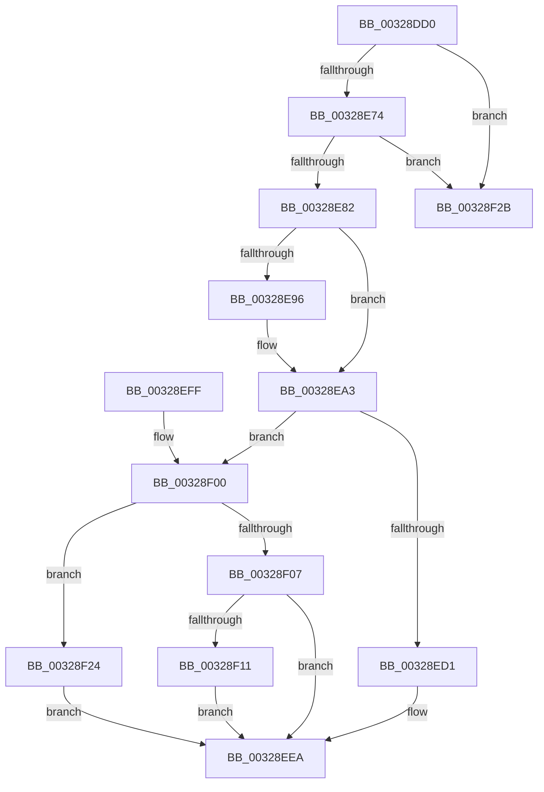

# MiInitializePoolCommitPacket

- RVA: `0x00328DD0`–`0x00328F49` (길이 `377` bytes)
- VA: `0x0000000140328DD0`
- 실행 섹션: `.text`
- PDB 이름 있음: `예`; PDB Function 태그: `아니요`
- unwind 정보 RVA: `0x00075F88`
- 디코드: `93`개 명령, `377/377` bytes 표시
- 미해석 바이트: `0` (있으면 어셈블리에 `.byte`로 보존)

> 이 문서는 커널 이미지의 기계어와 PDB 기호를 분석해 생성했습니다. 4번과 5번은 함수 원형과 자료형을 바이너리 사용 방식에서 추정한 C 해석이며 원본 소스 복구 결과는 아닙니다.

## 1. Dependencies

- 직접 호출 지점: **2**; 고유 호출 대상: **2**
- 직접 호출자로 확인된 함수: **1**
- RIP 상대 이미지 참조: **2**

### Outgoing calls
- `0x00328E66` → [MiMakeProtectionMask](MiMakeProtectionMask_function_00329480.md) (function, `0x00329480`)
- `0x00328F43` → [KeBugCheckEx](../4F/KeBugCheckEx_function_004FD660.md) (function, `0x004FD660`)

### Direct callers
- [MmAllocateSecurePoolMemory](../68/MmAllocateSecurePoolMemory_function_00682CC8.md) at `0x00682DC0`

### Static image references
- `0x00328EB6` → RVA `0x00E38480` (`.data`; read)
- `0x00328ED7` → RVA `0x00E380C0` (`.data`; read)

## 2. Other-region calls and transfers

- 다른 실행 섹션으로 향하는 call: **0**
- 별도 외부 분기/꼬리 이동을 확인하지 못했습니다.

## 3. Assembly (complete function range)

```asm
00328DD0  48 89 5C 24 08                  mov qword ptr [rsp + 8], rbx
00328DD5  48 89 6C 24 10                  mov qword ptr [rsp + 0x10], rbp
00328DDA  48 89 74 24 18                  mov qword ptr [rsp + 0x18], rsi
00328DDF  57                              push rdi
00328DE0  48 83 EC 30                     sub rsp, 0x30
00328DE4  4C 8B 54 24 78                  mov r10, qword ptr [rsp + 0x78]
00328DE9  33 ED                           xor ebp, ebp
00328DEB  48 8B 1A                        mov rbx, qword ptr [rdx]
00328DEE  66 41 89 6A 64                  mov word ptr [r10 + 0x64], bp
00328DF3  44 0F 20 C0                     mov rax, cr8
00328DF7  41 88 42 66                     mov byte ptr [r10 + 0x66], al
00328DFB  48 8D 53 FF                     lea rdx, [rbx - 1]
00328DFF  4C 8B 19                        mov r11, qword ptr [rcx]
00328E02  48 BE F8 FF FF FF 7F 00 00 00   movabs rsi, 0x7ffffffff8
00328E0C  49 03 D3                        add rdx, r11
00328E0F  4D 89 1A                        mov qword ptr [r10], r11
00328E12  48 C1 EA 09                     shr rdx, 9
00328E16  48 23 D6                        and rdx, rsi
00328E19  49 89 6A 30                     mov qword ptr [r10 + 0x30], rbp
00328E1D  48 BF 00 00 00 00 80 F6 FF FF   movabs rdi, 0xfffff68000000000
00328E27  48 8B C7                        mov rax, rdi
00328E2A  48 03 D0                        add rdx, rax
00328E2D  49 8B C3                        mov rax, r11
00328E30  48 C1 E8 09                     shr rax, 9
00328E34  48 23 C6                        and rax, rsi
00328E37  49 89 52 50                     mov qword ptr [r10 + 0x50], rdx
00328E3B  48 2B D0                        sub rdx, rax
00328E3E  48 8B C7                        mov rax, rdi
00328E41  48 2B D0                        sub rdx, rax
00328E44  49 89 6A 58                     mov qword ptr [r10 + 0x58], rbp
00328E48  8B 44 24 68                     mov eax, dword ptr [rsp + 0x68]
00328E4C  41 8B C9                        mov ecx, r9d
00328E4F  48 C1 FA 03                     sar rdx, 3
00328E53  48 FF C2                        inc rdx
00328E56  41 89 42 60                     mov dword ptr [r10 + 0x60], eax
00328E5A  49 89 52 08                     mov qword ptr [r10 + 8], rdx
00328E5E  49 89 6A 38                     mov qword ptr [r10 + 0x38], rbp
00328E62  49 89 6A 28                     mov qword ptr [r10 + 0x28], rbp
00328E66  E8 15 06 00 00                  call 0x140329480
00328E6B  83 F8 18                        cmp eax, 0x18
00328E6E  0F 87 B7 00 00 00               ja 0x140328f2b
00328E74  B9 52 00 00 01                  mov ecx, 0x1000052
00328E79  0F A3 C1                        bt ecx, eax
00328E7C  0F 83 A9 00 00 00               jae 0x140328f2b
00328E82  66 83 E0 1F                     and ax, 0x1f
00328E86  66 C1 E0 03                     shl ax, 3
00328E8A  66 41 89 42 64                  mov word ptr [r10 + 0x64], ax
00328E8F  41 0F BA E0 1E                  bt r8d, 0x1e
00328E94  73 0D                           jae 0x140328ea3
00328E96  B9 00 02 00 00                  mov ecx, 0x200
00328E9B  66 0B C1                        or ax, cx
00328E9E  66 41 89 42 64                  mov word ptr [r10 + 0x64], ax
00328EA3  33 C0                           xor eax, eax
00328EA5  0F 57 C0                        xorps xmm0, xmm0
00328EA8  41 0F 11 42 10                  movups xmmword ptr [r10 + 0x10], xmm0
00328EAD  49 89 42 20                     mov qword ptr [r10 + 0x20], rax
00328EB1  B9 00 01 00 00                  mov ecx, 0x100
00328EB6  48 8D 05 C3 F5 B0 00            lea rax, [rip + 0xb0f5c3]
00328EBD  49 89 42 48                     mov qword ptr [r10 + 0x48], rax
00328EC1  B8 04 00 00 00                  mov eax, 4
00328EC6  49 89 42 40                     mov qword ptr [r10 + 0x40], rax
00328ECA  48 85 4C 24 60                  test qword ptr [rsp + 0x60], rcx
00328ECF  74 2F                           je 0x140328f00
00328ED1  66 41 83 4A 64 02               or word ptr [r10 + 0x64], 2
00328ED7  48 8D 05 E2 F1 B0 00            lea rax, [rip + 0xb0f1e2]
00328EDE  49 89 42 48                     mov qword ptr [r10 + 0x48], rax
00328EE2  41 C7 42 40 05 00 00 00         mov dword ptr [r10 + 0x40], 5
00328EEA  48 8B 5C 24 40                  mov rbx, qword ptr [rsp + 0x40]
00328EEF  48 8B 6C 24 48                  mov rbp, qword ptr [rsp + 0x48]
00328EF4  48 8B 74 24 50                  mov rsi, qword ptr [rsp + 0x50]
00328EF9  48 83 C4 30                     add rsp, 0x30
00328EFD  5F                              pop rdi
00328EFE  C3                              ret
00328EFF  CC                              int3
00328F00  41 0F BA E0 1D                  bt r8d, 0x1d
00328F05  72 1D                           jb 0x140328f24
00328F07  48 8B 44 24 70                  mov rax, qword ptr [rsp + 0x70]
00328F0C  48 85 C0                        test rax, rax
00328F0F  74 D9                           je 0x140328eea
00328F11  66 41 09 4A 64                  or word ptr [r10 + 0x64], cx
00328F16  49 89 42 28                     mov qword ptr [r10 + 0x28], rax
00328F1A  41 C7 42 40 0E 00 00 00         mov dword ptr [r10 + 0x40], 0xe
00328F22  EB C6                           jmp 0x140328eea
00328F24  66 41 09 42 64                  or word ptr [r10 + 0x64], ax
00328F29  EB BF                           jmp 0x140328eea
00328F2B  41 8B C1                        mov eax, r9d
00328F2E  4D 8B C3                        mov r8, r11
00328F31  4C 8B CB                        mov r9, rbx
00328F34  48 89 44 24 20                  mov qword ptr [rsp + 0x20], rax
00328F39  BA 00 53 00 00                  mov edx, 0x5300
00328F3E  B9 1A 00 00 00                  mov ecx, 0x1a
00328F43  E8 18 47 1D 00                  call 0x1404fd660
00328F48  CC                              int3
```

## 4. C-style interpretation (structured pseudocode)

```c
__int64 __fastcall MiInitializePoolCommitPacket(__int64 a1, __int64 a2, int a3, int a4, __int64 a5, unsigned int a6, __int64 a7, __int64 a8)
{
    __int64 result;
    __int64 v_rbp;
    __int64 v_rsp;
    unsigned __int64 v_stack_p10;
    unsigned __int64 v_stack_p18;
    unsigned __int64 v_stack_p20;
    unsigned __int64 v_stack_p8;

    v_stack_p8 = v_rbx;
    v_stack_p10 = v_rbp;
    v_stack_p18 = v_rsi;
    v_rsp = (v_rsp) - (48);
    v_rbp = 0;
    *(unsigned __int16 *)(a8 + 100) = 0;
    *(unsigned __int8 *)(a8 + 102) = (unsigned __int8)(v_cr8);
    a2 = (*(unsigned __int64 *)(a2) - 1) + (*(unsigned __int64 *)(a1));
    *(unsigned __int64 *)(a8) = *(unsigned __int64 *)(a1);
    a2 = (a2) >> (9);
    a2 = (a2) & (v_rsi);
    *(unsigned __int64 *)(a8 + 48) = 0;
    a2 = (a2) + (v_rdi);
    result = (*(unsigned __int64 *)(a1)) >> (9);
    result = (result) & (v_rsi);
    *(unsigned __int64 *)(a8 + 80) = a2;
    a2 = (a2) - (result);
    a2 = (a2) - (v_rdi);
    *(unsigned __int64 *)(a8 + 88) = 0;
    a2 = (a2) >> (3);
    a2 = (a2) + 1;
    *(unsigned int *)(a8 + 96) = (unsigned int)((unsigned int)(a6));
    *(unsigned __int64 *)(a8 + 8) = a2;
    *(unsigned __int64 *)(a8 + 56) = 0;
    *(unsigned __int64 *)(a8 + 40) = 0;
    result = MiMakeProtectionMask((unsigned int)(a4), a2, a3, a4);
    if (((unsigned int)(result)) > 24) goto loc_00328F2B;
    if (((unsigned int)(result)) >= 24) goto loc_00328F2B;
    result = (unsigned __int16)((result) & (31));
    result = (unsigned __int16)((result) << (3));
    *(unsigned __int16 *)(a8 + 100) = (unsigned __int16)(result);
    if (!(condition_is_above_or_equal)) {
        a1 = 512;
        result = (unsigned __int16)((result) | ((unsigned __int16)(a1)));
        *(unsigned __int16 *)(a8 + 100) = (unsigned __int16)(result);
    }
    result = 0;
    *(unsigned __int64 *)(a8 + 16) = v_xmm0;
    *(unsigned __int64 *)(a8 + 32) = 0;
    *(unsigned __int64 *)(a8 + 72) = v_rip + 11597251;
    *(unsigned __int64 *)(a8 + 64) = 4;
    if (((a5) & (256)) == 0) goto loc_00328F00;
    *(unsigned __int64 *)(a8 + 72) = v_rip + 11596258;
    *(unsigned int *)(a8 + 64) = 5;
loc_00328EEA:
    v_rsp = (v_rsp) + (48);
    return v_rip + 11596258;
loc_00328F00:
    if (condition_is_below) goto loc_00328F24;
    if (a7 == 0) goto loc_00328EEA;
    *(unsigned __int64 *)(a8 + 40) = a7;
    *(unsigned int *)(a8 + 64) = 14;
    goto loc_00328EEA;
loc_00328F24:
    goto loc_00328EEA;
loc_00328F2B:
    v_stack_p20 = (unsigned int)(a4);
    result = KeBugCheckEx(26, (unsigned int)(0x5300ULL), *(unsigned __int64 *)(a1), v_stack_p8);
    return result;
}
```

## 5. (Beta) C Style

```c
int64_t MiInitializePoolCommitPacket(void *Arg1, void *Arg2, int32_t Arg3, int32_t Arg4, int64_t Arg5, uint32_t Arg6, int64_t Arg7, void *Arg8)
{
    uint8_t *arg1 = (uint8_t *)Arg1;
    uint8_t *arg2 = (uint8_t *)Arg2;
    uint8_t *arg8 = (uint8_t *)Arg8;

    int64_t result;
    int64_t local_rbp;
    int64_t local_rsp;
    uint64_t v_stack_p10;
    uint64_t v_stack_p18;
    uint64_t v_stack_p20;
    uint64_t v_stack_p8;

    v_stack_p8 = local_rbx;
    v_stack_p10 = local_rbp;
    v_stack_p18 = local_rsi;
    local_rsp = (local_rsp) - (48);
    local_rbp = 0;
    *(uint16_t *)(arg8 + 0x64) = 0;
    *(uint8_t *)(arg8 + 0x66) = (uint8_t)(v_cr8);
    Arg2 = (*(uint64_t *)(arg2) - 1) + (*(uint64_t *)(arg1));
    *(uint64_t *)(arg8) = *(uint64_t *)(arg1);
    Arg2 = (Arg2) >> (9);
    Arg2 = (Arg2) & (local_rsi);
    *(uint64_t *)(arg8 + 0x30) = 0;
    Arg2 = (Arg2) + (local_rdi);
    result = (*(uint64_t *)(arg1)) >> (9);
    result = (result) & (local_rsi);
    *(void **)(arg8 + 0x50) = Arg2;
    Arg2 = (Arg2) - (result);
    Arg2 = (Arg2) - (local_rdi);
    *(uint64_t *)(arg8 + 0x58) = 0;
    Arg2 = (Arg2) >> (3);
    Arg2 = (Arg2) + 1;
    *(uint32_t *)(arg8 + 0x60) = (uint32_t)((uint32_t)(Arg6));
    *(void **)(arg8 + 0x8) = Arg2;
    *(uint64_t *)(arg8 + 0x38) = 0;
    *(uint64_t *)(arg8 + 0x28) = 0;
    result = MiMakeProtectionMask((uint32_t)(Arg4), Arg2, Arg3, Arg4);
    if (((uint32_t)(result)) > 24) goto loc_00328F2B;
    if (((uint32_t)(result)) >= 24) goto loc_00328F2B;
    result = (uint16_t)((result) & (31));
    result = (uint16_t)((result) << (3));
    *(uint16_t *)(arg8 + 0x64) = (uint16_t)(result);
    if (!(condition_is_above_or_equal)) {
        Arg1 = 512;
        result = (uint16_t)((result) | ((uint16_t)(Arg1)));
        *(uint16_t *)(arg8 + 0x64) = (uint16_t)(result);
    }
    result = 0;
    *(uint64_t *)(arg8 + 0x10) = v_xmm0;
    *(uint64_t *)(arg8 + 0x20) = 0;
    *(uint64_t *)(arg8 + 0x48) = v_rip + 11597251;
    *(uint64_t *)(arg8 + 0x40) = 4;
    if (((Arg5) & (256)) == 0) goto loc_00328F00;
    *(uint64_t *)(arg8 + 0x48) = v_rip + 11596258;
    *(uint32_t *)(arg8 + 0x40) = 5;
loc_00328EEA:
    local_rsp = (local_rsp) + (48);
    return v_rip + 11596258;
loc_00328F00:
    if (condition_is_below) goto loc_00328F24;
    if (Arg7 == 0) goto loc_00328EEA;
    *(uint64_t *)(arg8 + 0x28) = Arg7;
    *(uint32_t *)(arg8 + 0x40) = 14;
    goto loc_00328EEA;
loc_00328F24:
    goto loc_00328EEA;
loc_00328F2B:
    v_stack_p20 = (uint32_t)(Arg4);
    result = KeBugCheckEx(26, (uint32_t)(0x5300ULL), *(uint64_t *)(arg1), v_stack_p8);
    return result;
}
```

### 관측된 메모리 오프셋

구조체 형식이 확인되지 않은 접근은 인자 기준의 오프셋으로만 기록했습니다.

| 기준 인자 | 오프셋 표현 | 폭 (bit) | 접근 |
|---|---:|---:|---|
| `Arg1` | `+ 0x0` | `64` | `R` |
| `Arg2` | `+ 0x0` | `64` | `R` |
| `Arg8` | `+ 0x0` | `64` | `W` |
| `Arg8` | `+ 0x8` | `64` | `W` |
| `Arg8` | `+ 0x28` | `64` | `W` |
| `Arg8` | `+ 0x30` | `64` | `W` |
| `Arg8` | `+ 0x38` | `64` | `W` |
| `Arg8` | `+ 0x50` | `64` | `W` |
| `Arg8` | `+ 0x58` | `64` | `W` |
| `Arg8` | `+ 0x60` | `32` | `W` |
| `Arg8` | `+ 0x64` | `16` | `W` |
| `Arg8` | `+ 0x66` | `8` | `W` |

## 6. Execution-region graph

[열기: 2D/3D 그래프와 함수 탐색 컨트롤 패널](../../../control-panel.html?section=text&rva=0x00328DD0&view=graph)

- 2D 그래프는 위에서 아래로 흐르고, 3D 그래프는 빈 공간을 드래그해 회전합니다. Shift+드래그는 이동, 휠은 확대·축소, 함수 노드 선택은 대상 보고서 이동입니다.

### Static fallback


