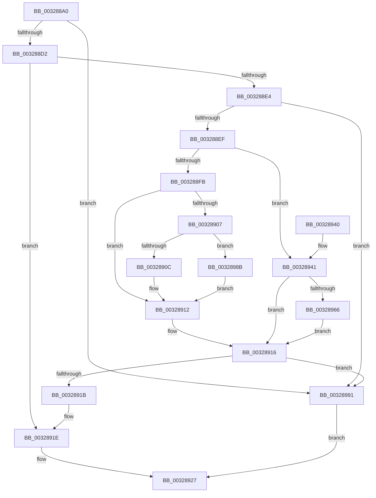

# MiIsFaultPteIntact

- RVA: `0x003288A0`–`0x00328995` (길이 `245` bytes)
- VA: `0x00000001403288A0`
- 실행 섹션: `.text`
- PDB 이름 있음: `예`; PDB Function 태그: `아니요`
- unwind 정보 RVA: `0x00075EFC`
- 디코드: `68`개 명령, `245/245` bytes 표시
- 미해석 바이트: `0` (있으면 어셈블리에 `.byte`로 보존)

> 이 문서는 커널 이미지의 기계어와 PDB 기호를 분석해 생성했습니다. 4번과 5번은 함수 원형과 자료형을 바이너리 사용 방식에서 추정한 C 해석이며 원본 소스 복구 결과는 아닙니다.

## 1. Dependencies

- 직접 호출 지점: **5**; 고유 호출 대상: **5**
- 직접 호출자로 확인된 함수: **4**
- RIP 상대 이미지 참조: **1**

### Outgoing calls
- `0x003288C1` → [MiFindActualFaultingPte](MiFindActualFaultingPte_function_0032899C.md) (function, `0x0032899C`)
- `0x003288D5` → [MI_READ_PTE_LOCK_FREE](../28/MI_READ_PTE_LOCK_FREE_function_002828A0.md) (function, `0x002828A0`)
- `0x003288F2` → [MiIsPrototypePteVadLookup](MiIsPrototypePteVadLookup_function_00328B70.md) (function, `0x00328B70`)
- `0x00328957` → [MiCheckVirtualAddress](MiCheckVirtualAddress_function_0032E4F0.md) (function, `0x0032E4F0`)
- `0x00328984` → [ExReleaseSpinLockSharedFromDpcLevel](../24/ExReleaseSpinLockSharedFromDpcLevel_function_0024A590.md) (function, `0x0024A590`)

### Direct callers
- [MiFinishHardFault](../2B/MiFinishHardFault_function_002B6F10.md) at `0x002B7468`
- [MiPrivateFixup](../36/MiPrivateFixup_function_003693E8.md) at `0x003697BC`
- [MiPrivateFixup](../36/MiPrivateFixup_function_003693E8.md) at `0x00369A14`
- [MiWaitForCollidedFaultComplete](../36/MiWaitForCollidedFaultComplete_function_00369EDC.md) at `0x0036A0DC`
- [MiIdealClusterPage](../4D/MiIdealClusterPage_function_004DB964.md) at `0x004DC0D9`

### Static image references
- `0x003288FB` → RVA `0x00E2DC80` (`.data`; read)

## 2. Other-region calls and transfers

- 다른 실행 섹션으로 향하는 call: **0**
- 별도 외부 분기/꼬리 이동을 확인하지 못했습니다.

## 3. Assembly (complete function range)

```asm
003288A0  48 89 5C 24 08                  mov qword ptr [rsp + 8], rbx
003288A5  48 89 6C 24 10                  mov qword ptr [rsp + 0x10], rbp
003288AA  48 89 74 24 18                  mov qword ptr [rsp + 0x18], rsi
003288AF  57                              push rdi
003288B0  41 56                           push r14
003288B2  41 57                           push r15
003288B4  48 83 EC 30                     sub rsp, 0x30
003288B8  4D 8B F1                        mov r14, r9
003288BB  49 8B E8                        mov rbp, r8
003288BE  4C 8B FA                        mov r15, rdx
003288C1  E8 D6 00 00 00                  call 0x14032899c
003288C6  48 8B F0                        mov rsi, rax
003288C9  48 85 C0                        test rax, rax
003288CC  0F 84 BF 00 00 00               je 0x140328991
003288D2  48 8B C8                        mov rcx, rax
003288D5  E8 C6 9F F5 FF                  call 0x1402828a0
003288DA  33 FF                           xor edi, edi
003288DC  48 8B D8                        mov rbx, rax
003288DF  48 3B F5                        cmp rsi, rbp
003288E2  74 3A                           je 0x14032891e
003288E4  48 0F BA E0 0A                  bt rax, 0xa
003288E9  0F 83 A2 00 00 00               jae 0x140328991
003288EF  48 8B C8                        mov rcx, rax
003288F2  E8 79 02 00 00                  call 0x140328b70
003288F7  85 C0                           test eax, eax
003288F9  75 46                           jne 0x140328941
003288FB  48 8B 05 7E 53 B0 00            mov rax, qword ptr [rip + 0xb0537e]
00328902  48 85 C0                        test rax, rax
00328905  74 0B                           je 0x140328912
00328907  F6 C3 10                        test bl, 0x10
0032890A  75 7F                           jne 0x14032898b
0032890C  48 F7 D0                        not rax
0032890F  48 23 D8                        and rbx, rax
00328912  48 C1 FB 10                     sar rbx, 0x10
00328916  48 3B DD                        cmp rbx, rbp
00328919  75 76                           jne 0x140328991
0032891B  48 8B 1B                        mov rbx, qword ptr [rbx]
0032891E  49 3B 1E                        cmp rbx, qword ptr [r14]
00328921  40 0F 94 C7                     sete dil
00328925  8B C7                           mov eax, edi
00328927  48 8B 5C 24 50                  mov rbx, qword ptr [rsp + 0x50]
0032892C  48 8B 6C 24 58                  mov rbp, qword ptr [rsp + 0x58]
00328931  48 8B 74 24 60                  mov rsi, qword ptr [rsp + 0x60]
00328936  48 83 C4 30                     add rsp, 0x30
0032893A  41 5F                           pop r15
0032893C  41 5E                           pop r14
0032893E  5F                              pop rdi
0032893F  C3                              ret
00328940  CC                              int3
00328941  4C 8D 44 24 28                  lea r8, [rsp + 0x28]
00328946  48 89 7C 24 28                  mov qword ptr [rsp + 0x28], rdi
0032894B  48 8D 54 24 20                  lea rdx, [rsp + 0x20]
00328950  89 7C 24 20                     mov dword ptr [rsp + 0x20], edi
00328954  49 8B CF                        mov rcx, r15
00328957  E8 94 5B 00 00                  call 0x14032e4f0
0032895C  48 8B D8                        mov rbx, rax
0032895F  48 39 7C 24 28                  cmp qword ptr [rsp + 0x28], rdi
00328964  74 B0                           je 0x140328916
00328966  65 48 8B 04 25 88 01 00 00      mov rax, qword ptr gs:[0x188]
0032896F  48 8B 88 B8 00 00 00            mov rcx, qword ptr [rax + 0xb8]
00328976  48 8B 89 10 04 00 00            mov rcx, qword ptr [rcx + 0x410]
0032897D  48 81 C1 EC 03 00 00            add rcx, 0x3ec
00328984  E8 07 1C F2 FF                  call 0x14024a590
00328989  EB 8B                           jmp 0x140328916
0032898B  48 83 E3 EF                     and rbx, 0xffffffffffffffef
0032898F  EB 81                           jmp 0x140328912
00328991  33 C0                           xor eax, eax
00328993  EB 92                           jmp 0x140328927
```

## 4. C-style interpretation (structured pseudocode)

```c
__int64 __fastcall MiIsFaultPteIntact(__int64 a1, __int64 a2, __int64 a3, __int64 a4)
{
    __int64 result;
    __int64 v_rbx;
    __int64 v_rdi;
    __int64 v_rsp;
    unsigned __int64 v_stack_p10;
    unsigned __int64 v_stack_p18;
    unsigned __int64 v_stack_p20;
    unsigned __int64 v_stack_p28;
    unsigned __int64 v_stack_p8;

    v_stack_p8 = v_rbx;
    v_stack_p10 = v_rbp;
    v_stack_p18 = v_rsi;
    v_rsp = (v_rsp) - (48);
    result = MiFindActualFaultingPte(a1, a2, a3, a4);
    if (result == 0) goto loc_00328991;
    result = MI_READ_PTE_LOCK_FREE(result, a2, a3, a4);
    v_rdi = 0;
    if (result == a3) goto loc_0032891E;
    if (result >= a3) goto loc_00328991;
    result = MiIsPrototypePteVadLookup(result, a2, a3, a4);
    if ((unsigned int)(result) != 0) goto loc_00328941;
    if (*(unsigned __int64 *)(v_rip + 11555710) == 0) goto loc_00328912;
    if ((((unsigned __int8)(result)) & (16)) != 0) goto loc_0032898B;
    result = ~(*(unsigned __int64 *)(v_rip + 11555710));
    v_rbx = (result) & (result);
loc_00328912:
    v_rbx = (v_rbx) >> (16);
loc_00328916:
    if (v_rbx != a3) goto loc_00328991;
loc_0032891E:
    v_rdi = ((*(unsigned __int64 *)(v_rbx)) == (*(unsigned __int64 *)(a4))) ? 1 : 0;
loc_00328927:
    v_rsp = (v_rsp) + (48);
    return (unsigned int)((unsigned int)(v_rdi));
loc_00328941:
    v_stack_p28 = v_rdi;
    v_stack_p20 = (unsigned int)(v_rdi);
    result = MiCheckVirtualAddress(a2, v_stack_p20, v_stack_p28, a4);
    if (v_stack_p28 == v_rdi) goto loc_00328916;
    a1 = (*(unsigned __int64 *)(*(unsigned __int64 *)(*(unsigned __int64 *)(gs_base + (0 + 392)) + 184) + 1040)) + (0x3ECULL);
    result = ExReleaseSpinLockSharedFromDpcLevel(a1, v_stack_p20, v_stack_p28, a4);
    goto loc_00328916;
loc_0032898B:
    v_rbx = (result) & (-17);
    goto loc_00328912;
loc_00328991:
    result = 0;
    goto loc_00328927;
}
```

## 5. (Beta) C Style

```c
int64_t MiIsFaultPteIntact(int64_t Arg1, int64_t Arg2, int64_t Arg3, void *Arg4)
{
    uint8_t *arg4 = (uint8_t *)Arg4;

    int64_t result;
    int64_t local_rbx;
    int64_t local_rdi;
    int64_t local_rsp;
    uint64_t v_stack_p10;
    uint64_t v_stack_p18;
    uint64_t v_stack_p20;
    uint64_t v_stack_p28;
    uint64_t v_stack_p8;

    v_stack_p8 = local_rbx;
    v_stack_p10 = local_rbp;
    v_stack_p18 = local_rsi;
    local_rsp = (local_rsp) - (48);
    result = MiFindActualFaultingPte(Arg1, Arg2, Arg3, Arg4);
    if (result == 0) goto loc_00328991;
    result = MI_READ_PTE_LOCK_FREE(result, Arg2, Arg3, Arg4);
    local_rdi = 0;
    if (result == Arg3) goto loc_0032891E;
    if (result >= Arg3) goto loc_00328991;
    result = MiIsPrototypePteVadLookup(result, Arg2, Arg3, Arg4);
    if ((uint32_t)(result) != 0) goto loc_00328941;
    if (*(uint64_t *)(v_rip + 0xB0537E) == 0) goto loc_00328912;
    if ((((uint8_t)(result)) & (16)) != 0) goto loc_0032898B;
    result = ~(*(uint64_t *)(v_rip + 0xB0537E));
    local_rbx = (result) & (result);
loc_00328912:
    local_rbx = (local_rbx) >> (16);
loc_00328916:
    if (local_rbx != Arg3) goto loc_00328991;
loc_0032891E:
    local_rdi = ((*(uint64_t *)(local_rbx)) == (*(uint64_t *)(arg4))) ? 1 : 0;
loc_00328927:
    local_rsp = (local_rsp) + (48);
    return (uint32_t)((uint32_t)(local_rdi));
loc_00328941:
    v_stack_p28 = local_rdi;
    v_stack_p20 = (uint32_t)(local_rdi);
    result = MiCheckVirtualAddress(Arg2, v_stack_p20, v_stack_p28, Arg4);
    if (v_stack_p28 == local_rdi) goto loc_00328916;
    Arg1 = (*(uint64_t *)(*(uint64_t *)(*(uint64_t *)(gs_base + (0 + 0x188)) + 0xB8) + 0x410)) + (0x3ECULL);
    result = ExReleaseSpinLockSharedFromDpcLevel(Arg1, v_stack_p20, v_stack_p28, Arg4);
    goto loc_00328916;
loc_0032898B:
    local_rbx = (result) & (-17);
    goto loc_00328912;
loc_00328991:
    result = 0;
    goto loc_00328927;
}
```

### 관측된 메모리 오프셋

구조체 형식이 확인되지 않은 접근은 인자 기준의 오프셋으로만 기록했습니다.

| 기준 인자 | 오프셋 표현 | 폭 (bit) | 접근 |
|---|---:|---:|---|
| `Arg4` | `+ 0x0` | `64` | `R` |

## 6. Execution-region graph

[열기: 2D/3D 그래프와 함수 탐색 컨트롤 패널](../../../control-panel.html?section=text&rva=0x003288A0&view=graph)

- 2D 그래프는 위에서 아래로 흐르고, 3D 그래프는 빈 공간을 드래그해 회전합니다. Shift+드래그는 이동, 휠은 확대·축소, 함수 노드 선택은 대상 보고서 이동입니다.

### Static fallback


