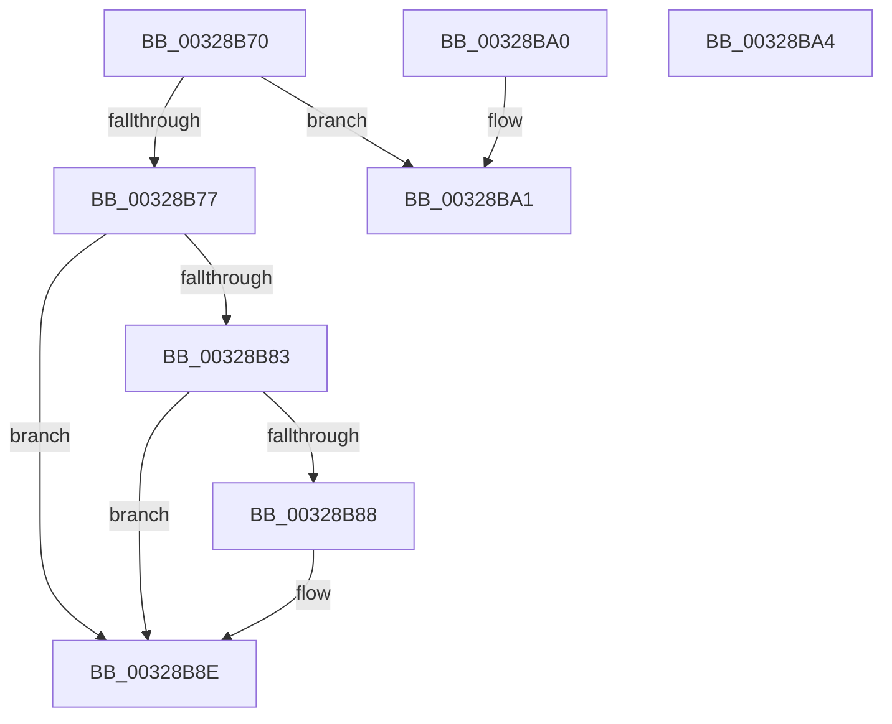

# MiIsPrototypePteVadLookup

- RVA: `0x00328B70`–`0x00328BA5` (길이 `53` bytes)
- VA: `0x0000000140328B70`
- 실행 섹션: `.text`
- PDB 이름 있음: `예`; PDB Function 태그: `아니요`
- unwind 정보 RVA: `0x000DB714`
- 디코드: `19`개 명령, `53/53` bytes 표시
- 미해석 바이트: `0` (있으면 어셈블리에 `.byte`로 보존)

> 이 문서는 커널 이미지의 기계어와 PDB 기호를 분석해 생성했습니다. 4번과 5번은 함수 원형과 자료형을 바이너리 사용 방식에서 추정한 C 해석이며 원본 소스 복구 결과는 아닙니다.

## 1. Dependencies

- 직접 호출 지점: **0**; 고유 호출 대상: **0**
- 직접 호출자로 확인된 함수: **19**
- RIP 상대 이미지 참조: **1**

### Outgoing calls
- 직접 디코드된 call 명령이 없습니다.

### Direct callers
- [MiTranslatePageForCopy](../22/MiTranslatePageForCopy_function_00228960.md) at `0x00228DB6`
- [MiBuildForkPte](../22/MiBuildForkPte_function_0022E32C.md) at `0x0022E93E`
- [MiBuildForkPte](../22/MiBuildForkPte_function_0022E32C.md) at `0x0022EC8C`
- [MiDecommitHandleProtoFormatPte](../24/MiDecommitHandleProtoFormatPte_function_00242D54.md) at `0x00242DF0`
- [MiWalkVaRange](../24/MiWalkVaRange_function_00243BF0.md) at `0x00244B64`
- [MiSetReadOnlyOnSectionView](../29/MiSetReadOnlyOnSectionView_function_00294538.md) at `0x002948EC`
- [MiSplitPrivatePage](../2A/MiSplitPrivatePage_function_002A6210.md) at `0x002A6599`
- [MiGetWorkingSetInfoList](../2A/MiGetWorkingSetInfoList_function_002AF770.md) at `0x002B06B5`
- [sub_002B5FA0](../2B/Unknown_function_002B5FA0.md) at `0x002B600C`
- [MiInitializeReadInProgressPfn](../2B/MiInitializeReadInProgressPfn_function_002B6990.md) at `0x002B6D96`
- [MiIsCfgBitMapPageShared](../2C/MiIsCfgBitMapPageShared_function_002C1200.md) at `0x002C1347`
- [MiCountSharedPages](../2C/MiCountSharedPages_function_002C30A4.md) at `0x002C32C8`
- [sub_002C3A7C](../2C/Unknown_function_002C3A7C.md) at `0x002C405F`
- [sub_002C3A7C](../2C/Unknown_function_002C3A7C.md) at `0x002C4076`
- [sub_002C3A7C](../2C/Unknown_function_002C3A7C.md) at `0x002C4090`
- [MiResolveProtoPteFault](MiResolveProtoPteFault_function_00321750.md) at `0x00321E8E`
- [MiResolveProtoPteFault](MiResolveProtoPteFault_function_00321750.md) at `0x003221C1`
- [MiIsFaultPteIntact](MiIsFaultPteIntact_function_003288A0.md) at `0x003288F2`
- [MiFindActualFaultingPte](MiFindActualFaultingPte_function_0032899C.md) at `0x00328A6B`
- [MiIsPteEvaluated](MiIsPteEvaluated_function_0032A36C.md) at `0x0032A417`
- [sub_0032BD21](Unknown_function_0032BD21.md) at `0x0032BD24`
- [MiCheckCommitReleaseFromVad](../66/MiCheckCommitReleaseFromVad_function_0066EB90.md) at `0x0066EDBA`
- [sub_006DC6C6](../6D/Unknown_function_006DC6C6.md) at `0x006DC706`

### Static image references
- `0x00328B77` → RVA `0x00E2DC80` (`.data`; read)

## 2. Other-region calls and transfers

- 다른 실행 섹션으로 향하는 call: **0**
- 별도 외부 분기/꼬리 이동을 확인하지 못했습니다.

## 3. Assembly (complete function range)

```asm
00328B70  48 0F BA E1 0A                  bt rcx, 0xa
00328B75  73 2A                           jae 0x140328ba1
00328B77  48 8B 05 02 51 B0 00            mov rax, qword ptr [rip + 0xb05102]
00328B7E  48 85 C0                        test rax, rax
00328B81  74 0B                           je 0x140328b8e
00328B83  F6 C1 10                        test cl, 0x10
00328B86  75 06                           jne 0x140328b8e
00328B88  48 F7 D0                        not rax
00328B8B  48 23 C8                        and rcx, rax
00328B8E  33 C0                           xor eax, eax
00328B90  48 C1 E9 20                     shr rcx, 0x20
00328B94  BA FF FF FF FF                  mov edx, 0xffffffff
00328B99  48 3B CA                        cmp rcx, rdx
00328B9C  0F 94 C0                        sete al
00328B9F  C3                              ret
00328BA0  CC                              int3
00328BA1  33 C0                           xor eax, eax
00328BA3  C3                              ret
00328BA4  CC                              int3
```

## 4. C-style interpretation (structured pseudocode)

```c
__int64 __fastcall MiIsPrototypePteVadLookup(__int64 a1)
{
    __int64 result;

    if (condition_is_above_or_equal) goto loc_00328BA1;
    if (*(unsigned __int64 *)(v_rip + 11555074) == 0) goto loc_00328B8E;
    result = *(unsigned __int64 *)(v_rip + 11555074);
    if ((((unsigned __int8)(a1)) & (16)) == 0) {
        result = ~(*(unsigned __int64 *)(v_rip + 11555074));
        a1 = (a1) & (result);
    }
    result = 0;
    a1 = (a1) >> (32);
    result = (a1 == ((unsigned int)(0xFFFFFFFFULL))) ? 1 : 0;
    return result;
loc_00328BA1:
    result = 0;
    return result;
}
```

## 5. (Beta) C Style

```c
int64_t MiIsPrototypePteVadLookup(int64_t Arg1)
{
    int64_t result;

    if (condition_is_above_or_equal) goto loc_00328BA1;
    if (*(uint64_t *)(v_rip + 0xB05102) == 0) goto loc_00328B8E;
    result = *(uint64_t *)(v_rip + 0xB05102);
    if ((((uint8_t)(Arg1)) & (16)) == 0) {
        result = ~(*(uint64_t *)(v_rip + 0xB05102));
        Arg1 = (Arg1) & (result);
    }
    result = 0;
    Arg1 = (Arg1) >> (32);
    result = (Arg1 == ((uint32_t)(0xFFFFFFFFULL))) ? 1 : 0;
    return result;
loc_00328BA1:
    result = 0;
    return result;
}
```

## 6. Execution-region graph

[열기: 2D/3D 그래프와 함수 탐색 컨트롤 패널](../../../control-panel.html?section=text&rva=0x00328B70&view=graph)

- 2D 그래프는 위에서 아래로 흐르고, 3D 그래프는 빈 공간을 드래그해 회전합니다. Shift+드래그는 이동, 휠은 확대·축소, 함수 노드 선택은 대상 보고서 이동입니다.

### Static fallback


