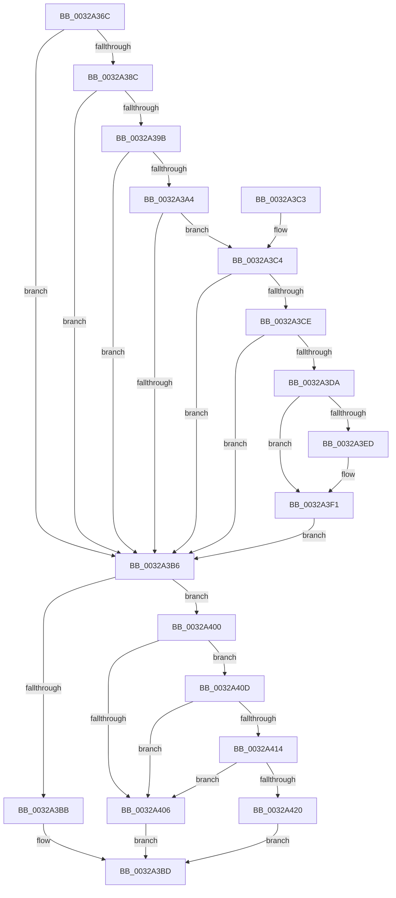

# MiIsPteEvaluated

- RVA: `0x0032A36C`–`0x0032A434` (길이 `200` bytes)
- VA: `0x000000014032A36C`
- 실행 섹션: `.text`
- PDB 이름 있음: `예`; PDB Function 태그: `아니요`
- unwind 정보 RVA: `0x0007606C`
- 디코드: `61`개 명령, `200/200` bytes 표시
- 미해석 바이트: `0` (있으면 어셈블리에 `.byte`로 보존)

> 이 문서는 커널 이미지의 기계어와 PDB 기호를 분석해 생성했습니다. 4번과 5번은 함수 원형과 자료형을 바이너리 사용 방식에서 추정한 C 해석이며 원본 소스 복구 결과는 아닙니다.

## 1. Dependencies

- 직접 호출 지점: **2**; 고유 호출 대상: **2**
- 직접 호출자로 확인된 함수: **2**
- RIP 상대 이미지 참조: **0**

### Outgoing calls
- `0x0032A3C4` → [MiPteHasShadow](MiPteHasShadow_function_0032B998.md) (function, `0x0032B998`)
- `0x0032A417` → [MiIsPrototypePteVadLookup](MiIsPrototypePteVadLookup_function_00328B70.md) (function, `0x00328B70`)

### Direct callers
- [MiExpandSharedZeroCluster](../36/MiExpandSharedZeroCluster_function_0036F20C.md) at `0x0036F36E`
- [MiGetClusterPage](../4D/MiGetClusterPage_function_004DC57C.md) at `0x004DC85D`

### Static image references
- 디코드된 RIP-relative 메모리 참조가 없습니다.

## 2. Other-region calls and transfers

- 다른 실행 섹션으로 향하는 call: **0**
- 별도 외부 분기/꼬리 이동을 확인하지 못했습니다.

## 3. Assembly (complete function range)

```asm
0032A36C  40 53                           push rbx
0032A36E  48 83 EC 20                     sub rsp, 0x20
0032A372  4C 8B 01                        mov r8, qword ptr [rcx]
0032A375  4C 8B D9                        mov r11, rcx
0032A378  8B DA                           mov ebx, edx
0032A37A  48 B8 00 D0 BE 7D FB F6 FF FF   movabs rax, 0xfffff6fb7dbed000
0032A384  45 33 D2                        xor r10d, r10d
0032A387  48 3B C8                        cmp rcx, rax
0032A38A  72 2A                           jb 0x14032a3b6
0032A38C  48 B8 F8 D7 BE 7D FB F6 FF FF   movabs rax, 0xfffff6fb7dbed7f8
0032A396  48 3B C8                        cmp rcx, rax
0032A399  77 1B                           ja 0x14032a3b6
0032A39B  4D 8B C8                        mov r9, r8
0032A39E  41 F6 C0 01                     test r8b, 1
0032A3A2  74 12                           je 0x14032a3b6
0032A3A4  41 F6 C0 42                     test r8b, 0x42
0032A3A8  0F 95 C1                        setne cl
0032A3AB  41 F6 C0 20                     test r8b, 0x20
0032A3AF  0F 95 C0                        setne al
0032A3B2  84 C8                           test al, cl
0032A3B4  74 0E                           je 0x14032a3c4
0032A3B6  4D 85 C0                        test r8, r8
0032A3B9  75 45                           jne 0x14032a400
0032A3BB  33 C0                           xor eax, eax
0032A3BD  48 83 C4 20                     add rsp, 0x20
0032A3C1  5B                              pop rbx
0032A3C2  C3                              ret
0032A3C3  CC                              int3
0032A3C4  E8 CF 15 00 00                  call 0x14032b998
0032A3C9  48 85 C0                        test rax, rax
0032A3CC  74 E8                           je 0x14032a3b6
0032A3CE  48 8B 80 08 05 00 00            mov rax, qword ptr [rax + 0x508]
0032A3D5  48 85 C0                        test rax, rax
0032A3D8  74 DC                           je 0x14032a3b6
0032A3DA  49 C1 EB 03                     shr r11, 3
0032A3DE  41 81 E3 FF 01 00 00            and r11d, 0x1ff
0032A3E5  4A 8B 04 D8                     mov rax, qword ptr [rax + r11*8]
0032A3E9  A8 20                           test al, 0x20
0032A3EB  74 04                           je 0x14032a3f1
0032A3ED  49 83 C9 20                     or r9, 0x20
0032A3F1  4D 8B C1                        mov r8, r9
0032A3F4  49 83 C8 42                     or r8, 0x42
0032A3F8  A8 42                           test al, 0x42
0032A3FA  4D 0F 44 C1                     cmove r8, r9
0032A3FE  EB B6                           jmp 0x14032a3b6
0032A400  41 F6 C0 01                     test r8b, 1
0032A404  74 07                           je 0x14032a40d
0032A406  B8 01 00 00 00                  mov eax, 1
0032A40B  EB B0                           jmp 0x14032a3bd
0032A40D  49 0F BA E0 0A                  bt r8, 0xa
0032A412  73 F2                           jae 0x14032a406
0032A414  49 8B C8                        mov rcx, r8
0032A417  E8 54 E7 FF FF                  call 0x140328b70
0032A41C  85 C0                           test eax, eax
0032A41E  74 E6                           je 0x14032a406
0032A420  49 C1 E8 05                     shr r8, 5
0032A424  41 83 E0 1F                     and r8d, 0x1f
0032A428  4C 3B C3                        cmp r8, rbx
0032A42B  41 0F 95 C2                     setne r10b
0032A42F  41 8B C2                        mov eax, r10d
0032A432  EB 89                           jmp 0x14032a3bd
```

## 4. C-style interpretation (structured pseudocode)

```c
__int64 __fastcall MiIsPteEvaluated(__int64 a1, int a2)
{
    __int64 result;
    __int64 v_r10;
    __int64 v_r11;
    __int64 v_rsp;

    v_rsp = (v_rsp) - (32);
    v_r10 = 0;
    if (a1 < result) goto loc_0032A3B6;
    if (a1 > result) goto loc_0032A3B6;
    if ((((unsigned __int8)(*(unsigned __int64 *)(a1))) & (1)) == 0) goto loc_0032A3B6;
    a1 = ((((unsigned __int8)(*(unsigned __int64 *)(a1))) & (66)) != 0) ? 1 : 0;
    result = ((((unsigned __int8)(*(unsigned __int64 *)(a1))) & (32)) != 0) ? 1 : 0;
    if ((((unsigned __int8)(result)) & ((unsigned __int8)(a1))) == 0) goto loc_0032A3C4;
loc_0032A3B6:
    if (*(unsigned __int64 *)(a1) != 0) goto loc_0032A400;
    result = 0;
loc_0032A3BD:
    v_rsp = (v_rsp) + (32);
    return result;
loc_0032A3C4:
    result = MiPteHasShadow(a1, a2, *(unsigned __int64 *)(a1), *(unsigned __int64 *)(a1));
    if (result == 0) goto loc_0032A3B6;
    if (*(unsigned __int64 *)(result + 1288) == 0) goto loc_0032A3B6;
    v_r11 = (a1) >> (3);
    v_r11 = (unsigned int)((v_r11) & (511));
    if ((((unsigned __int8)(*(unsigned __int64 *)(*(unsigned __int64 *)(result + 1288) + v_r11 * 8))) & (32)) != 0) {
        a4 = (*(unsigned __int64 *)(a1)) | (32);
    }
    a3 = (a4) | (66);
    if ((((unsigned __int8)(*(unsigned __int64 *)(*(unsigned __int64 *)(result + 1288) + v_r11 * 8))) & (66)) == 0) { a3 = a4; }
    goto loc_0032A3B6;
loc_0032A400:
    if ((((unsigned __int8)(a3)) & (1)) == 0) goto loc_0032A40D;
loc_0032A406:
    goto loc_0032A3BD;
loc_0032A40D:
    if (condition_is_above_or_equal) goto loc_0032A406;
    result = MiIsPrototypePteVadLookup(a3, a2, a3, a4);
    if ((unsigned int)(result) == 0) goto loc_0032A406;
    a3 = (a3) >> (5);
    a3 = (unsigned int)((a3) & (31));
    v_r10 = (a3 != ((unsigned int)(a2))) ? 1 : 0;
    goto loc_0032A3BD;
}
```

## 5. (Beta) C Style

```c
int64_t MiIsPteEvaluated(void *Arg1, int32_t Arg2)
{
    uint8_t *arg1 = (uint8_t *)Arg1;

    int64_t result;
    int64_t local_r10;
    int64_t local_r11;
    int64_t local_rsp;

    local_rsp = (local_rsp) - (32);
    local_r10 = 0;
    if (Arg1 < result) goto loc_0032A3B6;
    if (Arg1 > result) goto loc_0032A3B6;
    if ((((uint8_t)(*(uint64_t *)(arg1))) & (1)) == 0) goto loc_0032A3B6;
    Arg1 = ((((uint8_t)(*(uint64_t *)(arg1))) & (66)) != 0) ? 1 : 0;
    result = ((((uint8_t)(*(uint64_t *)(arg1))) & (32)) != 0) ? 1 : 0;
    if ((((uint8_t)(result)) & ((uint8_t)(Arg1))) == 0) goto loc_0032A3C4;
loc_0032A3B6:
    if (*(uint64_t *)(arg1) != 0) goto loc_0032A400;
    result = 0;
loc_0032A3BD:
    local_rsp = (local_rsp) + (32);
    return result;
loc_0032A3C4:
    result = MiPteHasShadow(Arg1, Arg2, *(uint64_t *)(arg1), *(uint64_t *)(arg1));
    if (result == 0) goto loc_0032A3B6;
    if (*(uint64_t *)(result + 0x508) == 0) goto loc_0032A3B6;
    local_r11 = (Arg1) >> (3);
    local_r11 = (uint32_t)((local_r11) & (511));
    if ((((uint8_t)(*(uint64_t *)(*(uint64_t *)(result + 0x508) + local_r11 * 8))) & (32)) != 0) {
        a4 = (*(uint64_t *)(arg1)) | (32);
    }
    a3 = (a4) | (66);
    if ((((uint8_t)(*(uint64_t *)(*(uint64_t *)(result + 0x508) + local_r11 * 8))) & (66)) == 0) { a3 = a4; }
    goto loc_0032A3B6;
loc_0032A400:
    if ((((uint8_t)(a3)) & (1)) == 0) goto loc_0032A40D;
loc_0032A406:
    goto loc_0032A3BD;
loc_0032A40D:
    if (condition_is_above_or_equal) goto loc_0032A406;
    result = MiIsPrototypePteVadLookup(a3, Arg2, a3, a4);
    if ((uint32_t)(result) == 0) goto loc_0032A406;
    a3 = (a3) >> (5);
    a3 = (uint32_t)((a3) & (31));
    local_r10 = (a3 != ((uint32_t)(Arg2))) ? 1 : 0;
    goto loc_0032A3BD;
}
```

### 관측된 메모리 오프셋

구조체 형식이 확인되지 않은 접근은 인자 기준의 오프셋으로만 기록했습니다.

| 기준 인자 | 오프셋 표현 | 폭 (bit) | 접근 |
|---|---:|---:|---|
| `Arg1` | `+ 0x0` | `64` | `R` |

## 6. Execution-region graph

[열기: 2D/3D 그래프와 함수 탐색 컨트롤 패널](../../../control-panel.html?section=text&rva=0x0032A36C&view=graph)

- 2D 그래프는 위에서 아래로 흐르고, 3D 그래프는 빈 공간을 드래그해 회전합니다. Shift+드래그는 이동, 휠은 확대·축소, 함수 노드 선택은 대상 보고서 이동입니다.

### Static fallback


