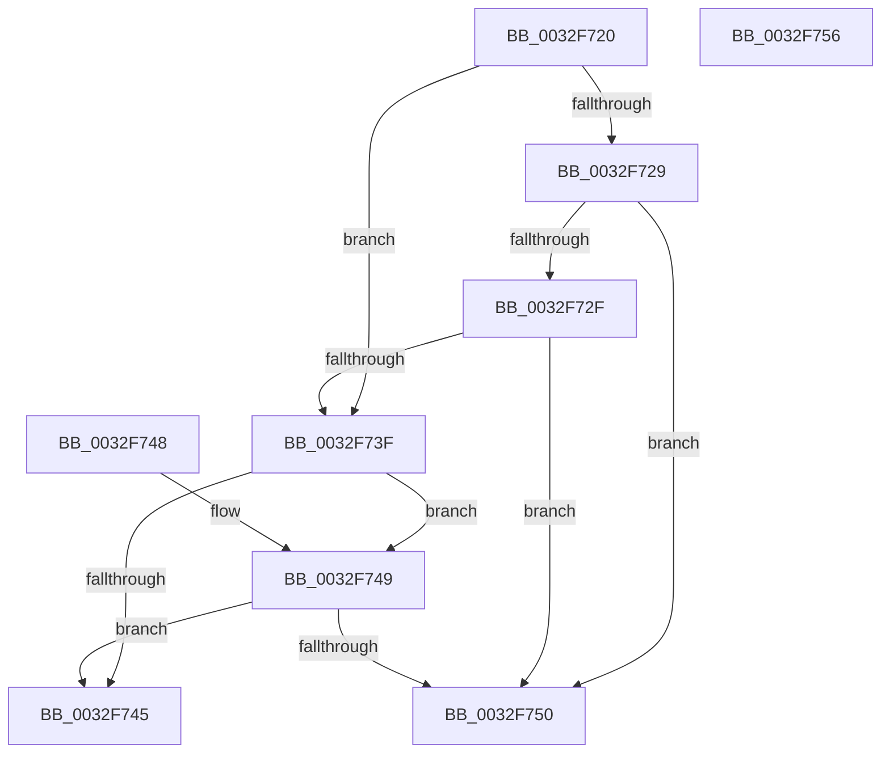

# MiIsVadLargePrivate

- RVA: `0x0032F720`–`0x0032F757` (길이 `55` bytes)
- VA: `0x000000014032F720`
- 실행 섹션: `.text`
- PDB 이름 있음: `예`; PDB Function 태그: `아니요`
- unwind 정보 RVA: `0x000DB714`
- 디코드: `21`개 명령, `55/55` bytes 표시
- 미해석 바이트: `0` (있으면 어셈블리에 `.byte`로 보존)

> 이 문서는 커널 이미지의 기계어와 PDB 기호를 분석해 생성했습니다. 4번과 5번은 함수 원형과 자료형을 바이너리 사용 방식에서 추정한 C 해석이며 원본 소스 복구 결과는 아닙니다.

## 1. Dependencies

- 직접 호출 지점: **0**; 고유 호출 대상: **0**
- 직접 호출자로 확인된 함수: **14**
- RIP 상대 이미지 참조: **0**

### Outgoing calls
- 직접 디코드된 call 명령이 없습니다.

### Direct callers
- [MiCloneVads](../22/MiCloneVads_function_0022DC1C.md) at `0x0022DE9F`
- [MiBuildForkPte](../22/MiBuildForkPte_function_0022E32C.md) at `0x0022E957`
- [MiBuildForkPte](../22/MiBuildForkPte_function_0022E32C.md) at `0x0022ECA5`
- [MiInsertVad](../26/MiInsertVad_function_00265540.md) at `0x002655C3`
- [MiRemoveVad](../29/MiRemoveVad_function_00295C78.md) at `0x00295E4E`
- [sub_0032D782](Unknown_function_0032D782.md) at `0x0032DCBD`
- [sub_0032E327](Unknown_function_0032E327.md) at `0x0032E42B`
- [MiCheckVirtualAddress](MiCheckVirtualAddress_function_0032E4F0.md) at `0x0032E826`
- [MiCheckUserVirtualAddress](../48/MiCheckUserVirtualAddress_function_00488834.md) at `0x0048899B`
- [MiPrefetchJumpVad](../4D/MiPrefetchJumpVad_function_004D7A28.md) at `0x004D7A87`
- [MiScrubProcessLargePage](../../page/80/MiScrubProcessLargePage_function_0080EE70.md) at `0x0080EF4A`
- [MiDeletePartialCloneVads](../../page/81/MiDeletePartialCloneVads_function_008116E4.md) at `0x00811726`
- [MiDeleteVad](../../page/88/MiDeleteVad_function_00888C80.md) at `0x00888D10`
- [MiDeleteVad](../../page/88/MiDeleteVad_function_00888C80.md) at `0x00888DAD`
- [MiAllocateChildVads](../../page/97/MiAllocateChildVads_function_0097E380.md) at `0x0097E530`
- [MiMapChildLargePageVads](../../page/AC/MiMapChildLargePageVads_function_00ACDE80.md) at `0x00ACDEF8`

### Static image references
- 디코드된 RIP-relative 메모리 참조가 없습니다.

## 2. Other-region calls and transfers

- 다른 실행 섹션으로 향하는 call: **0**
- 별도 외부 분기/꼬리 이동을 확인하지 못했습니다.

## 3. Assembly (complete function range)

```asm
0032F720  8B 41 30                        mov eax, dword ptr [rcx + 0x30]
0032F723  0F BA E0 15                     bt eax, 0x15
0032F727  73 16                           jae 0x14032f73f
0032F729  0F BA E0 17                     bt eax, 0x17
0032F72D  72 21                           jb 0x14032f750
0032F72F  8B D0                           mov edx, eax
0032F731  81 E2 00 00 18 00               and edx, 0x180000
0032F737  81 FA 00 00 10 00               cmp edx, 0x100000
0032F73D  73 11                           jae 0x14032f750
0032F73F  24 70                           and al, 0x70
0032F741  3C 20                           cmp al, 0x20
0032F743  74 04                           je 0x14032f749
0032F745  33 C0                           xor eax, eax
0032F747  C3                              ret
0032F748  CC                              int3
0032F749  8B 41 40                        mov eax, dword ptr [rcx + 0x40]
0032F74C  A8 01                           test al, 1
0032F74E  74 F5                           je 0x14032f745
0032F750  B8 01 00 00 00                  mov eax, 1
0032F755  C3                              ret
0032F756  CC                              int3
```

## 4. C-style interpretation (structured pseudocode)

```c
__int64 __fastcall MiIsVadLargePrivate(__int64 a1)
{
    __int64 result;

    if (condition_is_above_or_equal) goto loc_0032F73F;
    if (condition_is_below) goto loc_0032F750;
    a2 = (unsigned int)(((unsigned int)((unsigned int)((unsigned int)(*(unsigned int *)(a1 + 48))))) & (0x180000ULL));
    if (((unsigned int)(a2)) >= 0x100000ULL) goto loc_0032F750;
loc_0032F73F:
    result = (unsigned __int8)(((unsigned int)(*(unsigned int *)(a1 + 48))) & (112));
    if (((unsigned __int8)(result)) == 32) goto loc_0032F749;
loc_0032F745:
    result = 0;
    return result;
loc_0032F749:
    if ((((unsigned __int8)((unsigned int)(*(unsigned int *)(a1 + 64)))) & (1)) == 0) goto loc_0032F745;
loc_0032F750:
    return 1;
}
```

## 5. (Beta) C Style

```c
int64_t MiIsVadLargePrivate(void *Arg1)
{
    uint8_t *arg1 = (uint8_t *)Arg1;

    int64_t result;

    if (condition_is_above_or_equal) goto loc_0032F73F;
    if (condition_is_below) goto loc_0032F750;
    a2 = (uint32_t)(((uint32_t)((uint32_t)((uint32_t)(*(uint32_t *)(arg1 + 0x30))))) & (0x180000ULL));
    if (((uint32_t)(a2)) >= 0x100000ULL) goto loc_0032F750;
loc_0032F73F:
    result = (uint8_t)(((uint32_t)(*(uint32_t *)(arg1 + 0x30))) & (112));
    if (((uint8_t)(result)) == 32) goto loc_0032F749;
loc_0032F745:
    result = 0;
    return result;
loc_0032F749:
    if ((((uint8_t)((uint32_t)(*(uint32_t *)(arg1 + 0x40)))) & (1)) == 0) goto loc_0032F745;
loc_0032F750:
    return 1;
}
```

### 관측된 메모리 오프셋

구조체 형식이 확인되지 않은 접근은 인자 기준의 오프셋으로만 기록했습니다.

| 기준 인자 | 오프셋 표현 | 폭 (bit) | 접근 |
|---|---:|---:|---|
| `Arg1` | `+ 0x30` | `32` | `R` |
| `Arg1` | `+ 0x40` | `32` | `R` |

## 6. Execution-region graph

[열기: 2D/3D 그래프와 함수 탐색 컨트롤 패널](../../../control-panel.html?section=text&rva=0x0032F720&view=graph)

- 2D 그래프는 위에서 아래로 흐르고, 3D 그래프는 빈 공간을 드래그해 회전합니다. Shift+드래그는 이동, 휠은 확대·축소, 함수 노드 선택은 대상 보고서 이동입니다.

### Static fallback


