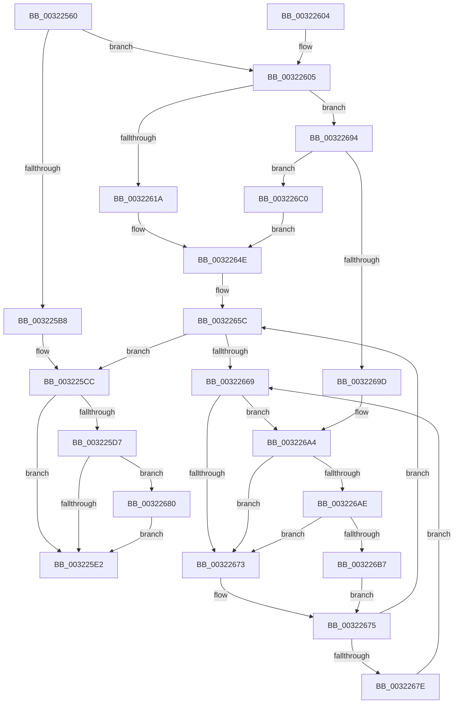

# MiLockOwnedProtoPage

- RVA: `0x00322560`–`0x003226DC` (길이 `380` bytes)
- VA: `0x0000000140322560`
- 실행 섹션: `.text`
- PDB 이름 있음: `예`; PDB Function 태그: `아니요`
- unwind 정보 RVA: `0x000757B8`
- 디코드: `101`개 명령, `380/380` bytes 표시
- 미해석 바이트: `0` (있으면 어셈블리에 `.byte`로 보존)

> 이 문서는 커널 이미지의 기계어와 PDB 기호를 분석해 생성했습니다. 4번과 5번은 함수 원형과 자료형을 바이너리 사용 방식에서 추정한 C 해석이며 원본 소스 복구 결과는 아닙니다.

## 1. Dependencies

- 직접 호출 지점: **6**; 고유 호출 대상: **6**
- 직접 호출자로 확인된 함수: **4**
- RIP 상대 이미지 참조: **2**

### Outgoing calls
- `0x00322592` → [memset](../6C/memset_function_006C6C40.md) (function, `0x006C6C40`)
- `0x00322610` → [MiGetLeafPfnBuddy](../43/MiGetLeafPfnBuddy_function_00438E30.md) (function, `0x00438E30`)
- `0x00322657` → [MiSpinForProtoPoolLock](../43/MiSpinForProtoPoolLock_function_00434540.md) (function, `0x00434540`)
- `0x0032268A` → [MiWriteValidPteVolatile](../29/MiWriteValidPteVolatile_function_00292B60.md) (function, `0x00292B60`)
- `0x003226AE` → [KiCheckVpBackingLongSpinWaitHypercall](../30/KiCheckVpBackingLongSpinWaitHypercall_function_0030F490.md) (function, `0x0030F490`)
- `0x003226B9` → [HvlNotifyLongSpinWait](../30/HvlNotifyLongSpinWait_function_0030F460.md) (function, `0x0030F460`)

### Direct callers
- [MiRelockProtoPoolPage](../31/MiRelockProtoPoolPage_function_0031826C.md) at `0x003182B6`
- [MiCheckProtoPtePageState](../31/MiCheckProtoPtePageState_function_003183E0.md) at `0x003184F7`
- [MiLockProtoPoolPageForce](MiLockProtoPoolPageForce_function_00320E10.md) at `0x00320FE2`
- [MiResolveProtoPteFault](MiResolveProtoPteFault_function_00321750.md) at `0x00321939`

### Static image references
- `0x0032266B` → RVA `0x00FC52AC` (`ALMOSTRO`; reference)
- `0x003226A4` → RVA `0x00FC6AB8` (`ALMOSTRO`; read)

## 2. Other-region calls and transfers

- 다른 실행 섹션으로 향하는 call: **0**
- 별도 외부 분기/꼬리 이동을 확인하지 못했습니다.

## 3. Assembly (complete function range)

```asm
00322560  48 89 5C 24 08                  mov qword ptr [rsp + 8], rbx
00322565  48 89 74 24 10                  mov qword ptr [rsp + 0x10], rsi
0032256A  48 89 7C 24 18                  mov qword ptr [rsp + 0x18], rdi
0032256F  4C 89 74 24 20                  mov qword ptr [rsp + 0x20], r14
00322574  55                              push rbp
00322575  48 81 EC E0 00 00 00            sub rsp, 0xe0
0032257C  48 8D 6C 24 60                  lea rbp, [rsp + 0x60]
00322581  48 83 E5 C0                     and rbp, 0xffffffffffffffc0
00322585  33 D2                           xor edx, edx
00322587  48 8B D9                        mov rbx, rcx
0032258A  48 8D 4D 40                     lea rcx, [rbp + 0x40]
0032258E  44 8D 42 40                     lea r8d, [rdx + 0x40]
00322592  E8 A9 46 3A 00                  call 0x1406c6c40
00322597  48 8B 7B 08                     mov rdi, qword ptr [rbx + 8]
0032259B  48 B8 00 00 00 00 00 00 00 80   movabs rax, 0x8000000000000000
003225A5  48 0B F8                        or rdi, rax
003225A8  49 BE FF FF FF FF FF FF FF 7F   movabs r14, 0x7fffffffffffffff
003225B2  F6 43 22 20                     test byte ptr [rbx + 0x22], 0x20
003225B6  75 4D                           jne 0x140322605
003225B8  8B 43 20                        mov eax, dword ptr [rbx + 0x20]
003225BB  89 45 00                        mov dword ptr [rbp], eax
003225BE  C1 E8 10                        shr eax, 0x10
003225C1  0C 20                           or al, 0x20
003225C3  88 45 02                        mov byte ptr [rbp + 2], al
003225C6  8B 45 00                        mov eax, dword ptr [rbp]
003225C9  89 43 20                        mov dword ptr [rbx + 0x20], eax
003225CC  48 8B 43 18                     mov rax, qword ptr [rbx + 0x18]
003225D0  48 0F BA E0 3E                  bt rax, 0x3e
003225D5  72 0B                           jb 0x1403225e2
003225D7  48 8B 07                        mov rax, qword ptr [rdi]
003225DA  A8 20                           test al, 0x20
003225DC  0F 84 9E 00 00 00               je 0x140322680
003225E2  F0 4C 21 73 18                  lock and qword ptr [rbx + 0x18], r14
003225E7  4C 8D 9C 24 E0 00 00 00         lea r11, [rsp + 0xe0]
003225EF  49 8B 5B 10                     mov rbx, qword ptr [r11 + 0x10]
003225F3  49 8B 73 18                     mov rsi, qword ptr [r11 + 0x18]
003225F7  49 8B 7B 20                     mov rdi, qword ptr [r11 + 0x20]
003225FB  4D 8B 73 28                     mov r14, qword ptr [r11 + 0x28]
003225FF  49 8B E3                        mov rsp, r11
00322602  5D                              pop rbp
00322603  C3                              ret
00322604  CC                              int3
00322605  33 F6                           xor esi, esi
00322607  48 8B CB                        mov rcx, rbx
0032260A  89 75 50                        mov dword ptr [rbp + 0x50], esi
0032260D  8D 56 01                        lea edx, [rsi + 1]
00322610  E8 1B 68 11 00                  call 0x140438e30
00322615  48 85 C0                        test rax, rax
00322618  75 7A                           jne 0x140322694
0032261A  48 8D 45 40                     lea rax, [rbp + 0x40]
0032261E  48 89 45 48                     mov qword ptr [rbp + 0x48], rax
00322622  48 8D 55 40                     lea rdx, [rbp + 0x40]
00322626  48 8D 45 40                     lea rax, [rbp + 0x40]
0032262A  48 C1 EA 03                     shr rdx, 3
0032262E  48 89 45 40                     mov qword ptr [rbp + 0x40], rax
00322632  48 8B CA                        mov rcx, rdx
00322635  48 8B 03                        mov rax, qword ptr [rbx]
00322638  48 33 C8                        xor rcx, rax
0032263B  48 B8 01 00 00 00 00 F0 FF FF   movabs rax, 0xfffff00000000001
00322645  48 23 C8                        and rcx, rax
00322648  48 33 CA                        xor rcx, rdx
0032264B  48 89 0B                        mov qword ptr [rbx], rcx
0032264E  F0 4C 21 73 18                  lock and qword ptr [rbx + 0x18], r14
00322653  48 8D 4D 40                     lea rcx, [rbp + 0x40]
00322657  E8 E4 1E 11 00                  call 0x140434540
0032265C  F0 48 0F BA 6B 18 3F            lock bts qword ptr [rbx + 0x18], 0x3f
00322663  0F 83 63 FF FF FF               jae 0x1403225cc
00322669  FF C6                           inc esi
0032266B  85 35 3B 2C CA 00               test dword ptr [rip + 0xca2c3b], esi
00322671  74 31                           je 0x1403226a4
00322673  F3 90                           pause
00322675  48 8B 43 18                     mov rax, qword ptr [rbx + 0x18]
00322679  48 85 C0                        test rax, rax
0032267C  79 DE                           jns 0x14032265c
0032267E  EB E9                           jmp 0x140322669
00322680  45 33 C0                        xor r8d, r8d
00322683  48 8B CF                        mov rcx, rdi
00322686  41 8D 50 01                     lea edx, [r8 + 1]
0032268A  E8 D1 04 F7 FF                  call 0x140292b60
0032268F  E9 4E FF FF FF                  jmp 0x1403225e2
00322694  48 8B 48 08                     mov rcx, qword ptr [rax + 8]
00322698  48 39 01                        cmp qword ptr [rcx], rax
0032269B  74 23                           je 0x1403226c0
0032269D  B9 03 00 00 00                  mov ecx, 3
003226A2  CD 29                           int 0x29
003226A4  8B 05 0E 44 CA 00               mov eax, dword ptr [rip + 0xca440e]
003226AA  A8 40                           test al, 0x40
003226AC  74 C5                           je 0x140322673
003226AE  E8 DD CD FE FF                  call 0x14030f490
003226B3  84 C0                           test al, al
003226B5  74 BC                           je 0x140322673
003226B7  8B CE                           mov ecx, esi
003226B9  E8 A2 CD FE FF                  call 0x14030f460
003226BE  EB B5                           jmp 0x140322675
003226C0  48 89 4D 48                     mov qword ptr [rbp + 0x48], rcx
003226C4  48 8D 55 40                     lea rdx, [rbp + 0x40]
003226C8  48 89 45 40                     mov qword ptr [rbp + 0x40], rax
003226CC  48 89 11                        mov qword ptr [rcx], rdx
003226CF  48 8D 4D 40                     lea rcx, [rbp + 0x40]
003226D3  48 89 48 08                     mov qword ptr [rax + 8], rcx
003226D7  E9 72 FF FF FF                  jmp 0x14032264e
```

## 4. C-style interpretation (structured pseudocode)

```c
__int64 __fastcall MiLockOwnedProtoPage(__int64 a1, int a2)
{
    __int64 result;
    __int64 v_rbp;
    __int64 v_rdi;
    __int64 v_rsi;
    __int64 v_rsp;
    unsigned int v_stack_m38;
    unsigned __int64 v_stack_m40;
    unsigned __int64 v_stack_m48;
    unsigned __int64 v_stack_m8;
    unsigned __int8 v_stack_m86;
    unsigned __int64 v_stack_m88;
    unsigned __int64 v_stack_p10;
    unsigned __int64 v_stack_p18;
    unsigned __int64 v_stack_p20;
    unsigned __int64 v_stack_p8;

    v_stack_p8 = v_rbx;
    v_stack_p10 = v_rsi;
    v_stack_p18 = v_rdi;
    v_stack_p20 = v_r14;
    v_rsp = (v_rsp) - (224);
    v_rbp = (v_stack_m88) & (-64);
    a2 = 0;
    result = memset(v_stack_m48, a2, a2 + 64, a4);
    v_rdi = (*(unsigned __int64 *)(a1 + 8)) | (result);
    if (((*(unsigned __int8 *)(a1 + 34)) & (32)) != 0) goto loc_00322605;
    v_stack_m88 = (unsigned int)((unsigned int)(*(unsigned int *)(a1 + 32)));
    result = (unsigned int)(((unsigned int)(*(unsigned int *)(a1 + 32))) >> (16));
    result = (unsigned __int8)((result) | (32));
    v_stack_m86 = (unsigned __int8)(result);
    *(unsigned int *)(a1 + 32) = (unsigned int)((unsigned int)(v_stack_m88));
loc_003225CC:
    if (condition_is_below) goto loc_003225E2;
    if ((((unsigned __int8)(*(unsigned __int64 *)(v_rdi))) & (32)) == 0) goto loc_00322680;
loc_003225E2:
    return *(unsigned __int64 *)(v_rdi);
loc_00322605:
    v_rsi = 0;
    v_stack_m38 = 0;
    result = MiGetLeafPfnBuddy(*(unsigned __int64 *)(v_stack_m8 + 16), v_rsi + 1, a2 + 64, a4);
    if (result != 0) goto loc_00322694;
    v_stack_m40 = v_stack_m48;
    a2 = (v_stack_m48) >> (3);
    v_stack_m48 = v_stack_m48;
    a1 = (a2) ^ (*(unsigned __int64 *)(*(unsigned __int64 *)(v_stack_m8 + 16)));
    a1 = (a1) & (*(unsigned __int64 *)(*(unsigned __int64 *)(v_stack_m8 + 16)));
    a1 = (a1) ^ (a2);
    *(unsigned __int64 *)(*(unsigned __int64 *)(v_stack_m8 + 16)) = a1;
loc_0032264E:
    result = MiSpinForProtoPoolLock(v_stack_m48, a2, a2 + 64, a4);
loc_0032265C:
    if (condition_is_above_or_equal) goto loc_003225CC;
loc_00322669:
    v_rsi = (unsigned int)((v_rsi) + 1);
    if (((*(unsigned int *)(v_rip + 13249595)) & ((unsigned int)(v_rsi))) == 0) goto loc_003226A4;
loc_00322673:
loc_00322675:
    if (!sign_flag) goto loc_0032265C;
    goto loc_00322669;
loc_00322680:
    a3 = 0;
    result = MiWriteValidPteVolatile(*(unsigned __int64 *)(v_stack_m8 + 32), a3 + 1, a3, a4);
    goto loc_003225E2;
loc_00322694:
    if ((*(unsigned __int64 *)(*(unsigned __int64 *)(result + 8))) == result) goto loc_003226C0;
loc_003226A4:
    if ((((unsigned __int8)((unsigned int)(*(unsigned int *)(v_rip + 13255694)))) & (64)) == 0) goto loc_00322673;
    result = KiCheckVpBackingLongSpinWaitHypercall(3, a3 + 1, a3, a4);
    if ((unsigned __int8)(result) == 0) goto loc_00322673;
    result = HvlNotifyLongSpinWait((unsigned int)((unsigned int)(v_rsi)), a3 + 1, a3, a4);
    goto loc_00322675;
loc_003226C0:
    v_stack_m40 = (unsigned int)((unsigned int)(v_rsi));
    v_stack_m48 = result;
    *(unsigned __int64 *)((unsigned int)((unsigned int)(v_rsi))) = v_stack_m48;
    *(unsigned __int64 *)(result + 8) = v_stack_m48;
    goto loc_0032264E;
}
```

## 5. (Beta) C Style

```c
int64_t MiLockOwnedProtoPage(void *Arg1, int32_t Arg2)
{
    uint8_t *arg1 = (uint8_t *)Arg1;

    int64_t result;
    int64_t local_rbp;
    int64_t local_rdi;
    int64_t local_rsi;
    int64_t local_rsp;
    uint32_t v_stack_m38;
    uint64_t v_stack_m40;
    uint64_t v_stack_m48;
    uint64_t v_stack_m8;
    uint8_t v_stack_m86;
    uint64_t v_stack_m88;
    uint64_t v_stack_p10;
    uint64_t v_stack_p18;
    uint64_t v_stack_p20;
    uint64_t v_stack_p8;

    v_stack_p8 = local_rbx;
    v_stack_p10 = local_rsi;
    v_stack_p18 = local_rdi;
    v_stack_p20 = local_r14;
    local_rsp = (local_rsp) - (224);
    local_rbp = (v_stack_m88) & (-64);
    Arg2 = 0;
    result = memset(v_stack_m48, Arg2, Arg2 + 64, a4);
    local_rdi = (*(uint64_t *)(arg1 + 0x8)) | (result);
    if (((*(uint8_t *)(arg1 + 0x22)) & (32)) != 0) goto loc_00322605;
    v_stack_m88 = (uint32_t)((uint32_t)(*(uint32_t *)(arg1 + 0x20)));
    result = (uint32_t)(((uint32_t)(*(uint32_t *)(arg1 + 0x20))) >> (16));
    result = (uint8_t)((result) | (32));
    v_stack_m86 = (uint8_t)(result);
    *(uint32_t *)(arg1 + 0x20) = (uint32_t)((uint32_t)(v_stack_m88));
loc_003225CC:
    if (condition_is_below) goto loc_003225E2;
    if ((((uint8_t)(*(uint64_t *)(local_rdi))) & (32)) == 0) goto loc_00322680;
loc_003225E2:
    return *(uint64_t *)(local_rdi);
loc_00322605:
    local_rsi = 0;
    v_stack_m38 = 0;
    result = MiGetLeafPfnBuddy(*(uint64_t *)(v_stack_m8 + 0x10), local_rsi + 1, Arg2 + 64, a4);
    if (result != 0) goto loc_00322694;
    v_stack_m40 = v_stack_m48;
    Arg2 = (v_stack_m48) >> (3);
    v_stack_m48 = v_stack_m48;
    Arg1 = (Arg2) ^ (*(uint64_t *)(*(uint64_t *)(v_stack_m8 + 0x10)));
    Arg1 = (Arg1) & (*(uint64_t *)(*(uint64_t *)(v_stack_m8 + 0x10)));
    Arg1 = (Arg1) ^ (Arg2);
    *(void **)(*(uint64_t *)(v_stack_m8 + 0x10)) = Arg1;
loc_0032264E:
    result = MiSpinForProtoPoolLock(v_stack_m48, Arg2, Arg2 + 64, a4);
loc_0032265C:
    if (condition_is_above_or_equal) goto loc_003225CC;
loc_00322669:
    local_rsi = (uint32_t)((local_rsi) + 1);
    if (((*(uint32_t *)(v_rip + 0xCA2C3B)) & ((uint32_t)(local_rsi))) == 0) goto loc_003226A4;
loc_00322673:
loc_00322675:
    if (!sign_flag) goto loc_0032265C;
    goto loc_00322669;
loc_00322680:
    a3 = 0;
    result = MiWriteValidPteVolatile(*(uint64_t *)(v_stack_m8 + 0x20), a3 + 1, a3, a4);
    goto loc_003225E2;
loc_00322694:
    if ((*(uint64_t *)(*(uint64_t *)(result + 0x8))) == result) goto loc_003226C0;
loc_003226A4:
    if ((((uint8_t)((uint32_t)(*(uint32_t *)(v_rip + 0xCA440E)))) & (64)) == 0) goto loc_00322673;
    result = KiCheckVpBackingLongSpinWaitHypercall(3, a3 + 1, a3, a4);
    if ((uint8_t)(result) == 0) goto loc_00322673;
    result = HvlNotifyLongSpinWait((uint32_t)((uint32_t)(local_rsi)), a3 + 1, a3, a4);
    goto loc_00322675;
loc_003226C0:
    v_stack_m40 = (uint32_t)((uint32_t)(local_rsi));
    v_stack_m48 = result;
    *(uint64_t *)((uint32_t)((uint32_t)(local_rsi))) = v_stack_m48;
    *(uint64_t *)(result + 0x8) = v_stack_m48;
    goto loc_0032264E;
}
```

### 관측된 메모리 오프셋

구조체 형식이 확인되지 않은 접근은 인자 기준의 오프셋으로만 기록했습니다.

| 기준 인자 | 오프셋 표현 | 폭 (bit) | 접근 |
|---|---:|---:|---|
| `Arg1` | `+ 0x0` | `64` | `R` |
| `Arg1` | `+ 0x0` | `64` | `W` |
| `Arg1` | `+ 0x8` | `64` | `R` |
| `Arg1` | `+ 0x18` | `64` | `R` |
| `Arg1` | `+ 0x18` | `64` | `R/W` |
| `Arg1` | `+ 0x20` | `32` | `R` |
| `Arg1` | `+ 0x20` | `32` | `W` |
| `Arg1` | `+ 0x22` | `8` | `R` |

## 6. Execution-region graph

[열기: 2D/3D 그래프와 함수 탐색 컨트롤 패널](../../../control-panel.html?section=text&rva=0x00322560&view=graph)

- 2D 그래프는 위에서 아래로 흐르고, 3D 그래프는 빈 공간을 드래그해 회전합니다. Shift+드래그는 이동, 휠은 확대·축소, 함수 노드 선택은 대상 보고서 이동입니다.

### Static fallback


