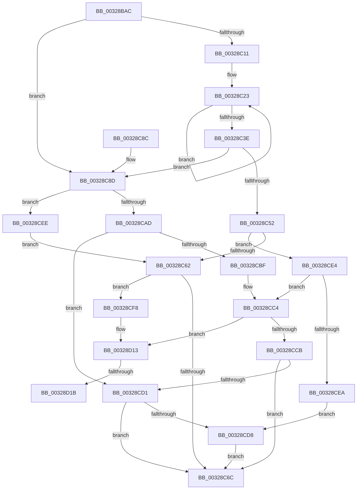

# MiLockPoolCommitPageTable

- RVA: `0x00328BAC`–`0x00328D36` (길이 `394` bytes)
- VA: `0x0000000140328BAC`
- 실행 섹션: `.text`
- PDB 이름 있음: `예`; PDB Function 태그: `예`
- unwind 정보 RVA: `0x00075F50`
- 디코드: `113`개 명령, `394/394` bytes 표시
- 미해석 바이트: `0` (있으면 어셈블리에 `.byte`로 보존)

> 이 문서는 커널 이미지의 기계어와 PDB 기호를 분석해 생성했습니다. 4번과 5번은 함수 원형과 자료형을 바이너리 사용 방식에서 추정한 C 해석이며 원본 소스 복구 결과는 아닙니다.

## 1. Dependencies

- 직접 호출 지점: **5**; 고유 호출 대상: **4**
- 직접 호출자로 확인된 함수: **2**
- RIP 상대 이미지 참조: **0**

### Outgoing calls
- `0x00328BFB` → [MiFastLockLeafPageTable](../27/MiFastLockLeafPageTable_function_00276340.md) (function, `0x00276340`)
- `0x00328C9B` → [MiLockLowestValidPageTableEx](../28/MiLockLowestValidPageTableEx_function_00280D10.md) (function, `0x00280D10`)
- `0x00328CDB` → [MiUnlockPageTable](../21/MiUnlockPageTable_function_00216EC0.md) (function, `0x00216EC0`)
- `0x00328D0D` → [KeBugCheckEx](../4F/KeBugCheckEx_function_004FD660.md) (function, `0x004FD660`)
- `0x00328D30` → [KeBugCheckEx](../4F/KeBugCheckEx_function_004FD660.md) (function, `0x004FD660`)

### Direct callers
- [MiCommitPoolMemory](MiCommitPoolMemory_function_00329520.md) at `0x003296AF`
- [sub_0034512B](../34/Unknown_function_0034512B.md) at `0x00345138`

### Static image references
- 디코드된 RIP-relative 메모리 참조가 없습니다.

## 2. Other-region calls and transfers

- 다른 실행 섹션으로 향하는 call: **0**
- call이 아닌 외부 분기/꼬리 이동: **1**
  - `0x00328D15` → [sub_006E1E26](../6E/Unknown_function_006E1E26.md) (`tail-transfer`)

## 3. Assembly (complete function range)

```asm
00328BAC  48 8B C4                        mov rax, rsp
00328BAF  48 89 58 10                     mov qword ptr [rax + 0x10], rbx
00328BB3  48 89 68 18                     mov qword ptr [rax + 0x18], rbp
00328BB7  48 89 70 20                     mov qword ptr [rax + 0x20], rsi
00328BBB  57                              push rdi
00328BBC  41 54                           push r12
00328BBE  41 57                           push r15
00328BC0  48 83 EC 50                     sub rsp, 0x50
00328BC4  48 83 60 08 00                  and qword ptr [rax + 8], 0
00328BC9  48 8B FA                        mov rdi, rdx
00328BCC  48 C1 E7 19                     shl rdi, 0x19
00328BD0  48 8B DA                        mov rbx, rdx
00328BD3  48 8B F1                        mov rsi, rcx
00328BD6  49 BF 00 00 00 00 80 F6 FF FF   movabs r15, 0xfffff68000000000
00328BE0  49 8B C7                        mov rax, r15
00328BE3  48 8B 69 48                     mov rbp, qword ptr [rcx + 0x48]
00328BE7  45 33 C0                        xor r8d, r8d
00328BEA  48 C1 E0 19                     shl rax, 0x19
00328BEE  48 8B CD                        mov rcx, rbp
00328BF1  48 2B F8                        sub rdi, rax
00328BF4  48 C1 FF 10                     sar rdi, 0x10
00328BF8  48 8B D7                        mov rdx, rdi
00328BFB  E8 40 D7 F4 FF                  call 0x140276340
00328C00  4C 63 C0                        movsxd r8, eax
00328C03  49 BC F8 FF FF FF 7F 00 00 00   movabs r12, 0x7ffffffff8
00328C0D  85 C0                           test eax, eax
00328C0F  74 7C                           je 0x140328c8d
00328C11  0F 57 C0                        xorps xmm0, xmm0
00328C14  48 8B CF                        mov rcx, rdi
00328C17  0F 11 44 24 30                  movups xmmword ptr [rsp + 0x30], xmm0
00328C1C  33 D2                           xor edx, edx
00328C1E  0F 11 44 24 40                  movups xmmword ptr [rsp + 0x40], xmm0
00328C23  48 C1 E9 09                     shr rcx, 9
00328C27  49 23 CC                        and rcx, r12
00328C2A  49 8B C7                        mov rax, r15
00328C2D  48 03 C8                        add rcx, rax
00328C30  48 89 4C D4 30                  mov qword ptr [rsp + rdx*8 + 0x30], rcx
00328C35  48 FF C2                        inc rdx
00328C38  48 83 FA 04                     cmp rdx, 4
00328C3C  7C E5                           jl 0x140328c23
00328C3E  4A 8B 4C C4 30                  mov rcx, qword ptr [rsp + r8*8 + 0x30]
00328C43  4E 8B 4C C4 28                  mov r9, qword ptr [rsp + r8*8 + 0x28]
00328C48  4C 89 4C 24 70                  mov qword ptr [rsp + 0x70], r9
00328C4D  48 85 C9                        test rcx, rcx
00328C50  74 3B                           je 0x140328c8d
00328C52  48 8B D1                        mov rdx, rcx
00328C55  41 8B D8                        mov ebx, r8d
00328C58  41 83 F8 01                     cmp r8d, 1
00328C5C  0F 85 82 00 00 00               jne 0x140328ce4
00328C62  F6 46 64 04                     test byte ptr [rsi + 0x64], 4
00328C66  0F 85 8C 00 00 00               jne 0x140328cf8
00328C6C  4C 8D 5C 24 50                  lea r11, [rsp + 0x50]
00328C71  48 89 56 58                     mov qword ptr [rsi + 0x58], rdx
00328C75  49 8B 6B 30                     mov rbp, qword ptr [r11 + 0x30]
00328C79  8B C3                           mov eax, ebx
00328C7B  49 8B 5B 28                     mov rbx, qword ptr [r11 + 0x28]
00328C7F  49 8B 73 38                     mov rsi, qword ptr [r11 + 0x38]
00328C83  49 8B E3                        mov rsp, r11
00328C86  41 5F                           pop r15
00328C88  41 5C                           pop r12
00328C8A  5F                              pop rdi
00328C8B  C3                              ret
00328C8C  CC                              int3
00328C8D  45 33 C9                        xor r9d, r9d
00328C90  4C 8D 44 24 70                  lea r8, [rsp + 0x70]
00328C95  48 8B D3                        mov rdx, rbx
00328C98  48 8B CD                        mov rcx, rbp
00328C9B  E8 70 80 F5 FF                  call 0x140280d10
00328CA0  4C 8B 4C 24 70                  mov r9, qword ptr [rsp + 0x70]
00328CA5  48 8B D0                        mov rdx, rax
00328CA8  4C 3B CB                        cmp r9, rbx
00328CAB  74 41                           je 0x140328cee
00328CAD  48 C1 EB 09                     shr rbx, 9
00328CB1  49 23 DC                        and rbx, r12
00328CB4  49 8B C7                        mov rax, r15
00328CB7  48 03 D8                        add rbx, rax
00328CBA  4C 3B CB                        cmp r9, rbx
00328CBD  75 12                           jne 0x140328cd1
00328CBF  BB 02 00 00 00                  mov ebx, 2
00328CC4  49 8B 01                        mov rax, qword ptr [r9]
00328CC7  A8 01                           test al, 1
00328CC9  75 48                           jne 0x140328d13
00328CCB  F6 46 64 04                     test byte ptr [rsi + 0x64], 4
00328CCF  75 9B                           jne 0x140328c6c
00328CD1  33 DB                           xor ebx, ebx
00328CD3  48 85 D2                        test rdx, rdx
00328CD6  74 94                           je 0x140328c6c
00328CD8  48 8B CD                        mov rcx, rbp
00328CDB  E8 E0 E1 EE FF                  call 0x140216ec0
00328CE0  33 D2                           xor edx, edx
00328CE2  EB 88                           jmp 0x140328c6c
00328CE4  41 83 F8 02                     cmp r8d, 2
00328CE8  74 DA                           je 0x140328cc4
00328CEA  33 DB                           xor ebx, ebx
00328CEC  EB EA                           jmp 0x140328cd8
00328CEE  BB 01 00 00 00                  mov ebx, 1
00328CF3  E9 6A FF FF FF                  jmp 0x140328c62
00328CF8  48 83 64 24 20 00               and qword ptr [rsp + 0x20], 0
00328CFE  45 33 C9                        xor r9d, r9d
00328D01  4C 8B C7                        mov r8, rdi
00328D04  BA 01 53 00 00                  mov edx, 0x5301
00328D09  41 8D 49 1A                     lea ecx, [r9 + 0x1a]
00328D0D  E8 4E 49 1D 00                  call 0x1404fd660
00328D12  CC                              int3
00328D13  84 C0                           test al, al
00328D15  0F 89 0B 91 3B 00               jns 0x1406e1e26
00328D1B  48 83 64 24 20 00               and qword ptr [rsp + 0x20], 0
00328D21  45 33 C9                        xor r9d, r9d
00328D24  4C 8B C7                        mov r8, rdi
00328D27  BA 02 53 00 00                  mov edx, 0x5302
00328D2C  41 8D 49 1A                     lea ecx, [r9 + 0x1a]
00328D30  E8 2B 49 1D 00                  call 0x1404fd660
00328D35  CC                              int3
```

## 4. C-style interpretation (structured pseudocode)

```c
__int64 __fastcall MiLockPoolCommitPageTable(__int64 a1, __int64 a2, int a3)
{
    __int64 result;
    __int64 v_rbx;
    __int64 v_rdi;
    __int64 v_rsp;
    unsigned __int64 v_stack_m18;
    unsigned __int64 v_stack_m28;
    unsigned __int64 v_stack_m30;
    unsigned __int64 v_stack_m38;
    unsigned __int64 v_stack_p20;
    unsigned __int64 v_stack_p8;

    *(unsigned __int64 *)(v_rsp + 16) = v_rbx;
    *(unsigned __int64 *)(v_rsp + 24) = v_rbp;
    *(unsigned __int64 *)(v_rsp + 32) = v_rsi;
    v_rsp = (v_rsp) - (80);
    v_rdi = (a2) << (25);
    a3 = 0;
    result = (v_r15) << (25);
    v_rdi = (v_rdi) - (result);
    v_rdi = (v_rdi) >> (16);
    result = MiFastLockLeafPageTable(*(unsigned __int64 *)(a1 + 72), v_rdi, a3, a4);
    if ((unsigned int)(result) == 0) goto loc_00328C8D;
    v_stack_m38 = v_xmm0;
    a2 = 0;
    v_stack_m28 = v_xmm0;
loc_00328C23:
    a1 = (v_rdi) >> (9);
    a1 = (a1) & (v_r12);
    a1 = (a1) + (v_r15);
    *(unsigned __int64 *)(v_rsp + a2 * 8 + 48) = a1;
    a2 = (a2) + 1;
    if (a2 < 4) goto loc_00328C23;
    v_stack_p8 = *(unsigned __int64 *)(v_rsp + (int)((unsigned int)(result)) * 8 + 40);
    if (*(unsigned __int64 *)(v_rsp + (int)((unsigned int)(result)) * 8 + 48) == 0) goto loc_00328C8D;
    if (((unsigned int)((int)((unsigned int)(result)))) != 1) goto loc_00328CE4;
loc_00328C62:
    if (((*(unsigned __int8 *)(a1 + 100)) & (4)) != 0) goto loc_00328CF8;
loc_00328C6C:
    *(unsigned __int64 *)(a1 + 88) = *(unsigned __int64 *)(v_rsp + (int)((unsigned int)(result)) * 8 + 48);
    return (unsigned int)((unsigned int)((unsigned int)((unsigned int)((int)((unsigned int)(result))))));
loc_00328C8D:
    a4 = 0;
    result = MiLockLowestValidPageTableEx(*(unsigned __int64 *)(v_stack_m18 + 48), *(unsigned __int64 *)(v_stack_m18 + 40), v_stack_p20, a4);
    if (v_stack_p20 == (*(unsigned __int64 *)(v_stack_m18 + 40))) goto loc_00328CEE;
    v_rbx = (*(unsigned __int64 *)(v_stack_m18 + 40)) >> (9);
    v_rbx = (v_rbx) & (v_r12);
    v_rbx = (v_rbx) + (v_r15);
    if (v_stack_p20 != v_rbx) goto loc_00328CD1;
loc_00328CC4:
    if ((((unsigned __int8)(*(unsigned __int64 *)(v_stack_p20))) & (1)) != 0) goto loc_00328D13;
    if (((*(unsigned __int8 *)(*(unsigned __int64 *)(v_stack_m18 + 56) + 100)) & (4)) != 0) goto loc_00328C6C;
loc_00328CD1:
    v_rbx = 0;
    if (result == 0) goto loc_00328C6C;
loc_00328CD8:
    result = MiUnlockPageTable(*(unsigned __int64 *)(v_stack_m18 + 48), result, v_stack_p20, v_stack_p20);
    a2 = 0;
    goto loc_00328C6C;
loc_00328CE4:
    if (((unsigned int)(v_stack_p20)) == 2) goto loc_00328CC4;
    v_rbx = 0;
    goto loc_00328CD8;
loc_00328CEE:
    goto loc_00328C62;
loc_00328CF8:
    a4 = 0;
    result = KeBugCheckEx(a4 + 26, (unsigned int)(0x5301ULL), v_rdi, a4);
loc_00328D13:
    a4 = 0;
    result = KeBugCheckEx(a4 + 26, (unsigned int)(0x5302ULL), v_rdi, a4);
    return result;
}
```

## 5. (Beta) C Style

```c
int64_t MiLockPoolCommitPageTable(void *Arg1, int64_t Arg2, int32_t Arg3)
{
    uint8_t *arg1 = (uint8_t *)Arg1;

    int64_t result;
    int64_t local_rbx;
    int64_t local_rdi;
    int64_t local_rsp;
    uint64_t v_stack_m18;
    uint64_t v_stack_m28;
    uint64_t v_stack_m30;
    uint64_t v_stack_m38;
    uint64_t v_stack_p20;
    uint64_t v_stack_p8;

    *(uint64_t *)(local_rsp + 0x10) = local_rbx;
    *(uint64_t *)(local_rsp + 0x18) = local_rbp;
    *(uint64_t *)(local_rsp + 0x20) = local_rsi;
    local_rsp = (local_rsp) - (80);
    local_rdi = (Arg2) << (25);
    Arg3 = 0;
    result = (local_r15) << (25);
    local_rdi = (local_rdi) - (result);
    local_rdi = (local_rdi) >> (16);
    result = MiFastLockLeafPageTable(*(uint64_t *)(arg1 + 0x48), local_rdi, Arg3, a4);
    if ((uint32_t)(result) == 0) goto loc_00328C8D;
    v_stack_m38 = v_xmm0;
    Arg2 = 0;
    v_stack_m28 = v_xmm0;
loc_00328C23:
    Arg1 = (local_rdi) >> (9);
    Arg1 = (Arg1) & (local_r12);
    Arg1 = (Arg1) + (local_r15);
    *(void **)(local_rsp + Arg2 * 8 + 0x30) = Arg1;
    Arg2 = (Arg2) + 1;
    if (Arg2 < 4) goto loc_00328C23;
    v_stack_p8 = *(uint64_t *)(local_rsp + (int32_t)((uint32_t)(result)) * 8 + 0x28);
    if (*(uint64_t *)(local_rsp + (int32_t)((uint32_t)(result)) * 8 + 0x30) == 0) goto loc_00328C8D;
    if (((uint32_t)((int32_t)((uint32_t)(result)))) != 1) goto loc_00328CE4;
loc_00328C62:
    if (((*(uint8_t *)(arg1 + 0x64)) & (4)) != 0) goto loc_00328CF8;
loc_00328C6C:
    *(uint64_t *)(arg1 + 0x58) = *(uint64_t *)(local_rsp + (int32_t)((uint32_t)(result)) * 8 + 0x30);
    return (uint32_t)((uint32_t)((uint32_t)((uint32_t)((int32_t)((uint32_t)(result))))));
loc_00328C8D:
    a4 = 0;
    result = MiLockLowestValidPageTableEx(*(uint64_t *)(v_stack_m18 + 0x30), *(uint64_t *)(v_stack_m18 + 0x28), v_stack_p20, a4);
    if (v_stack_p20 == (*(uint64_t *)(v_stack_m18 + 0x28))) goto loc_00328CEE;
    local_rbx = (*(uint64_t *)(v_stack_m18 + 0x28)) >> (9);
    local_rbx = (local_rbx) & (local_r12);
    local_rbx = (local_rbx) + (local_r15);
    if (v_stack_p20 != local_rbx) goto loc_00328CD1;
loc_00328CC4:
    if ((((uint8_t)(*(uint64_t *)(v_stack_p20))) & (1)) != 0) goto loc_00328D13;
    if (((*(uint8_t *)(*(uint64_t *)(v_stack_m18 + 0x38) + 0x64)) & (4)) != 0) goto loc_00328C6C;
loc_00328CD1:
    local_rbx = 0;
    if (result == 0) goto loc_00328C6C;
loc_00328CD8:
    result = MiUnlockPageTable(*(uint64_t *)(v_stack_m18 + 0x30), result, v_stack_p20, v_stack_p20);
    Arg2 = 0;
    goto loc_00328C6C;
loc_00328CE4:
    if (((uint32_t)(v_stack_p20)) == 2) goto loc_00328CC4;
    local_rbx = 0;
    goto loc_00328CD8;
loc_00328CEE:
    goto loc_00328C62;
loc_00328CF8:
    a4 = 0;
    result = KeBugCheckEx(a4 + 26, (uint32_t)(0x5301ULL), local_rdi, a4);
loc_00328D13:
    a4 = 0;
    result = KeBugCheckEx(a4 + 26, (uint32_t)(0x5302ULL), local_rdi, a4);
    return result;
}
```

### 관측된 메모리 오프셋

구조체 형식이 확인되지 않은 접근은 인자 기준의 오프셋으로만 기록했습니다.

| 기준 인자 | 오프셋 표현 | 폭 (bit) | 접근 |
|---|---:|---:|---|
| `Arg1` | `+ 0x48` | `64` | `R` |
| `Arg1` | `+ 0x58` | `64` | `W` |
| `Arg1` | `+ 0x64` | `8` | `R` |

## 6. Execution-region graph

[열기: 2D/3D 그래프와 함수 탐색 컨트롤 패널](../../../control-panel.html?section=text&rva=0x00328BAC&view=graph)

- 2D 그래프는 위에서 아래로 흐르고, 3D 그래프는 빈 공간을 드래그해 회전합니다. Shift+드래그는 이동, 휠은 확대·축소, 함수 노드 선택은 대상 보고서 이동입니다.

### Static fallback


