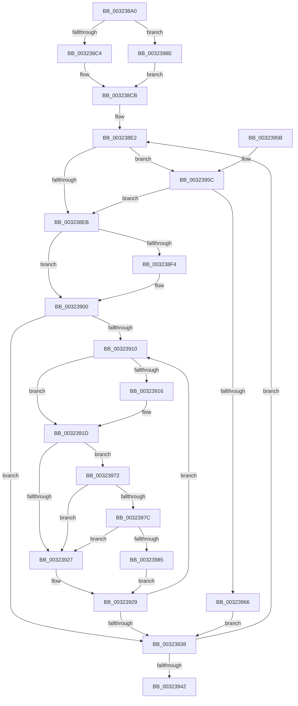

# MiLockWorkingSetExclusive

- RVA: `0x003238A0`–`0x0032399A` (길이 `250` bytes)
- VA: `0x00000001403238A0`
- 실행 섹션: `.text`
- PDB 이름 있음: `예`; PDB Function 태그: `아니요`
- unwind 정보 RVA: `0x00075924`
- 디코드: `71`개 명령, `250/250` bytes 표시
- 미해석 바이트: `0` (있으면 어셈블리에 `.byte`로 보존)

> 이 문서는 커널 이미지의 기계어와 PDB 기호를 분석해 생성했습니다. 4번과 5번은 함수 원형과 자료형을 바이너리 사용 방식에서 추정한 C 해석이며 원본 소스 복구 결과는 아닙니다.

## 1. Dependencies

- 직접 호출 지점: **5**; 고유 호출 대상: **5**
- 직접 호출자로 확인된 함수: **44**
- RIP 상대 이미지 참조: **5**

### Outgoing calls
- `0x003238D1` → [ExAcquireSpinLockExclusive](../24/ExAcquireSpinLockExclusive_function_00248690.md) (function, `0x00248690`)
- `0x003238F9` → [ExpWaitForSpinLockExclusiveAndAcquire](ExpWaitForSpinLockExclusiveAndAcquire_function_003239A0.md) (function, `0x003239A0`)
- `0x0032396B` → [ExpAcquireSpinLockExclusiveAtDpcLevelInstrumented](ExpAcquireSpinLockExclusiveAtDpcLevelInstrumented_function_00323A70.md) (function, `0x00323A70`)
- `0x0032397C` → [KiCheckVpBackingLongSpinWaitHypercall](../30/KiCheckVpBackingLongSpinWaitHypercall_function_0030F490.md) (function, `0x0030F490`)
- `0x00323987` → [HvlNotifyLongSpinWait](../30/HvlNotifyLongSpinWait_function_0030F460.md) (function, `0x0030F460`)

### Direct callers
- [MiHandleForkTransitionPte](../22/MiHandleForkTransitionPte_function_0022D34C.md) at `0x0022D9FF`
- [MiCloneVads](../22/MiCloneVads_function_0022DC1C.md) at `0x0022DD55`
- [MiCloneVads](../22/MiCloneVads_function_0022DC1C.md) at `0x0022DDBC`
- [MiCloneVads](../22/MiCloneVads_function_0022DC1C.md) at `0x0022DF57`
- [MiCloneVads](../22/MiCloneVads_function_0022DC1C.md) at `0x0022E18D`
- [MiBuildForkPte](../22/MiBuildForkPte_function_0022E32C.md) at `0x0022EBDC`
- [MiDeleteVaDirect](../27/MiDeleteVaDirect_function_00277560.md) at `0x002787BD`
- [MiDeleteVaDirect](../27/MiDeleteVaDirect_function_00277560.md) at `0x002787ED`
- [MiWalkPageTablesRecursively](../27/MiWalkPageTablesRecursively_function_002796C0.md) at `0x0027A748`
- [MiWalkPageTablesRecursively](../27/MiWalkPageTablesRecursively_function_002796C0.md) at `0x0027B173`
- [MiMakeSystemAddressValid](../27/MiMakeSystemAddressValid_function_0027FF70.md) at `0x00280B54`
- [MiSynchronizeSystemVa](../28/MiSynchronizeSystemVa_function_0028ECB8.md) at `0x0028EE89`
- [MiRemoveFromSystemSpace](../29/MiRemoveFromSystemSpace_function_002962FC.md) at `0x002963B8`
- [MiBeginProcessClean](../2A/MiBeginProcessClean_function_002A473C.md) at `0x002A477F`
- [MiPerformVadSplitting](../2A/MiPerformVadSplitting_function_002A5A80.md) at `0x002A5BA1`
- [MiPerformVadSplitting](../2A/MiPerformVadSplitting_function_002A5A80.md) at `0x002A5D3D`
- [MiPerformVadSplitting](../2A/MiPerformVadSplitting_function_002A5A80.md) at `0x002A5DA2`
- [MiCreateCloneChain](../2A/MiCreateCloneChain_function_002A8EE0.md) at `0x002A8F21`
- [MiDeleteRotateAndStopFaults](../2A/MiDeleteRotateAndStopFaults_function_002A9540.md) at `0x002A9597`
- [MiFastTrimWorkingSet](../2A/MiFastTrimWorkingSet_function_002AD420.md) at `0x002AD855`
- [MiFastTrimWorkingSet](../2A/MiFastTrimWorkingSet_function_002AD420.md) at `0x002AD85F`
- [MiStealPage](../2B/MiStealPage_function_002B28D0.md) at `0x002B3D30`
- [MiLockStealUserVm](../2B/MiLockStealUserVm_function_002B3EDC.md) at `0x002B409F`
- [MiOutSwapWorkingSet](../2C/MiOutSwapWorkingSet_function_002C1464.md) at `0x002C14E1`
- [MiRelockFaultState](../36/MiRelockFaultState_function_0036A230.md) at `0x0036A2B6`
- [MiInsertInSystemSpace](../3B/MiInsertInSystemSpace_function_003B2F5C.md) at `0x003B3200`
- [MiMapWithLargePages](../3B/MiMapWithLargePages_function_003B6624.md) at `0x003B6806`
- [MiReleaseOutSwappedProcessCommit](../3C/MiReleaseOutSwappedProcessCommit_function_003C8320.md) at `0x003C83DA`
- [MiReleaseOutSwappedProcessCommit](../3C/MiReleaseOutSwappedProcessCommit_function_003C8320.md) at `0x003C8536`
- [MiCheckHoldFaultForHotPatch](../3D/MiCheckHoldFaultForHotPatch_function_003D4BA8.md) at `0x003D4CB0`
- [MiDeleteProcessShadow](../46/MiDeleteProcessShadow_function_00465BF8.md) at `0x00465D63`
- [MiCleanWorkingSet](../47/MiCleanWorkingSet_function_004740C4.md) at `0x004740E0`
- [MmAdjustWorkingSetSizeEx](../47/MmAdjustWorkingSetSizeEx_function_0047D8D4.md) at `0x0047D95C`
- [MmEnforceWorkingSetLimit](../48/MmEnforceWorkingSetLimit_function_004881E0.md) at `0x00488267`
- [MiWaitForRotateToComplete](../4A/MiWaitForRotateToComplete_function_004A54F4.md) at `0x004A55B4`
- [MiRotateComplete](../4B/MiRotateComplete_function_004B0588.md) at `0x004B05BB`
- [MiCloneCaptureVadCommit](../4B/MiCloneCaptureVadCommit_function_004B4554.md) at `0x004B45FF`
- [MiCloneCaptureVadCommit](../4B/MiCloneCaptureVadCommit_function_004B4554.md) at `0x004B46EB`
- [MiLockDownWorkingSet](../4D/MiLockDownWorkingSet_function_004D4950.md) at `0x004D499B`
- [MiLockWorkingSetForLargeMapping](../4E/MiLockWorkingSetForLargeMapping_function_004E3110.md) at `0x004E318C`
- [MiLockWorkingSetForLargeMapping](../4E/MiLockWorkingSetForLargeMapping_function_004E3110.md) at `0x004E31C3`
- [MiLockWorkingSetForLargeMapping](../4E/MiLockWorkingSetForLargeMapping_function_004E3110.md) at `0x004E31CA`
- [ExpShareAddressSpaceWithDevice](../65/ExpShareAddressSpaceWithDevice_function_0065B528.md) at `0x0065B986`
- [MiClearCommitReleaseState](../66/MiClearCommitReleaseState_function_0066EF4C.md) at `0x0066EF55`
- [MiReAcquireOutSwappedProcessCommit](../66/MiReAcquireOutSwappedProcessCommit_function_0066F598.md) at `0x0066F67F`
- [MiReAcquireOutSwappedProcessCommit](../66/MiReAcquireOutSwappedProcessCommit_function_0066F598.md) at `0x0066F6E8`
- [MiReleaseCommitForResetPages](../66/MiReleaseCommitForResetPages_function_0066FAF8.md) at `0x0066FBE7`
- [MmReleaseCommitForMemResetPages](../66/MmReleaseCommitForMemResetPages_function_0066FDCC.md) at `0x0066FEAA`
- [MmSetCommitReleaseEligibility](../66/MmSetCommitReleaseEligibility_function_0066FF84.md) at `0x0066FFEC`
- [MiSetTrimWhileAgingState](../67/MiSetTrimWhileAgingState_function_0067ED14.md) at `0x0067ED37`
- [MiBeginHoldingDirtyFaults](../68/MiBeginHoldingDirtyFaults_function_00682F90.md) at `0x00682FC4`
- [MiFinishHoldingDirtyFaults](../68/MiFinishHoldingDirtyFaults_function_006835F8.md) at `0x00683621`
- [sub_006D715C](../6D/Unknown_function_006D715C.md) at `0x006D71CF`
- [sub_006D7206](../6D/Unknown_function_006D7206.md) at `0x006D7240`
- [sub_006E4786](../6E/Unknown_function_006E4786.md) at `0x006E480B`
- [sub_006F79AC](../6F/Unknown_function_006F79AC.md) at `0x006F79AF`
- [sub_006F9816](../6F/Unknown_function_006F9816.md) at `0x006F983F`

### Static image references
- `0x003238C4` → RVA `0x00E38840` (`.data`; read)
- `0x003238E2` → RVA `0x00FC6B06` (`ALMOSTRO`; read)
- `0x0032391F` → RVA `0x00FC52AC` (`ALMOSTRO`; reference)
- `0x0032395C` → RVA `0x00F0DE58` (`.data`; read)
- `0x00323972` → RVA `0x00FC6AB8` (`ALMOSTRO`; read)

## 2. Other-region calls and transfers

- 다른 실행 섹션으로 향하는 call: **0**
- 별도 외부 분기/꼬리 이동을 확인하지 못했습니다.

## 3. Assembly (complete function range)

```asm
003238A0  48 89 5C 24 10                  mov qword ptr [rsp + 0x10], rbx
003238A5  48 89 6C 24 18                  mov qword ptr [rsp + 0x18], rbp
003238AA  48 89 74 24 20                  mov qword ptr [rsp + 0x20], rsi
003238AF  57                              push rdi
003238B0  48 83 EC 20                     sub rsp, 0x20
003238B4  8B 81 B8 00 00 00               mov eax, dword ptr [rcx + 0xb8]
003238BA  24 0F                           and al, 0xf
003238BC  3C 01                           cmp al, 1
003238BE  0F 85 CA 00 00 00               jne 0x14032398e
003238C4  48 8D 1D 75 4F B1 00            lea rbx, [rip + 0xb14f75]
003238CB  48 8B 1B                        mov rbx, qword ptr [rbx]
003238CE  48 8B CB                        mov rcx, rbx
003238D1  E8 BA 4D F2 FF                  call 0x140248690
003238D6  0F B6 E8                        movzx ebp, al
003238D9  48 83 C3 40                     add rbx, 0x40
003238DD  BE 03 00 00 00                  mov esi, 3
003238E2  F6 05 1D 32 CA 00 21            test byte ptr [rip + 0xca321d], 0x21
003238E9  75 71                           jne 0x14032395c
003238EB  33 FF                           xor edi, edi
003238ED  F0 0F BA 2B 1F                  lock bts dword ptr [rbx], 0x1f
003238F2  73 0C                           jae 0x140323900
003238F4  B2 FF                           mov dl, 0xff
003238F6  48 8B CB                        mov rcx, rbx
003238F9  E8 A2 00 00 00                  call 0x1403239a0
003238FE  8B F8                           mov edi, eax
00323900  8B 13                           mov edx, dword ptr [rbx]
00323902  8B CA                           mov ecx, edx
00323904  0F BA F1 1E                     btr ecx, 0x1e
00323908  81 F9 00 00 00 80               cmp ecx, 0x80000000
0032390E  74 28                           je 0x140323938
00323910  0F BA E2 1E                     bt edx, 0x1e
00323914  72 07                           jb 0x14032391d
00323916  F0 81 0B 00 00 00 40            lock or dword ptr [rbx], 0x40000000
0032391D  FF C7                           inc edi
0032391F  85 3D 87 19 CA 00               test dword ptr [rip + 0xca1987], edi
00323925  74 4B                           je 0x140323972
00323927  F3 90                           pause
00323929  8B 13                           mov edx, dword ptr [rbx]
0032392B  8B C2                           mov eax, edx
0032392D  0F BA F0 1E                     btr eax, 0x1e
00323931  3D 00 00 00 80                  cmp eax, 0x80000000
00323936  75 D8                           jne 0x140323910
00323938  48 83 C3 40                     add rbx, 0x40
0032393C  48 83 EE 01                     sub rsi, 1
00323940  75 A0                           jne 0x1403238e2
00323942  48 8B 5C 24 38                  mov rbx, qword ptr [rsp + 0x38]
00323947  40 0F B6 C5                     movzx eax, bpl
0032394B  48 8B 6C 24 40                  mov rbp, qword ptr [rsp + 0x40]
00323950  48 8B 74 24 48                  mov rsi, qword ptr [rsp + 0x48]
00323955  48 83 C4 20                     add rsp, 0x20
00323959  5F                              pop rdi
0032395A  C3                              ret
0032395B  CC                              int3
0032395C  8B 05 F6 A4 BE 00               mov eax, dword ptr [rip + 0xbea4f6]
00323962  85 C0                           test eax, eax
00323964  75 85                           jne 0x1403238eb
00323966  B2 FF                           mov dl, 0xff
00323968  48 8B CB                        mov rcx, rbx
0032396B  E8 00 01 00 00                  call 0x140323a70
00323970  EB C6                           jmp 0x140323938
00323972  8B 05 40 31 CA 00               mov eax, dword ptr [rip + 0xca3140]
00323978  A8 40                           test al, 0x40
0032397A  74 AB                           je 0x140323927
0032397C  E8 0F BB FE FF                  call 0x14030f490
00323981  84 C0                           test al, al
00323983  74 A2                           je 0x140323927
00323985  8B CF                           mov ecx, edi
00323987  E8 D4 BA FE FF                  call 0x14030f460
0032398C  EB 9B                           jmp 0x140323929
0032398E  48 8D 99 C0 00 00 00            lea rbx, [rcx + 0xc0]
00323995  E9 31 FF FF FF                  jmp 0x1403238cb
```

## 4. C-style interpretation (structured pseudocode)

```c
__int64 __fastcall MiLockWorkingSetExclusive(__int64 a1)
{
    __int64 result;
    __int64 v_rbx;
    __int64 v_rdi;
    __int64 v_rsi;
    __int64 v_rsp;
    unsigned __int64 v_stack_p10;
    unsigned __int64 v_stack_p18;
    unsigned __int64 v_stack_p20;

    v_stack_p10 = v_rbx;
    v_stack_p18 = v_rbp;
    v_stack_p20 = v_rsi;
    v_rsp = (v_rsp) - (32);
    result = (unsigned __int8)(((unsigned int)(*(unsigned int *)(a1 + 184))) & (15));
    if (((unsigned __int8)(result)) != 1) goto loc_0032398E;
loc_003238CB:
    result = ExAcquireSpinLockExclusive(*(unsigned __int64 *)(v_rip + 11620213), a2, a3, a4);
    v_rbx = (*(unsigned __int64 *)(v_rip + 11620213)) + (64);
loc_003238E2:
    if (((*(unsigned __int8 *)(v_rip + 13251101)) & (33)) != 0) goto loc_0032395C;
loc_003238EB:
    v_rdi = 0;
    if (!(condition_is_above_or_equal)) {
        a2 = 255;
        a1 = v_rbx;
        result = ExpWaitForSpinLockExclusiveAndAcquire(a1, a2, a3, a4);
        v_rdi = (unsigned int)(result);
    }
    if (((unsigned int)((unsigned int)((unsigned int)((unsigned int)(*(unsigned int *)(v_rbx)))))) == 0x80000000ULL) goto loc_00323938;
loc_00323910:
    if (((unsigned int)((unsigned int)((unsigned int)((unsigned int)(*(unsigned int *)(v_rbx)))))) >= 0x80000000ULL) {
    }
    v_rdi = (unsigned int)((v_rdi) + 1);
    if (((*(unsigned int *)(v_rip + 13244807)) & ((unsigned int)(v_rdi))) == 0) goto loc_00323972;
loc_00323927:
loc_00323929:
    if (((unsigned int)((unsigned int)((unsigned int)((unsigned int)(*(unsigned int *)(v_rbx)))))) != 0x80000000ULL) goto loc_00323910;
loc_00323938:
    v_rbx = (v_rbx) + (64);
    v_rsi = (3) - (1);
    if (condition_is_not_equal) goto loc_003238E2;
    v_rsp = (v_rsp) + (32);
    return (unsigned __int8)((unsigned __int8)(result));
loc_0032395C:
    if ((unsigned int)((unsigned int)(*(unsigned int *)(v_rip + 12494070))) != 0) goto loc_003238EB;
    result = ExpAcquireSpinLockExclusiveAtDpcLevelInstrumented(v_stack_p10, 255, a3, a4);
    goto loc_00323938;
loc_00323972:
    if ((((unsigned __int8)((unsigned int)(*(unsigned int *)(v_rip + 13250880)))) & (64)) == 0) goto loc_00323927;
    result = KiCheckVpBackingLongSpinWaitHypercall(v_stack_p10, 255, a3, a4);
    if ((unsigned __int8)(result) == 0) goto loc_00323927;
    result = HvlNotifyLongSpinWait((unsigned int)((unsigned int)(v_rdi)), 255, a3, a4);
    goto loc_00323929;
loc_0032398E:
    goto loc_003238CB;
}
```

## 5. (Beta) C Style

```c
int64_t MiLockWorkingSetExclusive(void *Arg1)
{
    uint8_t *arg1 = (uint8_t *)Arg1;

    int64_t result;
    int64_t local_rbx;
    int64_t local_rdi;
    int64_t local_rsi;
    int64_t local_rsp;
    uint64_t v_stack_p10;
    uint64_t v_stack_p18;
    uint64_t v_stack_p20;

    v_stack_p10 = local_rbx;
    v_stack_p18 = local_rbp;
    v_stack_p20 = local_rsi;
    local_rsp = (local_rsp) - (32);
    result = (uint8_t)(((uint32_t)(*(uint32_t *)(arg1 + 0xB8))) & (15));
    if (((uint8_t)(result)) != 1) goto loc_0032398E;
loc_003238CB:
    result = ExAcquireSpinLockExclusive(*(uint64_t *)(v_rip + 0xB14F75), a2, a3, a4);
    local_rbx = (*(uint64_t *)(v_rip + 0xB14F75)) + (64);
loc_003238E2:
    if (((*(uint8_t *)(v_rip + 0xCA321D)) & (33)) != 0) goto loc_0032395C;
loc_003238EB:
    local_rdi = 0;
    if (!(condition_is_above_or_equal)) {
        a2 = 255;
        Arg1 = local_rbx;
        result = ExpWaitForSpinLockExclusiveAndAcquire(Arg1, a2, a3, a4);
        local_rdi = (uint32_t)(result);
    }
    if (((uint32_t)((uint32_t)((uint32_t)((uint32_t)(*(uint32_t *)(local_rbx)))))) == 0x80000000ULL) goto loc_00323938;
loc_00323910:
    if (((uint32_t)((uint32_t)((uint32_t)((uint32_t)(*(uint32_t *)(local_rbx)))))) >= 0x80000000ULL) {
    }
    local_rdi = (uint32_t)((local_rdi) + 1);
    if (((*(uint32_t *)(v_rip + 0xCA1987)) & ((uint32_t)(local_rdi))) == 0) goto loc_00323972;
loc_00323927:
loc_00323929:
    if (((uint32_t)((uint32_t)((uint32_t)((uint32_t)(*(uint32_t *)(local_rbx)))))) != 0x80000000ULL) goto loc_00323910;
loc_00323938:
    local_rbx = (local_rbx) + (64);
    local_rsi = (3) - (1);
    if (condition_is_not_equal) goto loc_003238E2;
    local_rsp = (local_rsp) + (32);
    return (uint8_t)((uint8_t)(result));
loc_0032395C:
    if ((uint32_t)((uint32_t)(*(uint32_t *)(v_rip + 0xBEA4F6))) != 0) goto loc_003238EB;
    result = ExpAcquireSpinLockExclusiveAtDpcLevelInstrumented(v_stack_p10, 255, a3, a4);
    goto loc_00323938;
loc_00323972:
    if ((((uint8_t)((uint32_t)(*(uint32_t *)(v_rip + 0xCA3140)))) & (64)) == 0) goto loc_00323927;
    result = KiCheckVpBackingLongSpinWaitHypercall(v_stack_p10, 255, a3, a4);
    if ((uint8_t)(result) == 0) goto loc_00323927;
    result = HvlNotifyLongSpinWait((uint32_t)((uint32_t)(local_rdi)), 255, a3, a4);
    goto loc_00323929;
loc_0032398E:
    goto loc_003238CB;
}
```

### 관측된 메모리 오프셋

구조체 형식이 확인되지 않은 접근은 인자 기준의 오프셋으로만 기록했습니다.

| 기준 인자 | 오프셋 표현 | 폭 (bit) | 접근 |
|---|---:|---:|---|
| `Arg1` | `+ 0xB8` | `32` | `R` |
| `Arg1` | `+ 0xC0` | `64` | `R` |

## 6. Execution-region graph

[열기: 2D/3D 그래프와 함수 탐색 컨트롤 패널](../../../control-panel.html?section=text&rva=0x003238A0&view=graph)

- 2D 그래프는 위에서 아래로 흐르고, 3D 그래프는 빈 공간을 드래그해 회전합니다. Shift+드래그는 이동, 휠은 확대·축소, 함수 노드 선택은 대상 보고서 이동입니다.

### Static fallback


