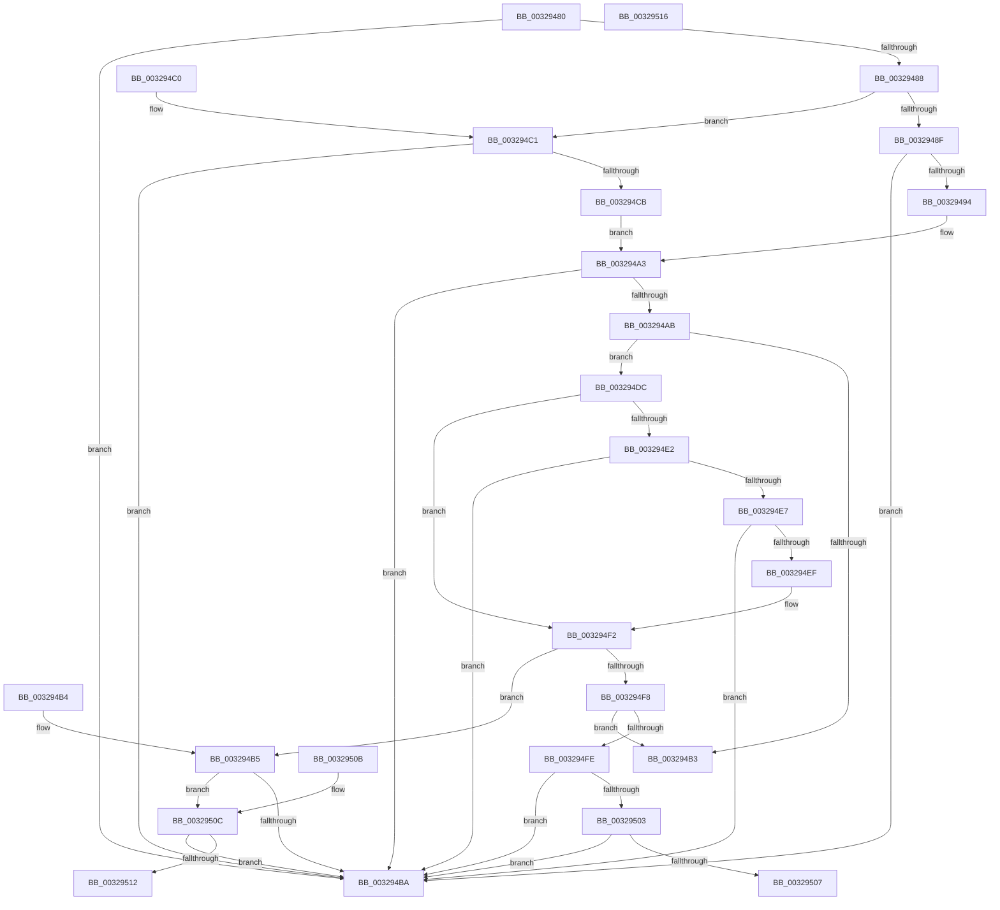

# MiMakeProtectionMask

- RVA: `0x00329480`–`0x00329517` (길이 `151` bytes)
- VA: `0x0000000140329480`
- 실행 섹션: `.text`
- PDB 이름 있음: `예`; PDB Function 태그: `아니요`
- unwind 정보 RVA: `0x000DB714`
- 디코드: `51`개 명령, `151/151` bytes 표시
- 미해석 바이트: `0` (있으면 어셈블리에 `.byte`로 보존)

> 이 문서는 커널 이미지의 기계어와 PDB 기호를 분석해 생성했습니다. 4번과 5번은 함수 원형과 자료형을 바이너리 사용 방식에서 추정한 C 해석이며 원본 소스 복구 결과는 아닙니다.

## 1. Dependencies

- 직접 호출 지점: **0**; 고유 호출 대상: **0**
- 직접 호출자로 확인된 함수: **21**
- RIP 상대 이미지 참조: **1**

### Outgoing calls
- 직접 디코드된 call 명령이 없습니다.

### Direct callers
- [MmProtectMdlSystemAddress](../22/MmProtectMdlSystemAddress_function_00227B50.md) at `0x00227BB5`
- [MmSetAddressRangeModifiedEx](../23/MmSetAddressRangeModifiedEx_function_00236F20.md) at `0x00236F4B`
- [MmProtectPool](../26/MmProtectPool_function_002697AC.md) at `0x002697D6`
- [MiSetProtectionOnSection](../2C/MiSetProtectionOnSection_function_002C3770.md) at `0x002C37C8`
- [MmMapIoSpaceEx](MmMapIoSpaceEx_function_00327830.md) at `0x0032783D`
- [MiInitializePoolCommitPacket](MiInitializePoolCommitPacket_function_00328DD0.md) at `0x00328E66`
- [sub_00328FA3](Unknown_function_00328FA3.md) at `0x003290B0`
- [MiCommitExistingVad](MiCommitExistingVad_function_0032A860.md) at `0x0032A8EF`
- [MiConvertContiguousMemoryParameters](../3E/MiConvertContiguousMemoryParameters_function_003E9EF8.md) at `0x003E9F36`
- [MmSetPageProtection](../4E/MmSetPageProtection_function_004E1580.md) at `0x004E15A3`
- [MmMapMdl](../67/MmMapMdl_function_0067CBA0.md) at `0x0067CBCD`
- [NtProtectVirtualMemory](../../page/88/NtProtectVirtualMemory_function_00880CA0.md) at `0x00880D3B`
- [NtProtectVirtualMemory](../../page/88/NtProtectVirtualMemory_function_00880CA0.md) at `0x00880EA1`
- [MmProtectVirtualMemory](../../page/88/MmProtectVirtualMemory_function_00881050.md) at `0x00881126`
- [MmProtectVirtualMemory](../../page/88/MmProtectVirtualMemory_function_00881050.md) at `0x008818CE`
- [MiCommitFileBackedSection](../../page/88/MiCommitFileBackedSection_function_00882238.md) at `0x008824AF`
- [MiAllocateVirtualMemoryPrepare](../../page/88/MiAllocateVirtualMemoryPrepare_function_00883220.md) at `0x00883A13`
- [MiAllocateVirtualMemory](../../page/88/MiAllocateVirtualMemory_function_00883B40.md) at `0x00883BD3`
- [MiAllocateVirtualMemory](../../page/88/MiAllocateVirtualMemory_function_00883B40.md) at `0x0088410D`
- [MiMapViewOfSectionCommon](../../page/89/MiMapViewOfSectionCommon_function_00898C90.md) at `0x00898CDE`
- [MiMapViewOfSection](../../page/89/MiMapViewOfSection_function_00898F10.md) at `0x00898FFB`
- [MiMapViewOfSection](../../page/89/MiMapViewOfSection_function_00898F10.md) at `0x0089915E`
- [MiInitializeCreateSectionPacket](../../page/98/MiInitializeCreateSectionPacket_function_00984130.md) at `0x00984277`
- [MiCopyPagesIntoEnclave](../../page/A4/MiCopyPagesIntoEnclave_function_00A472AC.md) at `0x00A47393`
- [MiLoadDataIntoVsmEnclave](../../page/AC/MiLoadDataIntoVsmEnclave_function_00ACD114.md) at `0x00ACD23A`

### Static image references
- `0x00329494` → RVA `0x00000000` (`image boundary/outside`; read)

## 2. Other-region calls and transfers

- 다른 실행 섹션으로 향하는 call: **0**
- 별도 외부 분기/꼬리 이동을 확인하지 못했습니다.

## 3. Assembly (complete function range)

```asm
00329480  81 F9 00 08 00 00               cmp ecx, 0x800
00329486  73 32                           jae 0x1403294ba
00329488  8B C1                           mov eax, ecx
0032948A  83 E0 0F                        and eax, 0xf
0032948D  74 32                           je 0x1403294c1
0032948F  F6 C1 F0                        test cl, 0xf0
00329492  75 26                           jne 0x1403294ba
00329494  48 8D 15 65 6B CD FF            lea rdx, [rip - 0x32949b]
0032949B  0F B6 94 10 E0 AF 03 00         movzx edx, byte ptr [rax + rdx + 0x3afe0]
003294A3  0F BE C2                        movsx eax, dl
003294A6  83 F8 FF                        cmp eax, -1
003294A9  74 0F                           je 0x1403294ba
003294AB  F7 C1 00 07 00 00               test ecx, 0x700
003294B1  75 29                           jne 0x1403294dc
003294B3  C3                              ret
003294B4  CC                              int3
003294B5  83 F8 18                        cmp eax, 0x18
003294B8  75 52                           jne 0x14032950c
003294BA  B8 FF FF FF FF                  mov eax, 0xffffffff
003294BF  C3                              ret
003294C0  CC                              int3
003294C1  8B C1                           mov eax, ecx
003294C3  C1 E8 04                        shr eax, 4
003294C6  83 E0 0F                        and eax, 0xf
003294C9  74 EF                           je 0x1403294ba
003294CB  48 8D 15 2E 6B CD FF            lea rdx, [rip - 0x3294d2]
003294D2  0F B6 94 10 F0 AF 03 00         movzx edx, byte ptr [rax + rdx + 0x3aff0]
003294DA  EB C7                           jmp 0x1403294a3
003294DC  0F BA E1 08                     bt ecx, 8
003294E0  73 10                           jae 0x1403294f2
003294E2  83 F8 18                        cmp eax, 0x18
003294E5  74 D3                           je 0x1403294ba
003294E7  F7 C1 00 06 00 00               test ecx, 0x600
003294ED  75 CB                           jne 0x1403294ba
003294EF  83 C8 10                        or eax, 0x10
003294F2  0F BA E1 09                     bt ecx, 9
003294F6  72 BD                           jb 0x1403294b5
003294F8  0F BA E1 0A                     bt ecx, 0xa
003294FC  73 B5                           jae 0x1403294b3
003294FE  83 F8 18                        cmp eax, 0x18
00329501  74 B7                           je 0x1403294ba
00329503  A8 02                           test al, 2
00329505  75 B3                           jne 0x1403294ba
00329507  83 C8 18                        or eax, 0x18
0032950A  C3                              ret
0032950B  CC                              int3
0032950C  0F BA E1 0A                     bt ecx, 0xa
00329510  72 A8                           jb 0x1403294ba
00329512  83 C8 08                        or eax, 8
00329515  C3                              ret
00329516  CC                              int3
```

## 4. C-style interpretation (structured pseudocode)

```c
__int64 __fastcall MiMakeProtectionMask(int a1)
{
    __int64 result;

    if (a1 >= 0x800ULL) goto loc_003294BA;
    result = (unsigned int)(((unsigned int)(a1)) & (15));
    if (condition_is_equal) goto loc_003294C1;
    if ((((unsigned __int8)(a1)) & (240)) != 0) goto loc_003294BA;
loc_003294A3:
    if (((unsigned int)((__int8)((unsigned __int8)(*(unsigned __int8 *)(result + v_rip - 3314843 * 1 + 241632))))) == -1) goto loc_003294BA;
    if (((a1) & (0x700ULL)) != 0) goto loc_003294DC;
loc_003294B3:
    return (__int8)((unsigned __int8)(*(unsigned __int8 *)(result + v_rip - 3314843 * 1 + 241632)));
loc_003294B5:
    if (((unsigned int)((__int8)((unsigned __int8)(*(unsigned __int8 *)(result + v_rip - 3314843 * 1 + 241632))))) != 24) goto loc_0032950C;
loc_003294BA:
    return (unsigned int)(0xFFFFFFFFULL);
loc_003294C1:
    result = (unsigned int)(((unsigned int)(a1)) >> (4));
    result = (unsigned int)((result) & (15));
    if (condition_is_equal) goto loc_003294BA;
    goto loc_003294A3;
loc_003294DC:
    if (condition_is_above_or_equal) goto loc_003294F2;
    if (((unsigned int)(result)) == 24) goto loc_003294BA;
    if (((a1) & (0x600ULL)) != 0) goto loc_003294BA;
    result = (unsigned int)((result) | (16));
loc_003294F2:
    if (condition_is_below) goto loc_003294B5;
    if (condition_is_above_or_equal) goto loc_003294B3;
    if (((unsigned int)(result)) == 24) goto loc_003294BA;
    if ((((unsigned __int8)(result)) & (2)) != 0) goto loc_003294BA;
    result = (unsigned int)((result) | (24));
    return result;
loc_0032950C:
    if (condition_is_below) goto loc_003294BA;
    result = (unsigned int)((result) | (8));
    return result;
}
```

## 5. (Beta) C Style

```c
int64_t MiMakeProtectionMask(int32_t Arg1)
{
    int64_t result;

    if (Arg1 >= 0x800ULL) goto loc_003294BA;
    result = (uint32_t)(((uint32_t)(Arg1)) & (15));
    if (condition_is_equal) goto loc_003294C1;
    if ((((uint8_t)(Arg1)) & (240)) != 0) goto loc_003294BA;
loc_003294A3:
    if (((uint32_t)((int8_t)((uint8_t)(*(uint8_t *)(result + v_rip - 0x32949B * 1 + 0x3AFE0))))) == -1) goto loc_003294BA;
    if (((Arg1) & (0x700ULL)) != 0) goto loc_003294DC;
loc_003294B3:
    return (int8_t)((uint8_t)(*(uint8_t *)(result + v_rip - 0x32949B * 1 + 0x3AFE0)));
loc_003294B5:
    if (((uint32_t)((int8_t)((uint8_t)(*(uint8_t *)(result + v_rip - 0x32949B * 1 + 0x3AFE0))))) != 24) goto loc_0032950C;
loc_003294BA:
    return (uint32_t)(0xFFFFFFFFULL);
loc_003294C1:
    result = (uint32_t)(((uint32_t)(Arg1)) >> (4));
    result = (uint32_t)((result) & (15));
    if (condition_is_equal) goto loc_003294BA;
    goto loc_003294A3;
loc_003294DC:
    if (condition_is_above_or_equal) goto loc_003294F2;
    if (((uint32_t)(result)) == 24) goto loc_003294BA;
    if (((Arg1) & (0x600ULL)) != 0) goto loc_003294BA;
    result = (uint32_t)((result) | (16));
loc_003294F2:
    if (condition_is_below) goto loc_003294B5;
    if (condition_is_above_or_equal) goto loc_003294B3;
    if (((uint32_t)(result)) == 24) goto loc_003294BA;
    if ((((uint8_t)(result)) & (2)) != 0) goto loc_003294BA;
    result = (uint32_t)((result) | (24));
    return result;
loc_0032950C:
    if (condition_is_below) goto loc_003294BA;
    result = (uint32_t)((result) | (8));
    return result;
}
```

## 6. Execution-region graph

[열기: 2D/3D 그래프와 함수 탐색 컨트롤 패널](../../../control-panel.html?section=text&rva=0x00329480&view=graph)

- 2D 그래프는 위에서 아래로 흐르고, 3D 그래프는 빈 공간을 드래그해 회전합니다. Shift+드래그는 이동, 휠은 확대·축소, 함수 노드 선택은 대상 보고서 이동입니다.

### Static fallback


