# MiMapContiguousMemory

- RVA: `0x0032787C`–`0x00327D36` (길이 `1,210` bytes)
- VA: `0x000000014032787C`
- 실행 섹션: `.text`
- PDB 이름 있음: `예`; PDB Function 태그: `예`
- unwind 정보 RVA: `0x00075E1C`
- 디코드: `310`개 명령, `1,210/1,210` bytes 표시
- 미해석 바이트: `0` (있으면 어셈블리에 `.byte`로 보존)

> 이 문서는 커널 이미지의 기계어와 PDB 기호를 분석해 생성했습니다. 4번과 5번은 함수 원형과 자료형을 바이너리 사용 방식에서 추정한 C 해석이며 원본 소스 복구 결과는 아닙니다.

## 1. Dependencies

- 직접 호출 지점: **18**; 고유 호출 대상: **10**
- 직접 호출자로 확인된 함수: **2**
- RIP 상대 이미지 참조: **8**

### Outgoing calls
- `0x00327950` → [MiSanitizePage](../47/MiSanitizePage_function_00471BF0.md) (function, `0x00471BF0`)
- `0x003279D6` → [MiReservePtes](../31/MiReservePtes_function_00318D20.md) (function, `0x00318D20`)
- `0x00327A06` → [MiFillSystemPtes](../31/MiFillSystemPtes_function_00319850.md) (function, `0x00319850`)
- `0x00327A18` → [MiReleasePtes](../24/MiReleasePtes_function_00247240.md) (function, `0x00247240`)
- `0x00327A26` → [_security_check_cookie](../6A/_security_check_cookie_function_006AC640.md) (function, `0x006AC640`)
- `0x00327A8C` → [MiMappingHasIoReferences](../46/MiMappingHasIoReferences_function_00460934.md) (function, `0x00460934`)
- `0x00327AAC` → [KasanTrackAddress](../46/KasanTrackAddress_function_00462520.md) (function, `0x00462520`)
- `0x00327B4D` → [KeBugCheckEx](../4F/KeBugCheckEx_function_004FD660.md) (function, `0x004FD660`)
- `0x00327B7C` → [KeBugCheckEx](../4F/KeBugCheckEx_function_004FD660.md) (function, `0x004FD660`)
- `0x00327B99` → [KeBugCheckEx](../4F/KeBugCheckEx_function_004FD660.md) (function, `0x004FD660`)
- `0x00327BB6` → [KeBugCheckEx](../4F/KeBugCheckEx_function_004FD660.md) (function, `0x004FD660`)
- `0x00327BE3` → [KeBugCheckEx](../4F/KeBugCheckEx_function_004FD660.md) (function, `0x004FD660`)
- `0x00327C04` → [KeBugCheckEx](../4F/KeBugCheckEx_function_004FD660.md) (function, `0x004FD660`)
- `0x00327C29` → [KeBugCheckEx](../4F/KeBugCheckEx_function_004FD660.md) (function, `0x004FD660`)
- `0x00327C8A` → [memset](../6C/memset_function_006C6C40.md) (function, `0x006C6C40`)
- `0x00327CB5` → [memset](../6C/memset_function_006C6C40.md) (function, `0x006C6C40`)
- `0x00327D17` → [MiUnmapContiguousMemory](../3F/MiUnmapContiguousMemory_function_003F7908.md) (function, `0x003F7908`)
- `0x00327D29` → [memset](../6C/memset_function_006C6C40.md) (function, `0x006C6C40`)

### Direct callers
- [MmMapIoSpaceEx](MmMapIoSpaceEx_function_00327830.md) at `0x00327861`
- [MiAllocateContiguousMemory](../3E/MiAllocateContiguousMemory_function_003E9FDC.md) at `0x003EA2A3`

### Static image references
- `0x00327895` → RVA `0x00E0A740` (`.data`; read)
- `0x00327955` → RVA `0x00E2DCE0` (`.data`; read)
- `0x003279BA` → RVA `0x00E37668` (`.data`; read)
- `0x003279C5` → RVA `0x00E35E80` (`.data`; read)
- `0x00327A91` → RVA `0x00FC51FC` (`ALMOSTRO`; read)
- `0x00327AB9` → RVA `0x00FCEC68` (`ALMOSTRO`; read)
- `0x00327AEF` → RVA `0x00FC6A88` (`ALMOSTRO`; read)
- `0x00327C4C` → RVA `0x00FC6ED8` (`ALMOSTRO`; read)

## 2. Other-region calls and transfers

- 다른 실행 섹션으로 향하는 call: **0**
- call이 아닌 외부 분기/꼬리 이동: **3**
  - `0x00327B1E` → [sub_006E1C04](../6E/Unknown_function_006E1C04.md) (`tail-transfer`)
  - `0x00327CFF` → [sub_006E1C04 + 0x5F](../6E/Unknown_function_006E1C04.md) (`tail-transfer`)
  - `0x00327D09` → [sub_006E1C04 + 0x5F](../6E/Unknown_function_006E1C04.md) (`tail-transfer`)

## 3. Assembly (complete function range)

```asm
0032787C  40 55                           push rbp
0032787E  53                              push rbx
0032787F  56                              push rsi
00327880  57                              push rdi
00327881  41 54                           push r12
00327883  41 55                           push r13
00327885  41 56                           push r14
00327887  41 57                           push r15
00327889  48 8D 6C 24 E9                  lea rbp, [rsp - 0x17]
0032788E  48 81 EC B8 00 00 00            sub rsp, 0xb8
00327895  48 8B 05 A4 2E AE 00            mov rax, qword ptr [rip + 0xae2ea4]
0032789C  48 33 C4                        xor rax, rsp
0032789F  48 89 45 07                     mov qword ptr [rbp + 7], rax
003278A3  45 8B E9                        mov r13d, r9d
003278A6  4C 89 45 C7                     mov qword ptr [rbp - 0x39], r8
003278AA  4C 8B E2                        mov r12, rdx
003278AD  8B C1                           mov eax, ecx
003278AF  BA FF 0F 00 00                  mov edx, 0xfff
003278B4  41 BB FF FF FF FF               mov r11d, 0xffffffff
003278BA  23 C2                           and eax, edx
003278BC  4D 8B C8                        mov r9, r8
003278BF  44 8B 45 7F                     mov r8d, dword ptr [rbp + 0x7f]
003278C3  48 8B D9                        mov rbx, rcx
003278C6  44 89 45 93                     mov dword ptr [rbp - 0x6d], r8d
003278CA  89 45 97                        mov dword ptr [rbp - 0x69], eax
003278CD  45 3B EB                        cmp r13d, r11d
003278D0  0F 84 47 01 00 00               je 0x140327a1d
003278D6  41 83 FD 18                     cmp r13d, 0x18
003278DA  0F 84 3D 01 00 00               je 0x140327a1d
003278E0  41 8B C5                        mov eax, r13d
003278E3  83 E0 05                        and eax, 5
003278E6  3C 05                           cmp al, 5
003278E8  0F 84 2F 01 00 00               je 0x140327a1d
003278EE  41 8B C5                        mov eax, r13d
003278F1  B9 F8 FF FF FF                  mov ecx, 0xfffffff8
003278F6  23 C1                           and eax, ecx
003278F8  83 F8 10                        cmp eax, 0x10
003278FB  0F 84 1C 01 00 00               je 0x140327a1d
00327901  4D 85 E4                        test r12, r12
00327904  0F 84 13 01 00 00               je 0x140327a1d
0032790A  49 8D 04 1C                     lea rax, [r12 + rbx]
0032790E  4A 8D 0C 23                     lea rcx, [rbx + r12]
00327912  48 3B C3                        cmp rax, rbx
00327915  0F 86 A4 03 00 00               jbe 0x140327cbf
0032791B  48 8B C3                        mov rax, rbx
0032791E  4D 8D 94 24 FF 0F 00 00         lea r10, [r12 + 0xfff]
00327926  48 23 C2                        and rax, rdx
00327929  4D 8D B1 FF 0F 00 00            lea r14, [r9 + 0xfff]
00327930  4C 03 D0                        add r10, rax
00327933  4C 03 F0                        add r14, rax
00327936  48 8B C3                        mov rax, rbx
00327939  49 C1 EA 0C                     shr r10, 0xc
0032793D  48 C1 E8 0C                     shr rax, 0xc
00327941  48 8B C8                        mov rcx, rax
00327944  4C 89 55 B7                     mov qword ptr [rbp - 0x49], r10
00327948  49 C1 EE 0C                     shr r14, 0xc
0032794C  48 89 45 BF                     mov qword ptr [rbp - 0x41], rax
00327950  E8 9B A2 14 00                  call 0x140471bf0
00327955  48 3B 05 84 63 B0 00            cmp rax, qword ptr [rip + 0xb06384]
0032795C  48 89 45 AF                     mov qword ptr [rbp - 0x51], rax
00327960  77 15                           ja 0x140327977
00327962  48 8D 0C 40                     lea rcx, [rax + rax*2]
00327966  48 03 C9                        add rcx, rcx
00327969  48 BA 28 00 00 00 00 DE FF FF   movabs rdx, 0xffffde0000000028
00327973  48 8B 0C CA                     mov rcx, qword ptr [rdx + rcx*8]
00327977  41 F6 C5 02                     test r13b, 2
0032797B  0F 85 6E 01 00 00               jne 0x140327aef
00327981  83 65 8F 00                     and dword ptr [rbp - 0x71], 0
00327985  33 C9                           xor ecx, ecx
00327987  33 FF                           xor edi, edi
00327989  48 89 4D A7                     mov qword ptr [rbp - 0x59], rcx
0032798D  33 F6                           xor esi, esi
0032798F  45 33 FF                        xor r15d, r15d
00327992  F7 C3 FF FF 1F 00               test ebx, 0x1fffff
00327998  0F 84 73 01 00 00               je 0x140327b11
0032799E  48 21 75 9F                     and qword ptr [rbp - 0x61], rsi
003279A2  48 85 C9                        test rcx, rcx
003279A5  0F 85 D7 00 00 00               jne 0x140327a82
003279AB  41 F6 C0 01                     test r8b, 1
003279AF  0F 85 54 01 00 00               jne 0x140327b09
003279B5  4D 3B F3                        cmp r14, r11
003279B8  77 63                           ja 0x140327a1d
003279BA  48 8D 05 A7 FC B0 00            lea rax, [rip + 0xb0fca7]
003279C1  41 F6 C5 18                     test r13b, 0x18
003279C5  48 8D 35 B4 E4 B0 00            lea rsi, [rip + 0xb0e4b4]
003279CC  41 8B D6                        mov edx, r14d
003279CF  48 0F 44 F0                     cmove rsi, rax
003279D3  48 8B CE                        mov rcx, rsi
003279D6  E8 45 13 FF FF                  call 0x140318d20
003279DB  48 8B F8                        mov rdi, rax
003279DE  48 85 C0                        test rax, rax
003279E1  74 3A                           je 0x140327a1d
003279E3  8B 45 93                        mov eax, dword ptr [rbp - 0x6d]
003279E6  48 8D 4D 8F                     lea rcx, [rbp - 0x71]
003279EA  4C 8B 45 AF                     mov r8, qword ptr [rbp - 0x51]
003279EE  45 8B CD                        mov r9d, r13d
003279F1  48 8B 55 B7                     mov rdx, qword ptr [rbp - 0x49]
003279F5  48 89 4C 24 28                  mov qword ptr [rsp + 0x28], rcx
003279FA  48 8B CF                        mov rcx, rdi
003279FD  D1 E8                           shr eax, 1
003279FF  83 E0 01                        and eax, 1
00327A02  89 44 24 20                     mov dword ptr [rsp + 0x20], eax
00327A06  E8 45 1E FF FF                  call 0x140319850
00327A0B  85 C0                           test eax, eax
00327A0D  79 31                           jns 0x140327a40
00327A0F  45 8B C6                        mov r8d, r14d
00327A12  48 8B D7                        mov rdx, rdi
00327A15  48 8B CE                        mov rcx, rsi
00327A18  E8 23 F8 F1 FF                  call 0x140247240
00327A1D  33 C0                           xor eax, eax
00327A1F  48 8B 4D 07                     mov rcx, qword ptr [rbp + 7]
00327A23  48 33 CC                        xor rcx, rsp
00327A26  E8 15 4C 38 00                  call 0x1406ac640
00327A2B  48 81 C4 B8 00 00 00            add rsp, 0xb8
00327A32  41 5F                           pop r15
00327A34  41 5E                           pop r14
00327A36  41 5D                           pop r13
00327A38  41 5C                           pop r12
00327A3A  5F                              pop rdi
00327A3B  5E                              pop rsi
00327A3C  5B                              pop rbx
00327A3D  5D                              pop rbp
00327A3E  C3                              ret
00327A3F  CC                              int3
00327A40  48 C1 E7 19                     shl rdi, 0x19
00327A44  48 B8 00 00 00 00 80 F6 FF FF   movabs rax, 0xfffff68000000000
00327A4E  8B 75 97                        mov esi, dword ptr [rbp - 0x69]
00327A51  BA F8 FF FF FF                  mov edx, 0xfffffff8
00327A56  48 C1 E0 19                     shl rax, 0x19
00327A5A  4D 8B FE                        mov r15, r14
00327A5D  48 2B F8                        sub rdi, rax
00327A60  49 C1 E7 0C                     shl r15, 0xc
00327A64  8B C6                           mov eax, esi
00327A66  48 C1 FF 10                     sar rdi, 0x10
00327A6A  48 23 C2                        and rax, rdx
00327A6D  48 89 45 9F                     mov qword ptr [rbp - 0x61], rax
00327A71  48 8D 0C 3E                     lea rcx, [rsi + rdi]
00327A75  83 E6 07                        and esi, 7
00327A78  49 03 F4                        add rsi, r12
00327A7B  48 89 4D A7                     mov qword ptr [rbp - 0x59], rcx
00327A7F  4C 2B F8                        sub r15, rax
00327A82  44 8B 65 8F                     mov r12d, dword ptr [rbp - 0x71]
00327A86  41 83 E4 01                     and r12d, 1
00327A8A  74 05                           je 0x140327a91
00327A8C  E8 A3 8E 13 00                  call 0x140460934
00327A91  8B 05 65 D7 C9 00               mov eax, dword ptr [rip + 0xc9d765]
00327A97  A8 01                           test al, 1
00327A99  0F 85 2E 02 00 00               jne 0x140327ccd
00327A9F  49 C1 E6 0C                     shl r14, 0xc
00327AA3  45 33 C0                        xor r8d, r8d
00327AA6  49 8B D6                        mov rdx, r14
00327AA9  48 8B CF                        mov rcx, rdi
00327AAC  E8 6F AA 13 00                  call 0x140462520
00327AB1  85 C0                           test eax, eax
00327AB3  0F 88 55 02 00 00               js 0x140327d0e
00327AB9  44 8A 35 A8 71 CA 00            mov r14b, byte ptr [rip + 0xca71a8]
00327AC0  49 BC 00 00 00 00 00 80 FF FF   movabs r12, 0xffff800000000000
00327ACA  49 BD 00 00 00 00 00 80 00 00   movabs r13, 0x800000000000
00327AD4  45 84 F6                        test r14b, r14b
00327AD7  75 4A                           jne 0x140327b23
00327AD9  48 8B 5D 9F                     mov rbx, qword ptr [rbp - 0x61]
00327ADD  48 8D 0C 3B                     lea rcx, [rbx + rdi]
00327AE1  45 84 F6                        test r14b, r14b
00327AE4  75 6D                           jne 0x140327b53
00327AE6  48 8B 45 A7                     mov rax, qword ptr [rbp - 0x59]
00327AEA  E9 30 FF FF FF                  jmp 0x140327a1f
00327AEF  48 F7 05 8E EF C9 00 00 80 00 00  test qword ptr [rip + 0xc9ef8e], 0x8000
00327AFA  0F 84 81 FE FF FF               je 0x140327981
00327B00  41 83 E5 FD                     and r13d, 0xfffffffd
00327B04  E9 78 FE FF FF                  jmp 0x140327981
00327B09  49 FF C6                        inc r14
00327B0C  E9 A4 FE FF FF                  jmp 0x1403279b5
00327B11  49 81 FC 00 00 20 00            cmp r12, 0x200000
00327B18  0F 82 80 FE FF FF               jb 0x14032799e
00327B1E  E9 E1 A0 3B 00                  jmp 0x1406e1c04
00327B23  49 3B FC                        cmp rdi, r12
00327B26  72 5A                           jb 0x140327b82
00327B28  40 F6 C7 07                     test dil, 7
00327B2C  0F 84 8A 00 00 00               je 0x140327bbc
00327B32  B8 02 00 00 00                  mov eax, 2
00327B37  48 C7 44 24 20 08 00 00 00      mov qword ptr [rsp + 0x20], 8
00327B40  44 8B C0                        mov r8d, eax
00327B43  8B D0                           mov edx, eax
00327B45  4C 8B CF                        mov r9, rdi
00327B48  B9 F1 01 00 00                  mov ecx, 0x1f1
00327B4D  E8 0E 5B 1D 00                  call 0x1404fd660
00327B52  CC                              int3
00327B53  49 3B CC                        cmp rcx, r12
00327B56  72 47                           jb 0x140327b9f
00327B58  F6 C1 07                        test cl, 7
00327B5B  0F 84 88 00 00 00               je 0x140327be9
00327B61  B8 02 00 00 00                  mov eax, 2
00327B66  48 C7 44 24 20 08 00 00 00      mov qword ptr [rsp + 0x20], 8
00327B6F  4C 8B C9                        mov r9, rcx
00327B72  44 8B C0                        mov r8d, eax
00327B75  8B D0                           mov edx, eax
00327B77  B9 F1 01 00 00                  mov ecx, 0x1f1
00327B7C  E8 DF 5A 1D 00                  call 0x1404fd660
00327B81  CC                              int3
00327B82  48 83 64 24 20 00               and qword ptr [rsp + 0x20], 0
00327B88  BA 02 00 00 00                  mov edx, 2
00327B8D  4C 8B CF                        mov r9, rdi
00327B90  B9 F1 01 00 00                  mov ecx, 0x1f1
00327B95  44 8D 42 FF                     lea r8d, [rdx - 1]
00327B99  E8 C2 5A 1D 00                  call 0x1404fd660
00327B9E  CC                              int3
00327B9F  48 83 64 24 20 00               and qword ptr [rsp + 0x20], 0
00327BA5  BA 02 00 00 00                  mov edx, 2
00327BAA  4C 8B C9                        mov r9, rcx
00327BAD  B9 F1 01 00 00                  mov ecx, 0x1f1
00327BB2  44 8D 42 FF                     lea r8d, [rdx - 1]
00327BB6  E8 A5 5A 1D 00                  call 0x1404fd660
00327BBB  CC                              int3
00327BBC  48 8B 5D 9F                     mov rbx, qword ptr [rbp - 0x61]
00327BC0  48 8D 04 3B                     lea rax, [rbx + rdi]
00327BC4  48 3B C7                        cmp rax, rdi
00327BC7  0F 83 C7 00 00 00               jae 0x140327c94
00327BCD  BA 02 00 00 00                  mov edx, 2
00327BD2  48 89 5C 24 20                  mov qword ptr [rsp + 0x20], rbx
00327BD7  4C 8B CF                        mov r9, rdi
00327BDA  B9 F1 01 00 00                  mov ecx, 0x1f1
00327BDF  44 8D 42 01                     lea r8d, [rdx + 1]
00327BE3  E8 78 5A 1D 00                  call 0x1404fd660
00327BE8  CC                              int3
00327BE9  49 3B F7                        cmp rsi, r15
00327BEC  76 1C                           jbe 0x140327c0a
00327BEE  BA 02 00 00 00                  mov edx, 2
00327BF3  4C 89 7C 24 20                  mov qword ptr [rsp + 0x20], r15
00327BF8  4C 8B CE                        mov r9, rsi
00327BFB  B9 F1 01 00 00                  mov ecx, 0x1f1
00327C00  44 8D 42 01                     lea r8d, [rdx + 1]
00327C04  E8 57 5A 1D 00                  call 0x1404fd660
00327C09  CC                              int3
00327C0A  4A 8D 04 39                     lea rax, [rcx + r15]
00327C0E  48 3B C1                        cmp rax, rcx
00327C11  73 1C                           jae 0x140327c2f
00327C13  BA 02 00 00 00                  mov edx, 2
00327C18  4C 89 7C 24 20                  mov qword ptr [rsp + 0x20], r15
00327C1D  4C 8B C9                        mov r9, rcx
00327C20  B9 F1 01 00 00                  mov ecx, 0x1f1
00327C25  44 8D 42 01                     lea r8d, [rdx + 1]
00327C29  E8 32 5A 1D 00                  call 0x1404fd660
00327C2E  CC                              int3
00327C2F  49 8D 47 FF                     lea rax, [r15 - 1]
00327C33  4C 8B F6                        mov r14, rsi
00327C36  48 8D 7E FF                     lea rdi, [rsi - 1]
00327C3A  49 C1 EE 03                     shr r14, 3
00327C3E  83 E7 07                        and edi, 7
00327C41  4A 8D 1C 29                     lea rbx, [rcx + r13]
00327C45  83 E0 07                        and eax, 7
00327C48  48 C1 EB 03                     shr rbx, 3
00327C4C  48 03 1D 85 F2 C9 00            add rbx, qword ptr [rip + 0xc9f285]
00327C53  48 2B F8                        sub rdi, rax
00327C56  48 2B FE                        sub rdi, rsi
00327C59  49 03 FF                        add rdi, r15
00327C5C  4D 85 F6                        test r14, r14
00327C5F  0F 85 BC 00 00 00               jne 0x140327d21
00327C65  40 F6 C6 07                     test sil, 7
00327C69  74 0A                           je 0x140327c75
00327C6B  40 80 E6 07                     and sil, 7
00327C6F  40 88 33                        mov byte ptr [rbx], sil
00327C72  48 FF C3                        inc rbx
00327C75  48 C1 EF 03                     shr rdi, 3
00327C79  48 85 FF                        test rdi, rdi
00327C7C  0F 84 64 FE FF FF               je 0x140327ae6
00327C82  4C 8B C7                        mov r8, rdi
00327C85  B2 8B                           mov dl, 0x8b
00327C87  48 8B CB                        mov rcx, rbx
00327C8A  E8 B1 EF 39 00                  call 0x1406c6c40
00327C8F  E9 52 FE FF FF                  jmp 0x140327ae6
00327C94  4A 8D 0C 2F                     lea rcx, [rdi + r13]
00327C98  4C 8B C3                        mov r8, rbx
00327C9B  48 C1 E9 03                     shr rcx, 3
00327C9F  48 03 0D 32 F2 C9 00            add rcx, qword ptr [rip + 0xc9f232]
00327CA6  49 C1 E8 03                     shr r8, 3
00327CAA  4D 85 C0                        test r8, r8
00327CAD  0F 84 2A FE FF FF               je 0x140327add
00327CB3  B2 8A                           mov dl, 0x8a
00327CB5  E8 86 EF 39 00                  call 0x1406c6c40
00327CBA  E9 1E FE FF FF                  jmp 0x140327add
00327CBF  48 85 C9                        test rcx, rcx
00327CC2  0F 85 55 FD FF FF               jne 0x140327a1d
00327CC8  E9 4E FC FF FF                  jmp 0x14032791b
00327CCD  33 C0                           xor eax, eax
00327CCF  48 81 E3 00 F0 FF FF            and rbx, 0xfffffffffffff000
00327CD6  F6 45 93 01                     test byte ptr [rbp - 0x6d], 1
00327CDA  48 89 45 CF                     mov qword ptr [rbp - 0x31], rax
00327CDE  48 89 45 D7                     mov qword ptr [rbp - 0x29], rax
00327CE2  89 45 F7                        mov dword ptr [rbp - 9], eax
00327CE5  48 8B 45 A7                     mov rax, qword ptr [rbp - 0x59]
00327CE9  48 89 45 E7                     mov qword ptr [rbp - 0x19], rax
00327CED  48 8B 45 BF                     mov rax, qword ptr [rbp - 0x41]
00327CF1  48 89 45 FF                     mov qword ptr [rbp - 1], rax
00327CF5  8B 45 97                        mov eax, dword ptr [rbp - 0x69]
00327CF8  89 45 FB                        mov dword ptr [rbp - 5], eax
00327CFB  48 89 5D EF                     mov qword ptr [rbp - 0x11], rbx
00327CFF  0F 84 5E 9F 3B 00               je 0x1406e1c63
00327D05  41 83 CC 02                     or r12d, 2
00327D09  E9 55 9F 3B 00                  jmp 0x1406e1c63
00327D0E  45 33 C0                        xor r8d, r8d
00327D11  49 8B D6                        mov rdx, r14
00327D14  48 8B CF                        mov rcx, rdi
00327D17  E8 EC FB 0C 00                  call 0x1403f7908
00327D1C  E9 FC FC FF FF                  jmp 0x140327a1d
00327D21  4D 8B C6                        mov r8, r14
00327D24  33 D2                           xor edx, edx
00327D26  48 8B CB                        mov rcx, rbx
00327D29  E8 12 EF 39 00                  call 0x1406c6c40
00327D2E  49 03 DE                        add rbx, r14
00327D31  E9 2F FF FF FF                  jmp 0x140327c65
```

## 4. C-style interpretation (structured pseudocode)

```c
__int64 __fastcall MiMapContiguousMemory(__int64 a1, __int64 a2, __int64 a3, int a4, unsigned int a5)
{
    __int64 result;
    __int64 v_r10;
    __int64 v_r12;
    __int64 v_r13;
    __int64 v_r14;
    __int64 v_r15;
    __int64 v_rbx;
    __int64 v_rdi;
    __int64 v_rsi;
    __int64 v_rsp;
    unsigned __int64 v_stack_m50;
    unsigned __int64 v_stack_m57;
    unsigned __int64 v_stack_m58;
    unsigned int v_stack_m5C;
    unsigned int v_stack_m60;
    unsigned __int64 v_stack_m68;
    unsigned __int64 v_stack_m70;
    unsigned __int64 v_stack_m80;
    unsigned __int64 v_stack_m88;
    unsigned __int64 v_stack_m90;
    unsigned __int64 v_stack_m98;
    unsigned __int64 v_stack_mA0;
    unsigned __int64 v_stack_mA8;
    unsigned __int64 v_stack_mB0;
    unsigned __int64 v_stack_mB8;
    unsigned int v_stack_mC0;
    unsigned int v_stack_mC4;
    unsigned int v_stack_mC8;
    unsigned __int64 v_stack_mD0;
    unsigned int v_stack_mD8;
    unsigned __int64 v_stack_p20;

    v_rsp = (v_rsp) - (184);
    result = (*(unsigned __int64 *)(v_rip + 11415204)) ^ (v_rsp);
    v_stack_m50 = result;
    v_stack_m90 = a3;
    result = (unsigned int)(((unsigned int)((unsigned int)(a1))) & ((unsigned int)((unsigned int)(0xFFFULL))));
    v_stack_mC4 = (unsigned int)((unsigned int)(a5));
    v_stack_mC0 = (unsigned int)(result);
    if (((unsigned int)((unsigned int)(a4))) == ((unsigned int)((unsigned int)(0xFFFFFFFFULL)))) goto loc_00327A1D;
    if (((unsigned int)((unsigned int)(a4))) == 24) goto loc_00327A1D;
    result = (unsigned int)(((unsigned int)((unsigned int)((unsigned int)(a4)))) & (5));
    if (((unsigned __int8)(result)) == 5) goto loc_00327A1D;
    result = (unsigned int)(((unsigned int)((unsigned int)((unsigned int)(a4)))) & ((unsigned int)((unsigned int)(0xFFFFFFF8ULL))));
    if (((unsigned int)(result)) == 16) goto loc_00327A1D;
    if (a2 == 0) goto loc_00327A1D;
    if ((a2 + a1 * 1) <= a1) goto loc_00327CBF;
loc_0032791B:
    result = (a1) & ((unsigned int)(0xFFFULL));
    v_r10 = (a2 + 4095) + (result);
    v_r14 = (a3 + 4095) + (result);
    v_r10 = (v_r10) >> (12);
    result = (a1) >> (12);
    v_stack_mA0 = v_r10;
    v_r14 = (v_r14) >> (12);
    v_stack_m98 = result;
    result = MiSanitizePage(result, (unsigned int)(0xFFFULL), (unsigned int)(a5), a3);
    v_stack_mA8 = result;
    if (result <= (*(unsigned __int64 *)(v_rip + 11559812))) {
        a1 = result + result * 2;
        a1 = (a1) + (a1);
        a1 = *(unsigned __int64 *)((unsigned int)(0xFFFULL) + a1 * 8);
    }
    if ((((unsigned __int8)((unsigned int)(a4))) & (2)) != 0) goto loc_00327AEF;
loc_00327981:
    a1 = 0;
    v_rdi = 0;
    v_stack_mB0 = 0;
    v_rsi = 0;
    v_r15 = 0;
    if (((0) & (0x1FFFFFULL)) == 0) goto loc_00327B11;
loc_0032799E:
    if (0 != 0) goto loc_00327A82;
    if ((((unsigned __int8)((unsigned int)(a5))) & (1)) != 0) goto loc_00327B09;
loc_003279B5:
    if (v_r14 > ((unsigned int)(0xFFFFFFFFULL))) goto loc_00327A1D;
    v_rsi = v_rip + 11592884;
    if ((((unsigned __int8)((unsigned int)(a4))) & (24)) == 0) { v_rsi = v_rip + 11599015; }
    result = MiReservePtes(v_rsi, (unsigned int)((unsigned int)(v_r14)), (unsigned int)(a5), a3);
    if (result == 0) goto loc_00327A1D;
    v_stack_mD0 = v_stack_mC8;
    result = (unsigned int)(((unsigned int)(v_stack_mC4)) >> (1));
    result = (unsigned int)((result) & (1));
    v_stack_mD8 = (unsigned int)(result);
    result = MiFillSystemPtes(result, v_stack_mA0, v_stack_mA8, (unsigned int)((unsigned int)((unsigned int)(a4))));
    if (!sign_flag) goto loc_00327A40;
    result = MiReleasePtes(v_rsi, result, (unsigned int)((unsigned int)(v_r14)), (unsigned int)((unsigned int)((unsigned int)(a4))));
loc_00327A1D:
    result = 0;
loc_00327A1F:
    a1 = (v_stack_m50) ^ (v_rsp);
    result = _security_check_cookie(a1, result, (unsigned int)((unsigned int)(v_r14)), (unsigned int)((unsigned int)((unsigned int)(a4))));
    v_rsp = (v_rsp) + (184);
    return result;
loc_00327A40:
    v_rdi = (result) << (25);
    result = (result) << (25);
    v_rdi = (v_rdi) - (result);
    v_r15 = (v_r14) << (12);
    v_rdi = (v_rdi) >> (16);
    result = ((unsigned int)((unsigned int)((unsigned int)(v_stack_mC0)))) & ((unsigned int)(0xFFFFFFF8ULL));
    v_stack_mB8 = result;
    v_rsi = (unsigned int)(((unsigned int)(v_stack_mC0)) & (7));
    v_rsi = (v_rsi) + (a2);
    v_stack_mB0 = (unsigned int)(v_stack_mC0) + v_rdi * 1;
    v_r15 = (v_r15) - (result);
loc_00327A82:
    v_r12 = (unsigned int)(((unsigned int)(v_stack_mC8)) & (1));
    if (!(condition_is_equal)) {
        result = MiMappingHasIoReferences((unsigned int)(v_stack_mC0) + v_rdi * 1, (unsigned int)(0xFFFFFFF8ULL), (unsigned int)((unsigned int)(v_r14)), (unsigned int)((unsigned int)((unsigned int)(a4))));
    }
    if ((((unsigned __int8)((unsigned int)(*(unsigned int *)(v_rip + 13227877)))) & (1)) != 0) goto loc_00327CCD;
    v_r14 = (v_r14) << (12);
    a3 = 0;
    result = KasanTrackAddress(v_rdi, v_r14, a3, (unsigned int)((unsigned int)((unsigned int)(a4))));
    if (sign_flag) goto loc_00327D0E;
    if ((unsigned __int8)(*(unsigned __int8 *)(v_rip + 13267368)) != 0) goto loc_00327B23;
loc_00327ADD:
    if ((unsigned __int8)(*(unsigned __int8 *)(v_rip + 13267368)) != 0) goto loc_00327B53;
loc_00327AE6:
    goto loc_00327A1F;
loc_00327AEF:
    if (((*(unsigned __int64 *)(v_rip + 13234062)) & (0x8000ULL)) == 0) goto loc_00327981;
    v_r13 = (unsigned int)(((unsigned int)(a4)) & (0xFFFFFFFDULL));
    goto loc_00327981;
loc_00327B09:
    v_r14 = (*(unsigned __int8 *)(v_rip + 13267368)) + 1;
    goto loc_003279B5;
loc_00327B11:
    if (v_r12 < 0x200000ULL) goto loc_0032799E;
loc_00327B23:
    if (v_rdi < v_r12) goto loc_00327B82;
    if ((((unsigned __int8)(v_rdi)) & (7)) == 0) goto loc_00327BBC;
    v_stack_p20 = 8;
    result = KeBugCheckEx(497, 2, 2, v_rdi);
loc_00327B53:
    if (497 < v_r12) goto loc_00327B9F;
    if (((497) & (7)) == 0) goto loc_00327BE9;
    v_stack_p20 = 8;
    result = KeBugCheckEx(497, 2, 2, 497);
loc_00327B82:
    result = KeBugCheckEx(497, 2, 2 - 1, v_rdi);
loc_00327B9F:
    result = KeBugCheckEx(497, 2, 2 - 1, 497);
loc_00327BBC:
    if ((v_stack_mB8 + v_rdi * 1) >= v_rdi) goto loc_00327C94;
    v_stack_p20 = v_stack_mB8;
    result = KeBugCheckEx(497, 2, 2 + 1, v_rdi);
loc_00327BE9:
    if (v_rsi >= = v_r15) {
        a2 = 2;
        v_stack_p20 = v_r15;
        a4 = v_rsi;
        a1 = 497;
        a3 = a2 + 1;
        result = KeBugCheckEx(a1, a2, a3, a4);
    }
    result = a1 + v_r15 * 1;
    if ((a1 + v_r15 * 1) < a1) {
        a2 = 2;
        v_stack_p20 = v_r15;
        a4 = a1;
        a1 = 497;
        a3 = a2 + 1;
        result = KeBugCheckEx(a1, a2, a3, a4);
    }
    v_r14 = (v_rsi) >> (3);
    v_rdi = (unsigned int)((v_rsi - 1) & (7));
    result = (unsigned int)((v_r15 - 1) & (7));
    v_rbx = (a1 + v_r13 * 1) >> (3);
    v_rbx = (v_rbx) + (*(unsigned __int64 *)(v_rip + 13234821));
    v_rdi = (v_rdi) - (result);
    v_rdi = (v_rdi) - (v_rsi);
    v_rdi = (v_rdi) + (v_r15);
    if (v_r14 != 0) goto loc_00327D21;
loc_00327C65:
    if ((((unsigned __int8)(v_rsi)) & (7)) != 0) {
        v_rsi = (unsigned __int8)((v_rsi) & (7));
        *(unsigned __int8 *)(v_rbx) = (unsigned __int8)(v_rsi);
        v_rbx = (v_rbx) + 1;
    }
    v_rdi = (v_rdi) >> (3);
    if (v_rdi == 0) goto loc_00327AE6;
    result = memset(v_rbx, 139, v_rdi, a4);
    goto loc_00327AE6;
loc_00327C94:
    a1 = (v_rdi + v_r13 * 1) >> (3);
    a1 = (a1) + (*(unsigned __int64 *)(v_rip + 13234738));
    a3 = (v_rbx) >> (3);
    if (a3 == 0) goto loc_00327ADD;
    result = memset(a1, 138, a3, a4);
    goto loc_00327ADD;
loc_00327CBF:
    if (a1 != 0) goto loc_00327A1D;
    goto loc_0032791B;
loc_00327CCD:
    result = 0;
    v_rbx = (v_rbx) & (0xFFFFFFFFFFFFF000ULL);
    v_stack_m88 = 0;
    v_stack_m80 = 0;
    v_stack_m60 = 0;
    v_stack_m70 = v_stack_mB0;
    v_stack_m58 = v_stack_m98;
    v_stack_m5C = (unsigned int)((unsigned int)(v_stack_mC0));
    v_stack_m68 = v_rbx;
    v_r12 = (unsigned int)((v_r12) | (2));
loc_00327D0E:
    a3 = 0;
    result = MiUnmapContiguousMemory(v_rdi, v_r14, a3, a4);
    goto loc_00327A1D;
loc_00327D21:
    a2 = 0;
    result = memset(v_rbx, a2, v_r14, a4);
    v_rbx = (v_rbx) + (v_r14);
    goto loc_00327C65;
}
```

## 5. (Beta) C Style

```c
int64_t MiMapContiguousMemory(void *Arg1, int64_t Arg2, void *Arg3, int32_t Arg4, uint32_t Arg5)
{
    uint8_t *arg1 = (uint8_t *)Arg1;
    uint8_t *arg3 = (uint8_t *)Arg3;

    int64_t result;
    int64_t local_r10;
    int64_t local_r12;
    int64_t local_r13;
    int64_t local_r14;
    int64_t local_r15;
    int64_t local_rbx;
    int64_t local_rdi;
    int64_t local_rsi;
    int64_t local_rsp;
    uint64_t v_stack_m50;
    uint64_t v_stack_m57;
    uint64_t v_stack_m58;
    uint32_t v_stack_m5C;
    uint32_t v_stack_m60;
    uint64_t v_stack_m68;
    uint64_t v_stack_m70;
    uint64_t v_stack_m80;
    uint64_t v_stack_m88;
    uint64_t v_stack_m90;
    uint64_t v_stack_m98;
    uint64_t v_stack_mA0;
    uint64_t v_stack_mA8;
    uint64_t v_stack_mB0;
    uint64_t v_stack_mB8;
    uint32_t v_stack_mC0;
    uint32_t v_stack_mC4;
    uint32_t v_stack_mC8;
    uint64_t v_stack_mD0;
    uint32_t v_stack_mD8;
    uint64_t v_stack_p20;

    local_rsp = (local_rsp) - (184);
    result = (*(uint64_t *)(v_rip + 0xAE2EA4)) ^ (local_rsp);
    v_stack_m50 = result;
    v_stack_m90 = Arg3;
    result = (uint32_t)(((uint32_t)((uint32_t)(Arg1))) & ((uint32_t)((uint32_t)(0xFFFULL))));
    v_stack_mC4 = (uint32_t)((uint32_t)(Arg5));
    v_stack_mC0 = (uint32_t)(result);
    if (((uint32_t)((uint32_t)(Arg4))) == ((uint32_t)((uint32_t)(0xFFFFFFFFULL)))) goto loc_00327A1D;
    if (((uint32_t)((uint32_t)(Arg4))) == 24) goto loc_00327A1D;
    result = (uint32_t)(((uint32_t)((uint32_t)((uint32_t)(Arg4)))) & (5));
    if (((uint8_t)(result)) == 5) goto loc_00327A1D;
    result = (uint32_t)(((uint32_t)((uint32_t)((uint32_t)(Arg4)))) & ((uint32_t)((uint32_t)(0xFFFFFFF8ULL))));
    if (((uint32_t)(result)) == 16) goto loc_00327A1D;
    if (Arg2 == 0) goto loc_00327A1D;
    if ((Arg2 + Arg1 * 1) <= Arg1) goto loc_00327CBF;
loc_0032791B:
    result = (Arg1) & ((uint32_t)(0xFFFULL));
    local_r10 = (Arg2 + 4095) + (result);
    local_r14 = (Arg3 + 4095) + (result);
    local_r10 = (local_r10) >> (12);
    result = (Arg1) >> (12);
    v_stack_mA0 = local_r10;
    local_r14 = (local_r14) >> (12);
    v_stack_m98 = result;
    result = MiSanitizePage(result, (uint32_t)(0xFFFULL), (uint32_t)(Arg5), Arg3);
    v_stack_mA8 = result;
    if (result <= (*(uint64_t *)(v_rip + 0xB06384))) {
        Arg1 = result + result * 2;
        Arg1 = (Arg1) + (Arg1);
        Arg1 = *(uint64_t *)((uint32_t)(0xFFFULL) + arg1 * 8);
    }
    if ((((uint8_t)((uint32_t)(Arg4))) & (2)) != 0) goto loc_00327AEF;
loc_00327981:
    Arg1 = 0;
    local_rdi = 0;
    v_stack_mB0 = 0;
    local_rsi = 0;
    local_r15 = 0;
    if (((0) & (0x1FFFFFULL)) == 0) goto loc_00327B11;
loc_0032799E:
    if (0 != 0) goto loc_00327A82;
    if ((((uint8_t)((uint32_t)(Arg5))) & (1)) != 0) goto loc_00327B09;
loc_003279B5:
    if (local_r14 > ((uint32_t)(0xFFFFFFFFULL))) goto loc_00327A1D;
    local_rsi = v_rip + 11592884;
    if ((((uint8_t)((uint32_t)(Arg4))) & (24)) == 0) { local_rsi = v_rip + 11599015; }
    result = MiReservePtes(local_rsi, (uint32_t)((uint32_t)(local_r14)), (uint32_t)(Arg5), Arg3);
    if (result == 0) goto loc_00327A1D;
    v_stack_mD0 = v_stack_mC8;
    result = (uint32_t)(((uint32_t)(v_stack_mC4)) >> (1));
    result = (uint32_t)((result) & (1));
    v_stack_mD8 = (uint32_t)(result);
    result = MiFillSystemPtes(result, v_stack_mA0, v_stack_mA8, (uint32_t)((uint32_t)((uint32_t)(Arg4))));
    if (!sign_flag) goto loc_00327A40;
    result = MiReleasePtes(local_rsi, result, (uint32_t)((uint32_t)(local_r14)), (uint32_t)((uint32_t)((uint32_t)(Arg4))));
loc_00327A1D:
    result = 0;
loc_00327A1F:
    Arg1 = (v_stack_m50) ^ (local_rsp);
    result = _security_check_cookie(Arg1, result, (uint32_t)((uint32_t)(local_r14)), (uint32_t)((uint32_t)((uint32_t)(Arg4))));
    local_rsp = (local_rsp) + (184);
    return result;
loc_00327A40:
    local_rdi = (result) << (25);
    result = (result) << (25);
    local_rdi = (local_rdi) - (result);
    local_r15 = (local_r14) << (12);
    local_rdi = (local_rdi) >> (16);
    result = ((uint32_t)((uint32_t)((uint32_t)(v_stack_mC0)))) & ((uint32_t)(0xFFFFFFF8ULL));
    v_stack_mB8 = result;
    local_rsi = (uint32_t)(((uint32_t)(v_stack_mC0)) & (7));
    local_rsi = (local_rsi) + (Arg2);
    v_stack_mB0 = (uint32_t)(v_stack_mC0) + local_rdi * 1;
    local_r15 = (local_r15) - (result);
loc_00327A82:
    local_r12 = (uint32_t)(((uint32_t)(v_stack_mC8)) & (1));
    if (!(condition_is_equal)) {
        result = MiMappingHasIoReferences((uint32_t)(v_stack_mC0) + local_rdi * 1, (uint32_t)(0xFFFFFFF8ULL), (uint32_t)((uint32_t)(local_r14)), (uint32_t)((uint32_t)((uint32_t)(Arg4))));
    }
    if ((((uint8_t)((uint32_t)(*(uint32_t *)(v_rip + 0xC9D765)))) & (1)) != 0) goto loc_00327CCD;
    local_r14 = (local_r14) << (12);
    Arg3 = 0;
    result = KasanTrackAddress(local_rdi, local_r14, Arg3, (uint32_t)((uint32_t)((uint32_t)(Arg4))));
    if (sign_flag) goto loc_00327D0E;
    if ((uint8_t)(*(uint8_t *)(v_rip + 0xCA71A8)) != 0) goto loc_00327B23;
loc_00327ADD:
    if ((uint8_t)(*(uint8_t *)(v_rip + 0xCA71A8)) != 0) goto loc_00327B53;
loc_00327AE6:
    goto loc_00327A1F;
loc_00327AEF:
    if (((*(uint64_t *)(v_rip + 0xC9EF8E)) & (0x8000ULL)) == 0) goto loc_00327981;
    local_r13 = (uint32_t)(((uint32_t)(Arg4)) & (0xFFFFFFFDULL));
    goto loc_00327981;
loc_00327B09:
    local_r14 = (*(uint8_t *)(v_rip + 0xCA71A8)) + 1;
    goto loc_003279B5;
loc_00327B11:
    if (local_r12 < 0x200000ULL) goto loc_0032799E;
loc_00327B23:
    if (local_rdi < local_r12) goto loc_00327B82;
    if ((((uint8_t)(local_rdi)) & (7)) == 0) goto loc_00327BBC;
    v_stack_p20 = 8;
    result = KeBugCheckEx(497, 2, 2, local_rdi);
loc_00327B53:
    if (497 < local_r12) goto loc_00327B9F;
    if (((497) & (7)) == 0) goto loc_00327BE9;
    v_stack_p20 = 8;
    result = KeBugCheckEx(497, 2, 2, 497);
loc_00327B82:
    result = KeBugCheckEx(497, 2, 2 - 1, local_rdi);
loc_00327B9F:
    result = KeBugCheckEx(497, 2, 2 - 1, 497);
loc_00327BBC:
    if ((v_stack_mB8 + local_rdi * 1) >= local_rdi) goto loc_00327C94;
    v_stack_p20 = v_stack_mB8;
    result = KeBugCheckEx(497, 2, 2 + 1, local_rdi);
loc_00327BE9:
    if (local_rsi >= = local_r15) {
        Arg2 = 2;
        v_stack_p20 = local_r15;
        Arg4 = local_rsi;
        Arg1 = 497;
        Arg3 = Arg2 + 1;
        result = KeBugCheckEx(Arg1, Arg2, Arg3, Arg4);
    }
    result = Arg1 + local_r15 * 1;
    if ((Arg1 + local_r15 * 1) < Arg1) {
        Arg2 = 2;
        v_stack_p20 = local_r15;
        Arg4 = Arg1;
        Arg1 = 497;
        Arg3 = Arg2 + 1;
        result = KeBugCheckEx(Arg1, Arg2, Arg3, Arg4);
    }
    local_r14 = (local_rsi) >> (3);
    local_rdi = (uint32_t)((local_rsi - 1) & (7));
    result = (uint32_t)((local_r15 - 1) & (7));
    local_rbx = (Arg1 + local_r13 * 1) >> (3);
    local_rbx = (local_rbx) + (*(uint64_t *)(v_rip + 0xC9F285));
    local_rdi = (local_rdi) - (result);
    local_rdi = (local_rdi) - (local_rsi);
    local_rdi = (local_rdi) + (local_r15);
    if (local_r14 != 0) goto loc_00327D21;
loc_00327C65:
    if ((((uint8_t)(local_rsi)) & (7)) != 0) {
        local_rsi = (uint8_t)((local_rsi) & (7));
        *(uint8_t *)(local_rbx) = (uint8_t)(local_rsi);
        local_rbx = (local_rbx) + 1;
    }
    local_rdi = (local_rdi) >> (3);
    if (local_rdi == 0) goto loc_00327AE6;
    result = memset(local_rbx, 139, local_rdi, Arg4);
    goto loc_00327AE6;
loc_00327C94:
    Arg1 = (local_rdi + local_r13 * 1) >> (3);
    Arg1 = (Arg1) + (*(uint64_t *)(v_rip + 0xC9F232));
    Arg3 = (local_rbx) >> (3);
    if (Arg3 == NULL) goto loc_00327ADD;
    result = memset(Arg1, 138, Arg3, Arg4);
    goto loc_00327ADD;
loc_00327CBF:
    if (Arg1 != NULL) goto loc_00327A1D;
    goto loc_0032791B;
loc_00327CCD:
    result = 0;
    local_rbx = (local_rbx) & (0xFFFFFFFFFFFFF000ULL);
    v_stack_m88 = 0;
    v_stack_m80 = 0;
    v_stack_m60 = 0;
    v_stack_m70 = v_stack_mB0;
    v_stack_m58 = v_stack_m98;
    v_stack_m5C = (uint32_t)((uint32_t)(v_stack_mC0));
    v_stack_m68 = local_rbx;
    local_r12 = (uint32_t)((local_r12) | (2));
loc_00327D0E:
    Arg3 = 0;
    result = MiUnmapContiguousMemory(local_rdi, local_r14, Arg3, Arg4);
    goto loc_00327A1D;
loc_00327D21:
    Arg2 = 0;
    result = memset(local_rbx, Arg2, local_r14, Arg4);
    local_rbx = (local_rbx) + (local_r14);
    goto loc_00327C65;
}
```

### 관측된 메모리 오프셋

구조체 형식이 확인되지 않은 접근은 인자 기준의 오프셋으로만 기록했습니다.

| 기준 인자 | 오프셋 표현 | 폭 (bit) | 접근 |
|---|---:|---:|---|
| `Arg1` | `+ 0x0 + r12*1` | `64` | `R` |
| `Arg3` | `+ 0xFFF` | `64` | `R` |

## 6. Execution-region graph

[열기: 2D/3D 그래프와 함수 탐색 컨트롤 패널](../../../control-panel.html?section=text&rva=0x0032787C&view=graph)

- 2D 그래프는 위에서 아래로 흐르고, 3D 그래프는 빈 공간을 드래그해 회전합니다. Shift+드래그는 이동, 휠은 확대·축소, 함수 노드 선택은 대상 보고서 이동입니다.

### Static fallback

```mermaid
flowchart TD
  bb_0032787C[BB_0032787C]
  bb_003278D6[BB_003278D6]
  bb_003278E0[BB_003278E0]
  bb_003278EE[BB_003278EE]
  bb_00327901[BB_00327901]
  bb_0032790A[BB_0032790A]
  bb_0032791B[BB_0032791B]
  bb_00327962[BB_00327962]
  bb_00327977[BB_00327977]
  bb_00327981[BB_00327981]
  bb_0032799E[BB_0032799E]
  bb_003279AB[BB_003279AB]
  bb_003279B5[BB_003279B5]
  bb_003279BA[BB_003279BA]
  bb_003279E3[BB_003279E3]
  bb_00327A0F[BB_00327A0F]
  bb_00327A1D[BB_00327A1D]
  bb_00327A1F[BB_00327A1F]
  bb_00327A3F[BB_00327A3F]
  bb_00327A40[BB_00327A40]
  bb_00327A82[BB_00327A82]
  bb_00327A8C[BB_00327A8C]
  bb_00327A91[BB_00327A91]
  bb_00327A9F[BB_00327A9F]
  bb_00327AB9[BB_00327AB9]
  bb_00327AD9[BB_00327AD9]
  bb_00327ADD[BB_00327ADD]
  bb_00327AE6[BB_00327AE6]
  bb_00327AEF[BB_00327AEF]
  bb_00327B00[BB_00327B00]
  bb_00327B09[BB_00327B09]
  bb_00327B11[BB_00327B11]
  bb_00327B1E[BB_00327B1E]
  bb_00327B23[BB_00327B23]
  bb_00327B28[BB_00327B28]
  bb_00327B32[BB_00327B32]
  bb_00327B53[BB_00327B53]
  bb_00327B58[BB_00327B58]
  bb_00327B61[BB_00327B61]
  bb_00327B82[BB_00327B82]
  bb_00327B9F[BB_00327B9F]
  bb_00327BBC[BB_00327BBC]
  bb_00327BCD[BB_00327BCD]
  bb_00327BE9[BB_00327BE9]
  bb_00327BEE[BB_00327BEE]
  bb_00327C0A[BB_00327C0A]
  bb_00327C13[BB_00327C13]
  bb_00327C2F[BB_00327C2F]
  bb_00327C65[BB_00327C65]
  bb_00327C6B[BB_00327C6B]
  bb_00327C75[BB_00327C75]
  bb_00327C82[BB_00327C82]
  bb_00327C94[BB_00327C94]
  bb_00327CB3[BB_00327CB3]
  bb_00327CBF[BB_00327CBF]
  bb_00327CC8[BB_00327CC8]
  bb_00327CCD[BB_00327CCD]
  bb_00327D05[BB_00327D05]
  bb_00327D0E[BB_00327D0E]
  bb_00327D21[BB_00327D21]
  bb_0032787C -->|branch| bb_00327A1D
  bb_0032787C -->|fallthrough| bb_003278D6
  bb_003278D6 -->|branch| bb_00327A1D
  bb_003278D6 -->|fallthrough| bb_003278E0
  bb_003278E0 -->|branch| bb_00327A1D
  bb_003278E0 -->|fallthrough| bb_003278EE
  bb_003278EE -->|branch| bb_00327A1D
  bb_003278EE -->|fallthrough| bb_00327901
  bb_00327901 -->|branch| bb_00327A1D
  bb_00327901 -->|fallthrough| bb_0032790A
  bb_0032790A -->|branch| bb_00327CBF
  bb_0032790A -->|fallthrough| bb_0032791B
  bb_0032791B -->|branch| bb_00327977
  bb_0032791B -->|fallthrough| bb_00327962
  bb_00327962 -->|flow| bb_00327977
  bb_00327977 -->|branch| bb_00327AEF
  bb_00327977 -->|fallthrough| bb_00327981
  bb_00327981 -->|branch| bb_00327B11
  bb_00327981 -->|fallthrough| bb_0032799E
  bb_0032799E -->|branch| bb_00327A82
  bb_0032799E -->|fallthrough| bb_003279AB
  bb_003279AB -->|branch| bb_00327B09
  bb_003279AB -->|fallthrough| bb_003279B5
  bb_003279B5 -->|branch| bb_00327A1D
  bb_003279B5 -->|fallthrough| bb_003279BA
  bb_003279BA -->|branch| bb_00327A1D
  bb_003279BA -->|fallthrough| bb_003279E3
  bb_003279E3 -->|branch| bb_00327A40
  bb_003279E3 -->|fallthrough| bb_00327A0F
  bb_00327A0F -->|flow| bb_00327A1D
  bb_00327A1D -->|flow| bb_00327A1F
  bb_00327A3F -->|flow| bb_00327A40
  bb_00327A40 -->|flow| bb_00327A82
  bb_00327A82 -->|branch| bb_00327A91
  bb_00327A82 -->|fallthrough| bb_00327A8C
  bb_00327A8C -->|flow| bb_00327A91
  bb_00327A91 -->|branch| bb_00327CCD
  bb_00327A91 -->|fallthrough| bb_00327A9F
  bb_00327A9F -->|branch| bb_00327D0E
  bb_00327A9F -->|fallthrough| bb_00327AB9
  bb_00327AB9 -->|branch| bb_00327B23
  bb_00327AB9 -->|fallthrough| bb_00327AD9
  bb_00327AD9 -->|flow| bb_00327ADD
  bb_00327ADD -->|branch| bb_00327B53
  bb_00327ADD -->|fallthrough| bb_00327AE6
  bb_00327AE6 -->|branch| bb_00327A1F
  bb_00327AEF -->|branch| bb_00327981
  bb_00327AEF -->|fallthrough| bb_00327B00
  bb_00327B00 -->|branch| bb_00327981
  bb_00327B09 -->|branch| bb_003279B5
  bb_00327B11 -->|branch| bb_0032799E
  bb_00327B11 -->|fallthrough| bb_00327B1E
  bb_00327B23 -->|branch| bb_00327B82
  bb_00327B23 -->|fallthrough| bb_00327B28
  bb_00327B28 -->|branch| bb_00327BBC
  bb_00327B28 -->|fallthrough| bb_00327B32
  bb_00327B32 -->|flow| bb_00327B53
  bb_00327B53 -->|branch| bb_00327B9F
  bb_00327B53 -->|fallthrough| bb_00327B58
  bb_00327B58 -->|branch| bb_00327BE9
  bb_00327B58 -->|fallthrough| bb_00327B61
  bb_00327B61 -->|flow| bb_00327B82
  bb_00327B82 -->|flow| bb_00327B9F
  bb_00327B9F -->|flow| bb_00327BBC
  bb_00327BBC -->|branch| bb_00327C94
  bb_00327BBC -->|fallthrough| bb_00327BCD
  bb_00327BCD -->|flow| bb_00327BE9
  bb_00327BE9 -->|branch| bb_00327C0A
  bb_00327BE9 -->|fallthrough| bb_00327BEE
  bb_00327BEE -->|flow| bb_00327C0A
  bb_00327C0A -->|branch| bb_00327C2F
  bb_00327C0A -->|fallthrough| bb_00327C13
  bb_00327C13 -->|flow| bb_00327C2F
  bb_00327C2F -->|branch| bb_00327D21
  bb_00327C2F -->|fallthrough| bb_00327C65
  bb_00327C65 -->|branch| bb_00327C75
  bb_00327C65 -->|fallthrough| bb_00327C6B
  bb_00327C6B -->|flow| bb_00327C75
  bb_00327C75 -->|branch| bb_00327AE6
  bb_00327C75 -->|fallthrough| bb_00327C82
  bb_00327C82 -->|branch| bb_00327AE6
  bb_00327C94 -->|branch| bb_00327ADD
  bb_00327C94 -->|fallthrough| bb_00327CB3
  bb_00327CB3 -->|branch| bb_00327ADD
  bb_00327CBF -->|branch| bb_00327A1D
  bb_00327CBF -->|fallthrough| bb_00327CC8
  bb_00327CC8 -->|branch| bb_0032791B
  bb_00327CCD -->|fallthrough| bb_00327D05
  bb_00327D0E -->|branch| bb_00327A1D
  bb_00327D21 -->|branch| bb_00327C65
```


