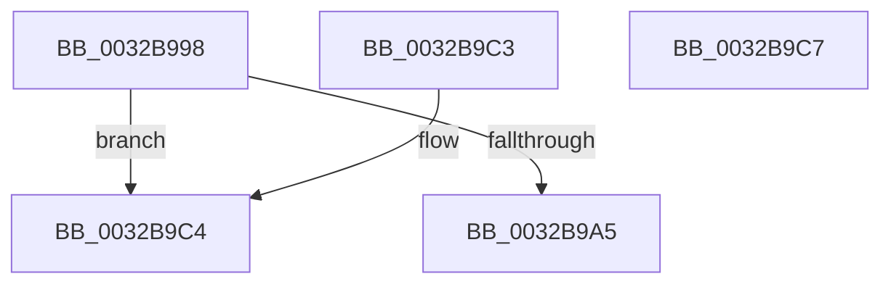

# MiPteHasShadow

- RVA: `0x0032B998`–`0x0032B9C8` (길이 `48` bytes)
- VA: `0x000000014032B998`
- 실행 섹션: `.text`
- PDB 이름 있음: `예`; PDB Function 태그: `아니요`
- unwind 정보 RVA: `0x000DB714`
- 디코드: `12`개 명령, `48/48` bytes 표시
- 미해석 바이트: `0` (있으면 어셈블리에 `.byte`로 보존)

> 이 문서는 커널 이미지의 기계어와 PDB 기호를 분석해 생성했습니다. 4번과 5번은 함수 원형과 자료형을 바이너리 사용 방식에서 추정한 C 해석이며 원본 소스 복구 결과는 아닙니다.

## 1. Dependencies

- 직접 호출 지점: **0**; 고유 호출 대상: **0**
- 직접 호출자로 확인된 함수: **27**
- RIP 상대 이미지 참조: **1**

### Outgoing calls
- 직접 디코드된 call 명령이 없습니다.

### Direct callers
- [sub_0023F124](../23/Unknown_function_0023F124.md) at `0x0023F2AA`
- [sub_00240188](../24/Unknown_function_00240188.md) at `0x002401A0`
- [MiEmptyWorkingSetHelper](../24/MiEmptyWorkingSetHelper_function_00240C00.md) at `0x00240E0A`
- [sub_00241476](../24/Unknown_function_00241476.md) at `0x0024170D`
- [sub_00245DB3](../24/Unknown_function_00245DB3.md) at `0x00245DB3`
- [sub_002465F5](../24/Unknown_function_002465F5.md) at `0x002465F5`
- [sub_0027B888](../27/Unknown_function_0027B888.md) at `0x0027B8C6`
- [MiAddWorkingSetEntries](../27/MiAddWorkingSetEntries_function_0027DC00.md) at `0x0027E18C`
- [MiSetVaAgeList](../29/MiSetVaAgeList_function_00290A20.md) at `0x0029123F`
- [MiSetVaAgeList](../29/MiSetVaAgeList_function_00290A20.md) at `0x00291287`
- [MiSetVaAgeList](../29/MiSetVaAgeList_function_00290A20.md) at `0x00291382`
- [MiSetVaAgeList](../29/MiSetVaAgeList_function_00290A20.md) at `0x002913C9`
- [MiSetVaAgeList](../29/MiSetVaAgeList_function_00290A20.md) at `0x0029145E`
- [MiSetVaAgeList](../29/MiSetVaAgeList_function_00290A20.md) at `0x002914AA`
- [sub_0029273F](../29/Unknown_function_0029273F.md) at `0x00292783`
- [MiSanitizeShadowPxe](../29/MiSanitizeShadowPxe_function_00294B68.md) at `0x00294B6F`
- [MiWritePteShadow](../29/MiWritePteShadow_function_00294EAC.md) at `0x00294EB3`
- [MiResolveProtoPteFault](MiResolveProtoPteFault_function_00321750.md) at `0x00321D91`
- [MiUserFault](MiUserFault_function_00329840.md) at `0x00329E12`
- [MiReducePteUseCount](MiReducePteUseCount_function_0032A160.md) at `0x0032A2DA`
- [MiIsPteEvaluated](MiIsPteEvaluated_function_0032A36C.md) at `0x0032A3C4`
- [MiCleanupLazyStampedPageTable](MiCleanupLazyStampedPageTable_function_0032A43C.md) at `0x0032A536`
- [MiGetPfnProtection](MiGetPfnProtection_function_0032A650.md) at `0x0032A767`
- [MiGetPfnProtection](MiGetPfnProtection_function_0032A650.md) at `0x0032A7AE`
- [MiCommitExistingVad](MiCommitExistingVad_function_0032A860.md) at `0x0032ACA8`
- [MiClearPageFileReservation](MiClearPageFileReservation_function_0032B68C.md) at `0x0032B6D9`
- [MiAccessCheck](MiAccessCheck_function_0032B720.md) at `0x0032B805`
- [sub_0032BC4B](Unknown_function_0032BC4B.md) at `0x0032BC7A`
- [MiQueryAddressState](MiQueryAddressState_function_0032C380.md) at `0x0032CB8C`
- [MiResolveSharedZeroFault](MiResolveSharedZeroFault_function_0032EF20.md) at `0x0032F41F`
- [sub_0032FE5C](Unknown_function_0032FE5C.md) at `0x0032FEDF`
- [sub_0032FE5C](Unknown_function_0032FE5C.md) at `0x0032FF46`
- [MiCompleteProtoPteFault](../34/MiCompleteProtoPteFault_function_00345710.md) at `0x00345DBF`
- [MI_CLEAR_PTE_BITS_FOR_READ_CLUSTER](../36/MI_CLEAR_PTE_BITS_FOR_READ_CLUSTER_function_0036D890.md) at `0x0036D8E4`

### Static image references
- `0x0032B998` → RVA `0x00FC6A88` (`ALMOSTRO`; read)

## 2. Other-region calls and transfers

- 다른 실행 섹션으로 향하는 call: **0**
- 별도 외부 분기/꼬리 이동을 확인하지 못했습니다.

## 3. Assembly (complete function range)

```asm
0032B998  48 F7 05 E5 B0 C9 00 00 00 60 00  test qword ptr [rip + 0xc9b0e5], 0x600000
0032B9A3  74 1F                           je 0x14032b9c4
0032B9A5  65 48 8B 04 25 88 01 00 00      mov rax, qword ptr gs:[0x188]
0032B9AE  33 C9                           xor ecx, ecx
0032B9B0  48 8B 80 B8 00 00 00            mov rax, qword ptr [rax + 0xb8]
0032B9B7  80 B8 60 01 00 00 01            cmp byte ptr [rax + 0x160], 1
0032B9BE  48 0F 44 C1                     cmove rax, rcx
0032B9C2  C3                              ret
0032B9C3  CC                              int3
0032B9C4  33 C0                           xor eax, eax
0032B9C6  C3                              ret
0032B9C7  CC                              int3
```

## 4. C-style interpretation (structured pseudocode)

```c
__int64 __fastcall MiPteHasShadow(int a1)
{
    __int64 result;

    if (((*(unsigned __int64 *)(v_rip + 13218021)) & (0x600000ULL)) == 0) goto loc_0032B9C4;
    a1 = 0;
    result = *(unsigned __int64 *)(*(unsigned __int64 *)(gs_base + (0 + 392)) + 184);
    if ((*(unsigned __int8 *)(*(unsigned __int64 *)(*(unsigned __int64 *)(gs_base + (0 + 392)) + 184) + 352)) == 1) { result = 0; }
    return result;
loc_0032B9C4:
    result = 0;
    return result;
}
```

## 5. (Beta) C Style

```c
int64_t MiPteHasShadow(int32_t Arg1)
{
    int64_t result;

    if (((*(uint64_t *)(v_rip + 0xC9B0E5)) & (0x600000ULL)) == 0) goto loc_0032B9C4;
    Arg1 = 0;
    result = *(uint64_t *)(*(uint64_t *)(gs_base + (0 + 0x188)) + 0xB8);
    if ((*(uint8_t *)(*(uint64_t *)(*(uint64_t *)(gs_base + (0 + 0x188)) + 0xB8) + 0x160)) == 1) { result = 0; }
    return result;
loc_0032B9C4:
    result = 0;
    return result;
}
```

## 6. Execution-region graph

[열기: 2D/3D 그래프와 함수 탐색 컨트롤 패널](../../../control-panel.html?section=text&rva=0x0032B998&view=graph)

- 2D 그래프는 위에서 아래로 흐르고, 3D 그래프는 빈 공간을 드래그해 회전합니다. Shift+드래그는 이동, 휠은 확대·축소, 함수 노드 선택은 대상 보고서 이동입니다.

### Static fallback


