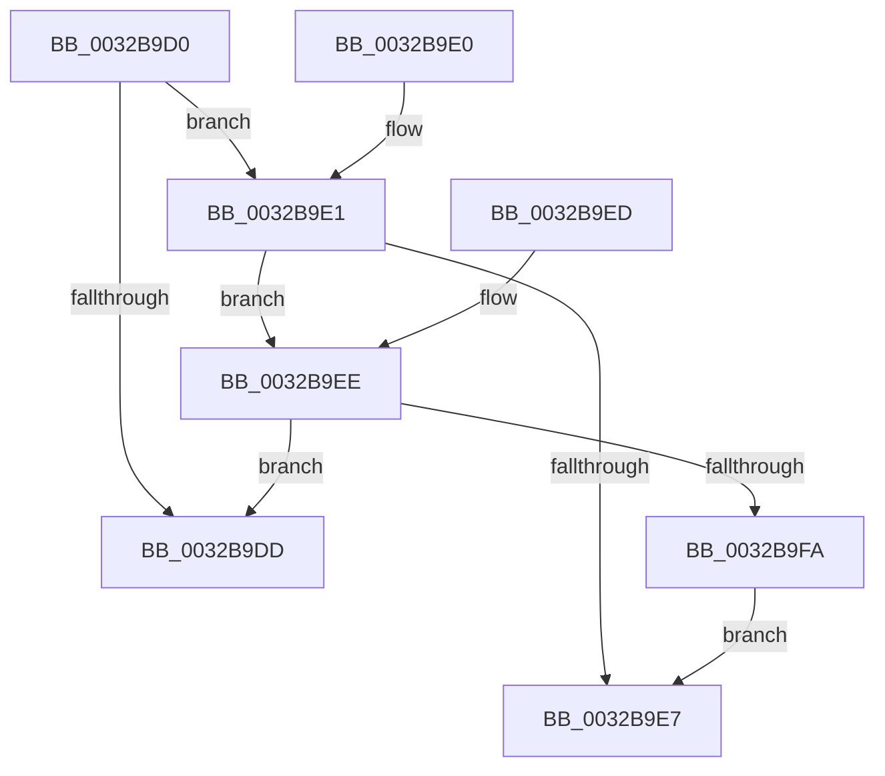

# MiPureAweVad

- RVA: `0x0032B9D0`–`0x0032B9FC` (길이 `44` bytes)
- VA: `0x000000014032B9D0`
- 실행 섹션: `.text`
- PDB 이름 있음: `예`; PDB Function 태그: `아니요`
- unwind 정보 RVA: `0x000DB714`
- 디코드: `17`개 명령, `44/44` bytes 표시
- 미해석 바이트: `0` (있으면 어셈블리에 `.byte`로 보존)

> 이 문서는 커널 이미지의 기계어와 PDB 기호를 분석해 생성했습니다. 4번과 5번은 함수 원형과 자료형을 바이너리 사용 방식에서 추정한 C 해석이며 원본 소스 복구 결과는 아닙니다.

## 1. Dependencies

- 직접 호출 지점: **0**; 고유 호출 대상: **0**
- 직접 호출자로 확인된 함수: **2**
- RIP 상대 이미지 참조: **0**

### Outgoing calls
- 직접 디코드된 call 명령이 없습니다.

### Direct callers
- [MiGetWorkingSetInfoList](../2A/MiGetWorkingSetInfoList_function_002AF770.md) at `0x002AFA06`
- [MiQueryAddressState](MiQueryAddressState_function_0032C380.md) at `0x0032C7D3`

### Static image references
- 디코드된 RIP-relative 메모리 참조가 없습니다.

## 2. Other-region calls and transfers

- 다른 실행 섹션으로 향하는 call: **0**
- 별도 외부 분기/꼬리 이동을 확인하지 못했습니다.

## 3. Assembly (complete function range)

```asm
0032B9D0  8B 41 30                        mov eax, dword ptr [rcx + 0x30]
0032B9D3  8B C8                           mov ecx, eax
0032B9D5  83 E1 70                        and ecx, 0x70
0032B9D8  80 F9 30                        cmp cl, 0x30
0032B9DB  74 04                           je 0x14032b9e1
0032B9DD  33 C0                           xor eax, eax
0032B9DF  C3                              ret
0032B9E0  CC                              int3
0032B9E1  0F BA E0 15                     bt eax, 0x15
0032B9E5  72 07                           jb 0x14032b9ee
0032B9E7  B8 01 00 00 00                  mov eax, 1
0032B9EC  C3                              ret
0032B9ED  CC                              int3
0032B9EE  25 00 00 00 0C                  and eax, 0xc000000
0032B9F3  3D 00 00 00 08                  cmp eax, 0x8000000
0032B9F8  74 E3                           je 0x14032b9dd
0032B9FA  EB EB                           jmp 0x14032b9e7
```

## 4. C-style interpretation (structured pseudocode)

```c
__int64 __fastcall MiPureAweVad(__int64 a1)
{
    __int64 result;

    a1 = (unsigned int)(((unsigned int)((unsigned int)((unsigned int)(*(unsigned int *)(a1 + 48))))) & (112));
    if (((unsigned __int8)(a1)) == 48) goto loc_0032B9E1;
loc_0032B9DD:
    result = 0;
    return result;
loc_0032B9E1:
    if (condition_is_below) goto loc_0032B9EE;
loc_0032B9E7:
    return 1;
loc_0032B9EE:
    result = (unsigned int)((1) & (0xC000000ULL));
    if (((unsigned int)(result)) == 0x8000000ULL) goto loc_0032B9DD;
    goto loc_0032B9E7;
}
```

## 5. (Beta) C Style

```c
int64_t MiPureAweVad(void *Arg1)
{
    uint8_t *arg1 = (uint8_t *)Arg1;

    int64_t result;

    Arg1 = (uint32_t)(((uint32_t)((uint32_t)((uint32_t)(*(uint32_t *)(arg1 + 0x30))))) & (112));
    if (((uint8_t)(Arg1)) == 48) goto loc_0032B9E1;
loc_0032B9DD:
    result = 0;
    return result;
loc_0032B9E1:
    if (condition_is_below) goto loc_0032B9EE;
loc_0032B9E7:
    return 1;
loc_0032B9EE:
    result = (uint32_t)((1) & (0xC000000ULL));
    if (((uint32_t)(result)) == 0x8000000ULL) goto loc_0032B9DD;
    goto loc_0032B9E7;
}
```

### 관측된 메모리 오프셋

구조체 형식이 확인되지 않은 접근은 인자 기준의 오프셋으로만 기록했습니다.

| 기준 인자 | 오프셋 표현 | 폭 (bit) | 접근 |
|---|---:|---:|---|
| `Arg1` | `+ 0x30` | `32` | `R` |

## 6. Execution-region graph

[열기: 2D/3D 그래프와 함수 탐색 컨트롤 패널](../../../control-panel.html?section=text&rva=0x0032B9D0&view=graph)

- 2D 그래프는 위에서 아래로 흐르고, 3D 그래프는 빈 공간을 드래그해 회전합니다. Shift+드래그는 이동, 휠은 확대·축소, 함수 노드 선택은 대상 보고서 이동입니다.

### Static fallback


