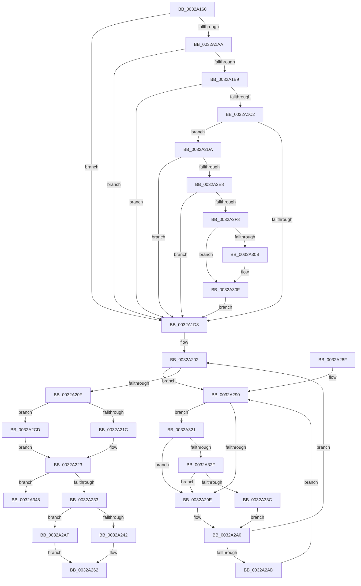

# MiReducePteUseCount

- RVA: `0x0032A160`–`0x0032A363` (길이 `515` bytes)
- VA: `0x000000014032A160`
- 실행 섹션: `.text`
- PDB 이름 있음: `예`; PDB Function 태그: `아니요`
- unwind 정보 RVA: `0x00076054`
- 디코드: `124`개 명령, `515/515` bytes 표시
- 미해석 바이트: `0` (있으면 어셈블리에 `.byte`로 보존)

> 이 문서는 커널 이미지의 기계어와 PDB 기호를 분석해 생성했습니다. 4번과 5번은 함수 원형과 자료형을 바이너리 사용 방식에서 추정한 C 해석이며 원본 소스 복구 결과는 아닙니다.

## 1. Dependencies

- 직접 호출 지점: **4**; 고유 호출 대상: **4**
- 직접 호출자로 확인된 함수: **2**
- RIP 상대 이미지 참조: **2**

### Outgoing calls
- `0x0032A2DA` → [MiPteHasShadow](MiPteHasShadow_function_0032B998.md) (function, `0x0032B998`)
- `0x0032A32F` → [KiCheckVpBackingLongSpinWaitHypercall](../30/KiCheckVpBackingLongSpinWaitHypercall_function_0030F490.md) (function, `0x0030F490`)
- `0x0032A33E` → [HvlNotifyLongSpinWait](../30/HvlNotifyLongSpinWait_function_0030F460.md) (function, `0x0030F460`)
- `0x0032A35D` → [KeBugCheckEx](../4F/KeBugCheckEx_function_004FD660.md) (function, `0x004FD660`)

### Direct callers
- [MiDecommitPagesTail](../27/MiDecommitPagesTail_function_002790FC.md) at `0x0027912D`
- [MiClearDriverTablePtes](../68/MiClearDriverTablePtes_function_00683024.md) at `0x00683158`

### Static image references
- `0x0032A292` → RVA `0x00FC52AC` (`ALMOSTRO`; reference)
- `0x0032A321` → RVA `0x00FC6AB8` (`ALMOSTRO`; read)

## 2. Other-region calls and transfers

- 다른 실행 섹션으로 향하는 call: **0**
- 별도 외부 분기/꼬리 이동을 확인하지 못했습니다.

## 3. Assembly (complete function range)

```asm
0032A160  48 89 5C 24 08                  mov qword ptr [rsp + 8], rbx
0032A165  48 89 6C 24 10                  mov qword ptr [rsp + 0x10], rbp
0032A16A  48 89 74 24 18                  mov qword ptr [rsp + 0x18], rsi
0032A16F  57                              push rdi
0032A170  48 83 EC 30                     sub rsp, 0x30
0032A174  4C 8B D2                        mov r10, rdx
0032A177  41 8B E8                        mov ebp, r8d
0032A17A  49 C1 EA 09                     shr r10, 9
0032A17E  48 B8 F8 FF FF FF 7F 00 00 00   movabs rax, 0x7ffffffff8
0032A188  4C 23 D0                        and r10, rax
0032A18B  48 B8 00 00 00 00 80 F6 FF FF   movabs rax, 0xfffff68000000000
0032A195  4C 03 D0                        add r10, rax
0032A198  4D 8B 0A                        mov r9, qword ptr [r10]
0032A19B  48 B8 00 D0 BE 7D FB F6 FF FF   movabs rax, 0xfffff6fb7dbed000
0032A1A5  4C 3B D0                        cmp r10, rax
0032A1A8  72 2E                           jb 0x14032a1d8
0032A1AA  48 B8 F8 D7 BE 7D FB F6 FF FF   movabs rax, 0xfffff6fb7dbed7f8
0032A1B4  4C 3B D0                        cmp r10, rax
0032A1B7  77 1F                           ja 0x14032a1d8
0032A1B9  49 8B D1                        mov rdx, r9
0032A1BC  41 F6 C1 01                     test r9b, 1
0032A1C0  74 16                           je 0x14032a1d8
0032A1C2  41 F6 C1 42                     test r9b, 0x42
0032A1C6  0F 95 C1                        setne cl
0032A1C9  41 F6 C1 20                     test r9b, 0x20
0032A1CD  0F 95 C0                        setne al
0032A1D0  84 C8                           test al, cl
0032A1D2  0F 84 02 01 00 00               je 0x14032a2da
0032A1D8  49 C1 E9 0C                     shr r9, 0xc
0032A1DC  48 B8 FF FF FF FF FF 00 00 00   movabs rax, 0xffffffffff
0032A1E6  4C 23 C8                        and r9, rax
0032A1E9  4B 8D 1C 49                     lea rbx, [r9 + r9*2]
0032A1ED  48 C1 E3 04                     shl rbx, 4
0032A1F1  48 B8 00 00 00 00 00 DE FF FF   movabs rax, 0xffffde0000000000
0032A1FB  48 03 D8                        add rbx, rax
0032A1FE  33 F6                           xor esi, esi
0032A200  8B FE                           mov edi, esi
0032A202  F0 48 0F BA 6B 18 3F            lock bts qword ptr [rbx + 0x18], 0x3f
0032A209  0F 82 81 00 00 00               jb 0x14032a290
0032A20F  8B 43 24                        mov eax, dword ptr [rbx + 0x24]
0032A212  0F BA E0 1A                     bt eax, 0x1a
0032A216  0F 83 B1 00 00 00               jae 0x14032a2cd
0032A21C  4C 8B 03                        mov r8, qword ptr [rbx]
0032A21F  49 C1 E8 20                     shr r8, 0x20
0032A223  41 81 E0 FF 03 00 00            and r8d, 0x3ff
0032A22A  44 3B C5                        cmp r8d, ebp
0032A22D  0F 82 15 01 00 00               jb 0x14032a348
0032A233  8B 43 24                        mov eax, dword ptr [rbx + 0x24]
0032A236  44 2B C5                        sub r8d, ebp
0032A239  45 8B C8                        mov r9d, r8d
0032A23C  0F BA E0 1A                     bt eax, 0x1a
0032A240  73 6D                           jae 0x14032a2af
0032A242  48 8B 03                        mov rax, qword ptr [rbx]
0032A245  49 C1 E1 20                     shl r9, 0x20
0032A249  49 8B C9                        mov rcx, r9
0032A24C  48 33 C8                        xor rcx, rax
0032A24F  48 B8 FF FF FF FF 00 FC FF FF   movabs rax, 0xfffffc00ffffffff
0032A259  48 23 C8                        and rcx, rax
0032A25C  49 33 C9                        xor rcx, r9
0032A25F  48 89 0B                        mov qword ptr [rbx], rcx
0032A262  48 B8 FF FF FF FF FF FF FF 7F   movabs rax, 0x7fffffffffffffff
0032A26C  F0 48 21 43 18                  lock and qword ptr [rbx + 0x18], rax
0032A271  48 8B 5C 24 40                  mov rbx, qword ptr [rsp + 0x40]
0032A276  45 85 C0                        test r8d, r8d
0032A279  48 8B 6C 24 48                  mov rbp, qword ptr [rsp + 0x48]
0032A27E  40 0F 94 C6                     sete sil
0032A282  8B C6                           mov eax, esi
0032A284  48 8B 74 24 50                  mov rsi, qword ptr [rsp + 0x50]
0032A289  48 83 C4 30                     add rsp, 0x30
0032A28D  5F                              pop rdi
0032A28E  C3                              ret
0032A28F  CC                              int3
0032A290  FF C7                           inc edi
0032A292  85 3D 14 B0 C9 00               test dword ptr [rip + 0xc9b014], edi
0032A298  0F 84 83 00 00 00               je 0x14032a321
0032A29E  F3 90                           pause
0032A2A0  48 8B 43 18                     mov rax, qword ptr [rbx + 0x18]
0032A2A4  48 85 C0                        test rax, rax
0032A2A7  0F 89 55 FF FF FF               jns 0x14032a202
0032A2AD  EB E1                           jmp 0x14032a290
0032A2AF  48 8B 4B 10                     mov rcx, qword ptr [rbx + 0x10]
0032A2B3  49 C1 E1 10                     shl r9, 0x10
0032A2B7  49 8B D1                        mov rdx, r9
0032A2BA  48 33 D1                        xor rdx, rcx
0032A2BD  48 81 E2 FF FF 00 FC            and rdx, 0xfffffffffc00ffff
0032A2C4  49 33 D1                        xor rdx, r9
0032A2C7  48 89 53 10                     mov qword ptr [rbx + 0x10], rdx
0032A2CB  EB 95                           jmp 0x14032a262
0032A2CD  4C 8B 43 10                     mov r8, qword ptr [rbx + 0x10]
0032A2D1  49 C1 E8 10                     shr r8, 0x10
0032A2D5  E9 49 FF FF FF                  jmp 0x14032a223
0032A2DA  E8 B9 16 00 00                  call 0x14032b998
0032A2DF  48 85 C0                        test rax, rax
0032A2E2  0F 84 F0 FE FF FF               je 0x14032a1d8
0032A2E8  48 8B 80 08 05 00 00            mov rax, qword ptr [rax + 0x508]
0032A2EF  48 85 C0                        test rax, rax
0032A2F2  0F 84 E0 FE FF FF               je 0x14032a1d8
0032A2F8  49 C1 EA 03                     shr r10, 3
0032A2FC  41 81 E2 FF 01 00 00            and r10d, 0x1ff
0032A303  4A 8B 04 D0                     mov rax, qword ptr [rax + r10*8]
0032A307  A8 20                           test al, 0x20
0032A309  74 04                           je 0x14032a30f
0032A30B  48 83 CA 20                     or rdx, 0x20
0032A30F  4C 8B CA                        mov r9, rdx
0032A312  49 83 C9 42                     or r9, 0x42
0032A316  A8 42                           test al, 0x42
0032A318  4C 0F 44 CA                     cmove r9, rdx
0032A31C  E9 B7 FE FF FF                  jmp 0x14032a1d8
0032A321  8B 05 91 C7 C9 00               mov eax, dword ptr [rip + 0xc9c791]
0032A327  A8 40                           test al, 0x40
0032A329  0F 84 6F FF FF FF               je 0x14032a29e
0032A32F  E8 5C 51 FE FF                  call 0x14030f490
0032A334  84 C0                           test al, al
0032A336  0F 84 62 FF FF FF               je 0x14032a29e
0032A33C  8B CF                           mov ecx, edi
0032A33E  E8 1D 51 FE FF                  call 0x14030f460
0032A343  E9 58 FF FF FF                  jmp 0x14032a2a0
0032A348  45 8B C8                        mov r9d, r8d
0032A34B  BA 90 17 04 00                  mov edx, 0x41790
0032A350  4C 8B C3                        mov r8, rbx
0032A353  48 89 6C 24 20                  mov qword ptr [rsp + 0x20], rbp
0032A358  B9 1A 00 00 00                  mov ecx, 0x1a
0032A35D  E8 FE 32 1D 00                  call 0x1404fd660
0032A362  CC                              int3
```

## 4. C-style interpretation (structured pseudocode)

```c
__int64 __fastcall MiReducePteUseCount(__int64 a1, __int64 a2, int a3)
{
    __int64 result;
    __int64 v_r10;
    __int64 v_rbx;
    __int64 v_rdi;
    __int64 v_rsi;
    __int64 v_rsp;
    unsigned __int64 v_stack_p10;
    unsigned __int64 v_stack_p18;
    unsigned __int64 v_stack_p20;
    unsigned __int64 v_stack_p8;

    v_stack_p8 = v_rbx;
    v_stack_p10 = v_rbp;
    v_stack_p18 = v_rsi;
    v_rsp = (v_rsp) - (48);
    v_r10 = (a2) >> (9);
    v_r10 = (v_r10) & (result);
    v_r10 = (v_r10) + (result);
    if (v_r10 < result) goto loc_0032A1D8;
    if (v_r10 > result) goto loc_0032A1D8;
    if ((((unsigned __int8)(*(unsigned __int64 *)(v_r10))) & (1)) == 0) goto loc_0032A1D8;
    a1 = ((((unsigned __int8)(*(unsigned __int64 *)(v_r10))) & (66)) != 0) ? 1 : 0;
    result = ((((unsigned __int8)(*(unsigned __int64 *)(v_r10))) & (32)) != 0) ? 1 : 0;
    if ((((unsigned __int8)(result)) & ((unsigned __int8)(a1))) == 0) goto loc_0032A2DA;
loc_0032A1D8:
    a4 = (*(unsigned __int64 *)(v_r10)) >> (12);
    a4 = (a4) & (result);
    v_rbx = (a4 + a4 * 2) << (4);
    v_rbx = (v_rbx) + (result);
    v_rsi = 0;
loc_0032A202:
    if (condition_is_below) goto loc_0032A290;
    if (condition_is_above_or_equal) goto loc_0032A2CD;
    a3 = (*(unsigned __int64 *)(v_rbx)) >> (32);
loc_0032A223:
    a3 = (unsigned int)((a3) & (0x3FFULL));
    if (a3 < ((unsigned int)((unsigned int)(a3)))) goto loc_0032A348;
    a3 = (unsigned int)((a3) - ((unsigned int)((unsigned int)(a3))));
    if (condition_is_above_or_equal) goto loc_0032A2AF;
    a4 = ((unsigned int)(a3)) << (32);
    a1 = (a4) ^ (*(unsigned __int64 *)(v_rbx));
    a1 = (a1) & (*(unsigned __int64 *)(v_rbx));
    a1 = (a1) ^ (a4);
    *(unsigned __int64 *)(v_rbx) = a1;
loc_0032A262:
    v_rsi = (a3 == 0) ? 1 : 0;
    v_rsp = (v_rsp) + (48);
    return (unsigned int)((unsigned int)(v_rsi));
loc_0032A290:
    v_rdi = (unsigned int)((0) + 1);
    if (((*(unsigned int *)(v_rip + 13217812)) & ((unsigned int)(v_rdi))) == 0) goto loc_0032A321;
loc_0032A29E:
loc_0032A2A0:
    if (!sign_flag) goto loc_0032A202;
    goto loc_0032A290;
loc_0032A2AF:
    a4 = (a4) << (16);
    a2 = (a4) ^ (*(unsigned __int64 *)(v_stack_p8 + 16));
    a2 = (a2) & (0xFFFFFFFFFC00FFFFULL);
    a2 = (a2) ^ (a4);
    *(unsigned __int64 *)(v_stack_p8 + 16) = a2;
    goto loc_0032A262;
loc_0032A2CD:
    a3 = (*(unsigned __int64 *)(v_stack_p8 + 16)) >> (16);
    goto loc_0032A223;
loc_0032A2DA:
    result = MiPteHasShadow(*(unsigned __int64 *)(v_stack_p8 + 16), a2, a3, a4);
    if (result == 0) goto loc_0032A1D8;
    if (*(unsigned __int64 *)(result + 1288) == 0) goto loc_0032A1D8;
    v_r10 = (v_r10) >> (3);
    v_r10 = (unsigned int)((v_r10) & (511));
    if ((((unsigned __int8)(*(unsigned __int64 *)(*(unsigned __int64 *)(result + 1288) + v_r10 * 8))) & (32)) != 0) {
        a2 = (a2) | (32);
    }
    a4 = (a2) | (66);
    if ((((unsigned __int8)(*(unsigned __int64 *)(*(unsigned __int64 *)(result + 1288) + v_r10 * 8))) & (66)) == 0) { a4 = a2; }
    goto loc_0032A1D8;
loc_0032A321:
    if ((((unsigned __int8)((unsigned int)(*(unsigned int *)(v_rip + 13223825)))) & (64)) == 0) goto loc_0032A29E;
    result = KiCheckVpBackingLongSpinWaitHypercall(*(unsigned __int64 *)(v_stack_p8 + 16), a2, a3, a4);
    if ((unsigned __int8)(result) == 0) goto loc_0032A29E;
    result = HvlNotifyLongSpinWait((unsigned int)((unsigned int)(v_rdi)), a2, a3, a4);
    goto loc_0032A2A0;
loc_0032A348:
    v_stack_p20 = v_stack_p10;
    result = KeBugCheckEx(26, (unsigned int)(0x41790ULL), v_stack_p8, (unsigned int)(a3));
    return result;
}
```

## 5. (Beta) C Style

```c
int64_t MiReducePteUseCount(int64_t Arg1, int64_t Arg2, int32_t Arg3)
{
    int64_t result;
    int64_t local_r10;
    int64_t local_rbx;
    int64_t local_rdi;
    int64_t local_rsi;
    int64_t local_rsp;
    uint64_t v_stack_p10;
    uint64_t v_stack_p18;
    uint64_t v_stack_p20;
    uint64_t v_stack_p8;

    v_stack_p8 = local_rbx;
    v_stack_p10 = local_rbp;
    v_stack_p18 = local_rsi;
    local_rsp = (local_rsp) - (48);
    local_r10 = (Arg2) >> (9);
    local_r10 = (local_r10) & (result);
    local_r10 = (local_r10) + (result);
    if (local_r10 < result) goto loc_0032A1D8;
    if (local_r10 > result) goto loc_0032A1D8;
    if ((((uint8_t)(*(uint64_t *)(local_r10))) & (1)) == 0) goto loc_0032A1D8;
    Arg1 = ((((uint8_t)(*(uint64_t *)(local_r10))) & (66)) != 0) ? 1 : 0;
    result = ((((uint8_t)(*(uint64_t *)(local_r10))) & (32)) != 0) ? 1 : 0;
    if ((((uint8_t)(result)) & ((uint8_t)(Arg1))) == 0) goto loc_0032A2DA;
loc_0032A1D8:
    a4 = (*(uint64_t *)(local_r10)) >> (12);
    a4 = (a4) & (result);
    local_rbx = (a4 + a4 * 2) << (4);
    local_rbx = (local_rbx) + (result);
    local_rsi = 0;
loc_0032A202:
    if (condition_is_below) goto loc_0032A290;
    if (condition_is_above_or_equal) goto loc_0032A2CD;
    Arg3 = (*(uint64_t *)(local_rbx)) >> (32);
loc_0032A223:
    Arg3 = (uint32_t)((Arg3) & (0x3FFULL));
    if (Arg3 < ((uint32_t)((uint32_t)(Arg3)))) goto loc_0032A348;
    Arg3 = (uint32_t)((Arg3) - ((uint32_t)((uint32_t)(Arg3))));
    if (condition_is_above_or_equal) goto loc_0032A2AF;
    a4 = ((uint32_t)(Arg3)) << (32);
    Arg1 = (a4) ^ (*(uint64_t *)(local_rbx));
    Arg1 = (Arg1) & (*(uint64_t *)(local_rbx));
    Arg1 = (Arg1) ^ (a4);
    *(uint64_t *)(local_rbx) = Arg1;
loc_0032A262:
    local_rsi = (Arg3 == 0) ? 1 : 0;
    local_rsp = (local_rsp) + (48);
    return (uint32_t)((uint32_t)(local_rsi));
loc_0032A290:
    local_rdi = (uint32_t)((0) + 1);
    if (((*(uint32_t *)(v_rip + 0xC9B014)) & ((uint32_t)(local_rdi))) == 0) goto loc_0032A321;
loc_0032A29E:
loc_0032A2A0:
    if (!sign_flag) goto loc_0032A202;
    goto loc_0032A290;
loc_0032A2AF:
    a4 = (a4) << (16);
    Arg2 = (a4) ^ (*(uint64_t *)(v_stack_p8 + 0x10));
    Arg2 = (Arg2) & (0xFFFFFFFFFC00FFFFULL);
    Arg2 = (Arg2) ^ (a4);
    *(uint64_t *)(v_stack_p8 + 0x10) = Arg2;
    goto loc_0032A262;
loc_0032A2CD:
    Arg3 = (*(uint64_t *)(v_stack_p8 + 0x10)) >> (16);
    goto loc_0032A223;
loc_0032A2DA:
    result = MiPteHasShadow(*(uint64_t *)(v_stack_p8 + 0x10), Arg2, Arg3, a4);
    if (result == 0) goto loc_0032A1D8;
    if (*(uint64_t *)(result + 0x508) == 0) goto loc_0032A1D8;
    local_r10 = (local_r10) >> (3);
    local_r10 = (uint32_t)((local_r10) & (511));
    if ((((uint8_t)(*(uint64_t *)(*(uint64_t *)(result + 0x508) + local_r10 * 8))) & (32)) != 0) {
        Arg2 = (Arg2) | (32);
    }
    a4 = (Arg2) | (66);
    if ((((uint8_t)(*(uint64_t *)(*(uint64_t *)(result + 0x508) + local_r10 * 8))) & (66)) == 0) { a4 = Arg2; }
    goto loc_0032A1D8;
loc_0032A321:
    if ((((uint8_t)((uint32_t)(*(uint32_t *)(v_rip + 0xC9C791)))) & (64)) == 0) goto loc_0032A29E;
    result = KiCheckVpBackingLongSpinWaitHypercall(*(uint64_t *)(v_stack_p8 + 0x10), Arg2, Arg3, a4);
    if ((uint8_t)(result) == 0) goto loc_0032A29E;
    result = HvlNotifyLongSpinWait((uint32_t)((uint32_t)(local_rdi)), Arg2, Arg3, a4);
    goto loc_0032A2A0;
loc_0032A348:
    v_stack_p20 = v_stack_p10;
    result = KeBugCheckEx(26, (uint32_t)(0x41790ULL), v_stack_p8, (uint32_t)(Arg3));
    return result;
}
```

## 6. Execution-region graph

[열기: 2D/3D 그래프와 함수 탐색 컨트롤 패널](../../../control-panel.html?section=text&rva=0x0032A160&view=graph)

- 2D 그래프는 위에서 아래로 흐르고, 3D 그래프는 빈 공간을 드래그해 회전합니다. Shift+드래그는 이동, 휠은 확대·축소, 함수 노드 선택은 대상 보고서 이동입니다.

### Static fallback


