# MiReleaseNonPagedResources

- RVA: `0x0032299C`–`0x00322C80` (길이 `740` bytes)
- VA: `0x000000014032299C`
- 실행 섹션: `.text`
- PDB 이름 있음: `예`; PDB Function 태그: `예`
- unwind 정보 RVA: `0x000757F8`
- 디코드: `181`개 명령, `740/740` bytes 표시
- 미해석 바이트: `0` (있으면 어셈블리에 `.byte`로 보존)

> 이 문서는 커널 이미지의 기계어와 PDB 기호를 분석해 생성했습니다. 4번과 5번은 함수 원형과 자료형을 바이너리 사용 방식에서 추정한 C 해석이며 원본 소스 복구 결과는 아닙니다.

## 1. Dependencies

- 직접 호출 지점: **13**; 고유 호출 대상: **6**
- 직접 호출자로 확인된 함수: **40**
- RIP 상대 이미지 참조: **1**

### Outgoing calls
- `0x00322B5B` → [ExAcquireSpinLockExclusiveAtDpcLevel](../24/ExAcquireSpinLockExclusiveAtDpcLevel_function_00248E80.md) (function, `0x00248E80`)
- `0x00322BA1` → [KeResetEvent](../24/KeResetEvent_function_00248350.md) (function, `0x00248350`)
- `0x00322BAC` → [MiReleaseSpinLockExclusive](../24/MiReleaseSpinLockExclusive_function_002482C0.md) (function, `0x002482C0`)
- `0x00322BD0` → [KeResetEvent](../24/KeResetEvent_function_00248350.md) (function, `0x00248350`)
- `0x00322BDE` → [ExAcquireSpinLockExclusive](../24/ExAcquireSpinLockExclusive_function_00248690.md) (function, `0x00248690`)
- `0x00322BFD` → [ExAcquireSpinLockExclusive](../24/ExAcquireSpinLockExclusive_function_00248690.md) (function, `0x00248690`)
- `0x00322C0B` → [MiRestockOverCommit](../40/MiRestockOverCommit_function_00407D94.md) (function, `0x00407D94`)
- `0x00322C19` → [MiReleaseSpinLockExclusive](../24/MiReleaseSpinLockExclusive_function_002482C0.md) (function, `0x002482C0`)
- `0x00322C31` → [KeSetEvent](../33/KeSetEvent_function_0033F310.md) (function, `0x0033F310`)
- `0x00322C3B` → [ExAcquireSpinLockExclusiveAtDpcLevel](../24/ExAcquireSpinLockExclusiveAtDpcLevel_function_00248E80.md) (function, `0x00248E80`)
- `0x00322C5F` → [KeSetEvent](../33/KeSetEvent_function_0033F310.md) (function, `0x0033F310`)
- `0x00322C6A` → [KeResetEvent](../24/KeResetEvent_function_00248350.md) (function, `0x00248350`)
- `0x00322C76` → [KeResetEvent](../24/KeResetEvent_function_00248350.md) (function, `0x00248350`)

### Direct callers
- [MiCreateUltraThreadContext](../28/MiCreateUltraThreadContext_function_00288200.md) at `0x00288376`
- [MiFindContiguousPagesEx](../28/MiFindContiguousPagesEx_function_0028BDE0.md) at `0x0028C474`
- [MiAllocateKernelStackPages](../2A/MiAllocateKernelStackPages_function_002A1BEC.md) at `0x002A225B`
- [MiAllocateKernelStackPages](../2A/MiAllocateKernelStackPages_function_002A1BEC.md) at `0x002A227D`
- [MmAllocateNonChargedSecurePages](../2C/MmAllocateNonChargedSecurePages_function_002C886C.md) at `0x002C8AE9`
- [MiCreateUltraThreadContextHelper](../2C/MiCreateUltraThreadContextHelper_function_002CB380.md) at `0x002CB4A8`
- [MiReplenishUltraPageTables](../2C/MiReplenishUltraPageTables_function_002CB4EC.md) at `0x002CB684`
- [MiFreePageFileHashPfns](../2D/MiFreePageFileHashPfns_function_002DBEF8.md) at `0x002DBFDB`
- [MiFreeSlabEntry](../2D/MiFreeSlabEntry_function_002DC650.md) at `0x002DC992`
- [MiDeleteUltraMapContext](../2D/MiDeleteUltraMapContext_function_002DC9A4.md) at `0x002DCA79`
- [MiManageUltraSpacePageTable](../2D/MiManageUltraSpacePageTable_function_002DCAF0.md) at `0x002DCE69`
- [sub_00322C9B](Unknown_function_00322C9B.md) at `0x00322DC7`
- [sub_0036CD3D](../36/Unknown_function_0036CD3D.md) at `0x0036CE51`
- [MiCreateSlabEntry](../37/MiCreateSlabEntry_function_00374DEC.md) at `0x00375458`
- [MiFreeSmallPageFromMdl](../37/MiFreeSmallPageFromMdl_function_00375D58.md) at `0x00375F14`
- [MiReplenishSlabAllocator](../37/MiReplenishSlabAllocator_function_003788E4.md) at `0x00378A0D`
- [MiReplenishSlabAllocator](../37/MiReplenishSlabAllocator_function_003788E4.md) at `0x00378ACA`
- [MiRebuildLargePage](../3B/MiRebuildLargePage_function_003BBAEC.md) at `0x003BBE19`
- [MmFreeNonChargedSecurePages](../3E/MmFreeNonChargedSecurePages_function_003E9218.md) at `0x003E9372`
- [MiFreeSecureKernelPage](../3E/MiFreeSecureKernelPage_function_003E9394.md) at `0x003E94D5`
- [MiReturnMdlCharges](../3F/MiReturnMdlCharges_function_003F6238.md) at `0x003F625D`
- [MiFreeLargePageCharges](../3F/MiFreeLargePageCharges_function_003F7FF0.md) at `0x003F7FFF`
- [MiDeleteProcessShadow](../46/MiDeleteProcessShadow_function_00465BF8.md) at `0x00465D56`
- [MiMapPageFileHash](../49/MiMapPageFileHash_function_004921E0.md) at `0x004926C1`
- [MiGetFileHashPage](../49/MiGetFileHashPage_function_004926F4.md) at `0x0049276A`
- [MiPrefetchReleasePreallocatedPages](../4B/MiPrefetchReleasePreallocatedPages_function_004BE374.md) at `0x004BE3B0`
- [MiDeleteSubsectionLargePages](../4D/MiDeleteSubsectionLargePages_function_004D51E0.md) at `0x004D54C4`
- [MiIdealClusterPage](../4D/MiIdealClusterPage_function_004DB964.md) at `0x004DBD17`
- [MiIdealClusterPage](../4D/MiIdealClusterPage_function_004DB964.md) at `0x004DBE1E`
- [MiIdealClusterPage](../4D/MiIdealClusterPage_function_004DB964.md) at `0x004DC086`
- [MiPfnRangeIsZero](../67/MiPfnRangeIsZero_function_006735C0.md) at `0x0067390E`
- [MiUnlinkBadPages](../67/MiUnlinkBadPages_function_0067A6FC.md) at `0x0067A7F1`
- [MiUnlinkBadPages](../67/MiUnlinkBadPages_function_0067A6FC.md) at `0x0067A84A`
- [MmMarkPhysicalMemoryAsBad](../67/MmMarkPhysicalMemoryAsBad_function_0067AA50.md) at `0x0067AC1A`
- [MmMarkPhysicalMemoryAsBad](../67/MmMarkPhysicalMemoryAsBad_function_0067AA50.md) at `0x0067AC77`
- [MmMarkPhysicalMemoryAsBad](../67/MmMarkPhysicalMemoryAsBad_function_0067AA50.md) at `0x0067ACE3`
- [MmMarkPhysicalMemoryAsBad](../67/MmMarkPhysicalMemoryAsBad_function_0067AA50.md) at `0x0067AF11`
- [MiMoveBadPageChargesCrossPartition](../68/MiMoveBadPageChargesCrossPartition_function_00689F60.md) at `0x00689FD3`
- [MmAllocateSecureKernelPages](../68/MmAllocateSecureKernelPages_function_0068F394.md) at `0x0068F6B4`
- [MmAllocateSecureKernelPages](../68/MmAllocateSecureKernelPages_function_0068F394.md) at `0x0068F712`
- [MiMoveBadPagePartition](../69/MiMoveBadPagePartition_function_00691924.md) at `0x00691965`
- [MiStoreReleaseReservedPageCharges](../69/MiStoreReleaseReservedPageCharges_function_00693054.md) at `0x00693062`
- [MiProcessVaContiguityInformation](../69/MiProcessVaContiguityInformation_function_006939C0.md) at `0x00693CE6`
- [sub_006DBADA](../6D/Unknown_function_006DBADA.md) at `0x006DBB17`
- [sub_006F4BF6](../6F/Unknown_function_006F4BF6.md) at `0x006F4BF6`
- [MiAllocateFastAwePages](../../page/80/MiAllocateFastAwePages_function_0080969C.md) at `0x008097B2`
- [MiAllocateProcessShadow](../../page/A5/MiAllocateProcessShadow_function_00A5F1A0.md) at `0x00A5F2DF`
- [MiChargeSystemImageCommitment](../../page/AB/MiChargeSystemImageCommitment_function_00AB5BA4.md) at `0x00AB5BC8`
- [MiCreateBootSlabEntries](../../init/C6/MiCreateBootSlabEntries_function_00C69A50.md) at `0x00C69BA3`

### Static image references
- `0x003229B2` → RVA `0x00E38D00` (`.data`; read)

## 2. Other-region calls and transfers

- 다른 실행 섹션으로 향하는 call: **0**
- call이 아닌 외부 분기/꼬리 이동: **2**
  - `0x00322C54` → [sub_006E1922](../6E/Unknown_function_006E1922.md) (`tail-transfer`)
  - `0x00322C65` → [sub_006E1922](../6E/Unknown_function_006E1922.md) (`tail-transfer`)

## 3. Assembly (complete function range)

```asm
0032299C  48 89 5C 24 10                  mov qword ptr [rsp + 0x10], rbx
003229A1  48 89 6C 24 18                  mov qword ptr [rsp + 0x18], rbp
003229A6  56                              push rsi
003229A7  57                              push rdi
003229A8  41 54                           push r12
003229AA  41 56                           push r14
003229AC  41 57                           push r15
003229AE  48 83 EC 20                     sub rsp, 0x20
003229B2  4C 8D 25 47 63 B1 00            lea r12, [rip + 0xb16347]
003229B9  48 8B FA                        mov rdi, rdx
003229BC  48 8B D9                        mov rbx, rcx
003229BF  48 8B F2                        mov rsi, rdx
003229C2  48 85 D2                        test rdx, rdx
003229C5  0F 84 A4 00 00 00               je 0x140322a6f
003229CB  48 83 B9 08 42 00 00 00         cmp qword ptr [rcx + 0x4208], 0
003229D3  41 B7 11                        mov r15b, 0x11
003229D6  0F 85 0F 02 00 00               jne 0x140322beb
003229DC  49 3B DC                        cmp rbx, r12
003229DF  75 43                           jne 0x140322a24
003229E1  65 4C 8B 04 25 20 00 00 00      mov r8, qword ptr gs:[0x20]
003229EA  41 0F 0D 88 98 8B 00 00         prefetchw byte ptr [r8 + 0x8b98]
003229F2  41 8B 90 98 8B 00 00            mov edx, dword ptr [r8 + 0x8b98]
003229F9  48 8D 04 32                     lea rax, [rdx + rsi]
003229FD  48 3D 00 01 00 00               cmp rax, 0x100
00322A03  77 1F                           ja 0x140322a24
00322A05  8D 0C 32                        lea ecx, [rdx + rsi]
00322A08  8B C2                           mov eax, edx
00322A0A  F0 41 0F B1 88 98 8B 00 00      lock cmpxchg dword ptr [r8 + 0x8b98], ecx
00322A13  48 63 C8                        movsxd rcx, eax
00322A16  48 3B CA                        cmp rcx, rdx
00322A19  0F 85 15 01 00 00               jne 0x140322b34
00322A1F  4C 8B C7                        mov r8, rdi
00322A22  EB 57                           jmp 0x140322a7b
00322A24  48 8B C6                        mov rax, rsi
00322A27  48 F7 D8                        neg rax
00322A2A  F0 48 01 83 80 4B 00 00         lock add qword ptr [rbx + 0x4b80], rax
00322A32  F0 48 0F C1 83 40 4B 00 00      lock xadd qword ptr [rbx + 0x4b40], rax
00322A3B  48 8B 93 E0 41 00 00            mov rdx, qword ptr [rbx + 0x41e0]
00322A42  48 8B C8                        mov rcx, rax
00322A45  4C 8B 83 D8 41 00 00            mov r8, qword ptr [rbx + 0x41d8]
00322A4C  48 2B CE                        sub rcx, rsi
00322A4F  48 3B C8                        cmp rcx, rax
00322A52  0F 87 B7 00 00 00               ja 0x140322b0f
00322A58  48 3B C2                        cmp rax, rdx
00322A5B  0F 83 DB 00 00 00               jae 0x140322b3c
00322A61  49 3B C8                        cmp rcx, r8
00322A64  73 09                           jae 0x140322a6f
00322A66  49 3B C0                        cmp rax, r8
00322A69  0F 83 D6 00 00 00               jae 0x140322b45
00322A6F  4C 8B C7                        mov r8, rdi
00322A72  49 3B DC                        cmp rbx, r12
00322A75  0F 85 85 00 00 00               jne 0x140322b00
00322A7B  65 4C 8B 0C 25 20 00 00 00      mov r9, qword ptr gs:[0x20]
00322A84  41 83 CA FF                     or r10d, 0xffffffff
00322A88  41 8B 91 9C 8B 00 00            mov edx, dword ptr [r9 + 0x8b9c]
00322A8F  41 3B D2                        cmp edx, r10d
00322A92  74 6C                           je 0x140322b00
00322A94  48 63 CA                        movsxd rcx, edx
00322A97  48 03 CF                        add rcx, rdi
00322A9A  48 81 F9 00 01 00 00            cmp rcx, 0x100
00322AA1  77 33                           ja 0x140322ad6
00322AA3  48 81 FF 00 00 08 00            cmp rdi, 0x80000
00322AAA  73 2A                           jae 0x140322ad6
00322AAC  8D 0C 17                        lea ecx, [rdi + rdx]
00322AAF  8B C2                           mov eax, edx
00322AB1  F0 41 0F B1 89 9C 8B 00 00      lock cmpxchg dword ptr [r9 + 0x8b9c], ecx
00322ABA  8B D0                           mov edx, eax
00322ABC  75 6B                           jne 0x140322b29
00322ABE  48 8B 5C 24 58                  mov rbx, qword ptr [rsp + 0x58]
00322AC3  48 8B 6C 24 60                  mov rbp, qword ptr [rsp + 0x60]
00322AC8  48 83 C4 20                     add rsp, 0x20
00322ACC  41 5F                           pop r15
00322ACE  41 5E                           pop r14
00322AD0  41 5C                           pop r12
00322AD2  5F                              pop rdi
00322AD3  5E                              pop rsi
00322AD4  C3                              ret
00322AD5  CC                              int3
00322AD6  B9 C0 00 00 00                  mov ecx, 0xc0
00322ADB  3B D1                           cmp edx, ecx
00322ADD  7E 1E                           jle 0x140322afd
00322ADF  41 3B D2                        cmp edx, r10d
00322AE2  74 19                           je 0x140322afd
00322AE4  8B C2                           mov eax, edx
00322AE6  F0 41 0F B1 89 9C 8B 00 00      lock cmpxchg dword ptr [r9 + 0x8b9c], ecx
00322AEF  75 0C                           jne 0x140322afd
00322AF1  8D 82 40 FF FF FF               lea eax, [rdx - 0xc0]
00322AF7  4C 63 C0                        movsxd r8, eax
00322AFA  4C 03 C7                        add r8, rdi
00322AFD  49 8B F8                        mov rdi, r8
00322B00  48 85 FF                        test rdi, rdi
00322B03  74 B9                           je 0x140322abe
00322B05  F0 48 01 BB 40 49 00 00         lock add qword ptr [rbx + 0x4940], rdi
00322B0D  EB AF                           jmp 0x140322abe
00322B0F  48 3B CA                        cmp rcx, rdx
00322B12  0F 83 2A 01 00 00               jae 0x140322c42
00322B18  49 3B C0                        cmp rax, r8
00322B1B  0F 83 4E FF FF FF               jae 0x140322a6f
00322B21  49 3B C8                        cmp rcx, r8
00322B24  E9 40 FF FF FF                  jmp 0x140322a69
00322B29  41 3B C2                        cmp eax, r10d
00322B2C  0F 85 62 FF FF FF               jne 0x140322a94
00322B32  EB A2                           jmp 0x140322ad6
00322B34  48 8B D1                        mov rdx, rcx
00322B37  E9 BD FE FF FF                  jmp 0x1403229f9
00322B3C  48 3B CA                        cmp rcx, rdx
00322B3F  0F 83 1C FF FF FF               jae 0x140322a61
00322B45  44 0F 20 C0                     mov rax, cr8
00322B49  48 8D B3 F8 41 00 00            lea rsi, [rbx + 0x41f8]
00322B50  48 8B CE                        mov rcx, rsi
00322B53  3C 02                           cmp al, 2
00322B55  0F 85 83 00 00 00               jne 0x140322bde
00322B5B  E8 20 63 F2 FF                  call 0x140248e80
00322B60  48 8B 93 40 4B 00 00            mov rdx, qword ptr [rbx + 0x4b40]
00322B67  48 8B 8B D8 41 00 00            mov rcx, qword ptr [rbx + 0x41d8]
00322B6E  4C 8B 83 E0 41 00 00            mov r8, qword ptr [rbx + 0x41e0]
00322B75  48 3B D1                        cmp rdx, rcx
00322B78  72 3C                           jb 0x140322bb6
00322B7A  48 8B 8B 30 01 00 00            mov rcx, qword ptr [rbx + 0x130]
00322B81  49 3B D0                        cmp rdx, r8
00322B84  0F 83 C6 00 00 00               jae 0x140322c50
00322B8A  83 79 04 01                     cmp dword ptr [rcx + 4], 1
00322B8E  0F 84 D6 00 00 00               je 0x140322c6a
00322B94  48 8B 8B 28 01 00 00            mov rcx, qword ptr [rbx + 0x128]
00322B9B  83 79 04 01                     cmp dword ptr [rcx + 4], 1
00322B9F  75 05                           jne 0x140322ba6
00322BA1  E8 AA 57 F2 FF                  call 0x140248350
00322BA6  41 8A D7                        mov dl, r15b
00322BA9  48 8B CE                        mov rcx, rsi
00322BAC  E8 0F 57 F2 FF                  call 0x1402482c0
00322BB1  E9 B9 FE FF FF                  jmp 0x140322a6f
00322BB6  48 8B 8B 28 01 00 00            mov rcx, qword ptr [rbx + 0x128]
00322BBD  83 79 04 00                     cmp dword ptr [rcx + 4], 0
00322BC1  74 69                           je 0x140322c2c
00322BC3  48 8B 8B 30 01 00 00            mov rcx, qword ptr [rbx + 0x130]
00322BCA  83 79 04 01                     cmp dword ptr [rcx + 4], 1
00322BCE  75 D6                           jne 0x140322ba6
00322BD0  E8 7B 57 F2 FF                  call 0x140248350
00322BD5  48 8B 8B 38 01 00 00            mov rcx, qword ptr [rbx + 0x138]
00322BDC  EB C3                           jmp 0x140322ba1
00322BDE  E8 AD 5A F2 FF                  call 0x140248690
00322BE3  44 8A F8                        mov r15b, al
00322BE6  E9 75 FF FF FF                  jmp 0x140322b60
00322BEB  44 0F 20 C0                     mov rax, cr8
00322BEF  48 8D A9 F8 41 00 00            lea rbp, [rcx + 0x41f8]
00322BF6  48 8B CD                        mov rcx, rbp
00322BF9  3C 02                           cmp al, 2
00322BFB  74 3B                           je 0x140322c38
00322BFD  E8 8E 5A F2 FF                  call 0x140248690
00322C02  44 8A F0                        mov r14b, al
00322C05  48 8B D7                        mov rdx, rdi
00322C08  48 8B CB                        mov rcx, rbx
00322C0B  E8 84 51 0E 00                  call 0x140407d94
00322C10  41 8A D6                        mov dl, r14b
00322C13  48 8B CD                        mov rcx, rbp
00322C16  48 8B F0                        mov rsi, rax
00322C19  E8 A2 56 F2 FF                  call 0x1402482c0
00322C1E  48 85 F6                        test rsi, rsi
00322C21  0F 84 48 FE FF FF               je 0x140322a6f
00322C27  E9 B0 FD FF FF                  jmp 0x1403229dc
00322C2C  45 33 C0                        xor r8d, r8d
00322C2F  33 D2                           xor edx, edx
00322C31  E8 DA C6 01 00                  call 0x14033f310
00322C36  EB 8B                           jmp 0x140322bc3
00322C38  45 8A F7                        mov r14b, r15b
00322C3B  E8 40 62 F2 FF                  call 0x140248e80
00322C40  EB C3                           jmp 0x140322c05
00322C42  48 3B C2                        cmp rax, rdx
00322C45  0F 82 FA FE FF FF               jb 0x140322b45
00322C4B  E9 C8 FE FF FF                  jmp 0x140322b18
00322C50  83 79 04 00                     cmp dword ptr [rcx + 4], 0
00322C54  0F 85 C8 EC 3B 00               jne 0x1406e1922
00322C5A  45 33 C0                        xor r8d, r8d
00322C5D  33 D2                           xor edx, edx
00322C5F  E8 AC C6 01 00                  call 0x14033f310
00322C64  90                              nop
00322C65  E9 B8 EC 3B 00                  jmp 0x1406e1922
00322C6A  E8 E1 56 F2 FF                  call 0x140248350
00322C6F  48 8B 8B 38 01 00 00            mov rcx, qword ptr [rbx + 0x138]
00322C76  E8 D5 56 F2 FF                  call 0x140248350
00322C7B  E9 14 FF FF FF                  jmp 0x140322b94
```

## 4. C-style interpretation (structured pseudocode)

```c
__int64 __fastcall MiReleaseNonPagedResources(__int64 a1, __int64 a2)
{
    __int64 result;
    __int64 v_r10;
    __int64 v_rsp;
    unsigned __int64 v_stack_p10;
    unsigned __int64 v_stack_p18;

    v_stack_p10 = v_rbx;
    v_stack_p18 = v_rbp;
    v_rsp = (v_rsp) - (32);
    if (a2 == 0) goto loc_00322A6F;
    if ((*(unsigned __int64 *)(a1 + 16904)) != 0) goto loc_00322BEB;
loc_003229DC:
    if (a1 != (v_rip + 11625287)) goto loc_00322A24;
loc_003229F9:
    if (((unsigned int)(*(unsigned int *)(*(unsigned __int64 *)(gs_base + (0 + 32)) + 35736)) + a2 * 1) > 256) goto loc_00322A24;
    if (((int)((unsigned int)((unsigned int)((unsigned int)((unsigned int)(*(unsigned int *)(*(unsigned __int64 *)(gs_base + (0 + 32)) + 35736))))))) != ((unsigned int)(*(unsigned int *)(*(unsigned __int64 *)(gs_base + (0 + 32)) + 35736)))) goto loc_00322B34;
    goto loc_00322A7B;
loc_00322A24:
    result = -(a2);
    a1 = (result) - (a2);
    if (a1 > result) goto loc_00322B0F;
    if (result >= (*(unsigned __int64 *)(a1 + 16864))) goto loc_00322B3C;
loc_00322A61:
    if (a1 >= (*(unsigned __int64 *)(a1 + 16856))) goto loc_00322A6F;
loc_00322A69:
    if (result >= (*(unsigned __int64 *)(a1 + 16856))) goto loc_00322B45;
loc_00322A6F:
    if (a1 != (v_rip + 11625287)) goto loc_00322B00;
loc_00322A7B:
    v_r10 = (unsigned int)((v_r10) | (0xFFFFFFFFULL));
    if (((unsigned int)((unsigned int)(*(unsigned int *)(*(unsigned __int64 *)(gs_base + (0 + 32)) + 35740)))) == ((unsigned int)(v_r10))) goto loc_00322B00;
loc_00322A94:
    a1 = ((int)((unsigned int)((unsigned int)(*(unsigned int *)(*(unsigned __int64 *)(gs_base + (0 + 32)) + 35740))))) + (a2);
    if (a1 > 256) goto loc_00322AD6;
    if (a2 >= 0x80000ULL) goto loc_00322AD6;
    if (a2 != 0x80000ULL) goto loc_00322B29;
loc_00322ABE:
    v_rsp = (v_rsp) + (32);
    return (unsigned int)((unsigned int)((unsigned int)(*(unsigned int *)(*(unsigned __int64 *)(gs_base + (0 + 32)) + 35740))));
loc_00322AD6:
    if (((unsigned int)((unsigned int)((unsigned int)((unsigned int)((unsigned int)((unsigned int)(*(unsigned int *)(*(unsigned __int64 *)(gs_base + (0 + 32)) + 35740)))))))) <= 192) goto loc_00322AFD;
    if (((unsigned int)((unsigned int)((unsigned int)((unsigned int)((unsigned int)((unsigned int)(*(unsigned int *)(*(unsigned __int64 *)(gs_base + (0 + 32)) + 35740)))))))) == ((unsigned int)(v_r10))) goto loc_00322AFD;
    result = (unsigned int)((unsigned int)((unsigned int)((unsigned int)((unsigned int)((unsigned int)((unsigned int)(*(unsigned int *)(*(unsigned __int64 *)(gs_base + (0 + 32)) + 35740))))))));
    if (((unsigned int)((unsigned int)((unsigned int)((unsigned int)((unsigned int)((unsigned int)(*(unsigned int *)(*(unsigned __int64 *)(gs_base + (0 + 32)) + 35740)))))))) == ((unsigned int)(v_r10))) {
        result = (unsigned int)((unsigned int)((unsigned int)((unsigned int)((unsigned int)(*(unsigned int *)(*(unsigned __int64 *)(gs_base + (0 + 32)) + 35740)))))) - 192;
        a3 = (int)((unsigned int)(result));
        a3 = (a3) + (a2);
    }
loc_00322B00:
    if (a3 == 0) goto loc_00322ABE;
    goto loc_00322ABE;
loc_00322B0F:
    if (192 >= ((unsigned int)((unsigned int)((unsigned int)((unsigned int)((unsigned int)(*(unsigned int *)(*(unsigned __int64 *)(gs_base + (0 + 32)) + 35740)))))))) goto loc_00322C42;
loc_00322B18:
    if (result >= a3) goto loc_00322A6F;
    goto loc_00322A69;
loc_00322B29:
    if (((unsigned int)(result)) != ((unsigned int)(v_r10))) goto loc_00322A94;
    goto loc_00322AD6;
loc_00322B34:
    goto loc_003229F9;
loc_00322B3C:
    if (192 >= 192) goto loc_00322A61;
loc_00322B45:
    if (((unsigned __int8)(v_cr8)) != 2) goto loc_00322BDE;
    result = ExAcquireSpinLockExclusiveAtDpcLevel(v_stack_p10 + 16888, 192, a3, *(unsigned __int64 *)(gs_base + (0 + 32)));
loc_00322B60:
    if ((*(unsigned __int64 *)(v_stack_p10 + 19264)) < (*(unsigned __int64 *)(v_stack_p10 + 16856))) goto loc_00322BB6;
    if ((*(unsigned __int64 *)(v_stack_p10 + 19264)) >= (*(unsigned __int64 *)(v_stack_p10 + 16864))) goto loc_00322C50;
    if ((*(unsigned int *)(*(unsigned __int64 *)(v_stack_p10 + 304) + 4)) == 1) goto loc_00322C6A;
loc_00322B94:
    if ((*(unsigned int *)(*(unsigned __int64 *)(v_stack_p10 + 296) + 4)) == 1) {
        result = KeResetEvent(*(unsigned __int64 *)(v_stack_p10 + 296), *(unsigned __int64 *)(v_stack_p10 + 19264), *(unsigned __int64 *)(v_stack_p10 + 16864), *(unsigned __int64 *)(gs_base + (0 + 32)));
    }
    result = MiReleaseSpinLockExclusive(v_stack_p10 + 16888, 17, *(unsigned __int64 *)(v_stack_p10 + 16864), *(unsigned __int64 *)(gs_base + (0 + 32)));
    goto loc_00322A6F;
loc_00322BB6:
    if ((*(unsigned int *)(*(unsigned __int64 *)(v_stack_p10 + 296) + 4)) == 0) goto loc_00322C2C;
loc_00322BC3:
    if ((*(unsigned int *)(*(unsigned __int64 *)(v_stack_p10 + 304) + 4)) != 1) goto loc_00322BA6;
    result = KeResetEvent(*(unsigned __int64 *)(v_stack_p10 + 304), 17, *(unsigned __int64 *)(v_stack_p10 + 16864), *(unsigned __int64 *)(gs_base + (0 + 32)));
    goto loc_00322BA1;
loc_00322BDE:
    result = ExAcquireSpinLockExclusive(*(unsigned __int64 *)(v_stack_p10 + 312), 17, *(unsigned __int64 *)(v_stack_p10 + 16864), *(unsigned __int64 *)(gs_base + (0 + 32)));
    goto loc_00322B60;
loc_00322BEB:
    if (((unsigned __int8)(v_cr8)) == 2) goto loc_00322C38;
    result = ExAcquireSpinLockExclusive(*(unsigned __int64 *)(v_stack_p10 + 312) + 16888, 17, *(unsigned __int64 *)(v_stack_p10 + 16864), *(unsigned __int64 *)(gs_base + (0 + 32)));
loc_00322C05:
    result = MiRestockOverCommit(v_stack_p10, a3, *(unsigned __int64 *)(v_stack_p10 + 16864), *(unsigned __int64 *)(gs_base + (0 + 32)));
    result = MiReleaseSpinLockExclusive(*(unsigned __int64 *)(v_stack_p10 + 312) + 16888, (unsigned __int8)((unsigned __int8)(result)), *(unsigned __int64 *)(v_stack_p10 + 16864), *(unsigned __int64 *)(gs_base + (0 + 32)));
    if (result == 0) goto loc_00322A6F;
    goto loc_003229DC;
loc_00322C2C:
    a3 = 0;
    a2 = 0;
    result = KeSetEvent(*(unsigned __int64 *)(v_stack_p10 + 312) + 16888, a2, a3, *(unsigned __int64 *)(gs_base + (0 + 32)));
    goto loc_00322BC3;
loc_00322C38:
    result = ExAcquireSpinLockExclusiveAtDpcLevel(*(unsigned __int64 *)(v_stack_p10 + 312) + 16888, a2, a3, *(unsigned __int64 *)(gs_base + (0 + 32)));
    goto loc_00322C05;
loc_00322C42:
    if (result < 0) goto loc_00322B45;
    goto loc_00322B18;
loc_00322C50:
    a3 = 0;
    a2 = 0;
    result = KeSetEvent(*(unsigned __int64 *)(v_stack_p10 + 312) + 16888, a2, a3, *(unsigned __int64 *)(gs_base + (0 + 32)));
loc_00322C6A:
    result = KeResetEvent(*(unsigned __int64 *)(v_stack_p10 + 312) + 16888, a2, a3, *(unsigned __int64 *)(gs_base + (0 + 32)));
    result = KeResetEvent(*(unsigned __int64 *)(v_stack_p10 + 312), a2, a3, *(unsigned __int64 *)(gs_base + (0 + 32)));
    goto loc_00322B94;
}
```

## 5. (Beta) C Style

```c
int64_t MiReleaseNonPagedResources(void *Arg1, int64_t Arg2)
{
    uint8_t *arg1 = (uint8_t *)Arg1;

    int64_t result;
    int64_t local_r10;
    int64_t local_rsp;
    uint64_t v_stack_p10;
    uint64_t v_stack_p18;

    v_stack_p10 = local_rbx;
    v_stack_p18 = local_rbp;
    local_rsp = (local_rsp) - (32);
    if (Arg2 == 0) goto loc_00322A6F;
    if ((*(uint64_t *)(arg1 + 0x4208)) != 0) goto loc_00322BEB;
loc_003229DC:
    if (Arg1 != (v_rip + 11625287)) goto loc_00322A24;
loc_003229F9:
    if (((uint32_t)(*(uint32_t *)(*(uint64_t *)(gs_base + (0 + 0x20)) + 0x8B98)) + Arg2 * 1) > 256) goto loc_00322A24;
    if (((int32_t)((uint32_t)((uint32_t)((uint32_t)((uint32_t)(*(uint32_t *)(*(uint64_t *)(gs_base + (0 + 0x20)) + 0x8B98))))))) != ((uint32_t)(*(uint32_t *)(*(uint64_t *)(gs_base + (0 + 0x20)) + 0x8B98)))) goto loc_00322B34;
    goto loc_00322A7B;
loc_00322A24:
    result = -(Arg2);
    Arg1 = (result) - (Arg2);
    if (Arg1 > result) goto loc_00322B0F;
    if (result >= (*(uint64_t *)(arg1 + 0x41E0))) goto loc_00322B3C;
loc_00322A61:
    if (Arg1 >= (*(uint64_t *)(arg1 + 0x41D8))) goto loc_00322A6F;
loc_00322A69:
    if (result >= (*(uint64_t *)(arg1 + 0x41D8))) goto loc_00322B45;
loc_00322A6F:
    if (Arg1 != (v_rip + 11625287)) goto loc_00322B00;
loc_00322A7B:
    local_r10 = (uint32_t)((local_r10) | (0xFFFFFFFFULL));
    if (((uint32_t)((uint32_t)(*(uint32_t *)(*(uint64_t *)(gs_base + (0 + 0x20)) + 0x8B9C)))) == ((uint32_t)(local_r10))) goto loc_00322B00;
loc_00322A94:
    Arg1 = ((int32_t)((uint32_t)((uint32_t)(*(uint32_t *)(*(uint64_t *)(gs_base + (0 + 0x20)) + 0x8B9C))))) + (Arg2);
    if (Arg1 > 256) goto loc_00322AD6;
    if (Arg2 >= 0x80000ULL) goto loc_00322AD6;
    if (Arg2 != 0x80000ULL) goto loc_00322B29;
loc_00322ABE:
    local_rsp = (local_rsp) + (32);
    return (uint32_t)((uint32_t)((uint32_t)(*(uint32_t *)(*(uint64_t *)(gs_base + (0 + 0x20)) + 0x8B9C))));
loc_00322AD6:
    if (((uint32_t)((uint32_t)((uint32_t)((uint32_t)((uint32_t)((uint32_t)(*(uint32_t *)(*(uint64_t *)(gs_base + (0 + 0x20)) + 0x8B9C)))))))) <= 192) goto loc_00322AFD;
    if (((uint32_t)((uint32_t)((uint32_t)((uint32_t)((uint32_t)((uint32_t)(*(uint32_t *)(*(uint64_t *)(gs_base + (0 + 0x20)) + 0x8B9C)))))))) == ((uint32_t)(local_r10))) goto loc_00322AFD;
    result = (uint32_t)((uint32_t)((uint32_t)((uint32_t)((uint32_t)((uint32_t)((uint32_t)(*(uint32_t *)(*(uint64_t *)(gs_base + (0 + 0x20)) + 0x8B9C))))))));
    if (((uint32_t)((uint32_t)((uint32_t)((uint32_t)((uint32_t)((uint32_t)(*(uint32_t *)(*(uint64_t *)(gs_base + (0 + 0x20)) + 0x8B9C)))))))) == ((uint32_t)(local_r10))) {
        result = (uint32_t)((uint32_t)((uint32_t)((uint32_t)((uint32_t)(*(uint32_t *)(*(uint64_t *)(gs_base + (0 + 0x20)) + 0x8B9C)))))) - 192;
        a3 = (int32_t)((uint32_t)(result));
        a3 = (a3) + (Arg2);
    }
loc_00322B00:
    if (a3 == 0) goto loc_00322ABE;
    goto loc_00322ABE;
loc_00322B0F:
    if (192 >= ((uint32_t)((uint32_t)((uint32_t)((uint32_t)((uint32_t)(*(uint32_t *)(*(uint64_t *)(gs_base + (0 + 0x20)) + 0x8B9C)))))))) goto loc_00322C42;
loc_00322B18:
    if (result >= a3) goto loc_00322A6F;
    goto loc_00322A69;
loc_00322B29:
    if (((uint32_t)(result)) != ((uint32_t)(local_r10))) goto loc_00322A94;
    goto loc_00322AD6;
loc_00322B34:
    goto loc_003229F9;
loc_00322B3C:
    if (192 >= 192) goto loc_00322A61;
loc_00322B45:
    if (((uint8_t)(v_cr8)) != 2) goto loc_00322BDE;
    result = ExAcquireSpinLockExclusiveAtDpcLevel(v_stack_p10 + 16888, 192, a3, *(uint64_t *)(gs_base + (0 + 0x20)));
loc_00322B60:
    if ((*(uint64_t *)(v_stack_p10 + 0x4B40)) < (*(uint64_t *)(v_stack_p10 + 0x41D8))) goto loc_00322BB6;
    if ((*(uint64_t *)(v_stack_p10 + 0x4B40)) >= (*(uint64_t *)(v_stack_p10 + 0x41E0))) goto loc_00322C50;
    if ((*(uint32_t *)(*(uint64_t *)(v_stack_p10 + 0x130) + 0x4)) == 1) goto loc_00322C6A;
loc_00322B94:
    if ((*(uint32_t *)(*(uint64_t *)(v_stack_p10 + 0x128) + 0x4)) == 1) {
        result = KeResetEvent(*(uint64_t *)(v_stack_p10 + 0x128), *(uint64_t *)(v_stack_p10 + 0x4B40), *(uint64_t *)(v_stack_p10 + 0x41E0), *(uint64_t *)(gs_base + (0 + 0x20)));
    }
    result = MiReleaseSpinLockExclusive(v_stack_p10 + 16888, 17, *(uint64_t *)(v_stack_p10 + 0x41E0), *(uint64_t *)(gs_base + (0 + 0x20)));
    goto loc_00322A6F;
loc_00322BB6:
    if ((*(uint32_t *)(*(uint64_t *)(v_stack_p10 + 0x128) + 0x4)) == 0) goto loc_00322C2C;
loc_00322BC3:
    if ((*(uint32_t *)(*(uint64_t *)(v_stack_p10 + 0x130) + 0x4)) != 1) goto loc_00322BA6;
    result = KeResetEvent(*(uint64_t *)(v_stack_p10 + 0x130), 17, *(uint64_t *)(v_stack_p10 + 0x41E0), *(uint64_t *)(gs_base + (0 + 0x20)));
    goto loc_00322BA1;
loc_00322BDE:
    result = ExAcquireSpinLockExclusive(*(uint64_t *)(v_stack_p10 + 0x138), 17, *(uint64_t *)(v_stack_p10 + 0x41E0), *(uint64_t *)(gs_base + (0 + 0x20)));
    goto loc_00322B60;
loc_00322BEB:
    if (((uint8_t)(v_cr8)) == 2) goto loc_00322C38;
    result = ExAcquireSpinLockExclusive(*(uint64_t *)(v_stack_p10 + 0x138) + 16888, 17, *(uint64_t *)(v_stack_p10 + 0x41E0), *(uint64_t *)(gs_base + (0 + 0x20)));
loc_00322C05:
    result = MiRestockOverCommit(v_stack_p10, a3, *(uint64_t *)(v_stack_p10 + 0x41E0), *(uint64_t *)(gs_base + (0 + 0x20)));
    result = MiReleaseSpinLockExclusive(*(uint64_t *)(v_stack_p10 + 0x138) + 16888, (uint8_t)((uint8_t)(result)), *(uint64_t *)(v_stack_p10 + 0x41E0), *(uint64_t *)(gs_base + (0 + 0x20)));
    if (result == 0) goto loc_00322A6F;
    goto loc_003229DC;
loc_00322C2C:
    a3 = 0;
    Arg2 = 0;
    result = KeSetEvent(*(uint64_t *)(v_stack_p10 + 0x138) + 16888, Arg2, a3, *(uint64_t *)(gs_base + (0 + 0x20)));
    goto loc_00322BC3;
loc_00322C38:
    result = ExAcquireSpinLockExclusiveAtDpcLevel(*(uint64_t *)(v_stack_p10 + 0x138) + 16888, Arg2, a3, *(uint64_t *)(gs_base + (0 + 0x20)));
    goto loc_00322C05;
loc_00322C42:
    if (result < 0) goto loc_00322B45;
    goto loc_00322B18;
loc_00322C50:
    a3 = 0;
    Arg2 = 0;
    result = KeSetEvent(*(uint64_t *)(v_stack_p10 + 0x138) + 16888, Arg2, a3, *(uint64_t *)(gs_base + (0 + 0x20)));
loc_00322C6A:
    result = KeResetEvent(*(uint64_t *)(v_stack_p10 + 0x138) + 16888, Arg2, a3, *(uint64_t *)(gs_base + (0 + 0x20)));
    result = KeResetEvent(*(uint64_t *)(v_stack_p10 + 0x138), Arg2, a3, *(uint64_t *)(gs_base + (0 + 0x20)));
    goto loc_00322B94;
}
```

### 관측된 메모리 오프셋

구조체 형식이 확인되지 않은 접근은 인자 기준의 오프셋으로만 기록했습니다.

| 기준 인자 | 오프셋 표현 | 폭 (bit) | 접근 |
|---|---:|---:|---|
| `Arg1` | `+ 0x41F8` | `64` | `R` |
| `Arg1` | `+ 0x4208` | `64` | `R` |

## 6. Execution-region graph

[열기: 2D/3D 그래프와 함수 탐색 컨트롤 패널](../../../control-panel.html?section=text&rva=0x0032299C&view=graph)

- 2D 그래프는 위에서 아래로 흐르고, 3D 그래프는 빈 공간을 드래그해 회전합니다. Shift+드래그는 이동, 휠은 확대·축소, 함수 노드 선택은 대상 보고서 이동입니다.

### Static fallback

```mermaid
flowchart TD
  bb_0032299C[BB_0032299C]
  bb_003229CB[BB_003229CB]
  bb_003229DC[BB_003229DC]
  bb_003229E1[BB_003229E1]
  bb_003229F9[BB_003229F9]
  bb_00322A05[BB_00322A05]
  bb_00322A1F[BB_00322A1F]
  bb_00322A24[BB_00322A24]
  bb_00322A58[BB_00322A58]
  bb_00322A61[BB_00322A61]
  bb_00322A66[BB_00322A66]
  bb_00322A69[BB_00322A69]
  bb_00322A6F[BB_00322A6F]
  bb_00322A7B[BB_00322A7B]
  bb_00322A94[BB_00322A94]
  bb_00322AA3[BB_00322AA3]
  bb_00322AAC[BB_00322AAC]
  bb_00322ABE[BB_00322ABE]
  bb_00322AD5[BB_00322AD5]
  bb_00322AD6[BB_00322AD6]
  bb_00322ADF[BB_00322ADF]
  bb_00322AE4[BB_00322AE4]
  bb_00322AF1[BB_00322AF1]
  bb_00322AFD[BB_00322AFD]
  bb_00322B00[BB_00322B00]
  bb_00322B05[BB_00322B05]
  bb_00322B0F[BB_00322B0F]
  bb_00322B18[BB_00322B18]
  bb_00322B21[BB_00322B21]
  bb_00322B29[BB_00322B29]
  bb_00322B32[BB_00322B32]
  bb_00322B34[BB_00322B34]
  bb_00322B3C[BB_00322B3C]
  bb_00322B45[BB_00322B45]
  bb_00322B5B[BB_00322B5B]
  bb_00322B60[BB_00322B60]
  bb_00322B7A[BB_00322B7A]
  bb_00322B8A[BB_00322B8A]
  bb_00322B94[BB_00322B94]
  bb_00322BA1[BB_00322BA1]
  bb_00322BA6[BB_00322BA6]
  bb_00322BB6[BB_00322BB6]
  bb_00322BC3[BB_00322BC3]
  bb_00322BD0[BB_00322BD0]
  bb_00322BDE[BB_00322BDE]
  bb_00322BEB[BB_00322BEB]
  bb_00322BFD[BB_00322BFD]
  bb_00322C05[BB_00322C05]
  bb_00322C27[BB_00322C27]
  bb_00322C2C[BB_00322C2C]
  bb_00322C38[BB_00322C38]
  bb_00322C42[BB_00322C42]
  bb_00322C4B[BB_00322C4B]
  bb_00322C50[BB_00322C50]
  bb_00322C5A[BB_00322C5A]
  bb_00322C6A[BB_00322C6A]
  bb_0032299C -->|branch| bb_00322A6F
  bb_0032299C -->|fallthrough| bb_003229CB
  bb_003229CB -->|branch| bb_00322BEB
  bb_003229CB -->|fallthrough| bb_003229DC
  bb_003229DC -->|branch| bb_00322A24
  bb_003229DC -->|fallthrough| bb_003229E1
  bb_003229E1 -->|flow| bb_003229F9
  bb_003229F9 -->|branch| bb_00322A24
  bb_003229F9 -->|fallthrough| bb_00322A05
  bb_00322A05 -->|branch| bb_00322B34
  bb_00322A05 -->|fallthrough| bb_00322A1F
  bb_00322A1F -->|branch| bb_00322A7B
  bb_00322A24 -->|branch| bb_00322B0F
  bb_00322A24 -->|fallthrough| bb_00322A58
  bb_00322A58 -->|branch| bb_00322B3C
  bb_00322A58 -->|fallthrough| bb_00322A61
  bb_00322A61 -->|branch| bb_00322A6F
  bb_00322A61 -->|fallthrough| bb_00322A66
  bb_00322A66 -->|flow| bb_00322A69
  bb_00322A69 -->|branch| bb_00322B45
  bb_00322A69 -->|fallthrough| bb_00322A6F
  bb_00322A6F -->|branch| bb_00322B00
  bb_00322A6F -->|fallthrough| bb_00322A7B
  bb_00322A7B -->|branch| bb_00322B00
  bb_00322A7B -->|fallthrough| bb_00322A94
  bb_00322A94 -->|branch| bb_00322AD6
  bb_00322A94 -->|fallthrough| bb_00322AA3
  bb_00322AA3 -->|branch| bb_00322AD6
  bb_00322AA3 -->|fallthrough| bb_00322AAC
  bb_00322AAC -->|branch| bb_00322B29
  bb_00322AAC -->|fallthrough| bb_00322ABE
  bb_00322AD5 -->|flow| bb_00322AD6
  bb_00322AD6 -->|branch| bb_00322AFD
  bb_00322AD6 -->|fallthrough| bb_00322ADF
  bb_00322ADF -->|branch| bb_00322AFD
  bb_00322ADF -->|fallthrough| bb_00322AE4
  bb_00322AE4 -->|branch| bb_00322AFD
  bb_00322AE4 -->|fallthrough| bb_00322AF1
  bb_00322AF1 -->|flow| bb_00322AFD
  bb_00322AFD -->|flow| bb_00322B00
  bb_00322B00 -->|branch| bb_00322ABE
  bb_00322B00 -->|fallthrough| bb_00322B05
  bb_00322B05 -->|branch| bb_00322ABE
  bb_00322B0F -->|branch| bb_00322C42
  bb_00322B0F -->|fallthrough| bb_00322B18
  bb_00322B18 -->|branch| bb_00322A6F
  bb_00322B18 -->|fallthrough| bb_00322B21
  bb_00322B21 -->|branch| bb_00322A69
  bb_00322B29 -->|branch| bb_00322A94
  bb_00322B29 -->|fallthrough| bb_00322B32
  bb_00322B32 -->|branch| bb_00322AD6
  bb_00322B34 -->|branch| bb_003229F9
  bb_00322B3C -->|branch| bb_00322A61
  bb_00322B3C -->|fallthrough| bb_00322B45
  bb_00322B45 -->|branch| bb_00322BDE
  bb_00322B45 -->|fallthrough| bb_00322B5B
  bb_00322B5B -->|flow| bb_00322B60
  bb_00322B60 -->|branch| bb_00322BB6
  bb_00322B60 -->|fallthrough| bb_00322B7A
  bb_00322B7A -->|branch| bb_00322C50
  bb_00322B7A -->|fallthrough| bb_00322B8A
  bb_00322B8A -->|branch| bb_00322C6A
  bb_00322B8A -->|fallthrough| bb_00322B94
  bb_00322B94 -->|branch| bb_00322BA6
  bb_00322B94 -->|fallthrough| bb_00322BA1
  bb_00322BA1 -->|flow| bb_00322BA6
  bb_00322BA6 -->|branch| bb_00322A6F
  bb_00322BB6 -->|branch| bb_00322C2C
  bb_00322BB6 -->|fallthrough| bb_00322BC3
  bb_00322BC3 -->|branch| bb_00322BA6
  bb_00322BC3 -->|fallthrough| bb_00322BD0
  bb_00322BD0 -->|branch| bb_00322BA1
  bb_00322BDE -->|branch| bb_00322B60
  bb_00322BEB -->|branch| bb_00322C38
  bb_00322BEB -->|fallthrough| bb_00322BFD
  bb_00322BFD -->|flow| bb_00322C05
  bb_00322C05 -->|branch| bb_00322A6F
  bb_00322C05 -->|fallthrough| bb_00322C27
  bb_00322C27 -->|branch| bb_003229DC
  bb_00322C2C -->|branch| bb_00322BC3
  bb_00322C38 -->|branch| bb_00322C05
  bb_00322C42 -->|branch| bb_00322B45
  bb_00322C42 -->|fallthrough| bb_00322C4B
  bb_00322C4B -->|branch| bb_00322B18
  bb_00322C50 -->|fallthrough| bb_00322C5A
  bb_00322C6A -->|branch| bb_00322B94
```


