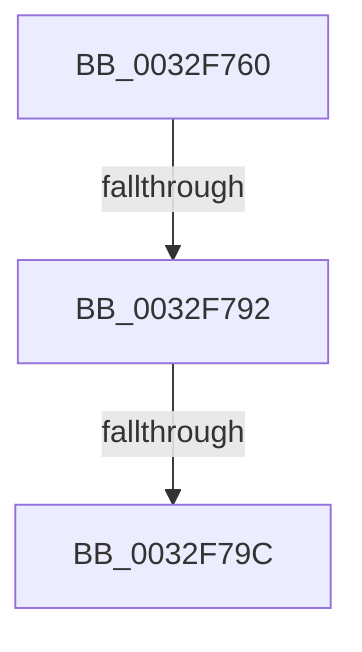

# MiResolvePrivateZeroFault

- RVA: `0x0032F760`–`0x0032F7AB` (길이 `75` bytes)
- VA: `0x000000014032F760`
- 실행 섹션: `.text`
- PDB 이름 있음: `예`; PDB Function 태그: `예`
- unwind 정보 RVA: `0x00076448`
- 디코드: `20`개 명령, `75/75` bytes 표시
- 미해석 바이트: `0` (있으면 어셈블리에 `.byte`로 보존)

> 이 문서는 커널 이미지의 기계어와 PDB 기호를 분석해 생성했습니다. 4번과 5번은 함수 원형과 자료형을 바이너리 사용 방식에서 추정한 C 해석이며 원본 소스 복구 결과는 아닙니다.

## 1. Dependencies

- 직접 호출 지점: **0**; 고유 호출 대상: **0**
- 직접 호출자로 확인된 함수: **2**
- RIP 상대 이미지 참조: **0**

### Outgoing calls
- 직접 디코드된 call 명령이 없습니다.

### Direct callers
- [sub_002B5B1B](../2B/Unknown_function_002B5B1B.md) at `0x002B5BD7`
- [sub_0032D782](Unknown_function_0032D782.md) at `0x0032DC85`

### Static image references
- 디코드된 RIP-relative 메모리 참조가 없습니다.

## 2. Other-region calls and transfers

- 다른 실행 섹션으로 향하는 call: **0**
- call이 아닌 외부 분기/꼬리 이동: **3**
  - `0x0032F790` → [sub_0032F7AB](Unknown_function_0032F7AB.md) (`tail-transfer`)
  - `0x0032F796` → [sub_0032FB87](Unknown_function_0032FB87.md) (`tail-transfer`)
  - `0x0032F7A5` → [sub_0032FB87 + 0xA](Unknown_function_0032FB87.md) (`tail-transfer`)

## 3. Assembly (complete function range)

```asm
0032F760  40 55                           push rbp
0032F762  56                              push rsi
0032F763  57                              push rdi
0032F764  41 57                           push r15
0032F766  48 8D AC 24 68 FF FF FF         lea rbp, [rsp - 0x98]
0032F76E  48 81 EC 98 01 00 00            sub rsp, 0x198
0032F775  4C 8B 51 08                     mov r10, qword ptr [rcx + 8]
0032F779  48 8B F9                        mov rdi, rcx
0032F77C  44 8B 01                        mov r8d, dword ptr [rcx]
0032F77F  4C 8B 79 10                     mov r15, qword ptr [rcx + 0x10]
0032F783  48 8B 71 38                     mov rsi, qword ptr [rcx + 0x38]
0032F787  4C 89 54 24 60                  mov qword ptr [rsp + 0x60], r10
0032F78C  41 F6 C0 02                     test r8b, 2
0032F790  74 19                           je 0x14032f7ab
0032F792  41 F6 C0 08                     test r8b, 8
0032F796  0F 84 EB 03 00 00               je 0x14032fb87
0032F79C  8B 41 20                        mov eax, dword ptr [rcx + 0x20]
0032F79F  83 E0 F8                        and eax, 0xfffffff8
0032F7A2  83 F8 10                        cmp eax, 0x10
0032F7A5  0F 84 E6 03 00 00               je 0x14032fb91
```

## 4. C-style interpretation (structured pseudocode)

```c
__int64 __fastcall MiResolvePrivateZeroFault(__int64 a1)
{
    __int64 result;
    __int64 v_rsp;
    unsigned __int64 v_stack_m158;
    unsigned __int64 v_stack_mB8;

    v_rsp = (v_rsp) - (408);
    v_stack_m158 = *(unsigned __int64 *)(a1 + 8);
    result = (unsigned int)(((unsigned int)(*(unsigned int *)(a1 + 32))) & (0xFFFFFFF8ULL));
}
```

## 5. (Beta) C Style

```c
int64_t MiResolvePrivateZeroFault(void *Arg1)
{
    uint8_t *arg1 = (uint8_t *)Arg1;

    int64_t result;
    int64_t local_rsp;
    uint64_t v_stack_m158;
    uint64_t v_stack_mB8;

    local_rsp = (local_rsp) - (408);
    v_stack_m158 = *(uint64_t *)(arg1 + 0x8);
    result = (uint32_t)(((uint32_t)(*(uint32_t *)(arg1 + 0x20))) & (0xFFFFFFF8ULL));
}
```

### 관측된 메모리 오프셋

구조체 형식이 확인되지 않은 접근은 인자 기준의 오프셋으로만 기록했습니다.

| 기준 인자 | 오프셋 표현 | 폭 (bit) | 접근 |
|---|---:|---:|---|
| `Arg1` | `+ 0x0` | `32` | `R` |
| `Arg1` | `+ 0x8` | `64` | `R` |
| `Arg1` | `+ 0x10` | `64` | `R` |
| `Arg1` | `+ 0x20` | `32` | `R` |
| `Arg1` | `+ 0x38` | `64` | `R` |

## 6. Execution-region graph

[열기: 2D/3D 그래프와 함수 탐색 컨트롤 패널](../../../control-panel.html?section=text&rva=0x0032F760&view=graph)

- 2D 그래프는 위에서 아래로 흐르고, 3D 그래프는 빈 공간을 드래그해 회전합니다. Shift+드래그는 이동, 휠은 확대·축소, 함수 노드 선택은 대상 보고서 이동입니다.

### Static fallback


