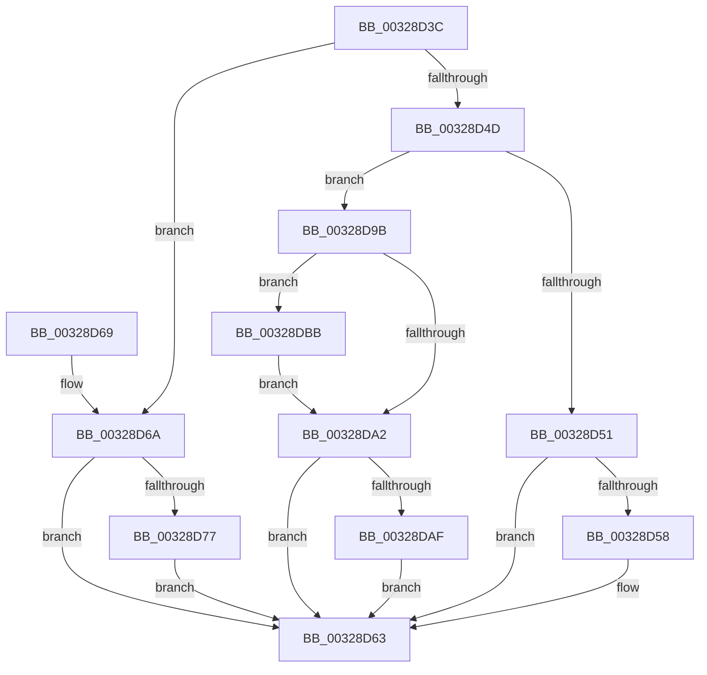

# MiReturnExcessPoolCommit

- RVA: `0x00328D3C`–`0x00328DC9` (길이 `141` bytes)
- VA: `0x0000000140328D3C`
- 실행 섹션: `.text`
- PDB 이름 있음: `예`; PDB Function 태그: `아니요`
- unwind 정보 RVA: `0x00075F7C`
- 디코드: `43`개 명령, `141/141` bytes 표시
- 미해석 바이트: `0` (있으면 어셈블리에 `.byte`로 보존)

> 이 문서는 커널 이미지의 기계어와 PDB 기호를 분석해 생성했습니다. 4번과 5번은 함수 원형과 자료형을 바이너리 사용 방식에서 추정한 C 해석이며 원본 소스 복구 결과는 아닙니다.

## 1. Dependencies

- 직접 호출 지점: **4**; 고유 호출 대상: **4**
- 직접 호출자로 확인된 함수: **1**
- RIP 상대 이미지 참조: **1**

### Outgoing calls
- `0x00328D5E` → [MiReturnPhysicalPoolPages](MiReturnPhysicalPoolPages_function_00328568.md) (function, `0x00328568`)
- `0x00328D94` → [MiReturnCommit](../24/MiReturnCommit_function_00248410.md) (function, `0x00248410`)
- `0x00328DB4` → [MiReturnExcessPoolCharges](../36/MiReturnExcessPoolCharges_function_00367C8C.md) (function, `0x00367C8C`)
- `0x00328DC2` → [MiFreeLargePageChain](../3B/MiFreeLargePageChain_function_003B8CCC.md) (function, `0x003B8CCC`)

### Direct callers
- [MiCommitPoolMemory](MiCommitPoolMemory_function_00329520.md) at `0x003295F9`

### Static image references
- `0x00328D81` → RVA `0x00E30088` (`.data`; read)

## 2. Other-region calls and transfers

- 다른 실행 섹션으로 향하는 call: **0**
- 별도 외부 분기/꼬리 이동을 확인하지 못했습니다.

## 3. Assembly (complete function range)

```asm
00328D3C  40 53                           push rbx
00328D3E  48 83 EC 20                     sub rsp, 0x20
00328D42  0F B7 41 64                     movzx eax, word ptr [rcx + 0x64]
00328D46  48 8B D9                        mov rbx, rcx
00328D49  A8 02                           test al, 2
00328D4B  75 1D                           jne 0x140328d6a
00328D4D  A8 04                           test al, 4
00328D4F  75 4A                           jne 0x140328d9b
00328D51  66 0F BA E0 08                  bt ax, 8
00328D56  72 0B                           jb 0x140328d63
00328D58  48 83 C1 10                     add rcx, 0x10
00328D5C  33 D2                           xor edx, edx
00328D5E  E8 05 F8 FF FF                  call 0x140328568
00328D63  48 83 C4 20                     add rsp, 0x20
00328D67  5B                              pop rbx
00328D68  C3                              ret
00328D69  CC                              int3
00328D6A  48 8B 41 30                     mov rax, qword ptr [rcx + 0x30]
00328D6E  48 8B 51 08                     mov rdx, qword ptr [rcx + 8]
00328D72  48 3B C2                        cmp rax, rdx
00328D75  74 EC                           je 0x140328d63
00328D77  48 2B D0                        sub rdx, rax
00328D7A  45 33 C0                        xor r8d, r8d
00328D7D  48 8B 41 48                     mov rax, qword ptr [rcx + 0x48]
00328D81  48 8B 0D 00 73 B0 00            mov rcx, qword ptr [rip + 0xb07300]
00328D88  44 0F B7 88 AE 00 00 00         movzx r9d, word ptr [rax + 0xae]
00328D90  4A 8B 0C C9                     mov rcx, qword ptr [rcx + r9*8]
00328D94  E8 77 F6 F1 FF                  call 0x140248410
00328D99  EB C8                           jmp 0x140328d63
00328D9B  48 83 79 20 00                  cmp qword ptr [rcx + 0x20], 0
00328DA0  75 19                           jne 0x140328dbb
00328DA2  48 8B 43 30                     mov rax, qword ptr [rbx + 0x30]
00328DA6  48 8B 4B 08                     mov rcx, qword ptr [rbx + 8]
00328DAA  48 3B C1                        cmp rax, rcx
00328DAD  74 B4                           je 0x140328d63
00328DAF  48 2B C8                        sub rcx, rax
00328DB2  33 D2                           xor edx, edx
00328DB4  E8 D3 EE 03 00                  call 0x140367c8c
00328DB9  EB A8                           jmp 0x140328d63
00328DBB  8A 53 66                        mov dl, byte ptr [rbx + 0x66]
00328DBE  48 83 C1 10                     add rcx, 0x10
00328DC2  E8 05 FF 08 00                  call 0x1403b8ccc
00328DC7  EB D9                           jmp 0x140328da2
```

## 4. C-style interpretation (structured pseudocode)

```c
__int64 __fastcall MiReturnExcessPoolCommit(__int64 a1, int a2, int a3)
{
    __int64 result;
    __int64 v_rsp;

    v_rsp = (v_rsp) - (32);
    if ((((unsigned __int8)(*(unsigned __int16 *)(a1 + 100))) & (2)) != 0) goto loc_00328D6A;
    if ((((unsigned __int8)(*(unsigned __int16 *)(a1 + 100))) & (4)) != 0) goto loc_00328D9B;
    result = *(unsigned __int16 *)(a1 + 100);
    if (!(condition_is_below)) {
        a1 = (a1) + (16);
        a2 = 0;
        result = MiReturnPhysicalPoolPages(a1, a2, a3, a4);
    }
    v_rsp = (v_rsp) + (32);
    return result;
loc_00328D6A:
    if ((*(unsigned __int64 *)(a1 + 48)) == (*(unsigned __int64 *)(a1 + 8))) goto loc_00328D63;
    a2 = (*(unsigned __int64 *)(a1 + 8)) - (*(unsigned __int64 *)(a1 + 48));
    a3 = 0;
    result = MiReturnCommit(*(unsigned __int64 *)(*(unsigned __int64 *)(v_rip + 11563776) + *(unsigned __int16 *)(*(unsigned __int64 *)(a1 + 72) + 174) * 8), a2, a3, *(unsigned __int16 *)(*(unsigned __int64 *)(a1 + 72) + 174));
    goto loc_00328D63;
loc_00328D9B:
    if ((*(unsigned __int64 *)(*(unsigned __int64 *)(*(unsigned __int64 *)(v_rip + 11563776) + *(unsigned __int16 *)(*(unsigned __int64 *)(a1 + 72) + 174) * 8) + 32)) != 0) goto loc_00328DBB;
loc_00328DA2:
    if ((*(unsigned __int64 *)(a1 + 48)) == (*(unsigned __int64 *)(a1 + 8))) goto loc_00328D63;
    a1 = (*(unsigned __int64 *)(a1 + 8)) - (*(unsigned __int64 *)(a1 + 48));
    a2 = 0;
    result = MiReturnExcessPoolCharges(a1, a2, a3, *(unsigned __int16 *)(*(unsigned __int64 *)(a1 + 72) + 174));
    goto loc_00328D63;
loc_00328DBB:
    a1 = (a1) + (16);
    result = MiFreeLargePageChain(a1, *(unsigned __int8 *)(a1 + 102), a3, *(unsigned __int16 *)(*(unsigned __int64 *)(a1 + 72) + 174));
    goto loc_00328DA2;
}
```

## 5. (Beta) C Style

```c
int64_t MiReturnExcessPoolCommit(void *Arg1, int32_t Arg2, int32_t Arg3)
{
    uint8_t *arg1 = (uint8_t *)Arg1;

    int64_t result;
    int64_t local_rsp;

    local_rsp = (local_rsp) - (32);
    if ((((uint8_t)(*(uint16_t *)(arg1 + 0x64))) & (2)) != 0) goto loc_00328D6A;
    if ((((uint8_t)(*(uint16_t *)(arg1 + 0x64))) & (4)) != 0) goto loc_00328D9B;
    result = *(uint16_t *)(arg1 + 0x64);
    if (!(condition_is_below)) {
        Arg1 = (Arg1) + (16);
        Arg2 = 0;
        result = MiReturnPhysicalPoolPages(Arg1, Arg2, Arg3, a4);
    }
    local_rsp = (local_rsp) + (32);
    return result;
loc_00328D6A:
    if ((*(uint64_t *)(arg1 + 0x30)) == (*(uint64_t *)(arg1 + 0x8))) goto loc_00328D63;
    Arg2 = (*(uint64_t *)(arg1 + 0x8)) - (*(uint64_t *)(arg1 + 0x30));
    Arg3 = 0;
    result = MiReturnCommit(*(uint64_t *)(*(uint64_t *)(v_rip + 0xB07300) + *(uint16_t *)(*(uint64_t *)(arg1 + 0x48) + 0xAE) * 8), Arg2, Arg3, *(uint16_t *)(*(uint64_t *)(arg1 + 0x48) + 0xAE));
    goto loc_00328D63;
loc_00328D9B:
    if ((*(uint64_t *)(*(uint64_t *)(*(uint64_t *)(v_rip + 0xB07300) + *(uint16_t *)(*(uint64_t *)(arg1 + 0x48) + 0xAE) * 8) + 0x20)) != 0) goto loc_00328DBB;
loc_00328DA2:
    if ((*(uint64_t *)(arg1 + 0x30)) == (*(uint64_t *)(arg1 + 0x8))) goto loc_00328D63;
    Arg1 = (*(uint64_t *)(arg1 + 0x8)) - (*(uint64_t *)(arg1 + 0x30));
    Arg2 = 0;
    result = MiReturnExcessPoolCharges(Arg1, Arg2, Arg3, *(uint16_t *)(*(uint64_t *)(arg1 + 0x48) + 0xAE));
    goto loc_00328D63;
loc_00328DBB:
    Arg1 = (Arg1) + (16);
    result = MiFreeLargePageChain(Arg1, *(uint8_t *)(arg1 + 0x66), Arg3, *(uint16_t *)(*(uint64_t *)(arg1 + 0x48) + 0xAE));
    goto loc_00328DA2;
}
```

### 관측된 메모리 오프셋

구조체 형식이 확인되지 않은 접근은 인자 기준의 오프셋으로만 기록했습니다.

| 기준 인자 | 오프셋 표현 | 폭 (bit) | 접근 |
|---|---:|---:|---|
| `Arg1` | `+ 0x8` | `64` | `R` |
| `Arg1` | `+ 0x20` | `64` | `R` |
| `Arg1` | `+ 0x30` | `64` | `R` |
| `Arg1` | `+ 0x48` | `64` | `R` |
| `Arg1` | `+ 0x64` | `16` | `R` |
| `Arg1` | `+ 0x66` | `8` | `R` |

## 6. Execution-region graph

[열기: 2D/3D 그래프와 함수 탐색 컨트롤 패널](../../../control-panel.html?section=text&rva=0x00328D3C&view=graph)

- 2D 그래프는 위에서 아래로 흐르고, 3D 그래프는 빈 공간을 드래그해 회전합니다. Shift+드래그는 이동, 휠은 확대·축소, 함수 노드 선택은 대상 보고서 이동입니다.

### Static fallback


