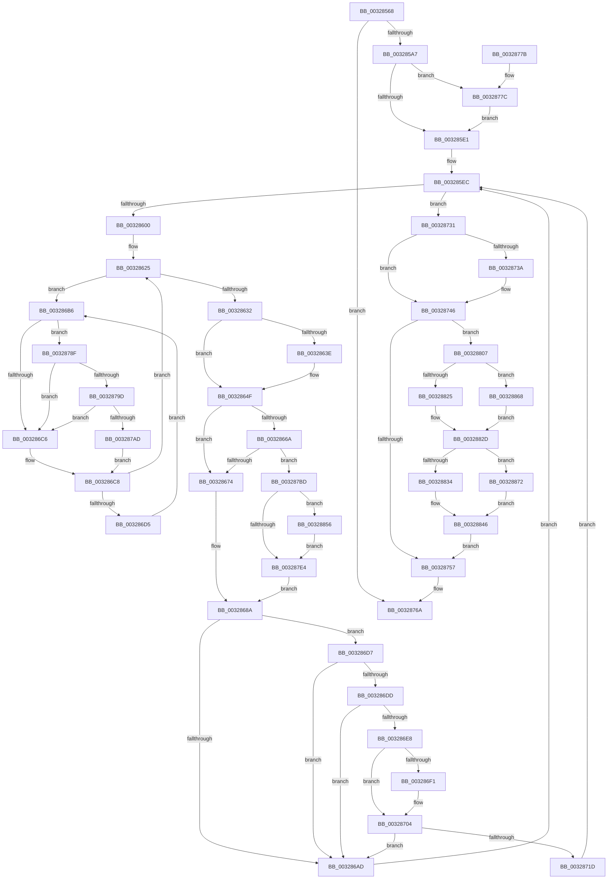

# MiReturnPhysicalPoolPages

- RVA: `0x00328568`–`0x0032888B` (길이 `803` bytes)
- VA: `0x0000000140328568`
- 실행 섹션: `.text`
- PDB 이름 있음: `예`; PDB Function 태그: `아니요`
- unwind 정보 RVA: `0x00075EE0`
- 디코드: `212`개 명령, `803/803` bytes 표시
- 미해석 바이트: `0` (있으면 어셈블리에 `.byte`로 보존)

> 이 문서는 커널 이미지의 기계어와 PDB 기호를 분석해 생성했습니다. 4번과 5번은 함수 원형과 자료형을 바이너리 사용 방식에서 추정한 C 해석이며 원본 소스 복구 결과는 아닙니다.

## 1. Dependencies

- 직접 호출 지점: **14**; 고유 호출 대상: **12**
- 직접 호출자로 확인된 함수: **4**
- RIP 상대 이미지 참조: **4**

### Outgoing calls
- `0x003285C0` → [MiMakeDemandZeroPte](../33/MiMakeDemandZeroPte_function_00337A00.md) (function, `0x00337A00`)
- `0x003285EF` → [MiUnlinkPageChainHead](../36/MiUnlinkPageChainHead_function_00365C40.md) (function, `0x00365C40`)
- `0x0032867A` → [MiInsertPageInFreeOrZeroedList](../33/MiInsertPageInFreeOrZeroedList_function_00334D20.md) (function, `0x00334D20`)
- `0x003286F8` → [KiLowerIrqlProcessIrqlFlags](../4F/KiLowerIrqlProcessIrqlFlags_function_004F5698.md) (function, `0x004F5698`)
- `0x00328720` → [KiRaiseIrqlProcessIrqlFlags](../4F/KiRaiseIrqlProcessIrqlFlags_function_004F56FC.md) (function, `0x004F56FC`)
- `0x00328741` → [KiLowerIrqlProcessIrqlFlags](../4F/KiLowerIrqlProcessIrqlFlags_function_004F5698.md) (function, `0x004F5698`)
- `0x00328765` → [MiReturnPoolCharges](../36/MiReturnPoolCharges_function_003679B4.md) (function, `0x003679B4`)
- `0x00328782` → [KiRaiseIrqlProcessIrqlFlags](../4F/KiRaiseIrqlProcessIrqlFlags_function_004F56FC.md) (function, `0x004F56FC`)
- `0x0032879D` → [KiCheckVpBackingLongSpinWaitHypercall](../30/KiCheckVpBackingLongSpinWaitHypercall_function_0030F490.md) (function, `0x0030F490`)
- `0x003287B0` → [HvlNotifyLongSpinWait](../30/HvlNotifyLongSpinWait_function_0030F460.md) (function, `0x0030F460`)
- `0x00328828` → [ExAcquireSpinLockExclusiveAtDpcLevel](../24/ExAcquireSpinLockExclusiveAtDpcLevel_function_00248E80.md) (function, `0x00248E80`)
- `0x0032884C` → [MiReleaseSpinLockExclusive](../24/MiReleaseSpinLockExclusive_function_002482C0.md) (function, `0x002482C0`)
- `0x00328859` → [MI_NODE_FROM_PFN](../2B/MI_NODE_FROM_PFN_function_002B0F30.md) (function, `0x002B0F30`)
- `0x00328868` → [ExAcquireSpinLockExclusive](../24/ExAcquireSpinLockExclusive_function_00248690.md) (function, `0x00248690`)

### Direct callers
- [MiClearNonPagedPtes](../2C/MiClearNonPagedPtes_function_002C17A0.md) at `0x002C188D`
- [MiClearNonPagedPtes](../2C/MiClearNonPagedPtes_function_002C17A0.md) at `0x002C18DA`
- [MiGetPoolPages](MiGetPoolPages_function_00327D3C.md) at `0x00327EDB`
- [MiGetPoolPages](MiGetPoolPages_function_00327D3C.md) at `0x00327F18`
- [MiReturnExcessPoolCommit](MiReturnExcessPoolCommit_function_00328D3C.md) at `0x00328D5E`
- [MiAddExpansionNonPagedPool](../68/MiAddExpansionNonPagedPool_function_00682B4C.md) at `0x00682BBC`
- [MiAddExpansionNonPagedPool](../68/MiAddExpansionNonPagedPool_function_00682B4C.md) at `0x00682CA1`

### Static image references
- `0x003285D4` → RVA `0x00FC6D20` (`ALMOSTRO`; read)
- `0x003286B9` → RVA `0x00FC52AC` (`ALMOSTRO`; reference)
- `0x0032878F` → RVA `0x00FC6AB8` (`ALMOSTRO`; read)
- `0x00328811` → RVA `0x00E2DBF8` (`.data`; read)

## 2. Other-region calls and transfers

- 다른 실행 섹션으로 향하는 call: **0**
- 별도 외부 분기/꼬리 이동을 확인하지 못했습니다.

## 3. Assembly (complete function range)

```asm
00328568  89 54 24 10                     mov dword ptr [rsp + 0x10], edx
0032856C  55                              push rbp
0032856D  53                              push rbx
0032856E  56                              push rsi
0032856F  57                              push rdi
00328570  41 54                           push r12
00328572  41 55                           push r13
00328574  41 56                           push r14
00328576  41 57                           push r15
00328578  48 8B EC                        mov rbp, rsp
0032857B  48 83 EC 78                     sub rsp, 0x78
0032857F  0F 57 C0                        xorps xmm0, xmm0
00328582  33 C0                           xor eax, eax
00328584  45 33 D2                        xor r10d, r10d
00328587  48 89 45 F0                     mov qword ptr [rbp - 0x10], rax
0032858B  44 8B E2                        mov r12d, edx
0032858E  4C 8B E9                        mov r13, rcx
00328591  0F 11 45 C0                     movups xmmword ptr [rbp - 0x40], xmm0
00328595  0F 11 45 D0                     movups xmmword ptr [rbp - 0x30], xmm0
00328599  0F 11 45 E0                     movups xmmword ptr [rbp - 0x20], xmm0
0032859D  4C 39 51 10                     cmp qword ptr [rcx + 0x10], r10
003285A1  0F 84 C3 01 00 00               je 0x14032876a
003285A7  83 CB FF                        or ebx, 0xffffffff
003285AA  4C 89 55 A8                     mov qword ptr [rbp - 0x58], r10
003285AE  8D 48 04                        lea ecx, [rax + 4]
003285B1  4C 89 55 B0                     mov qword ptr [rbp - 0x50], r10
003285B5  45 8B F2                        mov r14d, r10d
003285B8  4C 89 55 B8                     mov qword ptr [rbp - 0x48], r10
003285BC  4C 89 55 60                     mov qword ptr [rbp + 0x60], r10
003285C0  E8 3B F4 00 00                  call 0x140337a00
003285C5  48 8B F8                        mov rdi, rax
003285C8  45 0F 20 C7                     mov r15, cr8
003285CC  45 8D 4A 02                     lea r9d, [r10 + 2]
003285D0  45 0F 22 C1                     mov cr8, r9
003285D4  44 39 15 45 E7 C9 00            cmp dword ptr [rip + 0xc9e745], r10d
003285DB  0F 85 9B 01 00 00               jne 0x14032877c
003285E1  45 8B C4                        mov r8d, r12d
003285E4  41 83 E0 01                     and r8d, 1
003285E8  44 89 45 58                     mov dword ptr [rbp + 0x58], r8d
003285EC  49 8B CD                        mov rcx, r13
003285EF  E8 4C D6 03 00                  call 0x140365c40
003285F4  48 8B F0                        mov rsi, rax
003285F7  48 85 C0                        test rax, rax
003285FA  0F 84 31 01 00 00               je 0x140328731
00328600  48 B8 00 00 00 00 00 DE FF FF   movabs rax, 0xffffde0000000000
0032860A  4C 8B E6                        mov r12, rsi
0032860D  45 8B F2                        mov r14d, r10d
00328610  4C 2B E0                        sub r12, rax
00328613  48 B8 AB AA AA AA AA AA AA AA   movabs rax, 0xaaaaaaaaaaaaaaab
0032861D  49 C1 FC 04                     sar r12, 4
00328621  4C 0F AF E0                     imul r12, rax
00328625  F0 48 0F BA 6E 18 3F            lock bts qword ptr [rsi + 0x18], 0x3f
0032862C  0F 82 84 00 00 00               jb 0x1403286b6
00328632  41 B9 02 00 00 00               mov r9d, 2
00328638  44 84 4D 50                     test byte ptr [rbp + 0x50], r9b
0032863C  74 11                           je 0x14032864f
0032863E  8B 46 20                        mov eax, dword ptr [rsi + 0x20]
00328641  89 45 48                        mov dword ptr [rbp + 0x48], eax
00328644  66 44 89 55 48                  mov word ptr [rbp + 0x48], r10w
00328649  8B 45 48                        mov eax, dword ptr [rbp + 0x48]
0032864C  89 46 20                        mov dword ptr [rsi + 0x20], eax
0032864F  48 8B 46 18                     mov rax, qword ptr [rsi + 0x18]
00328653  48 B9 00 00 00 00 00 00 00 C0   movabs rcx, 0xc000000000000000
0032865D  48 23 C1                        and rax, rcx
00328660  48 89 46 18                     mov qword ptr [rsi + 0x18], rax
00328664  44 39 55 58                     cmp dword ptr [rbp + 0x58], r10d
00328668  75 0A                           jne 0x140328674
0032866A  F6 46 23 10                     test byte ptr [rsi + 0x23], 0x10
0032866E  0F 85 49 01 00 00               jne 0x1403287bd
00328674  41 8B D1                        mov edx, r9d
00328677  49 8B CC                        mov rcx, r12
0032867A  E8 A1 C6 00 00                  call 0x140334d20
0032867F  48 FF 45 C0                     inc qword ptr [rbp - 0x40]
00328683  48 FF 45 D8                     inc qword ptr [rbp - 0x28]
00328687  45 33 D2                        xor r10d, r10d
0032868A  48 B8 FF FF FF FF FF FF FF 7F   movabs rax, 0x7fffffffffffffff
00328694  F0 48 21 46 18                  lock and qword ptr [rsi + 0x18], rax
00328699  4C 8B 4D 60                     mov r9, qword ptr [rbp + 0x60]
0032869D  49 FF C1                        inc r9
003286A0  4C 89 4D 60                     mov qword ptr [rbp + 0x60], r9
003286A4  49 F7 C1 F8 01 00 00            test r9, 0x1f8
003286AB  74 2A                           je 0x1403286d7
003286AD  4C 8B 75 B8                     mov r14, qword ptr [rbp - 0x48]
003286B1  E9 36 FF FF FF                  jmp 0x1403285ec
003286B6  41 FF C6                        inc r14d
003286B9  44 85 35 EC CB C9 00            test dword ptr [rip + 0xc9cbec], r14d
003286C0  0F 84 C9 00 00 00               je 0x14032878f
003286C6  F3 90                           pause
003286C8  48 8B 46 18                     mov rax, qword ptr [rsi + 0x18]
003286CC  48 85 C0                        test rax, rax
003286CF  0F 89 50 FF FF FF               jns 0x140328625
003286D5  EB DF                           jmp 0x1403286b6
003286D7  4D 39 55 10                     cmp qword ptr [r13 + 0x10], r10
003286DB  74 D0                           je 0x1403286ad
003286DD  41 B9 02 00 00 00               mov r9d, 2
003286E3  45 3A F9                        cmp r15b, r9b
003286E6  73 C5                           jae 0x1403286ad
003286E8  44 39 15 31 E6 C9 00            cmp dword ptr [rip + 0xc9e631], r10d
003286EF  74 13                           je 0x140328704
003286F1  44 0F 20 C1                     mov rcx, cr8
003286F5  41 8A D7                        mov dl, r15b
003286F8  E8 9B CF 1C 00                  call 0x1404f5698
003286FD  45 33 D2                        xor r10d, r10d
00328700  45 8D 4A 02                     lea r9d, [r10 + 2]
00328704  41 0F B6 C7                     movzx eax, r15b
00328708  44 0F 22 C0                     mov cr8, rax
0032870C  44 0F 20 C1                     mov rcx, cr8
00328710  45 0F 22 C1                     mov cr8, r9
00328714  44 39 15 05 E6 C9 00            cmp dword ptr [rip + 0xc9e605], r10d
0032871B  74 90                           je 0x1403286ad
0032871D  41 8A D1                        mov dl, r9b
00328720  E8 D7 CF 1C 00                  call 0x1404f56fc
00328725  4C 8B 75 B8                     mov r14, qword ptr [rbp - 0x48]
00328729  45 33 D2                        xor r10d, r10d
0032872C  E9 BB FE FF FF                  jmp 0x1403285ec
00328731  44 39 15 E8 E5 C9 00            cmp dword ptr [rip + 0xc9e5e8], r10d
00328738  74 0C                           je 0x140328746
0032873A  44 0F 20 C1                     mov rcx, cr8
0032873E  41 8A D7                        mov dl, r15b
00328741  E8 52 CF 1C 00                  call 0x1404f5698
00328746  41 0F B6 C7                     movzx eax, r15b
0032874A  44 0F 22 C0                     mov cr8, rax
0032874E  4D 85 F6                        test r14, r14
00328751  0F 85 B0 00 00 00               jne 0x140328807
00328757  8B 45 58                        mov eax, dword ptr [rbp + 0x58]
0032875A  48 8D 4D C0                     lea rcx, [rbp - 0x40]
0032875E  44 8B 45 50                     mov r8d, dword ptr [rbp + 0x50]
00328762  8D 14 00                        lea edx, [rax + rax]
00328765  E8 4A F2 03 00                  call 0x1403679b4
0032876A  48 83 C4 78                     add rsp, 0x78
0032876E  41 5F                           pop r15
00328770  41 5E                           pop r14
00328772  41 5D                           pop r13
00328774  41 5C                           pop r12
00328776  5F                              pop rdi
00328777  5E                              pop rsi
00328778  5B                              pop rbx
00328779  5D                              pop rbp
0032877A  C3                              ret
0032877B  CC                              int3
0032877C  41 8A D1                        mov dl, r9b
0032877F  41 8A CF                        mov cl, r15b
00328782  E8 75 CF 1C 00                  call 0x1404f56fc
00328787  45 33 D2                        xor r10d, r10d
0032878A  E9 52 FE FF FF                  jmp 0x1403285e1
0032878F  8B 05 23 E3 C9 00               mov eax, dword ptr [rip + 0xc9e323]
00328795  A8 40                           test al, 0x40
00328797  0F 84 29 FF FF FF               je 0x1403286c6
0032879D  E8 EE 6C FE FF                  call 0x14030f490
003287A2  45 33 D2                        xor r10d, r10d
003287A5  84 C0                           test al, al
003287A7  0F 84 19 FF FF FF               je 0x1403286c6
003287AD  41 8B CE                        mov ecx, r14d
003287B0  E8 AB 6C FE FF                  call 0x14030f460
003287B5  45 33 D2                        xor r10d, r10d
003287B8  E9 0B FF FF FF                  jmp 0x1403286c8
003287BD  8B 46 20                        mov eax, dword ptr [rsi + 0x20]
003287C0  89 45 48                        mov dword ptr [rbp + 0x48], eax
003287C3  C1 E8 10                        shr eax, 0x10
003287C6  24 FD                           and al, 0xfd
003287C8  0C 05                           or al, 5
003287CA  88 45 4A                        mov byte ptr [rbp + 0x4a], al
003287CD  8B 45 48                        mov eax, dword ptr [rbp + 0x48]
003287D0  89 46 20                        mov dword ptr [rsi + 0x20], eax
003287D3  48 C7 46 08 F8 FF FF FF         mov qword ptr [rsi + 8], 0xfffffffffffffff8
003287DB  48 89 7E 10                     mov qword ptr [rsi + 0x10], rdi
003287DF  83 FB FF                        cmp ebx, -1
003287E2  74 72                           je 0x140328856
003287E4  48 8B 45 A8                     mov rax, qword ptr [rbp - 0x58]
003287E8  48 89 06                        mov qword ptr [rsi], rax
003287EB  48 8B 45 B0                     mov rax, qword ptr [rbp - 0x50]
003287EF  48 85 C0                        test rax, rax
003287F2  48 89 75 A8                     mov qword ptr [rbp - 0x58], rsi
003287F6  48 0F 44 C6                     cmove rax, rsi
003287FA  48 FF 45 B8                     inc qword ptr [rbp - 0x48]
003287FE  48 89 45 B0                     mov qword ptr [rbp - 0x50], rax
00328802  E9 83 FE FF FF                  jmp 0x14032868a
00328807  8B C3                           mov eax, ebx
00328809  48 8D 1C 40                     lea rbx, [rax + rax*2]
0032880D  48 C1 E3 07                     shl rbx, 7
00328811  48 03 1D E0 53 B0 00            add rbx, qword ptr [rip + 0xb053e0]
00328818  48 8D 7B 48                     lea rdi, [rbx + 0x48]
0032881C  48 8B CF                        mov rcx, rdi
0032881F  41 80 FF 02                     cmp r15b, 2
00328823  75 43                           jne 0x140328868
00328825  40 B6 11                        mov sil, 0x11
00328828  E8 53 06 F2 FF                  call 0x140248e80
0032882D  48 83 7B 50 00                  cmp qword ptr [rbx + 0x50], 0
00328832  75 3E                           jne 0x140328872
00328834  0F 10 45 A8                     movups xmm0, xmmword ptr [rbp - 0x58]
00328838  F2 0F 10 4D B8                  movsd xmm1, qword ptr [rbp - 0x48]
0032883D  0F 11 43 50                     movups xmmword ptr [rbx + 0x50], xmm0
00328841  F2 0F 11 4B 60                  movsd qword ptr [rbx + 0x60], xmm1
00328846  40 8A D6                        mov dl, sil
00328849  48 8B CF                        mov rcx, rdi
0032884C  E8 6F FA F1 FF                  call 0x1402482c0
00328851  E9 01 FF FF FF                  jmp 0x140328757
00328856  48 8B CE                        mov rcx, rsi
00328859  E8 D2 86 F8 FF                  call 0x1402b0f30
0032885E  8B D8                           mov ebx, eax
00328860  45 33 D2                        xor r10d, r10d
00328863  E9 7C FF FF FF                  jmp 0x1403287e4
00328868  E8 23 FE F1 FF                  call 0x140248690
0032886D  40 8A F0                        mov sil, al
00328870  EB BB                           jmp 0x14032882d
00328872  48 8B 53 58                     mov rdx, qword ptr [rbx + 0x58]
00328876  48 8B 45 A8                     mov rax, qword ptr [rbp - 0x58]
0032887A  48 89 02                        mov qword ptr [rdx], rax
0032887D  48 8B 45 B0                     mov rax, qword ptr [rbp - 0x50]
00328881  4C 01 73 60                     add qword ptr [rbx + 0x60], r14
00328885  48 89 43 58                     mov qword ptr [rbx + 0x58], rax
00328889  EB BB                           jmp 0x140328846
```

## 4. C-style interpretation (structured pseudocode)

```c
__int64 __fastcall MiReturnPhysicalPoolPages(__int64 a1, int a2)
{
    __int64 result;
    __int64 v_r10;
    __int64 v_r12;
    __int64 v_r14;
    __int64 v_rbx;
    __int64 v_rsp;
    unsigned __int64 v_stack_m50;
    unsigned __int64 v_stack_m60;
    unsigned __int64 v_stack_m68;
    unsigned __int64 v_stack_m70;
    unsigned __int64 v_stack_m80;
    unsigned __int64 v_stack_m88;
    unsigned __int64 v_stack_m90;
    unsigned __int64 v_stack_m98;
    unsigned int v_stack_p10;
    unsigned int v_stack_p18;
    unsigned __int64 v_stack_p20;
    unsigned int v_stack_p8;
    unsigned __int8 v_stack_pA;

    v_stack_p10 = a2;
    v_rsp = (v_rsp) - (120);
    result = 0;
    v_r10 = 0;
    v_stack_m50 = 0;
    v_stack_m80 = v_xmm0;
    v_stack_m70 = v_xmm0;
    v_stack_m60 = v_xmm0;
    if ((*(unsigned __int64 *)(a1 + 16)) == 0) goto loc_0032876A;
    v_rbx = (unsigned int)((v_rbx) | (0xFFFFFFFFULL));
    v_stack_m98 = 0;
    v_stack_m90 = 0;
    v_stack_m88 = 0;
    v_stack_p20 = 0;
    result = MiMakeDemandZeroPte(result + 4, a2, a3, a4);
    if ((*(unsigned int *)(v_rip + 13231941)) != 0) goto loc_0032877C;
loc_003285E1:
    a3 = (unsigned int)(((unsigned int)((unsigned int)((unsigned int)(a2)))) & (1));
    v_stack_p18 = (unsigned int)(a3);
loc_003285EC:
    result = MiUnlinkPageChainHead(a1, a2, a3, v_r10 + 2);
    if (result == 0) goto loc_00328731;
    v_r12 = (result) - (result);
    v_r12 = (v_r12) >> (4);
    v_r12 = (v_r12) * (result);
loc_00328625:
    if (condition_is_below) goto loc_003286B6;
    if (((v_stack_p10) & (2)) != 0) {
        result = *(unsigned int *)(result + 32);
        v_stack_p8 = (unsigned int)(result);
        v_stack_p8 = 0;
        result = v_stack_p8;
        *(unsigned int *)(result + 32) = (unsigned int)(result);
    }
    result = (*(unsigned __int64 *)(result + 24)) & (a1);
    *(unsigned __int64 *)(result + 24) = result;
    if (v_stack_p18 != 0) goto loc_00328674;
    if (((*(unsigned __int8 *)(result + 35)) & (16)) != 0) goto loc_003287BD;
loc_00328674:
    result = MiInsertPageInFreeOrZeroedList(v_r12, 2, a3, 2);
    v_r10 = 0;
loc_0032868A:
    a4 = (v_stack_p20) + 1;
    v_stack_p20 = a4;
    if (((a4) & (504)) == 0) goto loc_003286D7;
loc_003286AD:
    goto loc_003285EC;
loc_003286B6:
    v_r14 = (unsigned int)((v_stack_m88) + 1);
    if (((*(unsigned int *)(v_rip + 13224940)) & ((unsigned int)(v_r14))) == 0) goto loc_0032878F;
loc_003286C6:
loc_003286C8:
    if (!sign_flag) goto loc_00328625;
    goto loc_003286B6;
loc_003286D7:
    if ((*(unsigned __int64 *)(a1 + 16)) == 0) goto loc_003286AD;
    if (((unsigned __int8)(v_cr8)) >= 2) goto loc_003286AD;
    result = *(unsigned __int64 *)(result + 24);
    if ((*(unsigned int *)(v_rip + 13231665)) != 0) {
        a1 = v_r10 + 2;
        a2 = (unsigned __int8)(v_cr8);
        result = KiLowerIrqlProcessIrqlFlags(a1, a2, a3, 2);
        v_r10 = 0;
        a4 = v_r10 + 2;
    }
    if ((*(unsigned int *)(v_rip + 13231621)) == 0) goto loc_003286AD;
    result = KiRaiseIrqlProcessIrqlFlags((unsigned __int8)(v_cr8), (unsigned __int8)(a4), a3, a4);
    v_r10 = 0;
    goto loc_003285EC;
loc_00328731:
    if ((*(unsigned int *)(v_rip + 13231592)) != 0) {
        a1 = a4;
        a2 = (unsigned __int8)(v_cr8);
        result = KiLowerIrqlProcessIrqlFlags(a1, a2, a3, a4);
    }
    if (v_stack_m88 != 0) goto loc_00328807;
loc_00328757:
    result = MiReturnPoolCharges(v_stack_m80, (unsigned int)(v_stack_p18) + (unsigned int)(v_stack_p18) * 1, (unsigned int)(v_stack_p10), a4);
loc_0032876A:
    v_rsp = (v_rsp) + (120);
    return result;
loc_0032877C:
    result = KiRaiseIrqlProcessIrqlFlags((unsigned __int8)(v_cr8), (unsigned __int8)(a4), (unsigned int)(v_stack_p10), a4);
    v_r10 = 0;
    goto loc_003285E1;
loc_0032878F:
    if ((((unsigned __int8)((unsigned int)(*(unsigned int *)(v_rip + 13230883)))) & (64)) == 0) goto loc_003286C6;
    result = KiCheckVpBackingLongSpinWaitHypercall((unsigned __int8)(v_cr8), (unsigned __int8)(a4), (unsigned int)(v_stack_p10), a4);
    v_r10 = 0;
    if ((unsigned __int8)(result) == 0) goto loc_003286C6;
    result = HvlNotifyLongSpinWait((unsigned int)((unsigned int)(v_stack_m88)), (unsigned __int8)(a4), (unsigned int)(v_stack_p10), a4);
    v_r10 = 0;
    goto loc_003286C8;
loc_003287BD:
    v_stack_p8 = (unsigned int)((unsigned int)(*(unsigned int *)(result + 32)));
    result = (unsigned int)(((unsigned int)(*(unsigned int *)(result + 32))) >> (16));
    result = (unsigned __int8)((result) & (253));
    result = (unsigned __int8)((result) | (5));
    v_stack_pA = (unsigned __int8)(result);
    *(unsigned int *)(result + 32) = (unsigned int)((unsigned int)(v_stack_p8));
    *(unsigned __int64 *)(result + 8) = -8;
    *(unsigned __int64 *)(result + 16) = result;
    if (((unsigned int)(v_rbx)) == -1) goto loc_00328856;
loc_003287E4:
    *(unsigned __int64 *)(result) = v_stack_m98;
    v_stack_m98 = result;
    result = v_stack_m90;
    if (v_stack_m90 == 0) { result = result; }
    v_stack_m90 = result;
    goto loc_0032868A;
loc_00328807:
    v_rbx = ((unsigned int)((unsigned int)(v_rbx)) + (unsigned int)((unsigned int)(v_rbx)) * 2) << (7);
    v_rbx = (v_rbx) + (*(unsigned __int64 *)(v_rip + 11555808));
    if (((unsigned __int8)(v_cr8)) != 2) goto loc_00328868;
    result = ExAcquireSpinLockExclusiveAtDpcLevel(v_rbx + 72, (unsigned __int8)(a4), (unsigned int)(v_stack_p10), a4);
loc_0032882D:
    if ((*(unsigned __int64 *)(v_rbx + 80)) != 0) goto loc_00328872;
    *(unsigned __int64 *)(v_rbx + 80) = v_xmm0;
    *(unsigned __int64 *)(v_rbx + 96) = v_xmm1;
loc_00328846:
    result = MiReleaseSpinLockExclusive(v_rbx + 72, 17, (unsigned int)(v_stack_p10), a4);
    goto loc_00328757;
loc_00328856:
    result = MI_NODE_FROM_PFN(17, 17, (unsigned int)(v_stack_p10), a4);
    v_r10 = 0;
    goto loc_003287E4;
loc_00328868:
    result = ExAcquireSpinLockExclusive(17, 17, (unsigned int)(v_stack_p10), a4);
    goto loc_0032882D;
loc_00328872:
    *(unsigned __int64 *)(*(unsigned __int64 *)((unsigned int)((unsigned int)(result)) + 88)) = v_stack_m98;
    *(unsigned __int64 *)((unsigned int)((unsigned int)(result)) + 88) = v_stack_m90;
    goto loc_00328846;
}
```

## 5. (Beta) C Style

```c
int64_t MiReturnPhysicalPoolPages(void *Arg1, int32_t Arg2)
{
    uint8_t *arg1 = (uint8_t *)Arg1;

    int64_t result;
    int64_t local_r10;
    int64_t local_r12;
    int64_t local_r14;
    int64_t local_rbx;
    int64_t local_rsp;
    uint64_t v_stack_m50;
    uint64_t v_stack_m60;
    uint64_t v_stack_m68;
    uint64_t v_stack_m70;
    uint64_t v_stack_m80;
    uint64_t v_stack_m88;
    uint64_t v_stack_m90;
    uint64_t v_stack_m98;
    uint32_t v_stack_p10;
    uint32_t v_stack_p18;
    uint64_t v_stack_p20;
    uint32_t v_stack_p8;
    uint8_t v_stack_pA;

    v_stack_p10 = Arg2;
    local_rsp = (local_rsp) - (120);
    result = 0;
    local_r10 = 0;
    v_stack_m50 = 0;
    v_stack_m80 = v_xmm0;
    v_stack_m70 = v_xmm0;
    v_stack_m60 = v_xmm0;
    if ((*(uint64_t *)(arg1 + 0x10)) == 0) goto loc_0032876A;
    local_rbx = (uint32_t)((local_rbx) | (0xFFFFFFFFULL));
    v_stack_m98 = 0;
    v_stack_m90 = 0;
    v_stack_m88 = 0;
    v_stack_p20 = 0;
    result = MiMakeDemandZeroPte(result + 4, Arg2, a3, a4);
    if ((*(uint32_t *)(v_rip + 0xC9E745)) != 0) goto loc_0032877C;
loc_003285E1:
    a3 = (uint32_t)(((uint32_t)((uint32_t)((uint32_t)(Arg2)))) & (1));
    v_stack_p18 = (uint32_t)(a3);
loc_003285EC:
    result = MiUnlinkPageChainHead(Arg1, Arg2, a3, local_r10 + 2);
    if (result == 0) goto loc_00328731;
    local_r12 = (result) - (result);
    local_r12 = (local_r12) >> (4);
    local_r12 = (local_r12) * (result);
loc_00328625:
    if (condition_is_below) goto loc_003286B6;
    if (((v_stack_p10) & (2)) != 0) {
        result = *(uint32_t *)(result + 0x20);
        v_stack_p8 = (uint32_t)(result);
        v_stack_p8 = 0;
        result = v_stack_p8;
        *(uint32_t *)(result + 0x20) = (uint32_t)(result);
    }
    result = (*(uint64_t *)(result + 0x18)) & (Arg1);
    *(uint64_t *)(result + 0x18) = result;
    if (v_stack_p18 != 0) goto loc_00328674;
    if (((*(uint8_t *)(result + 0x23)) & (16)) != 0) goto loc_003287BD;
loc_00328674:
    result = MiInsertPageInFreeOrZeroedList(local_r12, 2, a3, 2);
    local_r10 = 0;
loc_0032868A:
    a4 = (v_stack_p20) + 1;
    v_stack_p20 = a4;
    if (((a4) & (504)) == 0) goto loc_003286D7;
loc_003286AD:
    goto loc_003285EC;
loc_003286B6:
    local_r14 = (uint32_t)((v_stack_m88) + 1);
    if (((*(uint32_t *)(v_rip + 0xC9CBEC)) & ((uint32_t)(local_r14))) == 0) goto loc_0032878F;
loc_003286C6:
loc_003286C8:
    if (!sign_flag) goto loc_00328625;
    goto loc_003286B6;
loc_003286D7:
    if ((*(uint64_t *)(arg1 + 0x10)) == 0) goto loc_003286AD;
    if (((uint8_t)(v_cr8)) >= 2) goto loc_003286AD;
    result = *(uint64_t *)(result + 0x18);
    if ((*(uint32_t *)(v_rip + 0xC9E631)) != 0) {
        Arg1 = local_r10 + 2;
        Arg2 = (uint8_t)(v_cr8);
        result = KiLowerIrqlProcessIrqlFlags(Arg1, Arg2, a3, 2);
        local_r10 = 0;
        a4 = local_r10 + 2;
    }
    if ((*(uint32_t *)(v_rip + 0xC9E605)) == 0) goto loc_003286AD;
    result = KiRaiseIrqlProcessIrqlFlags((uint8_t)(v_cr8), (uint8_t)(a4), a3, a4);
    local_r10 = 0;
    goto loc_003285EC;
loc_00328731:
    if ((*(uint32_t *)(v_rip + 0xC9E5E8)) != 0) {
        Arg1 = a4;
        Arg2 = (uint8_t)(v_cr8);
        result = KiLowerIrqlProcessIrqlFlags(Arg1, Arg2, a3, a4);
    }
    if (v_stack_m88 != 0) goto loc_00328807;
loc_00328757:
    result = MiReturnPoolCharges(v_stack_m80, (uint32_t)(v_stack_p18) + (uint32_t)(v_stack_p18) * 1, (uint32_t)(v_stack_p10), a4);
loc_0032876A:
    local_rsp = (local_rsp) + (120);
    return result;
loc_0032877C:
    result = KiRaiseIrqlProcessIrqlFlags((uint8_t)(v_cr8), (uint8_t)(a4), (uint32_t)(v_stack_p10), a4);
    local_r10 = 0;
    goto loc_003285E1;
loc_0032878F:
    if ((((uint8_t)((uint32_t)(*(uint32_t *)(v_rip + 0xC9E323)))) & (64)) == 0) goto loc_003286C6;
    result = KiCheckVpBackingLongSpinWaitHypercall((uint8_t)(v_cr8), (uint8_t)(a4), (uint32_t)(v_stack_p10), a4);
    local_r10 = 0;
    if ((uint8_t)(result) == 0) goto loc_003286C6;
    result = HvlNotifyLongSpinWait((uint32_t)((uint32_t)(v_stack_m88)), (uint8_t)(a4), (uint32_t)(v_stack_p10), a4);
    local_r10 = 0;
    goto loc_003286C8;
loc_003287BD:
    v_stack_p8 = (uint32_t)((uint32_t)(*(uint32_t *)(result + 0x20)));
    result = (uint32_t)(((uint32_t)(*(uint32_t *)(result + 0x20))) >> (16));
    result = (uint8_t)((result) & (253));
    result = (uint8_t)((result) | (5));
    v_stack_pA = (uint8_t)(result);
    *(uint32_t *)(result + 0x20) = (uint32_t)((uint32_t)(v_stack_p8));
    *(uint64_t *)(result + 0x8) = -8;
    *(uint64_t *)(result + 0x10) = result;
    if (((uint32_t)(local_rbx)) == -1) goto loc_00328856;
loc_003287E4:
    *(uint64_t *)(result) = v_stack_m98;
    v_stack_m98 = result;
    result = v_stack_m90;
    if (v_stack_m90 == 0) { result = result; }
    v_stack_m90 = result;
    goto loc_0032868A;
loc_00328807:
    local_rbx = ((uint32_t)((uint32_t)(local_rbx)) + (uint32_t)((uint32_t)(local_rbx)) * 2) << (7);
    local_rbx = (local_rbx) + (*(uint64_t *)(v_rip + 0xB053E0));
    if (((uint8_t)(v_cr8)) != 2) goto loc_00328868;
    result = ExAcquireSpinLockExclusiveAtDpcLevel(local_rbx + 72, (uint8_t)(a4), (uint32_t)(v_stack_p10), a4);
loc_0032882D:
    if ((*(uint64_t *)(local_rbx + 0x50)) != 0) goto loc_00328872;
    *(uint64_t *)(local_rbx + 0x50) = v_xmm0;
    *(uint64_t *)(local_rbx + 0x60) = v_xmm1;
loc_00328846:
    result = MiReleaseSpinLockExclusive(local_rbx + 72, 17, (uint32_t)(v_stack_p10), a4);
    goto loc_00328757;
loc_00328856:
    result = MI_NODE_FROM_PFN(17, 17, (uint32_t)(v_stack_p10), a4);
    local_r10 = 0;
    goto loc_003287E4;
loc_00328868:
    result = ExAcquireSpinLockExclusive(17, 17, (uint32_t)(v_stack_p10), a4);
    goto loc_0032882D;
loc_00328872:
    *(uint64_t *)(*(uint64_t *)((uint32_t)((uint32_t)(result)) + 0x58)) = v_stack_m98;
    *(uint64_t *)((uint32_t)((uint32_t)(result)) + 0x58) = v_stack_m90;
    goto loc_00328846;
}
```

### 관측된 메모리 오프셋

구조체 형식이 확인되지 않은 접근은 인자 기준의 오프셋으로만 기록했습니다.

| 기준 인자 | 오프셋 표현 | 폭 (bit) | 접근 |
|---|---:|---:|---|
| `Arg1` | `+ 0x10` | `64` | `R` |

## 6. Execution-region graph

[열기: 2D/3D 그래프와 함수 탐색 컨트롤 패널](../../../control-panel.html?section=text&rva=0x00328568&view=graph)

- 2D 그래프는 위에서 아래로 흐르고, 3D 그래프는 빈 공간을 드래그해 회전합니다. Shift+드래그는 이동, 휠은 확대·축소, 함수 노드 선택은 대상 보고서 이동입니다.

### Static fallback


