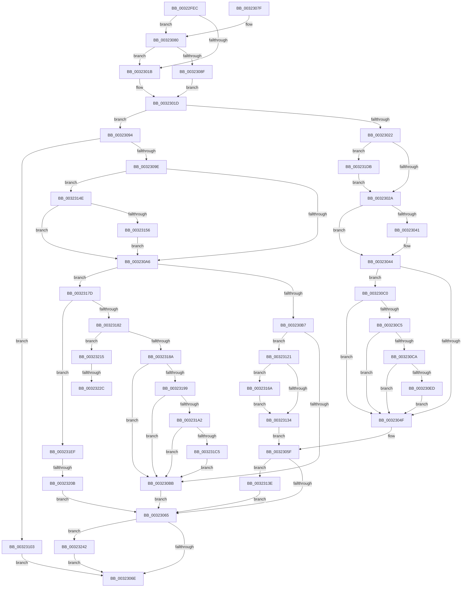

# MiRewritePteWithLockBit

- RVA: `0x00322FEC`–`0x0032325E` (길이 `626` bytes)
- VA: `0x0000000140322FEC`
- 실행 섹션: `.text`
- PDB 이름 있음: `예`; PDB Function 태그: `예`
- unwind 정보 RVA: `0x000758E0`
- 디코드: `158`개 명령, `626/626` bytes 표시
- 미해석 바이트: `0` (있으면 어셈블리에 `.byte`로 보존)

> 이 문서는 커널 이미지의 기계어와 PDB 기호를 분석해 생성했습니다. 4번과 5번은 함수 원형과 자료형을 바이너리 사용 방식에서 추정한 C 해석이며 원본 소스 복구 결과는 아닙니다.

## 1. Dependencies

- 직접 호출 지점: **17**; 고유 호출 대상: **12**
- 직접 호출자로 확인된 함수: **20**
- RIP 상대 이미지 참조: **2**

### Outgoing calls
- `0x0032302F` → [MiLockPte](../3E/MiLockPte_function_003EC090.md) (function, `0x003EC090`)
- `0x00323058` → [MiPteInShadowRange](../23/MiPteInShadowRange_function_0023FB00.md) (function, `0x0023FB00`)
- `0x003230A9` → [MI_READ_PTE_LOCK_FREE](../28/MI_READ_PTE_LOCK_FREE_function_002828A0.md) (function, `0x002828A0`)
- `0x003230F9` → [MiCheckLinearProtectedPteAccessedBit](../29/MiCheckLinearProtectedPteAccessedBit_function_00292D80.md) (function, `0x00292D80`)
- `0x00323106` → [MiLockNestedPageTable](../23/MiLockNestedPageTable_function_0023E890.md) (function, `0x0023E890`)
- `0x00323117` → [MiUnlockNestedPageTableWritePte](../23/MiUnlockNestedPageTableWritePte_function_0023F4E4.md) (function, `0x0023F4E4`)
- `0x0032312B` → [MiPteInShadowRange](../23/MiPteInShadowRange_function_0023FB00.md) (function, `0x0023FB00`)
- `0x00323144` → [MiWritePteShadow](../29/MiWritePteShadow_function_00294EAC.md) (function, `0x00294EAC`)
- `0x00323160` → [ExAcquireSpinLockExclusiveAtDpcLevel](../24/ExAcquireSpinLockExclusiveAtDpcLevel_function_00248E80.md) (function, `0x00248E80`)
- `0x0032316F` → [MiSanitizeShadowPxe](../29/MiSanitizeShadowPxe_function_00294B68.md) (function, `0x00294B68`)
- `0x003231D1` → [MiCheckLinearProtectedPteAccessedBit](../29/MiCheckLinearProtectedPteAccessedBit_function_00292D80.md) (function, `0x00292D80`)
- `0x003231E5` → [ExAcquireSpinLockExclusiveAtDpcLevel](../24/ExAcquireSpinLockExclusiveAtDpcLevel_function_00248E80.md) (function, `0x00248E80`)
- `0x0032320B` → [MiWriteValidPteNewProtection](../28/MiWriteValidPteNewProtection_function_00281810.md) (function, `0x00281810`)
- `0x0032321F` → [MiPteInShadowRange](../23/MiPteInShadowRange_function_0023FB00.md) (function, `0x0023FB00`)
- `0x00323231` → [MiSanitizeShadowPxe](../29/MiSanitizeShadowPxe_function_00294B68.md) (function, `0x00294B68`)
- `0x00323248` → [MiReplicatePteChange](../4F/MiReplicatePteChange_function_004F8A24.md) (function, `0x004F8A24`)
- `0x00323254` → [ExReleaseSpinLockExclusiveFromDpcLevel](../24/ExReleaseSpinLockExclusiveFromDpcLevel_function_002497E0.md) (function, `0x002497E0`)

### Direct callers
- [MiClearMappingAndDereferenceIoSpace](../24/MiClearMappingAndDereferenceIoSpace_function_00247DF0.md) at `0x002480EF`
- [MiStealPage](../2B/MiStealPage_function_002B28D0.md) at `0x002B36AA`
- [MiRevertValidPte](../2C/MiRevertValidPte_function_002C5160.md) at `0x002C5489`
- [sub_002C7147](../2C/Unknown_function_002C7147.md) at `0x002C7155`
- [sub_0032002D](Unknown_function_0032002D.md) at `0x0032005C`
- [MiGetUltraMapping](MiGetUltraMapping_function_00323270.md) at `0x0032347C`
- [MiGetUltraMapping](MiGetUltraMapping_function_00323270.md) at `0x003235C0`
- [MiDecommitLargePoolVa](../37/MiDecommitLargePoolVa_function_00377DD4.md) at `0x00377E63`
- [MiUnmapMdlCommon](../3E/MiUnmapMdlCommon_function_003E7DF0.md) at `0x003E8064`
- [sub_00436E2A](../43/Unknown_function_00436E2A.md) at `0x00436E56`
- [MiDeleteUltraMapHierarchy](../47/MiDeleteUltraMapHierarchy_function_004722FC.md) at `0x0047235E`
- [MiDeleteLargeUserPde](../4C/MiDeleteLargeUserPde_function_004C4D54.md) at `0x004C4E10`
- [MiProtectAweRegion](../4C/MiProtectAweRegion_function_004CE62C.md) at `0x004CEC54`
- [MiMapMdlWithLargePages](../4D/MiMapMdlWithLargePages_function_004D10B8.md) at `0x004D1282`
- [MiDecommitLargePte](../4D/MiDecommitLargePte_function_004D1ED4.md) at `0x004D1F6E`
- [MiDereferenceHugeContext](../4D/MiDereferenceHugeContext_function_004D9664.md) at `0x004D9772`
- [MiWriteAweClusterPte](../4E/MiWriteAweClusterPte_function_004E16A8.md) at `0x004E177F`
- [MiScrubLargeMappedPage](../69/MiScrubLargeMappedPage_function_00693E2C.md) at `0x00694066`
- [sub_006DB1A0](../6D/Unknown_function_006DB1A0.md) at `0x006DB1C7`
- [sub_006F91FE](../6F/Unknown_function_006F91FE.md) at `0x006F9320`
- [MiProtectLargeKernelHalRange](../../page/7F/MiProtectLargeKernelHalRange_function_007F8D20.md) at `0x007F8E1F`

### Static image references
- `0x00323034` → RVA `0x00FC6A88` (`ALMOSTRO`; read)
- `0x00323156` → RVA `0x00E374C0` (`.data`; read)

## 2. Other-region calls and transfers

- 다른 실행 섹션으로 향하는 call: **0**
- call이 아닌 외부 분기/꼬리 이동: **3**
  - `0x00323205` → [sub_006E1950](../6E/Unknown_function_006E1950.md) (`tail-transfer`)
  - `0x00323226` → [sub_006E1950 + 0xE](../6E/Unknown_function_006E1950.md) (`tail-transfer`)
  - `0x0032323D` → [sub_006E1950 + 0xE](../6E/Unknown_function_006E1950.md) (`tail-transfer`)

## 3. Assembly (complete function range)

```asm
00322FEC  48 89 5C 24 10                  mov qword ptr [rsp + 0x10], rbx
00322FF1  55                              push rbp
00322FF2  56                              push rsi
00322FF3  57                              push rdi
00322FF4  41 56                           push r14
00322FF6  41 57                           push r15
00322FF8  48 83 EC 20                     sub rsp, 0x20
00322FFC  49 8B D9                        mov rbx, r9
00322FFF  49 8B F8                        mov rdi, r8
00323002  48 8B E9                        mov rbp, rcx
00323005  45 33 F6                        xor r14d, r14d
00323008  48 B8 00 D0 BE 7D FB F6 FF FF   movabs rax, 0xfffff6fb7dbed000
00323012  45 8D 7E 01                     lea r15d, [r14 + 1]
00323016  4C 3B C0                        cmp r8, rax
00323019  73 65                           jae 0x140323080
0032301B  33 F6                           xor esi, esi
0032301D  48 85 ED                        test rbp, rbp
00323020  75 72                           jne 0x140323094
00323022  85 F6                           test esi, esi
00323024  0F 85 B1 01 00 00               jne 0x1403231db
0032302A  33 D2                           xor edx, edx
0032302C  48 8B CF                        mov rcx, rdi
0032302F  E8 5C 90 0C 00                  call 0x1403ec090
00323034  48 F7 05 49 3A CA 00 00 00 00 02  test qword ptr [rip + 0xca3a49], 0x2000000
0032303F  74 03                           je 0x140323044
00323041  0F AE E8                        lfence
00323044  48 0F BA 25 3B 3A CA 00 24      bt qword ptr [rip + 0xca3a3b], 0x24
0032304D  72 71                           jb 0x1403230c0
0032304F  48 8B C3                        mov rax, rbx
00323052  48 8B CF                        mov rcx, rdi
00323055  48 87 07                        xchg qword ptr [rdi], rax
00323058  E8 A3 CA F1 FF                  call 0x14023fb00
0032305D  85 C0                           test eax, eax
0032305F  0F 85 D9 00 00 00               jne 0x14032313e
00323065  45 85 F6                        test r14d, r14d
00323068  0F 85 D4 01 00 00               jne 0x140323242
0032306E  48 8B 5C 24 58                  mov rbx, qword ptr [rsp + 0x58]
00323073  48 83 C4 20                     add rsp, 0x20
00323077  41 5F                           pop r15
00323079  41 5E                           pop r14
0032307B  5F                              pop rdi
0032307C  5E                              pop rsi
0032307D  5D                              pop rbp
0032307E  C3                              ret
0032307F  CC                              int3
00323080  48 B8 FF DF BE 7D FB F6 FF FF   movabs rax, 0xfffff6fb7dbedfff
0032308A  48 3B F8                        cmp rdi, rax
0032308D  77 8C                           ja 0x14032301b
0032308F  41 8B F7                        mov esi, r15d
00323092  EB 89                           jmp 0x14032301d
00323094  8B 81 B8 00 00 00               mov eax, dword ptr [rcx + 0xb8]
0032309A  85 D2                           test edx, edx
0032309C  74 65                           je 0x140323103
0032309E  85 F6                           test esi, esi
003230A0  0F 85 A8 00 00 00               jne 0x14032314e
003230A6  48 8B CF                        mov rcx, rdi
003230A9  E8 F2 F7 F5 FF                  call 0x1402828a0
003230AE  41 84 DF                        test r15b, bl
003230B1  0F 85 C6 00 00 00               jne 0x14032317d
003230B7  85 F6                           test esi, esi
003230B9  75 66                           jne 0x140323121
003230BB  48 89 1F                        mov qword ptr [rdi], rbx
003230BE  EB A5                           jmp 0x140323065
003230C0  41 84 DF                        test r15b, bl
003230C3  74 8A                           je 0x14032304f
003230C5  F6 C3 20                        test bl, 0x20
003230C8  75 85                           jne 0x14032304f
003230CA  48 B8 00 00 00 00 80 F6 FF FF   movabs rax, 0xfffff68000000000
003230D4  48 8B C0                        mov rax, rax
003230D7  48 B9 00 00 00 00 40 00 00 00   movabs rcx, 0x4000000000
003230E1  48 03 C1                        add rax, rcx
003230E4  48 3B F8                        cmp rdi, rax
003230E7  0F 82 62 FF FF FF               jb 0x14032304f
003230ED  41 B8 80 00 00 00               mov r8d, 0x80
003230F3  48 8B D3                        mov rdx, rbx
003230F6  48 8B CF                        mov rcx, rdi
003230F9  E8 82 FC F6 FF                  call 0x140292d80
003230FE  E9 4C FF FF FF                  jmp 0x14032304f
00323103  48 8B D7                        mov rdx, rdi
00323106  E8 85 B7 F1 FF                  call 0x14023e890
0032310B  45 33 C9                        xor r9d, r9d
0032310E  4C 8B C3                        mov r8, rbx
00323111  48 8B D7                        mov rdx, rdi
00323114  48 8B CD                        mov rcx, rbp
00323117  E8 C8 C3 F1 FF                  call 0x14023f4e4
0032311C  E9 4D FF FF FF                  jmp 0x14032306e
00323121  48 8B CF                        mov rcx, rdi
00323124  48 89 5C 24 60                  mov qword ptr [rsp + 0x60], rbx
00323129  33 F6                           xor esi, esi
0032312B  E8 D0 C9 F1 FF                  call 0x14023fb00
00323130  85 C0                           test eax, eax
00323132  75 36                           jne 0x14032316a
00323134  48 89 1F                        mov qword ptr [rdi], rbx
00323137  85 F6                           test esi, esi
00323139  E9 21 FF FF FF                  jmp 0x14032305f
0032313E  48 8B D3                        mov rdx, rbx
00323141  48 8B CF                        mov rcx, rdi
00323144  E8 63 1D F7 FF                  call 0x140294eac
00323149  E9 17 FF FF FF                  jmp 0x140323065
0032314E  A8 0F                           test al, 0xf
00323150  0F 84 50 FF FF FF               je 0x1403230a6
00323156  48 8D 0D 63 43 B1 00            lea rcx, [rip + 0xb14363]
0032315D  45 8B F7                        mov r14d, r15d
00323160  E8 1B 5D F2 FF                  call 0x140248e80
00323165  E9 3C FF FF FF                  jmp 0x1403230a6
0032316A  48 8D 54 24 60                  lea rdx, [rsp + 0x60]
0032316F  E8 F4 19 F7 FF                  call 0x140294b68
00323174  48 8B 5C 24 60                  mov rbx, qword ptr [rsp + 0x60]
00323179  8B F0                           mov esi, eax
0032317B  EB B7                           jmp 0x140323134
0032317D  41 84 C7                        test r15b, al
00323180  75 6D                           jne 0x1403231ef
00323182  85 F6                           test esi, esi
00323184  0F 85 8B 00 00 00               jne 0x140323215
0032318A  48 0F BA 25 F5 38 CA 00 24      bt qword ptr [rip + 0xca38f5], 0x24
00323193  0F 83 22 FF FF FF               jae 0x1403230bb
00323199  F6 C3 20                        test bl, 0x20
0032319C  0F 85 19 FF FF FF               jne 0x1403230bb
003231A2  48 B8 00 00 00 00 80 F6 FF FF   movabs rax, 0xfffff68000000000
003231AC  48 8B C0                        mov rax, rax
003231AF  48 B9 00 00 00 00 40 00 00 00   movabs rcx, 0x4000000000
003231B9  48 03 C1                        add rax, rcx
003231BC  48 3B F8                        cmp rdi, rax
003231BF  0F 82 F6 FE FF FF               jb 0x1403230bb
003231C5  41 B8 80 00 00 00               mov r8d, 0x80
003231CB  48 8B D3                        mov rdx, rbx
003231CE  48 8B CF                        mov rcx, rdi
003231D1  E8 AA FB F6 FF                  call 0x140292d80
003231D6  E9 E0 FE FF FF                  jmp 0x1403230bb
003231DB  48 8D 0D DE 42 B1 00            lea rcx, [rip + 0xb142de]
003231E2  45 8B F7                        mov r14d, r15d
003231E5  E8 96 5C F2 FF                  call 0x140248e80
003231EA  E9 3B FE FF FF                  jmp 0x14032302a
003231EF  48 B9 00 F0 FF FF FF FF 0F 00   movabs rcx, 0xffffffffff000
003231F9  48 33 C3                        xor rax, rbx
003231FC  48 85 C1                        test rcx, rax
003231FF  48 8B D3                        mov rdx, rbx
00323202  48 8B CF                        mov rcx, rdi
00323205  0F 85 45 E7 3B 00               jne 0x1406e1950
0032320B  E8 00 E6 F5 FF                  call 0x140281810
00323210  E9 50 FE FF FF                  jmp 0x140323065
00323215  48 8B CF                        mov rcx, rdi
00323218  48 89 5C 24 50                  mov qword ptr [rsp + 0x50], rbx
0032321D  33 F6                           xor esi, esi
0032321F  E8 DC C8 F1 FF                  call 0x14023fb00
00323224  85 C0                           test eax, eax
00323226  0F 84 32 E7 3B 00               je 0x1406e195e
0032322C  48 8D 54 24 50                  lea rdx, [rsp + 0x50]
00323231  E8 32 19 F7 FF                  call 0x140294b68
00323236  48 8B 5C 24 50                  mov rbx, qword ptr [rsp + 0x50]
0032323B  8B F0                           mov esi, eax
0032323D  E9 1C E7 3B 00                  jmp 0x1406e195e
00323242  41 8B D7                        mov edx, r15d
00323245  48 8B CF                        mov rcx, rdi
00323248  E8 D7 57 1D 00                  call 0x1404f8a24
0032324D  48 8D 0D 6C 42 B1 00            lea rcx, [rip + 0xb1426c]
00323254  E8 87 65 F2 FF                  call 0x1402497e0
00323259  E9 10 FE FF FF                  jmp 0x14032306e
```

## 4. C-style interpretation (structured pseudocode)

```c
__int64 __fastcall MiRewritePteWithLockBit(__int64 a1, int a2, __int64 a3, __int64 a4)
{
    __int64 result;
    __int64 v_r14;
    __int64 v_rsi;
    __int64 v_rsp;
    unsigned __int64 v_stack_p10;
    unsigned __int64 v_stack_p50;
    unsigned __int64 v_stack_p60;

    v_stack_p10 = v_rbx;
    v_rsp = (v_rsp) - (32);
    v_r14 = 0;
    if (a3 >= result) goto loc_00323080;
loc_0032301B:
    v_rsi = 0;
loc_0032301D:
    if (a1 != 0) goto loc_00323094;
    if (0 != 0) goto loc_003231DB;
loc_0032302A:
    a2 = 0;
    result = MiLockPte(a3, a2, a3, a4);
    if (((*(unsigned __int64 *)(v_rip + 13253193)) & (0x2000000ULL)) != 0) {
    }
    if (condition_is_below) goto loc_003230C0;
loc_0032304F:
    result = MiPteInShadowRange(a3, a2, a3, a4);
loc_0032305F:
    if ((unsigned int)(result) != 0) goto loc_0032313E;
loc_00323065:
    if (0 != 0) goto loc_00323242;
loc_0032306E:
    v_rsp = (v_rsp) + (32);
    return result;
loc_00323080:
    if (a3 > result) goto loc_0032301B;
    goto loc_0032301D;
loc_00323094:
    if (0 == 0) goto loc_00323103;
    if ((unsigned int)((unsigned int)((unsigned int)(v_r14 + 1))) != 0) goto loc_0032314E;
loc_003230A6:
    result = MI_READ_PTE_LOCK_FREE(a3, a2, a3, a4);
    if ((((unsigned __int8)(v_r14 + 1)) & ((unsigned __int8)(v_stack_p10))) != 0) goto loc_0032317D;
    if ((unsigned int)((unsigned int)((unsigned int)(v_r14 + 1))) != 0) goto loc_00323121;
loc_003230BB:
    *(unsigned __int64 *)(a3) = v_stack_p10;
    goto loc_00323065;
loc_003230C0:
    if ((((unsigned __int8)(v_r14 + 1)) & ((unsigned __int8)(v_stack_p10))) == 0) goto loc_0032304F;
    if ((((unsigned __int8)(v_stack_p10)) & (32)) != 0) goto loc_0032304F;
    result = (result) + (a3);
    if (a3 < result) goto loc_0032304F;
    result = MiCheckLinearProtectedPteAccessedBit(a3, v_stack_p10, 128, a4);
    goto loc_0032304F;
loc_00323103:
    result = MiLockNestedPageTable(a3, a3, 128, a4);
    a4 = 0;
    result = MiUnlockNestedPageTableWritePte(a1, a3, v_stack_p10, a4);
    goto loc_0032306E;
loc_00323121:
    v_stack_p60 = v_stack_p10;
    v_rsi = 0;
    result = MiPteInShadowRange(a3, a3, v_stack_p10, a4);
    if ((unsigned int)(result) != 0) goto loc_0032316A;
loc_00323134:
    *(unsigned __int64 *)(a3) = v_stack_p10;
    goto loc_0032305F;
loc_0032313E:
    result = MiWritePteShadow(a3, v_stack_p10, v_stack_p10, a4);
    goto loc_00323065;
loc_0032314E:
    if ((((unsigned __int8)(result)) & (15)) == 0) goto loc_003230A6;
    result = ExAcquireSpinLockExclusiveAtDpcLevel(v_rip + 11617123, v_stack_p10, v_stack_p10, a4);
    goto loc_003230A6;
loc_0032316A:
    result = MiSanitizeShadowPxe(v_rip + 11617123, v_stack_p60, v_stack_p10, a4);
    goto loc_00323134;
loc_0032317D:
    if ((((unsigned __int8)(v_r14 + 1)) & ((unsigned __int8)(result))) != 0) goto loc_003231EF;
    if ((unsigned int)((unsigned int)((unsigned int)(result))) != 0) goto loc_00323215;
    if (condition_is_above_or_equal) goto loc_003230BB;
    if ((((unsigned __int8)(v_stack_p60)) & (32)) != 0) goto loc_003230BB;
    result = (result) + (v_rip + 11617123);
    if (a3 < result) goto loc_003230BB;
    result = MiCheckLinearProtectedPteAccessedBit(a3, v_stack_p60, 128, a4);
    goto loc_003230BB;
loc_003231DB:
    result = ExAcquireSpinLockExclusiveAtDpcLevel(v_rip + 11616990, v_stack_p60, 128, a4);
    goto loc_0032302A;
loc_003231EF:
    result = (result) ^ (v_stack_p60);
    result = MiWriteValidPteNewProtection(a3, v_stack_p60, 128, a4);
    goto loc_00323065;
loc_00323215:
    v_stack_p50 = v_stack_p60;
    v_rsi = 0;
    result = MiPteInShadowRange(a3, v_stack_p60, 128, a4);
    result = MiSanitizeShadowPxe(a3, v_stack_p50, 128, a4);
loc_00323242:
    result = MiReplicatePteChange(a3, (unsigned int)((unsigned int)(v_r14 + 1)), 128, a4);
    result = ExReleaseSpinLockExclusiveFromDpcLevel(v_rip + 11616876, (unsigned int)((unsigned int)(v_r14 + 1)), 128, a4);
    goto loc_0032306E;
}
```

## 5. (Beta) C Style

```c
int64_t MiRewritePteWithLockBit(void *Arg1, int32_t Arg2, int64_t Arg3, int64_t Arg4)
{
    uint8_t *arg1 = (uint8_t *)Arg1;

    int64_t result;
    int64_t local_r14;
    int64_t local_rsi;
    int64_t local_rsp;
    uint64_t v_stack_p10;
    uint64_t v_stack_p50;
    uint64_t v_stack_p60;

    v_stack_p10 = local_rbx;
    local_rsp = (local_rsp) - (32);
    local_r14 = 0;
    if (Arg3 >= result) goto loc_00323080;
loc_0032301B:
    local_rsi = 0;
loc_0032301D:
    if (Arg1 != NULL) goto loc_00323094;
    if (0 != 0) goto loc_003231DB;
loc_0032302A:
    Arg2 = 0;
    result = MiLockPte(Arg3, Arg2, Arg3, Arg4);
    if (((*(uint64_t *)(v_rip + 0xCA3A49)) & (0x2000000ULL)) != 0) {
    }
    if (condition_is_below) goto loc_003230C0;
loc_0032304F:
    result = MiPteInShadowRange(Arg3, Arg2, Arg3, Arg4);
loc_0032305F:
    if ((uint32_t)(result) != 0) goto loc_0032313E;
loc_00323065:
    if (0 != 0) goto loc_00323242;
loc_0032306E:
    local_rsp = (local_rsp) + (32);
    return result;
loc_00323080:
    if (Arg3 > result) goto loc_0032301B;
    goto loc_0032301D;
loc_00323094:
    if (0 == 0) goto loc_00323103;
    if ((uint32_t)((uint32_t)((uint32_t)(local_r14 + 1))) != 0) goto loc_0032314E;
loc_003230A6:
    result = MI_READ_PTE_LOCK_FREE(Arg3, Arg2, Arg3, Arg4);
    if ((((uint8_t)(local_r14 + 1)) & ((uint8_t)(v_stack_p10))) != 0) goto loc_0032317D;
    if ((uint32_t)((uint32_t)((uint32_t)(local_r14 + 1))) != 0) goto loc_00323121;
loc_003230BB:
    *(uint64_t *)(Arg3) = v_stack_p10;
    goto loc_00323065;
loc_003230C0:
    if ((((uint8_t)(local_r14 + 1)) & ((uint8_t)(v_stack_p10))) == 0) goto loc_0032304F;
    if ((((uint8_t)(v_stack_p10)) & (32)) != 0) goto loc_0032304F;
    result = (result) + (Arg3);
    if (Arg3 < result) goto loc_0032304F;
    result = MiCheckLinearProtectedPteAccessedBit(Arg3, v_stack_p10, 128, Arg4);
    goto loc_0032304F;
loc_00323103:
    result = MiLockNestedPageTable(Arg3, Arg3, 128, Arg4);
    Arg4 = 0;
    result = MiUnlockNestedPageTableWritePte(Arg1, Arg3, v_stack_p10, Arg4);
    goto loc_0032306E;
loc_00323121:
    v_stack_p60 = v_stack_p10;
    local_rsi = 0;
    result = MiPteInShadowRange(Arg3, Arg3, v_stack_p10, Arg4);
    if ((uint32_t)(result) != 0) goto loc_0032316A;
loc_00323134:
    *(uint64_t *)(Arg3) = v_stack_p10;
    goto loc_0032305F;
loc_0032313E:
    result = MiWritePteShadow(Arg3, v_stack_p10, v_stack_p10, Arg4);
    goto loc_00323065;
loc_0032314E:
    if ((((uint8_t)(result)) & (15)) == 0) goto loc_003230A6;
    result = ExAcquireSpinLockExclusiveAtDpcLevel(v_rip + 11617123, v_stack_p10, v_stack_p10, Arg4);
    goto loc_003230A6;
loc_0032316A:
    result = MiSanitizeShadowPxe(v_rip + 11617123, v_stack_p60, v_stack_p10, Arg4);
    goto loc_00323134;
loc_0032317D:
    if ((((uint8_t)(local_r14 + 1)) & ((uint8_t)(result))) != 0) goto loc_003231EF;
    if ((uint32_t)((uint32_t)((uint32_t)(result))) != 0) goto loc_00323215;
    if (condition_is_above_or_equal) goto loc_003230BB;
    if ((((uint8_t)(v_stack_p60)) & (32)) != 0) goto loc_003230BB;
    result = (result) + (v_rip + 11617123);
    if (Arg3 < result) goto loc_003230BB;
    result = MiCheckLinearProtectedPteAccessedBit(Arg3, v_stack_p60, 128, Arg4);
    goto loc_003230BB;
loc_003231DB:
    result = ExAcquireSpinLockExclusiveAtDpcLevel(v_rip + 11616990, v_stack_p60, 128, Arg4);
    goto loc_0032302A;
loc_003231EF:
    result = (result) ^ (v_stack_p60);
    result = MiWriteValidPteNewProtection(Arg3, v_stack_p60, 128, Arg4);
    goto loc_00323065;
loc_00323215:
    v_stack_p50 = v_stack_p60;
    local_rsi = 0;
    result = MiPteInShadowRange(Arg3, v_stack_p60, 128, Arg4);
    result = MiSanitizeShadowPxe(Arg3, v_stack_p50, 128, Arg4);
loc_00323242:
    result = MiReplicatePteChange(Arg3, (uint32_t)((uint32_t)(local_r14 + 1)), 128, Arg4);
    result = ExReleaseSpinLockExclusiveFromDpcLevel(v_rip + 11616876, (uint32_t)((uint32_t)(local_r14 + 1)), 128, Arg4);
    goto loc_0032306E;
}
```

### 관측된 메모리 오프셋

구조체 형식이 확인되지 않은 접근은 인자 기준의 오프셋으로만 기록했습니다.

| 기준 인자 | 오프셋 표현 | 폭 (bit) | 접근 |
|---|---:|---:|---|
| `Arg1` | `+ 0xB8` | `32` | `R` |

## 6. Execution-region graph

[열기: 2D/3D 그래프와 함수 탐색 컨트롤 패널](../../../control-panel.html?section=text&rva=0x00322FEC&view=graph)

- 2D 그래프는 위에서 아래로 흐르고, 3D 그래프는 빈 공간을 드래그해 회전합니다. Shift+드래그는 이동, 휠은 확대·축소, 함수 노드 선택은 대상 보고서 이동입니다.

### Static fallback


