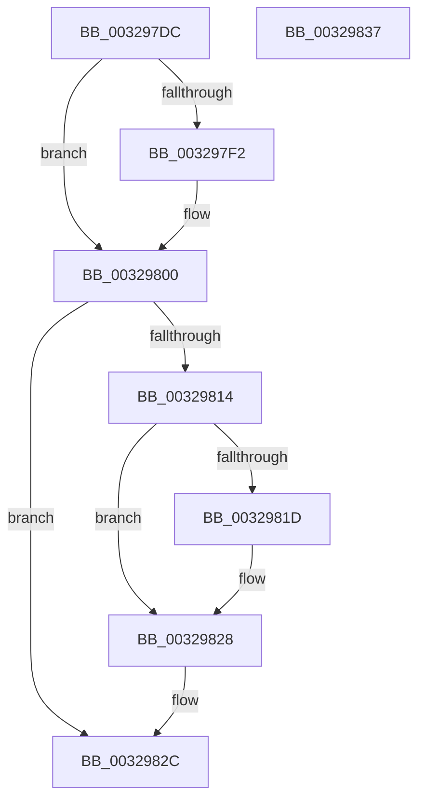

# MiUnlockPoolCommitWs

- RVA: `0x003297DC`–`0x00329838` (길이 `92` bytes)
- VA: `0x00000001403297DC`
- 실행 섹션: `.text`
- PDB 이름 있음: `예`; PDB Function 태그: `아니요`
- unwind 정보 RVA: `0x0005CAAC`
- 디코드: `27`개 명령, `92/92` bytes 표시
- 미해석 바이트: `0` (있으면 어셈블리에 `.byte`로 보존)

> 이 문서는 커널 이미지의 기계어와 PDB 기호를 분석해 생성했습니다. 4번과 5번은 함수 원형과 자료형을 바이너리 사용 방식에서 추정한 C 해석이며 원본 소스 복구 결과는 아닙니다.

## 1. Dependencies

- 직접 호출 지점: **3**; 고유 호출 대상: **3**
- 직접 호출자로 확인된 함수: **2**
- RIP 상대 이미지 참조: **1**

### Outgoing calls
- `0x003297F6` → [MiUnlockPageTable](../21/MiUnlockPageTable_function_00216EC0.md) (function, `0x00216EC0`)
- `0x00329806` → [MiUnlockWorkingSetShared](../27/MiUnlockWorkingSetShared_function_0027D690.md) (function, `0x0027D690`)
- `0x00329823` → [KiLowerIrqlProcessIrqlFlags](../4F/KiLowerIrqlProcessIrqlFlags_function_004F5698.md) (function, `0x004F5698`)

### Direct callers
- [MiCommitPoolMemory](MiCommitPoolMemory_function_00329520.md) at `0x00329587`
- [MiCommitPoolMemory](MiCommitPoolMemory_function_00329520.md) at `0x00329691`
- [MiCommitPoolMemory](MiCommitPoolMemory_function_00329520.md) at `0x003296EF`
- [sub_00344F15](../34/Unknown_function_00344F15.md) at `0x003450B1`

### Static image references
- `0x00329814` → RVA `0x00FC6D20` (`ALMOSTRO`; read)

## 2. Other-region calls and transfers

- 다른 실행 섹션으로 향하는 call: **0**
- 별도 외부 분기/꼬리 이동을 확인하지 못했습니다.

## 3. Assembly (complete function range)

```asm
003297DC  48 89 5C 24 08                  mov qword ptr [rsp + 8], rbx
003297E1  57                              push rdi
003297E2  48 83 EC 20                     sub rsp, 0x20
003297E6  48 8B 51 58                     mov rdx, qword ptr [rcx + 0x58]
003297EA  48 8B F9                        mov rdi, rcx
003297ED  48 85 D2                        test rdx, rdx
003297F0  74 0E                           je 0x140329800
003297F2  48 8B 49 48                     mov rcx, qword ptr [rcx + 0x48]
003297F6  E8 C5 D6 EE FF                  call 0x140216ec0
003297FB  48 83 67 58 00                  and qword ptr [rdi + 0x58], 0
00329800  48 8B 4F 48                     mov rcx, qword ptr [rdi + 0x48]
00329804  B2 11                           mov dl, 0x11
00329806  E8 85 3E F5 FF                  call 0x14027d690
0032980B  0F B6 5F 67                     movzx ebx, byte ptr [rdi + 0x67]
0032980F  80 FB 11                        cmp bl, 0x11
00329812  74 18                           je 0x14032982c
00329814  83 3D 05 D5 C9 00 00            cmp dword ptr [rip + 0xc9d505], 0
0032981B  74 0B                           je 0x140329828
0032981D  44 0F 20 C1                     mov rcx, cr8
00329821  8A D3                           mov dl, bl
00329823  E8 70 BE 1C 00                  call 0x1404f5698
00329828  44 0F 22 C3                     mov cr8, rbx
0032982C  48 8B 5C 24 30                  mov rbx, qword ptr [rsp + 0x30]
00329831  48 83 C4 20                     add rsp, 0x20
00329835  5F                              pop rdi
00329836  C3                              ret
00329837  CC                              int3
```

## 4. C-style interpretation (structured pseudocode)

```c
__int64 __fastcall MiUnlockPoolCommitWs(__int64 a1)
{
    __int64 result;
    __int64 v_rsp;
    unsigned __int64 v_stack_p8;

    v_stack_p8 = v_rbx;
    v_rsp = (v_rsp) - (32);
    if (*(unsigned __int64 *)(a1 + 88) != 0) {
        a1 = *(unsigned __int64 *)(a1 + 72);
        result = MiUnlockPageTable(a1, *(unsigned __int64 *)(a1 + 88), a3, a4);
    }
    result = MiUnlockWorkingSetShared(*(unsigned __int64 *)(a1 + 72), 17, a3, a4);
    if (((unsigned __int8)(*(unsigned __int8 *)(a1 + 103))) == 17) goto loc_0032982C;
    if ((*(unsigned int *)(v_rip + 13227269)) != 0) {
        a1 = v_cr8;
        a2 = (unsigned __int8)(*(unsigned __int8 *)(a1 + 103));
        result = KiLowerIrqlProcessIrqlFlags(a1, a2, a3, a4);
    }
loc_0032982C:
    v_rsp = (v_rsp) + (32);
    return result;
}
```

## 5. (Beta) C Style

```c
int64_t MiUnlockPoolCommitWs(void *Arg1)
{
    uint8_t *arg1 = (uint8_t *)Arg1;

    int64_t result;
    int64_t local_rsp;
    uint64_t v_stack_p8;

    v_stack_p8 = local_rbx;
    local_rsp = (local_rsp) - (32);
    if (*(uint64_t *)(arg1 + 0x58) != 0) {
        Arg1 = *(uint64_t *)(arg1 + 0x48);
        result = MiUnlockPageTable(Arg1, *(uint64_t *)(arg1 + 0x58), a3, a4);
    }
    result = MiUnlockWorkingSetShared(*(uint64_t *)(arg1 + 0x48), 17, a3, a4);
    if (((uint8_t)(*(uint8_t *)(arg1 + 0x67))) == 17) goto loc_0032982C;
    if ((*(uint32_t *)(v_rip + 0xC9D505)) != 0) {
        Arg1 = v_cr8;
        a2 = (uint8_t)(*(uint8_t *)(arg1 + 0x67));
        result = KiLowerIrqlProcessIrqlFlags(Arg1, a2, a3, a4);
    }
loc_0032982C:
    local_rsp = (local_rsp) + (32);
    return result;
}
```

### 관측된 메모리 오프셋

구조체 형식이 확인되지 않은 접근은 인자 기준의 오프셋으로만 기록했습니다.

| 기준 인자 | 오프셋 표현 | 폭 (bit) | 접근 |
|---|---:|---:|---|
| `Arg1` | `+ 0x48` | `64` | `R` |
| `Arg1` | `+ 0x58` | `64` | `R` |
| `Arg1` | `+ 0x58` | `64` | `R/W` |
| `Arg1` | `+ 0x67` | `8` | `R` |

## 6. Execution-region graph

[열기: 2D/3D 그래프와 함수 탐색 컨트롤 패널](../../../control-panel.html?section=text&rva=0x003297DC&view=graph)

- 2D 그래프는 위에서 아래로 흐르고, 3D 그래프는 빈 공간을 드래그해 회전합니다. Shift+드래그는 이동, 휠은 확대·축소, 함수 노드 선택은 대상 보고서 이동입니다.

### Static fallback


