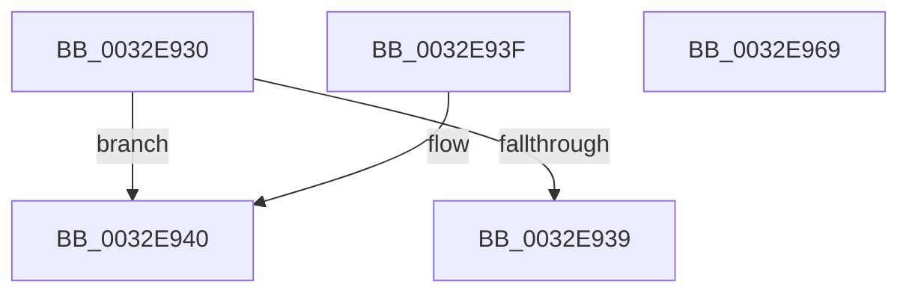

# MiVadExtentCommitted

- RVA: `0x0032E930`–`0x0032E96A` (길이 `58` bytes)
- VA: `0x000000014032E930`
- 실행 섹션: `.text`
- PDB 이름 있음: `예`; PDB Function 태그: `아니요`
- unwind 정보 RVA: `0x000DB714`
- 디코드: `20`개 명령, `58/58` bytes 표시
- 미해석 바이트: `0` (있으면 어셈블리에 `.byte`로 보존)

> 이 문서는 커널 이미지의 기계어와 PDB 기호를 분석해 생성했습니다. 4번과 5번은 함수 원형과 자료형을 바이너리 사용 방식에서 추정한 C 해석이며 원본 소스 복구 결과는 아닙니다.

## 1. Dependencies

- 직접 호출 지점: **0**; 고유 호출 대상: **0**
- 직접 호출자로 확인된 함수: **5**
- RIP 상대 이미지 참조: **0**

### Outgoing calls
- 직접 디코드된 call 명령이 없습니다.

### Direct callers
- [sub_0032BD21](Unknown_function_0032BD21.md) at `0x0032C007`
- [sub_0032D782](Unknown_function_0032D782.md) at `0x0032D9D2`
- [sub_0032E02E](Unknown_function_0032E02E.md) at `0x0032E25F`
- [MiCheckVirtualAddress](MiCheckVirtualAddress_function_0032E4F0.md) at `0x0032E708`
- [MiCheckUserVirtualAddress](../48/MiCheckUserVirtualAddress_function_00488834.md) at `0x0048890D`

### Static image references
- 디코드된 RIP-relative 메모리 참조가 없습니다.

## 2. Other-region calls and transfers

- 다른 실행 섹션으로 향하는 call: **0**
- 별도 외부 분기/꼬리 이동을 확인하지 못했습니다.

## 3. Assembly (complete function range)

```asm
0032E930  4C 8B 49 78                     mov r9, qword ptr [rcx + 0x78]
0032E934  4D 85 C9                        test r9, r9
0032E937  78 07                           js 0x14032e940
0032E939  B8 01 00 00 00                  mov eax, 1
0032E93E  C3                              ret
0032E93F  CC                              int3
0032E940  8B 41 18                        mov eax, dword ptr [rcx + 0x18]
0032E943  44 0F B6 41 20                  movzx r8d, byte ptr [rcx + 0x20]
0032E948  49 8B 09                        mov rcx, qword ptr [r9]
0032E94B  49 C1 E0 20                     shl r8, 0x20
0032E94F  48 FF C9                        dec rcx
0032E952  4C 0B C0                        or r8, rax
0032E955  48 C1 EA 0C                     shr rdx, 0xc
0032E959  33 C0                           xor eax, eax
0032E95B  48 C1 E9 0C                     shr rcx, 0xc
0032E95F  49 2B D0                        sub rdx, r8
0032E962  48 3B D1                        cmp rdx, rcx
0032E965  0F 96 C0                        setbe al
0032E968  C3                              ret
0032E969  CC                              int3
```

## 4. C-style interpretation (structured pseudocode)

```c
__int64 __fastcall MiVadExtentCommitted(__int64 a1, __int64 a2)
{
    __int64 result;

    if (sign_flag) goto loc_0032E940;
    return 1;
loc_0032E940:
    a3 = (*(unsigned __int8 *)(a1 + 32)) << (32);
    a1 = (*(unsigned __int64 *)(*(unsigned __int64 *)(a1 + 120))) - 1;
    a3 = (a3) | ((unsigned int)(*(unsigned int *)(a1 + 24)));
    a2 = (a2) >> (12);
    result = 0;
    a1 = (a1) >> (12);
    a2 = (a2) - (a3);
    result = (a2 <= a1) ? 1 : 0;
    return result;
}
```

## 5. (Beta) C Style

```c
int64_t MiVadExtentCommitted(void *Arg1, int64_t Arg2)
{
    uint8_t *arg1 = (uint8_t *)Arg1;

    int64_t result;

    if (sign_flag) goto loc_0032E940;
    return 1;
loc_0032E940:
    a3 = (*(uint8_t *)(arg1 + 0x20)) << (32);
    Arg1 = (*(uint64_t *)(*(uint64_t *)(arg1 + 0x78))) - 1;
    a3 = (a3) | ((uint32_t)(*(uint32_t *)(arg1 + 0x18)));
    Arg2 = (Arg2) >> (12);
    result = 0;
    Arg1 = (Arg1) >> (12);
    Arg2 = (Arg2) - (a3);
    result = (Arg2 <= Arg1) ? 1 : 0;
    return result;
}
```

### 관측된 메모리 오프셋

구조체 형식이 확인되지 않은 접근은 인자 기준의 오프셋으로만 기록했습니다.

| 기준 인자 | 오프셋 표현 | 폭 (bit) | 접근 |
|---|---:|---:|---|
| `Arg1` | `+ 0x18` | `32` | `R` |
| `Arg1` | `+ 0x20` | `8` | `R` |
| `Arg1` | `+ 0x78` | `64` | `R` |

## 6. Execution-region graph

[열기: 2D/3D 그래프와 함수 탐색 컨트롤 패널](../../../control-panel.html?section=text&rva=0x0032E930&view=graph)

- 2D 그래프는 위에서 아래로 흐르고, 3D 그래프는 빈 공간을 드래그해 회전합니다. Shift+드래그는 이동, 휠은 확대·축소, 함수 노드 선택은 대상 보고서 이동입니다.

### Static fallback


