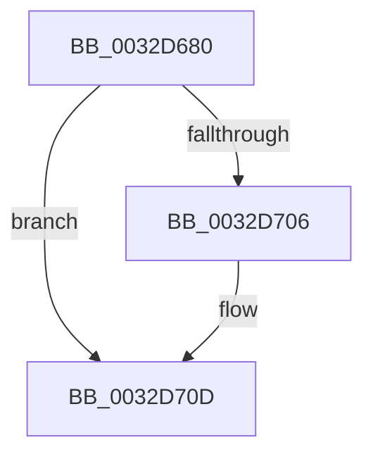

# MiZeroFault

- RVA: `0x0032D680`–`0x0032D714` (길이 `148` bytes)
- VA: `0x000000014032D680`
- 실행 섹션: `.text`
- PDB 이름 있음: `예`; PDB Function 태그: `예`
- unwind 정보 RVA: `0x00076204`
- 디코드: `37`개 명령, `148/148` bytes 표시
- 미해석 바이트: `0` (있으면 어셈블리에 `.byte`로 보존)

> 이 문서는 커널 이미지의 기계어와 PDB 기호를 분석해 생성했습니다. 4번과 5번은 함수 원형과 자료형을 바이너리 사용 방식에서 추정한 C 해석이며 원본 소스 복구 결과는 아닙니다.

## 1. Dependencies

- 직접 호출 지점: **0**; 고유 호출 대상: **0**
- 직접 호출자로 확인된 함수: **1**
- RIP 상대 이미지 참조: **0**

### Outgoing calls
- 직접 디코드된 call 명령이 없습니다.

### Direct callers
- [MiUserFault](MiUserFault_function_00329840.md) at `0x00329B9A`

### Static image references
- 디코드된 RIP-relative 메모리 참조가 없습니다.

## 2. Other-region calls and transfers

- 다른 실행 섹션으로 향하는 call: **0**
- 별도 외부 분기/꼬리 이동을 확인하지 못했습니다.

## 3. Assembly (complete function range)

```asm
0032D680  4C 89 4C 24 20                  mov qword ptr [rsp + 0x20], r9
0032D685  4C 89 44 24 18                  mov qword ptr [rsp + 0x18], r8
0032D68A  48 89 54 24 10                  mov qword ptr [rsp + 0x10], rdx
0032D68F  48 89 4C 24 08                  mov qword ptr [rsp + 8], rcx
0032D694  55                              push rbp
0032D695  53                              push rbx
0032D696  41 54                           push r12
0032D698  41 55                           push r13
0032D69A  48 8D 6C 24 C1                  lea rbp, [rsp - 0x3f]
0032D69F  48 81 EC C8 00 00 00            sub rsp, 0xc8
0032D6A6  4C 8B D9                        mov r11, rcx
0032D6A9  C6 02 01                        mov byte ptr [rdx], 1
0032D6AC  33 C9                           xor ecx, ecx
0032D6AE  41 C7 00 18 00 00 00            mov dword ptr [r8], 0x18
0032D6B5  89 4D AB                        mov dword ptr [rbp - 0x55], ecx
0032D6B8  45 33 D2                        xor r10d, r10d
0032D6BB  65 48 8B 04 25 88 01 00 00      mov rax, qword ptr gs:[0x188]
0032D6C4  0F 57 C0                        xorps xmm0, xmm0
0032D6C7  0F 57 C9                        xorps xmm1, xmm1
0032D6CA  4C 89 55 F7                     mov qword ptr [rbp - 9], r10
0032D6CE  4D 89 11                        mov qword ptr [r9], r10
0032D6D1  48 8B 98 B8 00 00 00            mov rbx, qword ptr [rax + 0xb8]
0032D6D8  49 8B 43 38                     mov rax, qword ptr [r11 + 0x38]
0032D6DC  4C 89 55 A7                     mov qword ptr [rbp - 0x59], r10
0032D6E0  66 0F 7F 45 B7                  movdqa xmmword ptr [rbp - 0x49], xmm0
0032D6E5  66 0F 7F 4D C7                  movdqa xmmword ptr [rbp - 0x39], xmm1
0032D6EA  66 0F 7F 45 D7                  movdqa xmmword ptr [rbp - 0x29], xmm0
0032D6EF  66 0F 7F 4D E7                  movdqa xmmword ptr [rbp - 0x19], xmm1
0032D6F4  8B 88 B8 00 00 00               mov ecx, dword ptr [rax + 0xb8]
0032D6FA  F6 C1 0F                        test cl, 0xf
0032D6FD  8B 4D A7                        mov ecx, dword ptr [rbp - 0x59]
0032D700  48 89 5D 07                     mov qword ptr [rbp + 7], rbx
0032D704  75 07                           jne 0x14032d70d
0032D706  0F BA E9 08                     bts ecx, 8
0032D70A  89 4D A7                        mov dword ptr [rbp - 0x59], ecx
0032D70D  4D 8B 43 10                     mov r8, qword ptr [r11 + 0x10]
0032D711  49 8B D0                        mov rdx, r8
```

## 4. C-style interpretation (structured pseudocode)

```c
__int64 __fastcall MiZeroFault(__int64 a1, __int64 a2, __int64 a3, __int64 a4)
{
    __int64 v_r10;
    __int64 v_rsp;
    unsigned __int64 v_stack_m58;
    unsigned __int64 v_stack_m5F;
    unsigned __int64 v_stack_m68;
    unsigned __int64 v_stack_m78;
    unsigned __int64 v_stack_m88;
    unsigned __int64 v_stack_m98;
    unsigned __int64 v_stack_mA8;
    unsigned int v_stack_mB4;
    unsigned __int64 v_stack_mB8;
    unsigned __int64 v_stack_p10;
    unsigned __int64 v_stack_p18;
    unsigned __int64 v_stack_p20;
    unsigned __int64 v_stack_p8;

    v_stack_p20 = a4;
    v_stack_p18 = a3;
    v_stack_p10 = a2;
    v_stack_p8 = a1;
    v_rsp = (v_rsp) - (200);
    *(unsigned __int8 *)(a2) = 1;
    a1 = 0;
    *(unsigned int *)(a3) = 24;
    v_stack_mB4 = 0;
    v_r10 = 0;
    v_stack_m68 = 0;
    *(unsigned __int64 *)(a4) = 0;
    v_stack_mB8 = 0;
    v_stack_mA8 = v_xmm0;
    v_stack_m98 = v_xmm1;
    v_stack_m88 = v_xmm0;
    v_stack_m78 = v_xmm1;
    v_stack_m58 = *(unsigned __int64 *)(*(unsigned __int64 *)(gs_base + (0 + 392)) + 184);
    if ((((unsigned __int8)((unsigned int)(*(unsigned int *)(*(unsigned __int64 *)(a1 + 56) + 184)))) & (15)) == 0) {
        v_stack_mB8 = (unsigned int)((unsigned int)(v_stack_mB8));
    }
    return *(unsigned __int64 *)(a1 + 56);
}
```

## 5. (Beta) C Style

```c
int64_t MiZeroFault(void *Arg1, void *Arg2, void *Arg3, void *Arg4)
{
    uint8_t *arg1 = (uint8_t *)Arg1;
    uint8_t *arg2 = (uint8_t *)Arg2;
    uint8_t *arg3 = (uint8_t *)Arg3;
    uint8_t *arg4 = (uint8_t *)Arg4;

    int64_t local_r10;
    int64_t local_rsp;
    uint64_t v_stack_m58;
    uint64_t v_stack_m5F;
    uint64_t v_stack_m68;
    uint64_t v_stack_m78;
    uint64_t v_stack_m88;
    uint64_t v_stack_m98;
    uint64_t v_stack_mA8;
    uint32_t v_stack_mB4;
    uint64_t v_stack_mB8;
    uint64_t v_stack_p10;
    uint64_t v_stack_p18;
    uint64_t v_stack_p20;
    uint64_t v_stack_p8;

    v_stack_p20 = Arg4;
    v_stack_p18 = Arg3;
    v_stack_p10 = Arg2;
    v_stack_p8 = Arg1;
    local_rsp = (local_rsp) - (200);
    *(uint8_t *)(arg2) = 1;
    Arg1 = 0;
    *(uint32_t *)(arg3) = 24;
    v_stack_mB4 = 0;
    local_r10 = 0;
    v_stack_m68 = 0;
    *(uint64_t *)(arg4) = 0;
    v_stack_mB8 = 0;
    v_stack_mA8 = v_xmm0;
    v_stack_m98 = v_xmm1;
    v_stack_m88 = v_xmm0;
    v_stack_m78 = v_xmm1;
    v_stack_m58 = *(uint64_t *)(*(uint64_t *)(gs_base + (0 + 0x188)) + 0xB8);
    if ((((uint8_t)((uint32_t)(*(uint32_t *)(*(uint64_t *)(arg1 + 0x38) + 0xB8)))) & (15)) == 0) {
        v_stack_mB8 = (uint32_t)((uint32_t)(v_stack_mB8));
    }
    return *(uint64_t *)(arg1 + 0x38);
}
```

### 관측된 메모리 오프셋

구조체 형식이 확인되지 않은 접근은 인자 기준의 오프셋으로만 기록했습니다.

| 기준 인자 | 오프셋 표현 | 폭 (bit) | 접근 |
|---|---:|---:|---|
| `Arg1` | `+ 0x10` | `64` | `R` |
| `Arg1` | `+ 0x38` | `64` | `R` |
| `Arg2` | `+ 0x0` | `8` | `W` |
| `Arg3` | `+ 0x0` | `32` | `W` |
| `Arg4` | `+ 0x0` | `64` | `W` |

## 6. Execution-region graph

[열기: 2D/3D 그래프와 함수 탐색 컨트롤 패널](../../../control-panel.html?section=text&rva=0x0032D680&view=graph)

- 2D 그래프는 위에서 아래로 흐르고, 3D 그래프는 빈 공간을 드래그해 회전합니다. Shift+드래그는 이동, 휠은 확대·축소, 함수 노드 선택은 대상 보고서 이동입니다.

### Static fallback


