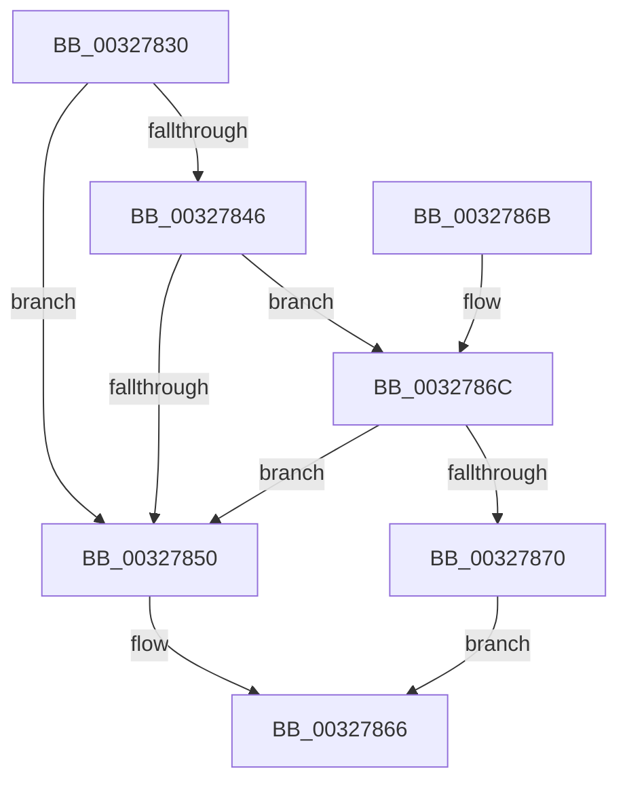

# MmMapIoSpaceEx

- RVA: `0x00327830`–`0x00327874` (길이 `68` bytes)
- VA: `0x0000000140327830`
- 실행 섹션: `.text`
- PDB 이름 있음: `예`; PDB Function 태그: `아니요`
- unwind 정보 RVA: `0x00075E10`
- 디코드: `24`개 명령, `68/68` bytes 표시
- 미해석 바이트: `0` (있으면 어셈블리에 `.byte`로 보존)

> 이 문서는 커널 이미지의 기계어와 PDB 기호를 분석해 생성했습니다. 4번과 5번은 함수 원형과 자료형을 바이너리 사용 방식에서 추정한 C 해석이며 원본 소스 복구 결과는 아닙니다.

## 1. Dependencies

- 직접 호출 지점: **2**; 고유 호출 대상: **2**
- 직접 호출자로 확인된 함수: **45**
- RIP 상대 이미지 참조: **0**

### Outgoing calls
- `0x0032783D` → [MiMakeProtectionMask](MiMakeProtectionMask_function_00329480.md) (function, `0x00329480`)
- `0x00327861` → [MiMapContiguousMemory](MiMapContiguousMemory_function_0032787C.md) (function, `0x0032787C`)

### Direct callers
- [HalpAcpiCheckAndMapTable](../3F/HalpAcpiCheckAndMapTable_function_003F75D8.md) at `0x003F761F`
- [HalpAcpiCheckAndMapTable](../3F/HalpAcpiCheckAndMapTable_function_003F75D8.md) at `0x003F7742`
- [HalpAcpiGetRsdt](../3F/HalpAcpiGetRsdt_function_003F806C.md) at `0x003F80DD`
- [MmMapIoSpace](../48/MmMapIoSpace_function_00488A20.md) at `0x00488A38`
- [HalpReadGenericErrorInfo](../4A/HalpReadGenericErrorInfo_function_004A9D38.md) at `0x004A9D7F`
- [HalInitializeBios](../53/HalInitializeBios_function_0053D9A0.md) at `0x0053DBC6`
- [HalInitializeBios](../53/HalInitializeBios_function_0053D9A0.md) at `0x0053DC14`
- [HalpMcaExtendedLogInitialize](../54/HalpMcaExtendedLogInitialize_function_0054162C.md) at `0x00541676`
- [HalpMcaExtendedLogInitialize](../54/HalpMcaExtendedLogInitialize_function_0054162C.md) at `0x005416CC`
- [HalpMcaExtendedLogInitialize](../54/HalpMcaExtendedLogInitialize_function_0054162C.md) at `0x00541711`
- [HalpDmaAllocateMapRegisterFrame](../55/HalpDmaAllocateMapRegisterFrame_function_005506BC.md) at `0x0055076C`
- [HalpSignalRAS](../55/HalpSignalRAS_function_00555C7C.md) at `0x00555CB5`
- [HalpMmUpdateTiledMemoryMapTargetStub](../55/HalpMmUpdateTiledMemoryMapTargetStub_function_0055A974.md) at `0x0055A99C`
- [HvlPhase1Initialize](../58/HvlPhase1Initialize_function_00583D80.md) at `0x00583E48`
- [HvlpEnableNextLogicalProcessor](../58/HvlpEnableNextLogicalProcessor_function_00585680.md) at `0x00585722`
- [HvlpInitializeHvCrashdump](../58/HvlpInitializeHvCrashdump_function_0058BCCC.md) at `0x0058BD23`
- [HvlpInitializeHvCrashdump](../58/HvlpInitializeHvCrashdump_function_0058BCCC.md) at `0x0058BD96`
- [BgkNotifyDisplayOwnershipLost](../59/BgkNotifyDisplayOwnershipLost_function_00590E80.md) at `0x00590EC4`
- [DifMmMapIoSpaceExWrapper](../63/DifMmMapIoSpaceExWrapper_function_00635A60.md) at `0x00635B45`
- [WmipFirmwareTableHandler](../64/WmipFirmwareTableHandler_function_0064E510.md) at `0x0064E5D6`
- [MiHugePageOperation](../68/MiHugePageOperation_function_0068C490.md) at `0x0068C5D6`
- [BgpFwLibraryEnable](../69/BgpFwLibraryEnable_function_0069ED8C.md) at `0x0069EE16`
- [BgpFwLibraryEnable](../69/BgpFwLibraryEnable_function_0069ED8C.md) at `0x0069EE30`
- [BgpFwMapFrameBuffer](../69/BgpFwMapFrameBuffer_function_0069EFA8.md) at `0x0069EFFB`
- [BgpFwMapFrameBuffer](../69/BgpFwMapFrameBuffer_function_0069EFA8.md) at `0x0069F011`
- [IpmiHwKcsInit](../6A/IpmiHwKcsInit_function_006A65EC.md) at `0x006A662C`
- [InbvPortInitialize](../6A/InbvPortInitialize_function_006A8194.md) at `0x006A826F`
- [sub_006F79F4](../6F/Unknown_function_006F79F4.md) at `0x006F7A88`
- [HalpDmaCvmMakeContiguousVirtualBufferShared](../../page/70/HalpDmaCvmMakeContiguousVirtualBufferShared_function_00709484.md) at `0x00709556`
- [HvlInitializeProcessor](../../page/71/HvlInitializeProcessor_function_0071804C.md) at `0x00718156`
- [HvlInitializeProcessor](../../page/71/HvlInitializeProcessor_function_0071804C.md) at `0x00718190`
- [WmipFindSMBiosStructure](../../page/7B/WmipFindSMBiosStructure_function_007B2944.md) at `0x007B298A`
- [WmipFindSysIdTable](../../page/7B/WmipFindSysIdTable_function_007B2A60.md) at `0x007B2A88`
- [WmipGetSMBiosEventlog](../../page/7B/WmipGetSMBiosEventlog_function_007B2B58.md) at `0x007B2CB3`
- [WmipParseSysIdTable](../../page/7B/WmipParseSysIdTable_function_007B3068.md) at `0x007B309F`
- [ExpGetSystemPlatformBinary](../../page/7C/ExpGetSystemPlatformBinary_function_007C3C18.md) at `0x007C3F6C`
- [WheapClearPoison](../../page/7D/WheapClearPoison_function_007D7DFC.md) at `0x007D7E5B`
- [MiZeroHotAddMemory](../../page/7F/MiZeroHotAddMemory_function_007FB324.md) at `0x007FB382`
- [WmipGetSMBiosTableData](../../page/A4/WmipGetSMBiosTableData_function_00A4F078.md) at `0x00A4F108`
- [HalpInitGenericErrorSourceEntry](../../pagelk/B5/HalpInitGenericErrorSourceEntry_function_00B5DF68.md) at `0x00B5DFCE`
- [HalpInitGenericErrorSourceEntryV2](../../pagelk/B5/HalpInitGenericErrorSourceEntryV2_function_00B5E1D0.md) at `0x00B5E245`
- [HalpInitializeGenericErrorSource](../../pagelk/B5/HalpInitializeGenericErrorSource_function_00B5E564.md) at `0x00B5E7F7`
- [PopGetHwConfigurationSignature](../../pagelk/B6/PopGetHwConfigurationSignature_function_00B6D5A4.md) at `0x00B6D6AC`
- [HalpMapNvsArea](../../pagelk/B7/HalpMapNvsArea_function_00B7D180.md) at `0x00B7D1DB`
- [VerifierMmMapIoSpace](../../pagevrfy/BB/VerifierMmMapIoSpace_function_00BB0980.md) at `0x00BB0A0E`
- [VerifierMmMapIoSpaceEx](../../pagevrfy/BB/VerifierMmMapIoSpaceEx_function_00BB0A80.md) at `0x00BB0A84`
- [HalpPowerInitFwPerformanceTableMappings](../../init/C1/HalpPowerInitFwPerformanceTableMappings_function_00C1EC34.md) at `0x00C1ECD2`
- [HalpPowerInitFwPerformanceTableMappings](../../init/C1/HalpPowerInitFwPerformanceTableMappings_function_00C1EC34.md) at `0x00C1ECF9`
- [HalpPowerInitFwPerformanceTableMappings](../../init/C1/HalpPowerInitFwPerformanceTableMappings_function_00C1EC34.md) at `0x00C1ED4F`
- [HalpPowerInitFwPerformanceTableMappings](../../init/C1/HalpPowerInitFwPerformanceTableMappings_function_00C1EC34.md) at `0x00C1ED72`
- [HalpDmaInitializeMasterAdapter](../../init/C2/HalpDmaInitializeMasterAdapter_function_00C21278.md) at `0x00C21356`
- [HalpAuditEnumerateRsdts](../../init/C2/HalpAuditEnumerateRsdts_function_00C24638.md) at `0x00C2467B`
- [HalpAuditEnumerateRsdtsInRange](../../init/C2/HalpAuditEnumerateRsdtsInRange_function_00C2472C.md) at `0x00C24759`
- [HalpAuditQuerySlicAddresses](../../init/C2/HalpAuditQuerySlicAddresses_function_00C24820.md) at `0x00C2485F`
- [HalpAuditQuerySlicAddresses](../../init/C2/HalpAuditQuerySlicAddresses_function_00C24820.md) at `0x00C24943`
- [PipInitComputerIds](../../init/C7/PipInitComputerIds_function_00C74734.md) at `0x00C74922`
- [sub_00C7EB3D](../../init/C7/Unknown_function_00C7EB3D.md) at `0x00C7EBA9`

### Static image references
- 디코드된 RIP-relative 메모리 참조가 없습니다.

## 2. Other-region calls and transfers

- 다른 실행 섹션으로 향하는 call: **0**
- 별도 외부 분기/꼬리 이동을 확인하지 못했습니다.

## 3. Assembly (complete function range)

```asm
00327830  48 83 EC 38                     sub rsp, 0x38
00327834  4C 8B D1                        mov r10, rcx
00327837  4C 8B DA                        mov r11, rdx
0032783A  41 8B C8                        mov ecx, r8d
0032783D  E8 3E 1C 00 00                  call 0x140329480
00327842  A8 02                           test al, 2
00327844  74 0A                           je 0x140327850
00327846  8B C8                           mov ecx, eax
00327848  83 E1 F8                        and ecx, 0xfffffff8
0032784B  83 F9 18                        cmp ecx, 0x18
0032784E  74 1C                           je 0x14032786c
00327850  83 64 24 20 00                  and dword ptr [rsp + 0x20], 0
00327855  44 8B C8                        mov r9d, eax
00327858  4D 8B C3                        mov r8, r11
0032785B  49 8B D3                        mov rdx, r11
0032785E  49 8B CA                        mov rcx, r10
00327861  E8 16 00 00 00                  call 0x14032787c
00327866  48 83 C4 38                     add rsp, 0x38
0032786A  C3                              ret
0032786B  CC                              int3
0032786C  A8 07                           test al, 7
0032786E  74 E0                           je 0x140327850
00327870  33 C0                           xor eax, eax
00327872  EB F2                           jmp 0x140327866
```

## 4. C-style interpretation (structured pseudocode)

```c
__int64 __fastcall MmMapIoSpaceEx(__int64 a1, __int64 a2, int a3)
{
    __int64 result;
    __int64 v_rsp;
    unsigned int v_stack_m18;

    v_rsp = (v_rsp) - (56);
    result = MiMakeProtectionMask((unsigned int)(a3), a2, a3, a4);
    if ((((unsigned __int8)(result)) & (2)) == 0) goto loc_00327850;
    a1 = (unsigned int)(((unsigned int)((unsigned int)(result))) & (0xFFFFFFF8ULL));
    if (((unsigned int)(a1)) == 24) goto loc_0032786C;
loc_00327850:
    result = MiMapContiguousMemory(a1, a2, a2, (unsigned int)((unsigned int)(result)));
loc_00327866:
    v_rsp = (v_rsp) + (56);
    return result;
loc_0032786C:
    if ((((unsigned __int8)(result)) & (7)) == 0) goto loc_00327850;
    result = 0;
    goto loc_00327866;
}
```

## 5. (Beta) C Style

```c
int64_t MmMapIoSpaceEx(int64_t Arg1, int64_t Arg2, int32_t Arg3)
{
    int64_t result;
    int64_t local_rsp;
    uint32_t v_stack_m18;

    local_rsp = (local_rsp) - (56);
    result = MiMakeProtectionMask((uint32_t)(Arg3), Arg2, Arg3, a4);
    if ((((uint8_t)(result)) & (2)) == 0) goto loc_00327850;
    Arg1 = (uint32_t)(((uint32_t)((uint32_t)(result))) & (0xFFFFFFF8ULL));
    if (((uint32_t)(Arg1)) == 24) goto loc_0032786C;
loc_00327850:
    result = MiMapContiguousMemory(Arg1, Arg2, Arg2, (uint32_t)((uint32_t)(result)));
loc_00327866:
    local_rsp = (local_rsp) + (56);
    return result;
loc_0032786C:
    if ((((uint8_t)(result)) & (7)) == 0) goto loc_00327850;
    result = 0;
    goto loc_00327866;
}
```

## 6. Execution-region graph

[열기: 2D/3D 그래프와 함수 탐색 컨트롤 패널](../../../control-panel.html?section=text&rva=0x00327830&view=graph)

- 2D 그래프는 위에서 아래로 흐르고, 3D 그래프는 빈 공간을 드래그해 회전합니다. Shift+드래그는 이동, 휠은 확대·축소, 함수 노드 선택은 대상 보고서 이동입니다.

### Static fallback


