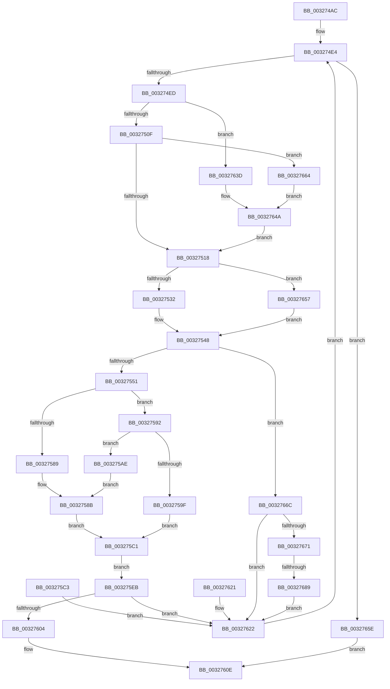

# RtlCSparseBitmapFindBitSetCapped

- RVA: `0x003274AC`–`0x00327697` (길이 `491` bytes)
- VA: `0x00000001403274AC`
- 실행 섹션: `.text`
- PDB 이름 있음: `예`; PDB Function 태그: `예`
- unwind 정보 RVA: `0x00075DB4`
- 디코드: `137`개 명령, `491/491` bytes 표시
- 미해석 바이트: `0` (있으면 어셈블리에 `.byte`로 보존)

> 이 문서는 커널 이미지의 기계어와 PDB 기호를 분석해 생성했습니다. 4번과 5번은 함수 원형과 자료형을 바이너리 사용 방식에서 추정한 C 해석이며 원본 소스 복구 결과는 아닙니다.

## 1. Dependencies

- 직접 호출 지점: **2**; 고유 호출 대상: **2**
- 직접 호출자로 확인된 함수: **3**
- RIP 상대 이미지 참조: **0**

### Outgoing calls
- `0x0032759F` → [RtlLengthCurrentClearRunForwardEx](../4B/RtlLengthCurrentClearRunForwardEx_function_004B3F4C.md) (function, `0x004B3F4C`)
- `0x003275B4` → [RtlLengthCurrentClearRunBackwardEx](../4F/RtlLengthCurrentClearRunBackwardEx_function_004F6764.md) (function, `0x004F6764`)

### Direct callers
- [RtlSparseArrayElementAllocated](RtlSparseArrayElementAllocated_function_00327364.md) at `0x0032738F`
- [RtlpHpVaMgrCtxQuery](RtlpHpVaMgrCtxQuery_function_003273C0.md) at `0x00327406`
- [RtlSparseArrayElementFindCapped](../60/RtlSparseArrayElementFindCapped_function_00605484.md) at `0x006054A9`

### Static image references
- 디코드된 RIP-relative 메모리 참조가 없습니다.

## 2. Other-region calls and transfers

- 다른 실행 섹션으로 향하는 call: **0**
- call이 아닌 외부 분기/꼬리 이동: **1**
  - `0x00327683` → [sub_006E1BEA](../6E/Unknown_function_006E1BEA.md) (`tail-transfer`)

## 3. Assembly (complete function range)

```asm
003274AC  4C 89 44 24 18                  mov qword ptr [rsp + 0x18], r8
003274B1  48 89 4C 24 08                  mov qword ptr [rsp + 8], rcx
003274B6  53                              push rbx
003274B7  56                              push rsi
003274B8  57                              push rdi
003274B9  41 54                           push r12
003274BB  41 55                           push r13
003274BD  41 56                           push r14
003274BF  41 57                           push r15
003274C1  48 83 EC 40                     sub rsp, 0x40
003274C5  49 8B F8                        mov rdi, r8
003274C8  4C 8B FA                        mov r15, rdx
003274CB  4C 8B E1                        mov r12, rcx
003274CE  0F 57 C0                        xorps xmm0, xmm0
003274D1  0F 11 44 24 28                  movups xmmword ptr [rsp + 0x28], xmm0
003274D6  48 89 94 24 98 00 00 00         mov qword ptr [rsp + 0x98], rdx
003274DE  41 BD 00 80 00 00               mov r13d, 0x8000
003274E4  48 85 FF                        test rdi, rdi
003274E7  0F 84 71 01 00 00               je 0x14032765e
003274ED  4D 8B F7                        mov r14, r15
003274F0  41 81 E6 FF 7F 00 00            and r14d, 0x7fff
003274F7  48 8B DF                        mov rbx, rdi
003274FA  48 89 9C 24 88 00 00 00         mov qword ptr [rsp + 0x88], rbx
00327502  49 8D 04 3E                     lea rax, [r14 + rdi]
00327506  48 85 FF                        test rdi, rdi
00327509  0F 88 2E 01 00 00               js 0x14032763d
0032750F  49 3B C5                        cmp rax, r13
00327512  0F 8F 4C 01 00 00               jg 0x140327664
00327518  49 8B D7                        mov rdx, r15
0032751B  48 C1 EA 0F                     shr rdx, 0xf
0032751F  48 8B C2                        mov rax, rdx
00327522  48 C1 E8 0F                     shr rax, 0xf
00327526  49 0F A3 44 24 38               bt qword ptr [r12 + 0x38], rax
0032752C  0F 83 25 01 00 00               jae 0x140327657
00327532  49 8B 04 24                     mov rax, qword ptr [r12]
00327536  48 0F A3 10                     bt qword ptr [rax], rdx
0032753A  0F 92 C0                        setb al
0032753D  0F B6 C8                        movzx ecx, al
00327540  F7 D9                           neg ecx
00327542  1B C0                           sbb eax, eax
00327544  F7 D8                           neg eax
00327546  FF C0                           inc eax
00327548  83 F8 02                        cmp eax, 2
0032754B  0F 82 1B 01 00 00               jb 0x14032766c
00327551  49 8B C7                        mov rax, r15
00327554  48 99                           cqo
00327556  49 F7 FD                        idiv r13
00327559  48 8B F0                        mov rsi, rax
0032755C  B9 01 00 00 00                  mov ecx, 1
00327561  48 3B D9                        cmp rbx, rcx
00327564  48 0F 4F CB                     cmovg rcx, rbx
00327568  49 03 CE                        add rcx, r14
0032756B  48 C1 E0 0C                     shl rax, 0xc
0032756F  49 03 44 24 08                  add rax, qword ptr [r12 + 8]
00327574  48 89 4C 24 28                  mov qword ptr [rsp + 0x28], rcx
00327579  48 89 44 24 30                  mov qword ptr [rsp + 0x30], rax
0032757E  4C 0F A3 30                     bt qword ptr [rax], r14
00327582  0F 92 C0                        setb al
00327585  84 C0                           test al, al
00327587  74 09                           je 0x140327592
00327589  33 D2                           xor edx, edx
0032758B  48 89 54 24 20                  mov qword ptr [rsp + 0x20], rdx
00327590  EB 2F                           jmp 0x1403275c1
00327592  49 8B D6                        mov rdx, r14
00327595  48 8D 4C 24 28                  lea rcx, [rsp + 0x28]
0032759A  48 85 DB                        test rbx, rbx
0032759D  7E 0F                           jle 0x1403275ae
0032759F  E8 A8 C9 18 00                  call 0x1404b3f4c
003275A4  48 8B D0                        mov rdx, rax
003275A7  48 89 44 24 20                  mov qword ptr [rsp + 0x20], rax
003275AC  EB 13                           jmp 0x1403275c1
003275AE  4C 8B C3                        mov r8, rbx
003275B1  49 F7 D8                        neg r8
003275B4  E8 AB F1 1C 00                  call 0x1404f6764
003275B9  48 8B D0                        mov rdx, rax
003275BC  48 F7 DA                        neg rdx
003275BF  EB CA                           jmp 0x14032758b
003275C1  EB 28                           jmp 0x1403275eb
003275C3  41 BD 00 80 00 00               mov r13d, 0x8000
003275C9  48 8B BC 24 90 00 00 00         mov rdi, qword ptr [rsp + 0x90]
003275D1  4C 8B A4 24 80 00 00 00         mov r12, qword ptr [rsp + 0x80]
003275D9  4C 8B BC 24 98 00 00 00         mov r15, qword ptr [rsp + 0x98]
003275E1  48 8B 9C 24 88 00 00 00         mov rbx, qword ptr [rsp + 0x88]
003275E9  EB 37                           jmp 0x140327622
003275EB  48 8B CA                        mov rcx, rdx
003275EE  48 F7 D9                        neg rcx
003275F1  48 0F 48 CA                     cmovs rcx, rdx
003275F5  48 8B C3                        mov rax, rbx
003275F8  48 F7 D8                        neg rax
003275FB  48 0F 48 C3                     cmovs rax, rbx
003275FF  48 3B C8                        cmp rcx, rax
00327602  7D 1E                           jge 0x140327622
00327604  48 C1 E6 0F                     shl rsi, 0xf
00327608  48 03 F2                        add rsi, rdx
0032760B  49 03 F6                        add rsi, r14
0032760E  48 8B C6                        mov rax, rsi
00327611  48 83 C4 40                     add rsp, 0x40
00327615  41 5F                           pop r15
00327617  41 5E                           pop r14
00327619  41 5D                           pop r13
0032761B  41 5C                           pop r12
0032761D  5F                              pop rdi
0032761E  5E                              pop rsi
0032761F  5B                              pop rbx
00327620  C3                              ret
00327621  CC                              int3
00327622  4C 03 FB                        add r15, rbx
00327625  4C 89 BC 24 98 00 00 00         mov qword ptr [rsp + 0x98], r15
0032762D  48 2B FB                        sub rdi, rbx
00327630  48 89 BC 24 90 00 00 00         mov qword ptr [rsp + 0x90], rdi
00327638  E9 A7 FE FF FF                  jmp 0x1403274e4
0032763D  49 8B DE                        mov rbx, r14
00327640  48 F7 D3                        not rbx
00327643  48 85 C0                        test rax, rax
00327646  48 0F 49 DF                     cmovns rbx, rdi
0032764A  48 89 9C 24 88 00 00 00         mov qword ptr [rsp + 0x88], rbx
00327652  E9 C1 FE FF FF                  jmp 0x140327518
00327657  33 C0                           xor eax, eax
00327659  E9 EA FE FF FF                  jmp 0x140327548
0032765E  48 83 CE FF                     or rsi, 0xffffffffffffffff
00327662  EB AA                           jmp 0x14032760e
00327664  49 8B DD                        mov rbx, r13
00327667  49 2B DE                        sub rbx, r14
0032766A  EB DE                           jmp 0x14032764a
0032766C  83 F8 01                        cmp eax, 1
0032766F  74 B1                           je 0x140327622
00327671  49 8B C7                        mov rax, r15
00327674  25 FF FF FF 3F                  and eax, 0x3fffffff
00327679  48 8B DF                        mov rbx, rdi
0032767C  48 8D 0C 38                     lea rcx, [rax + rdi]
00327680  48 85 FF                        test rdi, rdi
00327683  0F 89 61 A5 3B 00               jns 0x1406e1bea
00327689  8B D8                           mov ebx, eax
0032768B  48 F7 D3                        not rbx
0032768E  48 85 C9                        test rcx, rcx
00327691  48 0F 49 DF                     cmovns rbx, rdi
00327695  EB 8B                           jmp 0x140327622
```

## 4. C-style interpretation (structured pseudocode)

```c
__int64 __fastcall RtlCSparseBitmapFindBitSetCapped(__int64 a1, __int64 a2, __int64 a3)
{
    __int64 result;
    __int64 v_r14;
    __int64 v_r15;
    __int64 v_rbx;
    __int64 v_rdi;
    __int64 v_rsi;
    __int64 v_rsp;
    unsigned __int64 v_stack_m48;
    unsigned __int64 v_stack_m50;
    unsigned __int64 v_stack_m58;
    unsigned __int64 v_stack_p10;
    unsigned __int64 v_stack_p18;
    unsigned __int64 v_stack_p20;
    unsigned __int64 v_stack_p8;
    unsigned __int64 v_stack_p88;
    unsigned __int64 v_stack_p90;
    unsigned __int64 v_stack_p98;

    v_stack_p18 = a3;
    v_stack_p8 = a1;
    v_rsp = (v_rsp) - (64);
    v_stack_m50 = v_xmm0;
    v_stack_p20 = a2;
loc_003274E4:
    if (a3 == 0) goto loc_0032765E;
    v_r14 = (unsigned int)((a2) & (0x7FFFULL));
    v_stack_p10 = a3;
    if (sign_flag) goto loc_0032763D;
    if ((v_r14 + a3 * 1) > ((unsigned int)(0x8000ULL))) goto loc_00327664;
loc_00327518:
    a2 = (a2) >> (15);
    result = (a2) >> (15);
    if (condition_is_above_or_equal) goto loc_00327657;
    result = (condition_is_below) ? 1 : 0;
    a1 = (unsigned int)(-((unsigned __int8)(result)));
    result = (unsigned int)(-(result));
    result = (unsigned int)((result) + 1);
loc_00327548:
    if (((unsigned int)(result)) < 2) goto loc_0032766C;
    a1 = 1;
    if (a3 > 1) { a1 = a3; }
    a1 = (a1) + (v_r14);
    result = (a2) << (12);
    result = (result) + (*(unsigned __int64 *)(a1 + 8));
    v_stack_m50 = a1;
    v_stack_m48 = result;
    result = (condition_is_below) ? 1 : 0;
    if ((unsigned __int8)(result) == 0) goto loc_00327592;
    a2 = 0;
loc_0032758B:
    v_stack_m58 = 0;
    goto loc_003275C1;
loc_00327592:
    if (condition_is_less_or_equal) goto loc_003275AE;
    result = RtlLengthCurrentClearRunForwardEx(v_stack_m50, v_r14, a3, a4);
    v_stack_m58 = result;
    goto loc_003275C1;
loc_003275AE:
    a3 = -(a3);
    result = RtlLengthCurrentClearRunBackwardEx(v_stack_m50, result, a3, a4);
    a2 = -(result);
    goto loc_0032758B;
loc_003275C1:
    goto loc_003275EB;
loc_003275EB:
    a1 = -(a2);
    if (sign_flag) { a1 = a2; }
    result = -(a3);
    if (sign_flag) { result = a3; }
    if (a1 >= result) goto loc_00327622;
    v_rsi = (a2) << (15);
    v_rsi = (v_rsi) + (a2);
    v_rsi = (v_rsi) + (v_r14);
loc_0032760E:
    v_rsp = (v_rsp) + (64);
    return v_rsi;
loc_00327622:
    v_r15 = (a2) + (a3);
    v_stack_p98 = v_r15;
    v_rdi = (a3) - (a3);
    v_stack_p90 = v_rdi;
    goto loc_003274E4;
loc_0032763D:
    v_rbx = ~(v_r14);
    if (!sign_flag) { v_rbx = v_rdi; }
loc_0032764A:
    v_stack_p88 = v_rbx;
    goto loc_00327518;
loc_00327657:
    result = 0;
    goto loc_00327548;
loc_0032765E:
    v_rsi = (v_rsi) | (-1);
    goto loc_0032760E;
loc_00327664:
    v_rbx = ((unsigned int)(0x8000ULL)) - (v_r14);
    goto loc_0032764A;
loc_0032766C:
    if (0 == 1) goto loc_00327622;
    result = (unsigned int)((v_r15) & (0x3FFFFFFFULL));
    v_rbx = ~((unsigned int)((unsigned int)(result)));
    if (!sign_flag) { v_rbx = v_rdi; }
    goto loc_00327622;
}
```

## 5. (Beta) C Style

```c
int64_t RtlCSparseBitmapFindBitSetCapped(void *Arg1, void *Arg2, int64_t Arg3)
{
    uint8_t *arg1 = (uint8_t *)Arg1;
    uint8_t *arg2 = (uint8_t *)Arg2;

    int64_t result;
    int64_t local_r14;
    int64_t local_r15;
    int64_t local_rbx;
    int64_t local_rdi;
    int64_t local_rsi;
    int64_t local_rsp;
    uint64_t v_stack_m48;
    uint64_t v_stack_m50;
    uint64_t v_stack_m58;
    uint64_t v_stack_p10;
    uint64_t v_stack_p18;
    uint64_t v_stack_p20;
    uint64_t v_stack_p8;
    uint64_t v_stack_p88;
    uint64_t v_stack_p90;
    uint64_t v_stack_p98;

    v_stack_p18 = Arg3;
    v_stack_p8 = Arg1;
    local_rsp = (local_rsp) - (64);
    v_stack_m50 = v_xmm0;
    v_stack_p20 = Arg2;
loc_003274E4:
    if (Arg3 == 0) goto loc_0032765E;
    local_r14 = (uint32_t)((Arg2) & (0x7FFFULL));
    v_stack_p10 = Arg3;
    if (sign_flag) goto loc_0032763D;
    if ((local_r14 + Arg3 * 1) > ((uint32_t)(0x8000ULL))) goto loc_00327664;
loc_00327518:
    Arg2 = (Arg2) >> (15);
    result = (Arg2) >> (15);
    if (condition_is_above_or_equal) goto loc_00327657;
    result = (condition_is_below) ? 1 : 0;
    Arg1 = (uint32_t)(-((uint8_t)(result)));
    result = (uint32_t)(-(result));
    result = (uint32_t)((result) + 1);
loc_00327548:
    if (((uint32_t)(result)) < 2) goto loc_0032766C;
    Arg1 = 1;
    if (Arg3 > 1) { Arg1 = Arg3; }
    Arg1 = (Arg1) + (local_r14);
    result = (Arg2) << (12);
    result = (result) + (*(uint64_t *)(arg1 + 0x8));
    v_stack_m50 = Arg1;
    v_stack_m48 = result;
    result = (condition_is_below) ? 1 : 0;
    if ((uint8_t)(result) == 0) goto loc_00327592;
    Arg2 = 0;
loc_0032758B:
    v_stack_m58 = 0;
    goto loc_003275C1;
loc_00327592:
    if (condition_is_less_or_equal) goto loc_003275AE;
    result = RtlLengthCurrentClearRunForwardEx(v_stack_m50, local_r14, Arg3, a4);
    v_stack_m58 = result;
    goto loc_003275C1;
loc_003275AE:
    Arg3 = -(Arg3);
    result = RtlLengthCurrentClearRunBackwardEx(v_stack_m50, result, Arg3, a4);
    Arg2 = -(result);
    goto loc_0032758B;
loc_003275C1:
    goto loc_003275EB;
loc_003275EB:
    Arg1 = -(Arg2);
    if (sign_flag) { Arg1 = Arg2; }
    result = -(Arg3);
    if (sign_flag) { result = Arg3; }
    if (Arg1 >= result) goto loc_00327622;
    local_rsi = (Arg2) << (15);
    local_rsi = (local_rsi) + (Arg2);
    local_rsi = (local_rsi) + (local_r14);
loc_0032760E:
    local_rsp = (local_rsp) + (64);
    return local_rsi;
loc_00327622:
    local_r15 = (Arg2) + (Arg3);
    v_stack_p98 = local_r15;
    local_rdi = (Arg3) - (Arg3);
    v_stack_p90 = local_rdi;
    goto loc_003274E4;
loc_0032763D:
    local_rbx = ~(local_r14);
    if (!sign_flag) { local_rbx = local_rdi; }
loc_0032764A:
    v_stack_p88 = local_rbx;
    goto loc_00327518;
loc_00327657:
    result = 0;
    goto loc_00327548;
loc_0032765E:
    local_rsi = (local_rsi) | (-1);
    goto loc_0032760E;
loc_00327664:
    local_rbx = ((uint32_t)(0x8000ULL)) - (local_r14);
    goto loc_0032764A;
loc_0032766C:
    if (0 == 1) goto loc_00327622;
    result = (uint32_t)((local_r15) & (0x3FFFFFFFULL));
    local_rbx = ~((uint32_t)((uint32_t)(result)));
    if (!sign_flag) { local_rbx = local_rdi; }
    goto loc_00327622;
}
```

### 관측된 메모리 오프셋

구조체 형식이 확인되지 않은 접근은 인자 기준의 오프셋으로만 기록했습니다.

| 기준 인자 | 오프셋 표현 | 폭 (bit) | 접근 |
|---|---:|---:|---|
| `Arg1` | `+ 0x0` | `64` | `R` |
| `Arg1` | `+ 0x8` | `64` | `R` |
| `Arg1` | `+ 0x38` | `64` | `R` |
| `Arg2` | `+ 0x0 + rdi*1` | `64` | `R` |

## 6. Execution-region graph

[열기: 2D/3D 그래프와 함수 탐색 컨트롤 패널](../../../control-panel.html?section=text&rva=0x003274AC&view=graph)

- 2D 그래프는 위에서 아래로 흐르고, 3D 그래프는 빈 공간을 드래그해 회전합니다. Shift+드래그는 이동, 휠은 확대·축소, 함수 노드 선택은 대상 보고서 이동입니다.

### Static fallback


