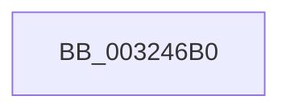

# RtlpHpAcquireLockExclusive

- RVA: `0x003246B0`–`0x003246C5` (길이 `21` bytes)
- VA: `0x00000001403246B0`
- 실행 섹션: `.text`
- PDB 이름 있음: `예`; PDB Function 태그: `아니요`
- unwind 정보 RVA: `0x00075AB0`
- 디코드: `6`개 명령, `21/21` bytes 표시
- 미해석 바이트: `0` (있으면 어셈블리에 `.byte`로 보존)

> 이 문서는 커널 이미지의 기계어와 PDB 기호를 분석해 생성했습니다. 4번과 5번은 함수 원형과 자료형을 바이너리 사용 방식에서 추정한 C 해석이며 원본 소스 복구 결과는 아닙니다.

## 1. Dependencies

- 직접 호출 지점: **0**; 고유 호출 대상: **0**
- 직접 호출자로 확인된 함수: **25**
- RIP 상대 이미지 참조: **0**

### Outgoing calls
- 직접 디코드된 call 명령이 없습니다.

### Direct callers
- [RtlpHpSegLockAcquire](../2E/RtlpHpSegLockAcquire_function_002E34A0.md) at `0x002E34B1`
- [RtlpHpLfhOwnerCompact](../2E/RtlpHpLfhOwnerCompact_function_002E785C.md) at `0x002E796F`
- [RtlpHpLfhOwnerCompact](../2E/RtlpHpLfhOwnerCompact_function_002E785C.md) at `0x002E7A2B`
- [RtlpHpLfhBucketGetSubsegment](../2E/RtlpHpLfhBucketGetSubsegment_function_002E8474.md) at `0x002E84B0`
- [RtlpHpLfhBucketAddSubsegment](../2E/RtlpHpLfhBucketAddSubsegment_function_002E8CD8.md) at `0x002E8D27`
- [RtlpHpLfhSlotAllocateSlow](../2E/RtlpHpLfhSlotAllocateSlow_function_002E8FBC.md) at `0x002E9145`
- [RtlpHpLfhSlotAllocateSlow](../2E/RtlpHpLfhSlotAllocateSlow_function_002E8FBC.md) at `0x002E95BE`
- [RtlpHpLfhSubsegmentCommitBlock](../2E/RtlpHpLfhSubsegmentCommitBlock_function_002EA630.md) at `0x002EA7D4`
- [RtlpHpLfhSubsegmentIncBlockCounts](../2E/RtlpHpLfhSubsegmentIncBlockCounts_function_002EB4A0.md) at `0x002EB62A`
- [RtlpHpLargeLockAcquire](../2E/RtlpHpLargeLockAcquire_function_002ECA40.md) at `0x002ECA50`
- [RtlpHpSegMgrLock](../2E/RtlpHpSegMgrLock_function_002ED710.md) at `0x002ED721`
- [RtlpHpVaMgrCtxFree](../2E/RtlpHpVaMgrCtxFree_function_002ED734.md) at `0x002ED8ED`
- [RtlpHpVaMgrAlloc](../2E/RtlpHpVaMgrAlloc_function_002EDB1C.md) at `0x002EDB63`
- [RtlpHpVaMgrAlloc](../2E/RtlpHpVaMgrAlloc_function_002EDB1C.md) at `0x002EDC4D`
- [RtlpHpLfhOwnerListCompact](RtlpHpLfhOwnerListCompact_function_00323BA8.md) at `0x00323C22`
- [RtlpHpLfhSubsegmentDelayFreeListProcess](RtlpHpLfhSubsegmentDelayFreeListProcess_function_00323CE0.md) at `0x00323FF0`
- [RtlpHpSegMgrCommitInitiate](RtlpHpSegMgrCommitInitiate_function_003271DC.md) at `0x00327281`
- [RtlpHpFixedVsAllocate](../3B/RtlpHpFixedVsAllocate_function_003B47F0.md) at `0x003B48AA`
- [RtlpHpFixedVsFree](../4A/RtlpHpFixedVsFree_function_004A7FE0.md) at `0x004A812A`
- [RtlpHpHeapExtendContext](../4B/RtlpHpHeapExtendContext_function_004B1EFC.md) at `0x004B1F62`
- [RtlpHpCustomVaCallbacksRegistrarRegister](../60/RtlpHpCustomVaCallbacksRegistrarRegister_function_00602804.md) at `0x0060293F`
- [RtlpHpCustomVaCallbacksRegistrarUnregister](../60/RtlpHpCustomVaCallbacksRegistrarUnregister_function_00602B9C.md) at `0x00602BBE`
- [RtlpHpRegisterEnvironment](../60/RtlpHpRegisterEnvironment_function_006036C0.md) at `0x006037E4`
- [RtlpHpVaMgrCtxAllocatorReference](../60/RtlpHpVaMgrCtxAllocatorReference_function_00603BC0.md) at `0x00603C23`
- [RtlpHpLfhContextLockExtension](../60/RtlpHpLfhContextLockExtension_function_00604A50.md) at `0x00604A5C`
- [RtlpHpLfhPrivateSlotCreate](../60/RtlpHpLfhPrivateSlotCreate_function_00604D50.md) at `0x00604E8B`
- [RtlpHpLfhPrivateSlotListCompact](../60/RtlpHpLfhPrivateSlotListCompact_function_00604F1C.md) at `0x00604F6C`
- [RtlpHpLfhPrivateSlotShutdown](../60/RtlpHpLfhPrivateSlotShutdown_function_0060502C.md) at `0x0060518E`

### Static image references
- 디코드된 RIP-relative 메모리 참조가 없습니다.

## 2. Other-region calls and transfers

- 다른 실행 섹션으로 향하는 call: **0**
- call이 아닌 외부 분기/꼬리 이동: **1**
  - `0x003246BF` → [sub_00324759 + 0x1](Unknown_function_00324759.md) (`tail-transfer`)

## 3. Assembly (complete function range)

```asm
003246B0  48 89 5C 24 18                  mov qword ptr [rsp + 0x18], rbx
003246B5  57                              push rdi
003246B6  48 83 EC 20                     sub rsp, 0x20
003246BA  48 8B D9                        mov rbx, rcx
003246BD  85 D2                           test edx, edx
003246BF  0F 84 95 00 00 00               je 0x14032475a
```

## 4. C-style interpretation (structured pseudocode)

```c
void __fastcall RtlpHpAcquireLockExclusive(__int64 a1, int a2)
{
    __int64 v_rsp;
    unsigned __int64 v_stack_p18;

    v_stack_p18 = v_rbx;
    v_rsp = (v_rsp) - (32);
}
```

## 5. (Beta) C Style

```c
void RtlpHpAcquireLockExclusive(int64_t Arg1, int32_t Arg2)
{
    int64_t local_rsp;
    uint64_t v_stack_p18;

    v_stack_p18 = local_rbx;
    local_rsp = (local_rsp) - (32);
}
```

## 6. Execution-region graph

[열기: 2D/3D 그래프와 함수 탐색 컨트롤 패널](../../../control-panel.html?section=text&rva=0x003246B0&view=graph)

- 2D 그래프는 위에서 아래로 흐르고, 3D 그래프는 빈 공간을 드래그해 회전합니다. Shift+드래그는 이동, 휠은 확대·축소, 함수 노드 선택은 대상 보고서 이동입니다.

### Static fallback


