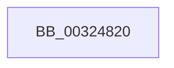

# RtlpHpAcquireQueuedLockExclusive

- RVA: `0x00324820`–`0x0032483C` (길이 `28` bytes)
- VA: `0x0000000140324820`
- 실행 섹션: `.text`
- PDB 이름 있음: `예`; PDB Function 태그: `아니요`
- unwind 정보 RVA: `0x00075B00`
- 디코드: `8`개 명령, `28/28` bytes 표시
- 미해석 바이트: `0` (있으면 어셈블리에 `.byte`로 보존)

> 이 문서는 커널 이미지의 기계어와 PDB 기호를 분석해 생성했습니다. 4번과 5번은 함수 원형과 자료형을 바이너리 사용 방식에서 추정한 C 해석이며 원본 소스 복구 결과는 아닙니다.

## 1. Dependencies

- 직접 호출 지점: **0**; 고유 호출 대상: **0**
- 직접 호출자로 확인된 함수: **8**
- RIP 상대 이미지 참조: **0**

### Outgoing calls
- 직접 디코드된 call 명령이 없습니다.

### Direct callers
- [RtlpHpVsChunkFree](../2E/RtlpHpVsChunkFree_function_002E3980.md) at `0x002E4115`
- [RtlpHpVsChunkSplit](../2E/RtlpHpVsChunkSplit_function_002E5C80.md) at `0x002E6731`
- [RtlpHpVsChunkSplit](../2E/RtlpHpVsChunkSplit_function_002E5C80.md) at `0x002E68D9`
- [RtlpHpVsChunkSplit](../2E/RtlpHpVsChunkSplit_function_002E5C80.md) at `0x002E69BB`
- [RtlpHpVsSubsegmentCommitPages](../2E/RtlpHpVsSubsegmentCommitPages_function_002E6C74.md) at `0x002E6CE6`
- [RtlpHpVsSlotCompactChunks](../2E/RtlpHpVsSlotCompactChunks_function_002E6E00.md) at `0x002E6E48`
- [RtlpHpVsContextAllocate](../2E/RtlpHpVsContextAllocate_function_002EA944.md) at `0x002EAB0B`
- [RtlpHpVsSlotAllocate](../2E/RtlpHpVsSlotAllocate_function_002EAB38.md) at `0x002EAD22`
- [RtlpHpVsContextMultiAlloc](../2E/RtlpHpVsContextMultiAlloc_function_002EB6B4.md) at `0x002EB742`
- [RtlpHpVsSlotFreeList](../36/RtlpHpVsSlotFreeList_function_00361ACC.md) at `0x00361B1A`

### Static image references
- 디코드된 RIP-relative 메모리 참조가 없습니다.

## 2. Other-region calls and transfers

- 다른 실행 섹션으로 향하는 call: **0**
- call이 아닌 외부 분기/꼬리 이동: **1**
  - `0x00324836` → [sub_003248D2 + 0xC](Unknown_function_003248D2.md) (`tail-transfer`)

## 3. Assembly (complete function range)

```asm
00324820  48 89 5C 24 20                  mov qword ptr [rsp + 0x20], rbx
00324825  57                              push rdi
00324826  48 83 EC 20                     sub rsp, 0x20
0032482A  49 89 48 08                     mov qword ptr [r8 + 8], rcx
0032482E  49 8B F8                        mov rdi, r8
00324831  48 8B D9                        mov rbx, rcx
00324834  85 D2                           test edx, edx
00324836  0F 84 A2 00 00 00               je 0x1403248de
```

## 4. C-style interpretation (structured pseudocode)

```c
void __fastcall RtlpHpAcquireQueuedLockExclusive(__int64 a1, int a2, __int64 a3)
{
    __int64 v_rsp;
    unsigned __int64 v_stack_p20;

    v_stack_p20 = v_rbx;
    v_rsp = (v_rsp) - (32);
    *(unsigned __int64 *)(a3 + 8) = a1;
}
```

## 5. (Beta) C Style

```c
void RtlpHpAcquireQueuedLockExclusive(int64_t Arg1, int32_t Arg2, void *Arg3)
{
    uint8_t *arg3 = (uint8_t *)Arg3;

    int64_t local_rsp;
    uint64_t v_stack_p20;

    v_stack_p20 = local_rbx;
    local_rsp = (local_rsp) - (32);
    *(uint64_t *)(arg3 + 0x8) = Arg1;
}
```

### 관측된 메모리 오프셋

구조체 형식이 확인되지 않은 접근은 인자 기준의 오프셋으로만 기록했습니다.

| 기준 인자 | 오프셋 표현 | 폭 (bit) | 접근 |
|---|---:|---:|---|
| `Arg3` | `+ 0x8` | `64` | `W` |

## 6. Execution-region graph

[열기: 2D/3D 그래프와 함수 탐색 컨트롤 패널](../../../control-panel.html?section=text&rva=0x00324820&view=graph)

- 2D 그래프는 위에서 아래로 흐르고, 3D 그래프는 빈 공간을 드래그해 회전합니다. Shift+드래그는 이동, 휠은 확대·축소, 함수 노드 선택은 대상 보고서 이동입니다.

### Static fallback


