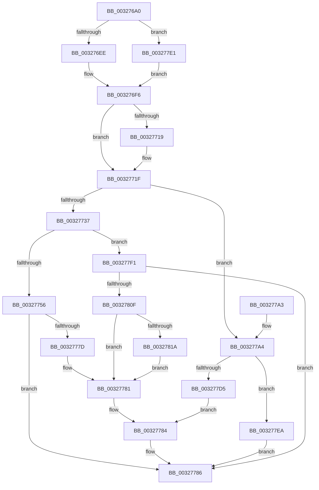

# RtlpHpAllocVA

- RVA: `0x003276A0`–`0x0032782A` (길이 `394` bytes)
- VA: `0x00000001403276A0`
- 실행 섹션: `.text`
- PDB 이름 있음: `예`; PDB Function 태그: `아니요`
- unwind 정보 RVA: `0x00075DF4`
- 디코드: `109`개 명령, `394/394` bytes 표시
- 미해석 바이트: `0` (있으면 어셈블리에 `.byte`로 보존)

> 이 문서는 커널 이미지의 기계어와 PDB 기호를 분석해 생성했습니다. 4번과 5번은 함수 원형과 자료형을 바이너리 사용 방식에서 추정한 C 해석이며 원본 소스 복구 결과는 아닙니다.

## 1. Dependencies

- 직접 호출 지점: **4**; 고유 호출 대상: **4**
- 직접 호출자로 확인된 함수: **4**
- RIP 상대 이미지 참조: **1**

### Outgoing calls
- `0x00327774` → [RtlpHpEnvAllocVA](RtlpHpEnvAllocVA_function_00328F50.md) (function, `0x00328F50`)
- `0x003277C8` → [RtlpHpVaMgrCtxAlloc](../2E/RtlpHpVaMgrCtxAlloc_function_002EDA80.md) (function, `0x002EDA80`)
- `0x00327802` → [RtlpHpVaMgrCtxCommit](../60/RtlpHpVaMgrCtxCommit_function_00603D44.md) (function, `0x00603D44`)
- `0x00327820` → [RtlHeapZero](../6B/RtlHeapZero_function_006BBC10.md) (function, `0x006BBC10`)

### Direct callers
- [RtlpHpLargeAlloc](../2E/RtlpHpLargeAlloc_function_002EBD5C.md) at `0x002EBFAB`
- [RtlpHpSegMgrCommit](RtlpHpSegMgrCommit_function_00326BE4.md) at `0x00326DAF`
- [RtlpHpHeapExtendContext](../4B/RtlpHpHeapExtendContext_function_004B1EFC.md) at `0x004B202A`
- [RtlpHpHeapAllocate](../60/RtlpHpHeapAllocate_function_00602D98.md) at `0x00602ED4`
- [RtlpHpHeapAllocate](../60/RtlpHpHeapAllocate_function_00602D98.md) at `0x00602F08`

### Static image references
- `0x003277BD` → RVA `0x00E68658` (`.data`; read)

## 2. Other-region calls and transfers

- 다른 실행 섹션으로 향하는 call: **0**
- 별도 외부 분기/꼬리 이동을 확인하지 못했습니다.

## 3. Assembly (complete function range)

```asm
003276A0  48 8B C4                        mov rax, rsp
003276A3  48 89 58 08                     mov qword ptr [rax + 8], rbx
003276A7  48 89 70 10                     mov qword ptr [rax + 0x10], rsi
003276AB  48 89 78 18                     mov qword ptr [rax + 0x18], rdi
003276AF  4C 89 70 20                     mov qword ptr [rax + 0x20], r14
003276B3  55                              push rbp
003276B4  48 8B EC                        mov rbp, rsp
003276B7  48 81 EC 80 00 00 00            sub rsp, 0x80
003276BE  48 8B 45 38                     mov rax, qword ptr [rbp + 0x38]
003276C2  48 8B F2                        mov rsi, rdx
003276C5  48 8B F9                        mov rdi, rcx
003276C8  45 8B F1                        mov r14d, r9d
003276CB  33 C9                           xor ecx, ecx
003276CD  4D 8B D0                        mov r10, r8
003276D0  89 4D EC                        mov dword ptr [rbp - 0x14], ecx
003276D3  0F 10 00                        movups xmm0, xmmword ptr [rax]
003276D6  66 48 0F 7E C2                  movq rdx, xmm0
003276DB  48 8B C2                        mov rax, rdx
003276DE  48 C1 E8 18                     shr rax, 0x18
003276E2  0F 11 45 D0                     movups xmmword ptr [rbp - 0x30], xmm0
003276E6  84 C0                           test al, al
003276E8  0F 84 F3 00 00 00               je 0x1403277e1
003276EE  0F B6 C0                        movzx eax, al
003276F1  FF C8                           dec eax
003276F3  89 45 E0                        mov dword ptr [rbp - 0x20], eax
003276F6  48 8B C2                        mov rax, rdx
003276F9  48 C1 E8 08                     shr rax, 8
003276FD  44 0F B6 C0                     movzx r8d, al
00327701  48 8B C2                        mov rax, rdx
00327704  48 C1 E8 10                     shr rax, 0x10
00327708  44 0F B6 C8                     movzx r9d, al
0032770C  44 89 4D E8                     mov dword ptr [rbp - 0x18], r9d
00327710  44 89 45 E4                     mov dword ptr [rbp - 0x1c], r8d
00327714  F6 C2 08                        test dl, 8
00327717  74 06                           je 0x14032771f
00327719  83 C9 01                        or ecx, 1
0032771C  89 4D EC                        mov dword ptr [rbp - 0x14], ecx
0032771F  48 8B 45 D8                     mov rax, qword ptr [rbp - 0x28]
00327723  48 8B 1E                        mov rbx, qword ptr [rsi]
00327726  48 89 45 F0                     mov qword ptr [rbp - 0x10], rax
0032772A  48 8D 43 FF                     lea rax, [rbx - 1]
0032772E  41 81 FE 00 20 00 00            cmp r14d, 0x2000
00327735  74 6D                           je 0x1403277a4
00327737  B9 FF 0F 00 00                  mov ecx, 0xfff
0032773C  48 23 C1                        and rax, rcx
0032773F  48 2B D8                        sub rbx, rax
00327742  8A 45 D1                        mov al, byte ptr [rbp - 0x2f]
00327745  48 03 D9                        add rbx, rcx
00327748  2C 02                           sub al, 2
0032774A  48 89 5D 38                     mov qword ptr [rbp + 0x38], rbx
0032774E  3C 02                           cmp al, 2
00327750  0F 86 9B 00 00 00               jbe 0x1403277f1
00327756  8B 45 30                        mov eax, dword ptr [rbp + 0x30]
00327759  48 8D 55 38                     lea rdx, [rbp + 0x38]
0032775D  44 89 4C 24 40                  mov dword ptr [rsp + 0x40], r9d
00327762  48 8B CF                        mov rcx, rdi
00327765  44 89 44 24 30                  mov dword ptr [rsp + 0x30], r8d
0032776A  45 8B CE                        mov r9d, r14d
0032776D  4D 8B C2                        mov r8, r10
00327770  89 44 24 20                     mov dword ptr [rsp + 0x20], eax
00327774  E8 D7 17 00 00                  call 0x140328f50
00327779  85 C0                           test eax, eax
0032777B  78 09                           js 0x140327786
0032777D  48 8B 5D 38                     mov rbx, qword ptr [rbp + 0x38]
00327781  48 89 1E                        mov qword ptr [rsi], rbx
00327784  33 C0                           xor eax, eax
00327786  4C 8D 9C 24 80 00 00 00         lea r11, [rsp + 0x80]
0032778E  49 8B 5B 10                     mov rbx, qword ptr [r11 + 0x10]
00327792  49 8B 73 18                     mov rsi, qword ptr [r11 + 0x18]
00327796  49 8B 7B 20                     mov rdi, qword ptr [r11 + 0x20]
0032779A  4D 8B 73 28                     mov r14, qword ptr [r11 + 0x28]
0032779E  49 8B E3                        mov rsp, r11
003277A1  5D                              pop rbp
003277A2  C3                              ret
003277A3  CC                              int3
003277A4  B9 FF FF 0F 00                  mov ecx, 0xfffff
003277A9  4C 8D 4D E0                     lea r9, [rbp - 0x20]
003277AD  48 23 C1                        and rax, rcx
003277B0  48 8D 55 38                     lea rdx, [rbp + 0x38]
003277B4  48 2B D8                        sub rbx, rax
003277B7  4D 8B C2                        mov r8, r10
003277BA  48 03 D9                        add rbx, rcx
003277BD  48 8D 0D 94 0E B4 00            lea rcx, [rip + 0xb40e94]
003277C4  48 89 5D 38                     mov qword ptr [rbp + 0x38], rbx
003277C8  E8 B3 62 FC FF                  call 0x1402eda80
003277CD  48 8B C8                        mov rcx, rax
003277D0  48 85 C0                        test rax, rax
003277D3  74 15                           je 0x1403277ea
003277D5  48 8B 45 38                     mov rax, qword ptr [rbp + 0x38]
003277D9  48 89 06                        mov qword ptr [rsi], rax
003277DC  48 89 0F                        mov qword ptr [rdi], rcx
003277DF  EB A3                           jmp 0x140327784
003277E1  83 4D E0 FF                     or dword ptr [rbp - 0x20], 0xffffffff
003277E5  E9 0C FF FF FF                  jmp 0x1403276f6
003277EA  B8 9A 00 00 C0                  mov eax, 0xc000009a
003277EF  EB 95                           jmp 0x140327786
003277F1  44 8B 4D 30                     mov r9d, dword ptr [rbp + 0x30]
003277F5  48 8D 0D 5C 0E B4 00            lea rcx, [rip + 0xb40e5c]
003277FC  48 8B 17                        mov rdx, qword ptr [rdi]
003277FF  4C 8B C3                        mov r8, rbx
00327802  E8 3D C5 2D 00                  call 0x140603d44
00327807  85 C0                           test eax, eax
00327809  0F 88 77 FF FF FF               js 0x140327786
0032780F  41 0F BA E6 1E                  bt r14d, 0x1e
00327814  0F 83 67 FF FF FF               jae 0x140327781
0032781A  48 8B 0F                        mov rcx, qword ptr [rdi]
0032781D  48 8B D3                        mov rdx, rbx
00327820  E8 EB 43 39 00                  call 0x1406bbc10
00327825  E9 57 FF FF FF                  jmp 0x140327781
```

## 4. C-style interpretation (structured pseudocode)

```c
__int64 __fastcall RtlpHpAllocVA(__int64 a1, __int64 a2, __int64 a3, int a4, unsigned int a5, __int64 a6)
{
    __int64 result;
    __int64 v_rbx;
    __int64 v_rsp;
    unsigned __int64 v_stack_m18;
    unsigned int v_stack_m1C;
    unsigned int v_stack_m20;
    unsigned int v_stack_m24;
    unsigned int v_stack_m28;
    unsigned __int64 v_stack_m30;
    unsigned __int8 v_stack_m37;
    unsigned __int64 v_stack_m38;
    unsigned int v_stack_m48;
    unsigned int v_stack_m58;
    unsigned int v_stack_m68;
    unsigned __int64 v_stack_m8;
    unsigned __int64 v_stack_p30;

    *(unsigned __int64 *)(v_rsp + 8) = v_rbx;
    *(unsigned __int64 *)(v_rsp + 16) = v_rsi;
    *(unsigned __int64 *)(v_rsp + 24) = v_rdi;
    *(unsigned __int64 *)(v_rsp + 32) = v_r14;
    v_rsp = (v_rsp) - (128);
    a1 = 0;
    v_stack_m1C = 0;
    result = (a2) >> (24);
    v_stack_m38 = v_xmm0;
    if ((unsigned __int8)(result) == 0) goto loc_003277E1;
    result = (unsigned int)(((unsigned __int8)(result)) - 1);
    v_stack_m28 = (unsigned int)(result);
loc_003276F6:
    result = (a2) >> (8);
    result = (a2) >> (16);
    v_stack_m20 = (unsigned int)((unsigned __int8)(result));
    v_stack_m24 = (unsigned int)((unsigned __int8)(result));
    if ((((unsigned __int8)(a2)) & (8)) != 0) {
        a1 = (unsigned int)((a1) | (1));
        v_stack_m1C = (unsigned int)(a1);
    }
    v_stack_m18 = v_stack_m30;
    if (((unsigned int)((unsigned int)(a4))) == 0x2000ULL) goto loc_003277A4;
    result = (*(unsigned __int64 *)(a2) - 1) & ((unsigned int)(0xFFFULL));
    v_rbx = (*(unsigned __int64 *)(a2)) - (result);
    v_rbx = (v_rbx) + ((unsigned int)(0xFFFULL));
    result = (unsigned __int8)((v_stack_m37) - (2));
    v_stack_p30 = v_rbx;
    if (((unsigned __int8)(result)) <= 2) goto loc_003277F1;
    v_stack_m48 = (unsigned int)((unsigned __int8)(result));
    v_stack_m58 = (unsigned int)((unsigned __int8)(result));
    v_stack_m68 = (unsigned int)((unsigned int)(a5));
    result = RtlpHpEnvAllocVA(a1, a6, a3, (unsigned int)((unsigned int)((unsigned int)(a4))));
    if (sign_flag) goto loc_00327786;
loc_00327781:
    *(unsigned __int64 *)(a2) = a6;
loc_00327784:
    result = 0;
loc_00327786:
    return result;
loc_003277A4:
    result = (result) & ((unsigned int)(0xFFFFFULL));
    v_rbx = (*(unsigned __int64 *)(v_stack_m8 + 16)) - (result);
    v_rbx = (v_rbx) + ((unsigned int)(0xFFFFFULL));
    v_stack_p30 = v_rbx;
    result = RtlpHpVaMgrCtxAlloc(v_rip + 11800212, a6, a3, v_stack_m28);
    if (result == 0) goto loc_003277EA;
    *(unsigned __int64 *)(*(unsigned __int64 *)(v_stack_m8 + 24)) = a6;
    *(unsigned __int64 *)(*(unsigned __int64 *)(v_stack_m8 + 32)) = result;
    goto loc_00327784;
loc_003277E1:
    goto loc_003276F6;
loc_003277EA:
    goto loc_00327786;
loc_003277F1:
    result = RtlpHpVaMgrCtxCommit(v_rip + 11800156, *(unsigned __int64 *)(*(unsigned __int64 *)(v_stack_m8 + 32)), v_rbx, (unsigned int)(a5));
    if (sign_flag) goto loc_00327786;
    if (condition_is_above_or_equal) goto loc_00327781;
    result = RtlHeapZero(*(unsigned __int64 *)(*(unsigned __int64 *)(v_stack_m8 + 32)), v_rbx, v_rbx, (unsigned int)(a5));
    goto loc_00327781;
}
```

## 5. (Beta) C Style

```c
int64_t RtlpHpAllocVA(void *Arg1, void *Arg2, int64_t Arg3, int32_t Arg4, uint32_t Arg5, void *Arg6)
{
    uint8_t *arg1 = (uint8_t *)Arg1;
    uint8_t *arg2 = (uint8_t *)Arg2;
    uint8_t *arg6 = (uint8_t *)Arg6;

    int64_t result;
    int64_t local_rbx;
    int64_t local_rsp;
    uint64_t v_stack_m18;
    uint32_t v_stack_m1C;
    uint32_t v_stack_m20;
    uint32_t v_stack_m24;
    uint32_t v_stack_m28;
    uint64_t v_stack_m30;
    uint8_t v_stack_m37;
    uint64_t v_stack_m38;
    uint32_t v_stack_m48;
    uint32_t v_stack_m58;
    uint32_t v_stack_m68;
    uint64_t v_stack_m8;
    uint64_t v_stack_p30;

    *(uint64_t *)(local_rsp + 0x8) = local_rbx;
    *(uint64_t *)(local_rsp + 0x10) = local_rsi;
    *(uint64_t *)(local_rsp + 0x18) = local_rdi;
    *(uint64_t *)(local_rsp + 0x20) = local_r14;
    local_rsp = (local_rsp) - (128);
    Arg1 = 0;
    v_stack_m1C = 0;
    result = (Arg2) >> (24);
    v_stack_m38 = v_xmm0;
    if ((uint8_t)(result) == 0) goto loc_003277E1;
    result = (uint32_t)(((uint8_t)(result)) - 1);
    v_stack_m28 = (uint32_t)(result);
loc_003276F6:
    result = (Arg2) >> (8);
    result = (Arg2) >> (16);
    v_stack_m20 = (uint32_t)((uint8_t)(result));
    v_stack_m24 = (uint32_t)((uint8_t)(result));
    if ((((uint8_t)(Arg2)) & (8)) != 0) {
        Arg1 = (uint32_t)((Arg1) | (1));
        v_stack_m1C = (uint32_t)(Arg1);
    }
    v_stack_m18 = v_stack_m30;
    if (((uint32_t)((uint32_t)(Arg4))) == 0x2000ULL) goto loc_003277A4;
    result = (*(uint64_t *)(arg2) - 1) & ((uint32_t)(0xFFFULL));
    local_rbx = (*(uint64_t *)(arg2)) - (result);
    local_rbx = (local_rbx) + ((uint32_t)(0xFFFULL));
    result = (uint8_t)((v_stack_m37) - (2));
    v_stack_p30 = local_rbx;
    if (((uint8_t)(result)) <= 2) goto loc_003277F1;
    v_stack_m48 = (uint32_t)((uint8_t)(result));
    v_stack_m58 = (uint32_t)((uint8_t)(result));
    v_stack_m68 = (uint32_t)((uint32_t)(Arg5));
    result = RtlpHpEnvAllocVA(Arg1, Arg6, Arg3, (uint32_t)((uint32_t)((uint32_t)(Arg4))));
    if (sign_flag) goto loc_00327786;
loc_00327781:
    *(void **)(arg2) = Arg6;
loc_00327784:
    result = 0;
loc_00327786:
    return result;
loc_003277A4:
    result = (result) & ((uint32_t)(0xFFFFFULL));
    local_rbx = (*(uint64_t *)(v_stack_m8 + 0x10)) - (result);
    local_rbx = (local_rbx) + ((uint32_t)(0xFFFFFULL));
    v_stack_p30 = local_rbx;
    result = RtlpHpVaMgrCtxAlloc(v_rip + 11800212, Arg6, Arg3, v_stack_m28);
    if (result == 0) goto loc_003277EA;
    *(void **)(*(uint64_t *)(v_stack_m8 + 0x18)) = Arg6;
    *(uint64_t *)(*(uint64_t *)(v_stack_m8 + 0x20)) = result;
    goto loc_00327784;
loc_003277E1:
    goto loc_003276F6;
loc_003277EA:
    goto loc_00327786;
loc_003277F1:
    result = RtlpHpVaMgrCtxCommit(v_rip + 11800156, *(uint64_t *)(*(uint64_t *)(v_stack_m8 + 0x20)), local_rbx, (uint32_t)(Arg5));
    if (sign_flag) goto loc_00327786;
    if (condition_is_above_or_equal) goto loc_00327781;
    result = RtlHeapZero(*(uint64_t *)(*(uint64_t *)(v_stack_m8 + 0x20)), local_rbx, local_rbx, (uint32_t)(Arg5));
    goto loc_00327781;
}
```

### 관측된 메모리 오프셋

구조체 형식이 확인되지 않은 접근은 인자 기준의 오프셋으로만 기록했습니다.

| 기준 인자 | 오프셋 표현 | 폭 (bit) | 접근 |
|---|---:|---:|---|
| `Arg1` | `+ 0x0` | `64` | `R` |
| `Arg1` | `+ 0x0` | `64` | `W` |
| `Arg2` | `+ 0x0` | `64` | `R` |
| `Arg2` | `+ 0x0` | `64` | `W` |
| `Arg6` | `+ 0x0` | `128` | `R` |

## 6. Execution-region graph

[열기: 2D/3D 그래프와 함수 탐색 컨트롤 패널](../../../control-panel.html?section=text&rva=0x003276A0&view=graph)

- 2D 그래프는 위에서 아래로 흐르고, 3D 그래프는 빈 공간을 드래그해 회전합니다. Shift+드래그는 이동, 휠은 확대·축소, 함수 노드 선택은 대상 보고서 이동입니다.

### Static fallback


