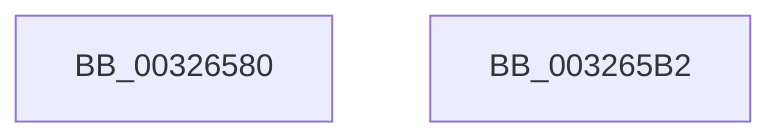

# RtlpHpAllocateHeapBackend

- RVA: `0x00326580`–`0x003265B3` (길이 `51` bytes)
- VA: `0x0000000140326580`
- 실행 섹션: `.text`
- PDB 이름 있음: `예`; PDB Function 태그: `아니요`
- unwind 정보 RVA: `0x0005D2F4`
- 디코드: `13`개 명령, `51/51` bytes 표시
- 미해석 바이트: `0` (있으면 어셈블리에 `.byte`로 보존)

> 이 문서는 커널 이미지의 기계어와 PDB 기호를 분석해 생성했습니다. 4번과 5번은 함수 원형과 자료형을 바이너리 사용 방식에서 추정한 C 해석이며 원본 소스 복구 결과는 아닙니다.

## 1. Dependencies

- 직접 호출 지점: **1**; 고유 호출 대상: **1**
- 직접 호출자로 확인된 함수: **6**
- RIP 상대 이미지 참조: **0**

### Outgoing calls
- `0x003265A8` → [RtlpHpSegAlloc](RtlpHpSegAlloc_function_003265BC.md) (function, `0x003265BC`)

### Direct callers
- [sub_002E9C01](../2E/Unknown_function_002E9C01.md) at `0x002E9DA9`
- [RtlpHpAllocateHeapSlow](../2E/RtlpHpAllocateHeapSlow_function_002E9DEC.md) at `0x002EA445`
- [RtlpHpMetadataAlloc](../2E/RtlpHpMetadataAlloc_function_002EC180.md) at `0x002EC578`
- [ExAllocateContiguousHeapPool](../2E/ExAllocateContiguousHeapPool_function_002EE960.md) at `0x002EEA48`
- [ExAllocateHeapPool](../35/ExAllocateHeapPool_function_0035BA30.md) at `0x0035C123`
- [ExAllocateHeapPool](../35/ExAllocateHeapPool_function_0035BA30.md) at `0x0035E93E`
- [ExAllocateHeapPool](../35/ExAllocateHeapPool_function_0035BA30.md) at `0x0035E96D`
- [ExAllocateHeapPages](../44/ExAllocateHeapPages_function_00446BB4.md) at `0x00446BFE`

### Static image references
- 디코드된 RIP-relative 메모리 참조가 없습니다.

## 2. Other-region calls and transfers

- 다른 실행 섹션으로 향하는 call: **0**
- 별도 외부 분기/꼬리 이동을 확인하지 못했습니다.

## 3. Assembly (complete function range)

```asm
00326580  48 83 EC 38                     sub rsp, 0x38
00326584  8B 81 50 01 00 00               mov eax, dword ptr [rcx + 0x150]
0032658A  41 BB 40 01 00 00               mov r11d, 0x140
00326590  4C 3B C0                        cmp r8, rax
00326593  44 89 4C 24 20                  mov dword ptr [rsp + 0x20], r9d
00326598  41 BA 00 02 00 00               mov r10d, 0x200
0032659E  4D 8B C8                        mov r9, r8
003265A1  45 0F 46 D3                     cmovbe r10d, r11d
003265A5  49 03 CA                        add rcx, r10
003265A8  E8 0F 00 00 00                  call 0x1403265bc
003265AD  48 83 C4 38                     add rsp, 0x38
003265B1  C3                              ret
003265B2  CC                              int3
```

## 4. C-style interpretation (structured pseudocode)

```c
__int64 __fastcall RtlpHpAllocateHeapBackend(__int64 a1, __int64 a2, __int64 a3, int a4)
{
    __int64 result;
    __int64 v_r10;
    __int64 v_rsp;
    unsigned int v_stack_m18;

    v_rsp = (v_rsp) - (56);
    v_stack_m18 = a4;
    v_r10 = 512;
    if (a3 <= ((unsigned int)(*(unsigned int *)(a1 + 336)))) { v_r10 = 320; }
    a1 = (a1) + (v_r10);
    result = RtlpHpSegAlloc(a1, a2, a3, a3);
    v_rsp = (v_rsp) + (56);
    return result;
}
```

## 5. (Beta) C Style

```c
int64_t RtlpHpAllocateHeapBackend(void *Arg1, int64_t Arg2, int64_t Arg3, int32_t Arg4)
{
    uint8_t *arg1 = (uint8_t *)Arg1;

    int64_t result;
    int64_t local_r10;
    int64_t local_rsp;
    uint32_t v_stack_m18;

    local_rsp = (local_rsp) - (56);
    v_stack_m18 = Arg4;
    local_r10 = 512;
    if (Arg3 <= ((uint32_t)(*(uint32_t *)(arg1 + 0x150)))) { local_r10 = 320; }
    Arg1 = (Arg1) + (local_r10);
    result = RtlpHpSegAlloc(Arg1, Arg2, Arg3, Arg3);
    local_rsp = (local_rsp) + (56);
    return result;
}
```

### 관측된 메모리 오프셋

구조체 형식이 확인되지 않은 접근은 인자 기준의 오프셋으로만 기록했습니다.

| 기준 인자 | 오프셋 표현 | 폭 (bit) | 접근 |
|---|---:|---:|---|
| `Arg1` | `+ 0x150` | `32` | `R` |

## 6. Execution-region graph

[열기: 2D/3D 그래프와 함수 탐색 컨트롤 패널](../../../control-panel.html?section=text&rva=0x00326580&view=graph)

- 2D 그래프는 위에서 아래로 흐르고, 3D 그래프는 빈 공간을 드래그해 회전합니다. Shift+드래그는 이동, 휠은 확대·축소, 함수 노드 선택은 대상 보고서 이동입니다.

### Static fallback


