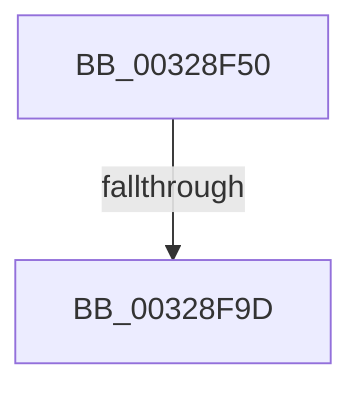

# RtlpHpEnvAllocVA

- RVA: `0x00328F50`–`0x00328FA3` (길이 `83` bytes)
- VA: `0x0000000140328F50`
- 실행 섹션: `.text`
- PDB 이름 있음: `예`; PDB Function 태그: `예`
- unwind 정보 RVA: `0x00075FA0`
- 디코드: `24`개 명령, `83/83` bytes 표시
- 미해석 바이트: `0` (있으면 어셈블리에 `.byte`로 보존)

> 이 문서는 커널 이미지의 기계어와 PDB 기호를 분석해 생성했습니다. 4번과 5번은 함수 원형과 자료형을 바이너리 사용 방식에서 추정한 C 해석이며 원본 소스 복구 결과는 아닙니다.

## 1. Dependencies

- 직접 호출 지점: **0**; 고유 호출 대상: **0**
- 직접 호출자로 확인된 함수: **5**
- RIP 상대 이미지 참조: **0**

### Outgoing calls
- 직접 디코드된 call 명령이 없습니다.

### Direct callers
- [RtlpHpVaMgrAllocAligned](../2E/RtlpHpVaMgrAllocAligned_function_002EF234.md) at `0x002EF2A5`
- [RtlpCSparseBitmapPageCommit](../2F/RtlpCSparseBitmapPageCommit_function_002F0B98.md) at `0x002F0CA9`
- [RtlpCSparseBitmapPageCommit](../2F/RtlpCSparseBitmapPageCommit_function_002F0B98.md) at `0x002F0D0D`
- [RtlpHpAllocVA](RtlpHpAllocVA_function_003276A0.md) at `0x00327774`
- [RtlpHpVaMgrRangeCommit](../60/RtlpHpVaMgrRangeCommit_function_00603EF8.md) at `0x00603FF0`
- [RtlCSparseBitmapStart](../60/RtlCSparseBitmapStart_function_00605338.md) at `0x006053FE`
- [RtlCSparseBitmapStart](../60/RtlCSparseBitmapStart_function_00605338.md) at `0x00605457`

### Static image references
- 디코드된 RIP-relative 메모리 참조가 없습니다.

## 2. Other-region calls and transfers

- 다른 실행 섹션으로 향하는 call: **0**
- call이 아닌 외부 분기/꼬리 이동: **1**
  - `0x00328F97` → [sub_00329426](Unknown_function_00329426.md) (`tail-transfer`)

## 3. Assembly (complete function range)

```asm
00328F50  48 89 54 24 10                  mov qword ptr [rsp + 0x10], rdx
00328F55  48 89 4C 24 08                  mov qword ptr [rsp + 8], rcx
00328F5A  55                              push rbp
00328F5B  53                              push rbx
00328F5C  57                              push rdi
00328F5D  41 54                           push r12
00328F5F  41 55                           push r13
00328F61  41 56                           push r14
00328F63  41 57                           push r15
00328F65  48 8D 6C 24 F9                  lea rbp, [rsp - 7]
00328F6A  48 81 EC C0 00 00 00            sub rsp, 0xc0
00328F71  41 8B F9                        mov edi, r9d
00328F74  4C 8B D1                        mov r10, rcx
00328F77  4D 85 C0                        test r8, r8
00328F7A  B9 01 00 00 00                  mov ecx, 1
00328F7F  8B C7                           mov eax, edi
00328F81  4C 8B CA                        mov r9, rdx
00328F84  49 0F 45 C8                     cmovne rcx, r8
00328F88  25 00 10 00 20                  and eax, 0x20001000
00328F8D  48 89 4C 24 30                  mov qword ptr [rsp + 0x30], rcx
00328F92  3D 00 10 00 20                  cmp eax, 0x20001000
00328F97  0F 84 89 04 00 00               je 0x140329426
00328F9D  8B 55 77                        mov edx, dword ptr [rbp + 0x77]
00328FA0  4D 8B 39                        mov r15, qword ptr [r9]
```

## 4. C-style interpretation (structured pseudocode)

```c
__int64 __fastcall RtlpHpEnvAllocVA(__int64 a1, __int64 a2, __int64 a3, int a4, __int64 a5, __int64 a6, unsigned int a7)
{
    __int64 result;
    __int64 v_rsp;
    unsigned __int64 v_stack_m3F;
    unsigned __int64 v_stack_mC8;
    unsigned __int64 v_stack_p10;
    unsigned __int64 v_stack_p8;

    v_stack_p10 = a2;
    v_stack_p8 = a1;
    v_rsp = (v_rsp) - (192);
    a1 = 1;
    if (a3 != 0) { a1 = a3; }
    result = (unsigned int)(((unsigned int)((unsigned int)((unsigned int)(a4)))) & (0x20001000ULL));
    v_stack_mC8 = a1;
    return result;
}
```

## 5. (Beta) C Style

```c
int64_t RtlpHpEnvAllocVA(int64_t Arg1, void *Arg2, int64_t Arg3, int32_t Arg4, uint64_t Arg5, uint64_t Arg6, uint32_t Arg7)
{
    uint8_t *arg2 = (uint8_t *)Arg2;

    int64_t result;
    int64_t local_rsp;
    uint64_t v_stack_m3F;
    uint64_t v_stack_mC8;
    uint64_t v_stack_p10;
    uint64_t v_stack_p8;

    v_stack_p10 = Arg2;
    v_stack_p8 = Arg1;
    local_rsp = (local_rsp) - (192);
    Arg1 = 1;
    if (Arg3 != 0) { Arg1 = Arg3; }
    result = (uint32_t)(((uint32_t)((uint32_t)((uint32_t)(Arg4)))) & (0x20001000ULL));
    v_stack_mC8 = Arg1;
    return result;
}
```

### 관측된 메모리 오프셋

구조체 형식이 확인되지 않은 접근은 인자 기준의 오프셋으로만 기록했습니다.

| 기준 인자 | 오프셋 표현 | 폭 (bit) | 접근 |
|---|---:|---:|---|
| `Arg2` | `+ 0x0` | `64` | `R` |

## 6. Execution-region graph

[열기: 2D/3D 그래프와 함수 탐색 컨트롤 패널](../../../control-panel.html?section=text&rva=0x00328F50&view=graph)

- 2D 그래프는 위에서 아래로 흐르고, 3D 그래프는 빈 공간을 드래그해 회전합니다. Shift+드래그는 이동, 휠은 확대·축소, 함수 노드 선택은 대상 보고서 이동입니다.

### Static fallback


