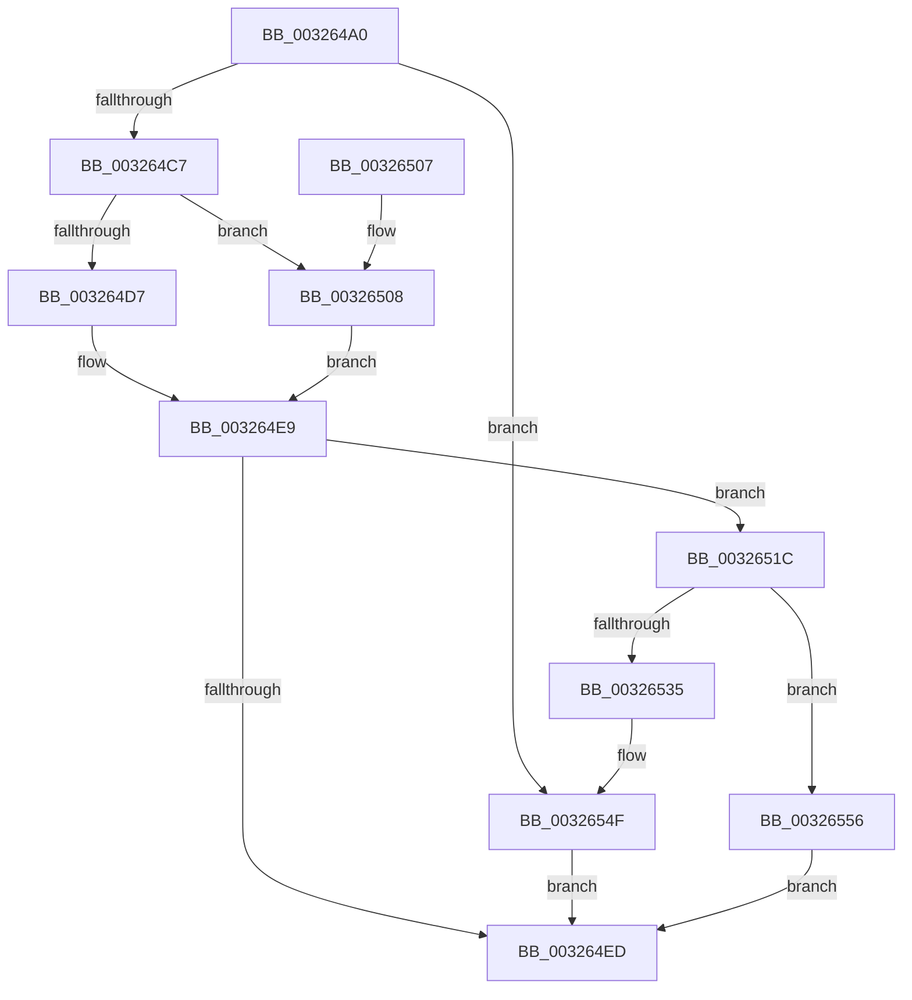

# RtlpHpEnvCompactionSchedule

- RVA: `0x003264A0`–`0x0032657A` (길이 `218` bytes)
- VA: `0x00000001403264A0`
- 실행 섹션: `.text`
- PDB 이름 있음: `예`; PDB Function 태그: `아니요`
- unwind 정보 RVA: `0x00075C90`
- 디코드: `54`개 명령, `218/218` bytes 표시
- 미해석 바이트: `0` (있으면 어셈블리에 `.byte`로 보존)

> 이 문서는 커널 이미지의 기계어와 PDB 기호를 분석해 생성했습니다. 4번과 5번은 함수 원형과 자료형을 바이너리 사용 방식에서 추정한 C 해석이며 원본 소스 복구 결과는 아닙니다.

## 1. Dependencies

- 직접 호출 지점: **5**; 고유 호출 대상: **5**
- 직접 호출자로 확인된 함수: **17**
- RIP 상대 이미지 참조: **6**

### Outgoing calls
- `0x003264F7` → [_security_check_cookie](../6A/_security_check_cookie_function_006AC640.md) (function, `0x006AC640`)
- `0x0032652C` → [ExpTimerSetParametersAreValid](../45/ExpTimerSetParametersAreValid_function_0045B68C.md) (function, `0x0045B68C`)
- `0x00326549` → [KeBugCheckEx](../4F/KeBugCheckEx_function_004FD660.md) (function, `0x004FD660`)
- `0x00326559` → [ExpCheckForFreedEnhancedTimer](../3A/ExpCheckForFreedEnhancedTimer_function_003A0148.md) (function, `0x003A0148`)
- `0x00326570` → [KeSetTimer2](../3A/KeSetTimer2_function_003A08E0.md) (function, `0x003A08E0`)

### Direct callers
- [RtlpHpVsCommitLimitCheck](../2E/RtlpHpVsCommitLimitCheck_function_002E5BBC.md) at `0x002E5C46`
- [RtlpHpLfhContextCompact](../2E/RtlpHpLfhContextCompact_function_002E769C.md) at `0x002E7774`
- [RtlpHpAllocateHeapSlow](../2E/RtlpHpAllocateHeapSlow_function_002E9DEC.md) at `0x002EA33C`
- [RtlpHpLfhSubsegmentCommitBlock](../2E/RtlpHpLfhSubsegmentCommitBlock_function_002EA630.md) at `0x002EA8F5`
- [RtlpHpLfhSubsegmentIncBlockCounts](../2E/RtlpHpLfhSubsegmentIncBlockCounts_function_002EB4A0.md) at `0x002EB67F`
- [RtlpHpLfhSubsegmentDelayFreeListProcess](RtlpHpLfhSubsegmentDelayFreeListProcess_function_00323CE0.md) at `0x00323F70`
- [RtlpHpSegPageRangeCoalesce](RtlpHpSegPageRangeCoalesce_function_00325860.md) at `0x00325B03`
- [RtlpHpLfhContextFree](../35/RtlpHpLfhContextFree_function_0035B2A0.md) at `0x0035B456`
- [ExAllocateHeapPool](../35/ExAllocateHeapPool_function_0035BA30.md) at `0x0035C4DA`
- [ExAllocateHeapPool](../35/ExAllocateHeapPool_function_0035BA30.md) at `0x0035D3F2`
- [sub_0035F6BF](../35/Unknown_function_0035F6BF.md) at `0x0035F956`
- [sub_003602E3](../36/Unknown_function_003602E3.md) at `0x003608C2`
- [RtlpHpLfhContextUpdateFreeCommitCount](../49/RtlpHpLfhContextUpdateFreeCommitCount_function_00497E98.md) at `0x00497EF4`
- [sub_006DE040](../6D/Unknown_function_006DE040.md) at `0x006DE39A`
- [sub_006DE430](../6D/Unknown_function_006DE430.md) at `0x006DE5CC`
- [sub_006DE832](../6D/Unknown_function_006DE832.md) at `0x006DEB04`
- [sub_006E2C7C](../6E/Unknown_function_006E2C7C.md) at `0x006E2E0C`
- [sub_006E2C7C](../6E/Unknown_function_006E2C7C.md) at `0x006E3056`
- [sub_00B830A9](../../poolcode/B8/Unknown_function_00B830A9.md) at `0x00B8367C`

### Static image references
- `0x003264AA` → RVA `0x00E0A740` (`.data`; read)
- `0x003264BB` → RVA `0x00EFA830` (`.data`; read)
- `0x003264D9` → RVA `0x00EFA7BC` (`.data`; read)
- `0x003264E2` → RVA `0x00EFA820` (`.data`; read)
- `0x0032650A` → RVA `0x00EFA7C0` (`.data`; read)
- `0x00326513` → RVA `0x00EFA828` (`.data`; read)

## 2. Other-region calls and transfers

- 다른 실행 섹션으로 향하는 call: **0**
- 별도 외부 분기/꼬리 이동을 확인하지 못했습니다.

## 3. Assembly (complete function range)

```asm
003264A0  48 89 5C 24 08                  mov qword ptr [rsp + 8], rbx
003264A5  57                              push rdi
003264A6  48 83 EC 50                     sub rsp, 0x50
003264AA  48 8B 05 8F 42 AE 00            mov rax, qword ptr [rip + 0xae428f]
003264B1  48 33 C4                        xor rax, rsp
003264B4  48 89 44 24 40                  mov qword ptr [rsp + 0x40], rax
003264B9  33 DB                           xor ebx, ebx
003264BB  39 1D 6F 43 BD 00               cmp dword ptr [rip + 0xbd436f], ebx
003264C1  0F 84 88 00 00 00               je 0x14032654f
003264C7  48 8B 01                        mov rax, qword ptr [rcx]
003264CA  44 8D 43 01                     lea r8d, [rbx + 1]
003264CE  48 C1 E8 08                     shr rax, 8
003264D2  41 3A C0                        cmp al, r8b
003264D5  75 31                           jne 0x140326508
003264D7  33 C0                           xor eax, eax
003264D9  F0 44 0F B1 05 DA 42 BD 00      lock cmpxchg dword ptr [rip + 0xbd42da], r8d
003264E2  48 8B 3D 37 43 BD 00            mov rdi, qword ptr [rip + 0xbd4337]
003264E9  85 C0                           test eax, eax
003264EB  74 2F                           je 0x14032651c
003264ED  8B C3                           mov eax, ebx
003264EF  48 8B 4C 24 40                  mov rcx, qword ptr [rsp + 0x40]
003264F4  48 33 CC                        xor rcx, rsp
003264F7  E8 44 61 38 00                  call 0x1406ac640
003264FC  48 8B 5C 24 60                  mov rbx, qword ptr [rsp + 0x60]
00326501  48 83 C4 50                     add rsp, 0x50
00326505  5F                              pop rdi
00326506  C3                              ret
00326507  CC                              int3
00326508  33 C0                           xor eax, eax
0032650A  F0 44 0F B1 05 AD 42 BD 00      lock cmpxchg dword ptr [rip + 0xbd42ad], r8d
00326513  48 8B 3D 0E 43 BD 00            mov rdi, qword ptr [rip + 0xbd430e]
0032651A  EB CD                           jmp 0x1403264e9
0032651C  48 83 4C 24 38 FF               or qword ptr [rsp + 0x38], 0xffffffffffffffff
00326522  48 8D 4C 24 30                  lea rcx, [rsp + 0x30]
00326527  48 89 5C 24 30                  mov qword ptr [rsp + 0x30], rbx
0032652C  E8 5B 51 13 00                  call 0x14045b68c
00326531  84 C0                           test al, al
00326533  75 21                           jne 0x140326556
00326535  4C 8D 4C 24 30                  lea r9, [rsp + 0x30]
0032653A  48 89 5C 24 20                  mov qword ptr [rsp + 0x20], rbx
0032653F  BA 09 00 00 00                  mov edx, 9
00326544  B9 C7 00 00 00                  mov ecx, 0xc7
00326549  E8 12 71 1D 00                  call 0x1404fd660
0032654E  CC                              int3
0032654F  BB 02 00 00 C0                  mov ebx, 0xc0000002
00326554  EB 97                           jmp 0x1403264ed
00326556  48 8B CF                        mov rcx, rdi
00326559  E8 EA 9B 07 00                  call 0x1403a0148
0032655E  4C 8D 4C 24 30                  lea r9, [rsp + 0x30]
00326563  45 33 C0                        xor r8d, r8d
00326566  48 C7 C2 80 69 67 FF            mov rdx, 0xffffffffff676980
0032656D  48 8B CF                        mov rcx, rdi
00326570  E8 6B A3 07 00                  call 0x1403a08e0
00326575  E9 73 FF FF FF                  jmp 0x1403264ed
```

## 4. C-style interpretation (structured pseudocode)

```c
__int64 __fastcall RtlpHpEnvCompactionSchedule(__int64 a1)
{
    __int64 result;
    __int64 v_rbx;
    __int64 v_rsp;
    unsigned __int64 v_stack_m18;
    unsigned __int64 v_stack_p20;
    unsigned __int64 v_stack_p30;
    unsigned __int64 v_stack_p38;
    unsigned __int64 v_stack_p8;

    v_stack_p8 = v_rbx;
    v_rsp = (v_rsp) - (80);
    result = (*(unsigned __int64 *)(v_rip + 11420303)) ^ (v_rsp);
    v_stack_m18 = result;
    v_rbx = 0;
    if ((*(unsigned int *)(v_rip + 12403567)) == 0) goto loc_0032654F;
    result = (*(unsigned __int64 *)(a1)) >> (8);
    if (((unsigned __int8)(result)) != ((unsigned __int8)(v_rbx + 1))) goto loc_00326508;
    result = 0;
loc_003264E9:
    if (0 == 0) goto loc_0032651C;
loc_003264ED:
    a1 = (v_stack_m18) ^ (v_rsp);
    result = _security_check_cookie(a1, a2, v_rbx + 1, a4);
    v_rsp = (v_rsp) + (80);
    return result;
loc_00326508:
    result = 0;
    goto loc_003264E9;
loc_0032651C:
    v_stack_p30 = v_stack_p8;
    result = ExpTimerSetParametersAreValid(v_stack_p30, a2, v_rbx + 1, a4);
    if ((unsigned __int8)(result) != 0) goto loc_00326556;
    v_stack_p20 = v_stack_p8;
    result = KeBugCheckEx(199, 9, v_rbx + 1, v_stack_p30);
loc_0032654F:
    goto loc_003264ED;
loc_00326556:
    result = ExpCheckForFreedEnhancedTimer(*(unsigned __int64 *)(v_rip + 12403470), 9, v_rbx + 1, v_stack_p30);
    a3 = 0;
    result = KeSetTimer2(*(unsigned __int64 *)(v_rip + 12403470), 0xFFFFFFFFFF676980ULL, a3, v_stack_p30);
    goto loc_003264ED;
}
```

## 5. (Beta) C Style

```c
int64_t RtlpHpEnvCompactionSchedule(void *Arg1)
{
    uint8_t *arg1 = (uint8_t *)Arg1;

    int64_t result;
    int64_t local_rbx;
    int64_t local_rsp;
    uint64_t v_stack_m18;
    uint64_t v_stack_p20;
    uint64_t v_stack_p30;
    uint64_t v_stack_p38;
    uint64_t v_stack_p8;

    v_stack_p8 = local_rbx;
    local_rsp = (local_rsp) - (80);
    result = (*(uint64_t *)(v_rip + 0xAE428F)) ^ (local_rsp);
    v_stack_m18 = result;
    local_rbx = 0;
    if ((*(uint32_t *)(v_rip + 0xBD436F)) == 0) goto loc_0032654F;
    result = (*(uint64_t *)(arg1)) >> (8);
    if (((uint8_t)(result)) != ((uint8_t)(local_rbx + 1))) goto loc_00326508;
    result = 0;
loc_003264E9:
    if (0 == 0) goto loc_0032651C;
loc_003264ED:
    Arg1 = (v_stack_m18) ^ (local_rsp);
    result = _security_check_cookie(Arg1, a2, local_rbx + 1, a4);
    local_rsp = (local_rsp) + (80);
    return result;
loc_00326508:
    result = 0;
    goto loc_003264E9;
loc_0032651C:
    v_stack_p30 = v_stack_p8;
    result = ExpTimerSetParametersAreValid(v_stack_p30, a2, local_rbx + 1, a4);
    if ((uint8_t)(result) != 0) goto loc_00326556;
    v_stack_p20 = v_stack_p8;
    result = KeBugCheckEx(199, 9, local_rbx + 1, v_stack_p30);
loc_0032654F:
    goto loc_003264ED;
loc_00326556:
    result = ExpCheckForFreedEnhancedTimer(*(uint64_t *)(v_rip + 0xBD430E), 9, local_rbx + 1, v_stack_p30);
    a3 = 0;
    result = KeSetTimer2(*(uint64_t *)(v_rip + 0xBD430E), 0xFFFFFFFFFF676980ULL, a3, v_stack_p30);
    goto loc_003264ED;
}
```

### 관측된 메모리 오프셋

구조체 형식이 확인되지 않은 접근은 인자 기준의 오프셋으로만 기록했습니다.

| 기준 인자 | 오프셋 표현 | 폭 (bit) | 접근 |
|---|---:|---:|---|
| `Arg1` | `+ 0x0` | `64` | `R` |

## 6. Execution-region graph

[열기: 2D/3D 그래프와 함수 탐색 컨트롤 패널](../../../control-panel.html?section=text&rva=0x003264A0&view=graph)

- 2D 그래프는 위에서 아래로 흐르고, 3D 그래프는 빈 공간을 드래그해 회전합니다. Shift+드래그는 이동, 휠은 확대·축소, 함수 노드 선택은 대상 보고서 이동입니다.

### Static fallback


