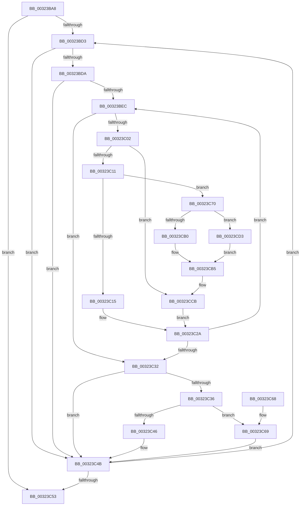

# RtlpHpLfhOwnerListCompact

- RVA: `0x00323BA8`–`0x00323CDA` (길이 `306` bytes)
- VA: `0x0000000140323BA8`
- 실행 섹션: `.text`
- PDB 이름 있음: `예`; PDB Function 태그: `아니요`
- unwind 정보 RVA: `0x000759B8`
- 디코드: `95`개 명령, `306/306` bytes 표시
- 미해석 바이트: `0` (있으면 어셈블리에 `.byte`로 보존)

> 이 문서는 커널 이미지의 기계어와 PDB 기호를 분석해 생성했습니다. 4번과 5번은 함수 원형과 자료형을 바이너리 사용 방식에서 추정한 C 해석이며 원본 소스 복구 결과는 아닙니다.

## 1. Dependencies

- 직접 호출 지점: **7**; 고유 호출 대상: **7**
- 직접 호출자로 확인된 함수: **1**
- RIP 상대 이미지 참조: **2**

### Outgoing calls
- `0x00323BF6` → [RtlpHpLfhSubsegmentFindEmptyUnits](RtlpHpLfhSubsegmentFindEmptyUnits_function_00324600.md) (function, `0x00324600`)
- `0x00323C22` → [RtlpHpAcquireLockExclusive](RtlpHpAcquireLockExclusive_function_003246B0.md) (function, `0x003246B0`)
- `0x00323C46` → [RtlpHpReleaseLockExclusive](RtlpHpReleaseLockExclusive_function_00324230.md) (function, `0x00324230`)
- `0x00323C69` → [RtlpHpReleaseLockShared](RtlpHpReleaseLockShared_function_003245B0.md) (function, `0x003245B0`)
- `0x00323CB0` → [RtlpHpSegLfhVsDecommit](RtlpHpSegLfhVsDecommit_function_003243F0.md) (function, `0x003243F0`)
- `0x00323CC6` → [RtlpHpLfhSubsegmentDecBlockCounts](RtlpHpLfhSubsegmentDecBlockCounts_function_003244D0.md) (function, `0x003244D0`)
- `0x00323CD3` → [guard_dispatch_icall](../6B/guard_dispatch_icall_function_006BAAD0.md) (function, `0x006BAAD0`)

### Direct callers
- [RtlpHpLfhOwnerCompact](../2E/RtlpHpLfhOwnerCompact_function_002E785C.md) at `0x002E7A65`

### Static image references
- `0x00323C74` → RVA `0x003243F0` (`RtlpHpSegLfhVsDecommit`; read)
- `0x00323C93` → RVA `0x00E28300` (`.data`; read)

## 2. Other-region calls and transfers

- 다른 실행 섹션으로 향하는 call: **0**
- 별도 외부 분기/꼬리 이동을 확인하지 못했습니다.

## 3. Assembly (complete function range)

```asm
00323BA8  48 89 5C 24 08                  mov qword ptr [rsp + 8], rbx
00323BAD  48 89 54 24 10                  mov qword ptr [rsp + 0x10], rdx
00323BB2  55                              push rbp
00323BB3  56                              push rsi
00323BB4  57                              push rdi
00323BB5  41 54                           push r12
00323BB7  41 55                           push r13
00323BB9  41 56                           push r14
00323BBB  41 57                           push r15
00323BBD  48 83 EC 30                     sub rsp, 0x30
00323BC1  49 8B 18                        mov rbx, qword ptr [r8]
00323BC4  4D 8B F8                        mov r15, r8
00323BC7  48 8B E9                        mov rbp, rcx
00323BCA  49 3B D8                        cmp rbx, r8
00323BCD  0F 84 80 00 00 00               je 0x140323c53
00323BD3  8A 43 27                        mov al, byte ptr [rbx + 0x27]
00323BD6  3C 01                           cmp al, 1
00323BD8  74 71                           je 0x140323c4b
00323BDA  83 64 24 78 00                  and dword ptr [rsp + 0x78], 0
00323BDF  33 F6                           xor esi, esi
00323BE1  41 B5 FF                        mov r13b, 0xff
00323BE4  8D 7E 01                        lea edi, [rsi + 1]
00323BE7  40 3A C7                        cmp al, dil
00323BEA  76 5F                           jbe 0x140323c4b
00323BEC  4C 8D 44 24 78                  lea r8, [rsp + 0x78]
00323BF1  8B D7                           mov edx, edi
00323BF3  48 8B CB                        mov rcx, rbx
00323BF6  E8 05 0A 00 00                  call 0x140324600
00323BFB  8B F8                           mov edi, eax
00323BFD  83 F8 FF                        cmp eax, -1
00323C00  74 30                           je 0x140323c32
00323C02  44 8B 74 24 78                  mov r14d, dword ptr [rsp + 0x78]
00323C07  41 83 FE 01                     cmp r14d, 1
00323C0B  0F 82 BA 00 00 00               jb 0x140323ccb
00323C11  85 F6                           test esi, esi
00323C13  75 5B                           jne 0x140323c70
00323C15  0F B6 55 41                     movzx edx, byte ptr [rbp + 0x41]
00323C19  48 8D 4B 38                     lea rcx, [rbx + 0x38]
00323C1D  BE 02 00 00 00                  mov esi, 2
00323C22  E8 89 0A 00 00                  call 0x1403246b0
00323C27  44 8A E8                        mov r13b, al
00323C2A  0F B6 43 27                     movzx eax, byte ptr [rbx + 0x27]
00323C2E  3B F8                           cmp edi, eax
00323C30  72 BA                           jb 0x140323bec
00323C32  85 F6                           test esi, esi
00323C34  74 15                           je 0x140323c4b
00323C36  0F B6 55 41                     movzx edx, byte ptr [rbp + 0x41]
00323C3A  48 8D 4B 38                     lea rcx, [rbx + 0x38]
00323C3E  45 8A C5                        mov r8b, r13b
00323C41  83 FE 02                        cmp esi, 2
00323C44  75 23                           jne 0x140323c69
00323C46  E8 E5 05 00 00                  call 0x140324230
00323C4B  48 8B 1B                        mov rbx, qword ptr [rbx]
00323C4E  49 3B DF                        cmp rbx, r15
00323C51  75 80                           jne 0x140323bd3
00323C53  48 8B 5C 24 70                  mov rbx, qword ptr [rsp + 0x70]
00323C58  48 83 C4 30                     add rsp, 0x30
00323C5C  41 5F                           pop r15
00323C5E  41 5E                           pop r14
00323C60  41 5D                           pop r13
00323C62  41 5C                           pop r12
00323C64  5F                              pop rdi
00323C65  5E                              pop rsi
00323C66  5D                              pop rbp
00323C67  C3                              ret
00323C68  CC                              int3
00323C69  E8 42 09 00 00                  call 0x1403245b0
00323C6E  EB DB                           jmp 0x140323c4b
00323C70  0F B6 4B 26                     movzx ecx, byte ptr [rbx + 0x26]
00323C74  4C 8D 05 75 07 00 00            lea r8, [rip + 0x775]
00323C7B  C1 E0 0C                        shl eax, 0xc
00323C7E  45 8B E6                        mov r12d, r14d
00323C81  D3 E0                           shl eax, cl
00323C83  8B D0                           mov edx, eax
00323C85  89 84 24 80 00 00 00            mov dword ptr [rsp + 0x80], eax
00323C8C  48 03 D3                        add rdx, rbx
00323C8F  48 8B 45 20                     mov rax, qword ptr [rbp + 0x20]
00323C93  48 33 05 66 46 B0 00            xor rax, qword ptr [rip + 0xb04666]
00323C9A  41 C1 E4 0C                     shl r12d, 0xc
00323C9E  48 33 C5                        xor rax, rbp
00323CA1  41 D3 E4                        shl r12d, cl
00323CA4  48 8B 4D 00                     mov rcx, qword ptr [rbp]
00323CA8  49 3B C0                        cmp rax, r8
00323CAB  45 8B C4                        mov r8d, r12d
00323CAE  75 23                           jne 0x140323cd3
00323CB0  E8 3B 07 00 00                  call 0x1403243f0
00323CB5  44 8B 84 24 80 00 00 00         mov r8d, dword ptr [rsp + 0x80]
00323CBD  45 8B CC                        mov r9d, r12d
00323CC0  48 8B D3                        mov rdx, rbx
00323CC3  48 8B CD                        mov rcx, rbp
00323CC6  E8 05 08 00 00                  call 0x1403244d0
00323CCB  41 03 FE                        add edi, r14d
00323CCE  E9 57 FF FF FF                  jmp 0x140323c2a
00323CD3  E8 F8 6D 39 00                  call 0x1406baad0
00323CD8  EB DB                           jmp 0x140323cb5
```

## 4. C-style interpretation (structured pseudocode)

```c
__int64 __fastcall RtlpHpLfhOwnerListCompact(__int64 a1, __int64 a2, __int64 a3)
{
    __int64 result;
    __int64 v_r12;
    __int64 v_rdi;
    __int64 v_rsi;
    __int64 v_rsp;
    unsigned __int64 v_stack_p10;
    unsigned __int64 v_stack_p8;
    unsigned int v_stack_p80;

    v_stack_p8 = v_rbx;
    v_stack_p10 = a2;
    v_rsp = (v_rsp) - (48);
    if ((*(unsigned __int64 *)(a3)) == a3) goto loc_00323C53;
loc_00323BD3:
    if (((unsigned __int8)(*(unsigned __int8 *)(*(unsigned __int64 *)(a3) + 39))) == 1) goto loc_00323C4B;
    v_rsi = 0;
    if (((unsigned __int8)(*(unsigned __int8 *)(*(unsigned __int64 *)(a3) + 39))) <= ((unsigned __int8)(v_rsi + 1))) goto loc_00323C4B;
loc_00323BEC:
    result = RtlpHpLfhSubsegmentFindEmptyUnits(*(unsigned __int64 *)(a3), (unsigned int)((unsigned int)(v_rsi + 1)), v_stack_p10, a4);
    if (((unsigned int)(result)) == -1) goto loc_00323C32;
    if (((unsigned int)((unsigned int)(v_stack_p10))) < 1) goto loc_00323CCB;
    if (0 != 0) goto loc_00323C70;
    result = RtlpHpAcquireLockExclusive(*(unsigned __int64 *)(a3) + 56, *(unsigned __int8 *)(a1 + 65), v_stack_p10, a4);
loc_00323C2A:
    if (((unsigned int)((unsigned int)((unsigned int)(result)))) < ((unsigned int)(*(unsigned __int8 *)(*(unsigned __int64 *)(a3) + 39)))) goto loc_00323BEC;
loc_00323C32:
    if (2 == 0) goto loc_00323C4B;
    if (2 != 2) goto loc_00323C69;
    result = RtlpHpReleaseLockExclusive(*(unsigned __int64 *)(a3) + 56, *(unsigned __int8 *)(a1 + 65), (unsigned __int8)((unsigned __int8)(result)), a4);
loc_00323C4B:
    if ((*(unsigned __int64 *)(*(unsigned __int64 *)(a3))) != a3) goto loc_00323BD3;
loc_00323C53:
    v_rsp = (v_rsp) + (48);
    return result;
loc_00323C69:
    result = RtlpHpReleaseLockShared(*(unsigned __int64 *)(a3) + 56, *(unsigned __int8 *)(a1 + 65), (unsigned __int8)((unsigned __int8)(result)), a4);
    goto loc_00323C4B;
loc_00323C70:
    result = (unsigned int)((result) << (12));
    result = (unsigned int)((result) << ((unsigned __int8)(*(unsigned __int8 *)(v_stack_p8 + 38))));
    v_stack_p80 = (unsigned int)(result);
    a2 = ((unsigned int)((unsigned int)(result))) + (v_stack_p8);
    result = (*(unsigned __int64 *)(a1 + 32)) ^ (*(unsigned __int64 *)(v_rip + 11552358));
    v_r12 = (unsigned int)(((unsigned int)((unsigned int)((unsigned int)(v_stack_p10)))) << (12));
    result = (result) ^ (a1);
    v_r12 = (unsigned int)((v_r12) << ((unsigned __int8)(*(unsigned __int8 *)(v_stack_p8 + 38))));
    if (result != (v_rip + 1909)) goto loc_00323CD3;
    result = RtlpHpSegLfhVsDecommit(*(unsigned __int64 *)(a1), a2, (unsigned int)((unsigned int)(v_r12)), a4);
loc_00323CB5:
    result = RtlpHpLfhSubsegmentDecBlockCounts(a1, v_stack_p8, (unsigned int)(v_stack_p80), (unsigned int)((unsigned int)(v_r12)));
loc_00323CCB:
    v_rdi = (unsigned int)(((unsigned int)((unsigned int)(result))) + ((unsigned int)((unsigned int)(v_stack_p10))));
    goto loc_00323C2A;
loc_00323CD3:
    result = guard_dispatch_icall(a1, v_stack_p8, (unsigned int)(v_stack_p80), (unsigned int)((unsigned int)(v_r12)));
    goto loc_00323CB5;
}
```

## 5. (Beta) C Style

```c
int64_t RtlpHpLfhOwnerListCompact(void *Arg1, int64_t Arg2, void *Arg3)
{
    uint8_t *arg1 = (uint8_t *)Arg1;
    uint8_t *arg3 = (uint8_t *)Arg3;

    int64_t result;
    int64_t local_r12;
    int64_t local_rdi;
    int64_t local_rsi;
    int64_t local_rsp;
    uint64_t v_stack_p10;
    uint64_t v_stack_p8;
    uint32_t v_stack_p80;

    v_stack_p8 = local_rbx;
    v_stack_p10 = Arg2;
    local_rsp = (local_rsp) - (48);
    if ((*(uint64_t *)(arg3)) == Arg3) goto loc_00323C53;
loc_00323BD3:
    if (((uint8_t)(*(uint8_t *)(*(uint64_t *)(arg3) + 0x27))) == 1) goto loc_00323C4B;
    local_rsi = 0;
    if (((uint8_t)(*(uint8_t *)(*(uint64_t *)(arg3) + 0x27))) <= ((uint8_t)(local_rsi + 1))) goto loc_00323C4B;
loc_00323BEC:
    result = RtlpHpLfhSubsegmentFindEmptyUnits(*(uint64_t *)(arg3), (uint32_t)((uint32_t)(local_rsi + 1)), v_stack_p10, a4);
    if (((uint32_t)(result)) == -1) goto loc_00323C32;
    if (((uint32_t)((uint32_t)(v_stack_p10))) < 1) goto loc_00323CCB;
    if (0 != 0) goto loc_00323C70;
    result = RtlpHpAcquireLockExclusive(*(uint64_t *)(arg3) + 56, *(uint8_t *)(arg1 + 0x41), v_stack_p10, a4);
loc_00323C2A:
    if (((uint32_t)((uint32_t)((uint32_t)(result)))) < ((uint32_t)(*(uint8_t *)(*(uint64_t *)(arg3) + 0x27)))) goto loc_00323BEC;
loc_00323C32:
    if (2 == 0) goto loc_00323C4B;
    if (2 != 2) goto loc_00323C69;
    result = RtlpHpReleaseLockExclusive(*(uint64_t *)(arg3) + 56, *(uint8_t *)(arg1 + 0x41), (uint8_t)((uint8_t)(result)), a4);
loc_00323C4B:
    if ((*(uint64_t *)(*(uint64_t *)(arg3))) != Arg3) goto loc_00323BD3;
loc_00323C53:
    local_rsp = (local_rsp) + (48);
    return result;
loc_00323C69:
    result = RtlpHpReleaseLockShared(*(uint64_t *)(arg3) + 56, *(uint8_t *)(arg1 + 0x41), (uint8_t)((uint8_t)(result)), a4);
    goto loc_00323C4B;
loc_00323C70:
    result = (uint32_t)((result) << (12));
    result = (uint32_t)((result) << ((uint8_t)(*(uint8_t *)(v_stack_p8 + 0x26))));
    v_stack_p80 = (uint32_t)(result);
    Arg2 = ((uint32_t)((uint32_t)(result))) + (v_stack_p8);
    result = (*(uint64_t *)(arg1 + 0x20)) ^ (*(uint64_t *)(v_rip + 0xB04666));
    local_r12 = (uint32_t)(((uint32_t)((uint32_t)((uint32_t)(v_stack_p10)))) << (12));
    result = (result) ^ (Arg1);
    local_r12 = (uint32_t)((local_r12) << ((uint8_t)(*(uint8_t *)(v_stack_p8 + 0x26))));
    if (result != (v_rip + 1909)) goto loc_00323CD3;
    result = RtlpHpSegLfhVsDecommit(*(uint64_t *)(arg1), Arg2, (uint32_t)((uint32_t)(local_r12)), a4);
loc_00323CB5:
    result = RtlpHpLfhSubsegmentDecBlockCounts(Arg1, v_stack_p8, (uint32_t)(v_stack_p80), (uint32_t)((uint32_t)(local_r12)));
loc_00323CCB:
    local_rdi = (uint32_t)(((uint32_t)((uint32_t)(result))) + ((uint32_t)((uint32_t)(v_stack_p10))));
    goto loc_00323C2A;
loc_00323CD3:
    result = guard_dispatch_icall(Arg1, v_stack_p8, (uint32_t)(v_stack_p80), (uint32_t)((uint32_t)(local_r12)));
    goto loc_00323CB5;
}
```

### 관측된 메모리 오프셋

구조체 형식이 확인되지 않은 접근은 인자 기준의 오프셋으로만 기록했습니다.

| 기준 인자 | 오프셋 표현 | 폭 (bit) | 접근 |
|---|---:|---:|---|
| `Arg1` | `+ 0x0` | `64` | `R` |
| `Arg1` | `+ 0x20` | `64` | `R` |
| `Arg1` | `+ 0x41` | `8` | `R` |
| `Arg3` | `+ 0x0` | `64` | `R` |

## 6. Execution-region graph

[열기: 2D/3D 그래프와 함수 탐색 컨트롤 패널](../../../control-panel.html?section=text&rva=0x00323BA8&view=graph)

- 2D 그래프는 위에서 아래로 흐르고, 3D 그래프는 빈 공간을 드래그해 회전합니다. Shift+드래그는 이동, 휠은 확대·축소, 함수 노드 선택은 대상 보고서 이동입니다.

### Static fallback


