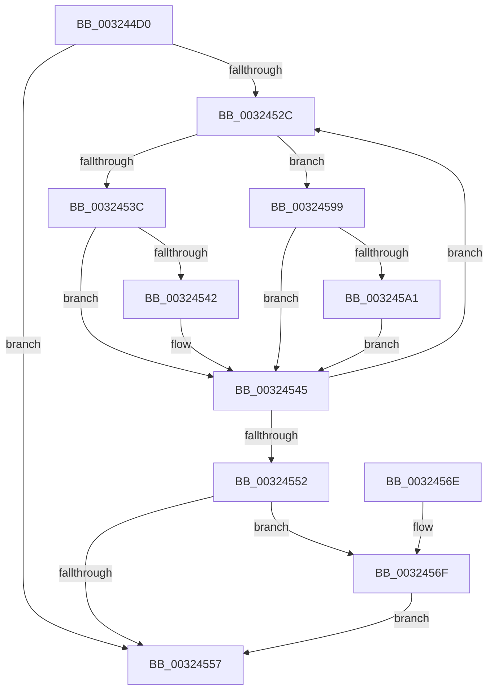

# RtlpHpLfhSubsegmentDecBlockCounts

- RVA: `0x003244D0`–`0x003245A9` (길이 `217` bytes)
- VA: `0x00000001403244D0`
- 실행 섹션: `.text`
- PDB 이름 있음: `예`; PDB Function 태그: `아니요`
- unwind 정보 RVA: `0x00075A98`
- 디코드: `67`개 명령, `217/217` bytes 표시
- 미해석 바이트: `0` (있으면 어셈블리에 `.byte`로 보존)

> 이 문서는 커널 이미지의 기계어와 PDB 기호를 분석해 생성했습니다. 4번과 5번은 함수 원형과 자료형을 바이너리 사용 방식에서 추정한 C 해석이며 원본 소스 복구 결과는 아닙니다.

## 1. Dependencies

- 직접 호출 지점: **1**; 고유 호출 대상: **1**
- 직접 호출자로 확인된 함수: **3**
- RIP 상대 이미지 참조: **0**

### Outgoing calls
- `0x00324592` → [RtlpHpLfhContextUpdateFreeCommitCount](../49/RtlpHpLfhContextUpdateFreeCommitCount_function_00497E98.md) (function, `0x00497E98`)

### Direct callers
- [RtlpHpLfhSubsegmentCommitBlock](../2E/RtlpHpLfhSubsegmentCommitBlock_function_002EA630.md) at `0x002EA921`
- [RtlpHpLfhOwnerListCompact](RtlpHpLfhOwnerListCompact_function_00323BA8.md) at `0x00323CC6`
- [RtlpHpLfhSubsegmentDelayFreeListProcess](RtlpHpLfhSubsegmentDelayFreeListProcess_function_00323CE0.md) at `0x003240D7`

### Static image references
- 디코드된 RIP-relative 메모리 참조가 없습니다.

## 2. Other-region calls and transfers

- 다른 실행 섹션으로 향하는 call: **0**
- 별도 외부 분기/꼬리 이동을 확인하지 못했습니다.

## 3. Assembly (complete function range)

```asm
003244D0  48 89 5C 24 08                  mov qword ptr [rsp + 8], rbx
003244D5  48 89 6C 24 10                  mov qword ptr [rsp + 0x10], rbp
003244DA  48 89 74 24 18                  mov qword ptr [rsp + 0x18], rsi
003244DF  57                              push rdi
003244E0  48 83 EC 20                     sub rsp, 0x20
003244E4  0F B6 42 18                     movzx eax, byte ptr [rdx + 0x18]
003244E8  45 8B D0                        mov r10d, r8d
003244EB  41 C1 EA 0C                     shr r10d, 0xc
003244EF  48 8B F2                        mov rsi, rdx
003244F2  48 8B E9                        mov rbp, rcx
003244F5  0F B6 4A 26                     movzx ecx, byte ptr [rdx + 0x26]
003244F9  41 D3 EA                        shr r10d, cl
003244FC  48 8D 14 C2                     lea rdx, [rdx + rax*8]
00324500  4B 8D 1C 12                     lea rbx, [r10 + r10]
00324504  48 03 D3                        add rdx, rbx
00324507  0F 0D 0A                        prefetchw byte ptr [rdx]
0032450A  41 8D 40 FF                     lea eax, [r8 - 1]
0032450E  BF FF FF FF FF                  mov edi, 0xffffffff
00324513  41 03 C1                        add eax, r9d
00324516  45 33 C0                        xor r8d, r8d
00324519  C1 E8 0C                        shr eax, 0xc
0032451C  D3 E8                           shr eax, cl
0032451E  41 2B C2                        sub eax, r10d
00324521  FF C0                           inc eax
00324523  48 8D 0C 42                     lea rcx, [rdx + rax*2]
00324527  48 3B D1                        cmp rdx, rcx
0032452A  73 2B                           jae 0x140324557
0032452C  B8 FF FF FF FF                  mov eax, 0xffffffff
00324531  66 F0 0F C1 02                  lock xadd word ptr [rdx], ax
00324536  66 83 E8 01                     sub ax, 1
0032453A  74 5D                           je 0x140324599
0032453C  66 83 F8 FF                     cmp ax, -1
00324540  75 03                           jne 0x140324545
00324542  41 FF C8                        dec r8d
00324545  48 83 C2 02                     add rdx, 2
00324549  48 83 C3 02                     add rbx, 2
0032454D  48 3B D1                        cmp rdx, rcx
00324550  72 DA                           jb 0x14032452c
00324552  45 85 C0                        test r8d, r8d
00324555  75 18                           jne 0x14032456f
00324557  48 8B 5C 24 30                  mov rbx, qword ptr [rsp + 0x30]
0032455C  8B C7                           mov eax, edi
0032455E  48 8B 6C 24 38                  mov rbp, qword ptr [rsp + 0x38]
00324563  48 8B 74 24 40                  mov rsi, qword ptr [rsp + 0x40]
00324568  48 83 C4 20                     add rsp, 0x20
0032456C  5F                              pop rdi
0032456D  C3                              ret
0032456E  CC                              int3
0032456F  0F B6 4E 26                     movzx ecx, byte ptr [rsi + 0x26]
00324573  41 C1 E0 0C                     shl r8d, 0xc
00324577  41 D3 E0                        shl r8d, cl
0032457A  48 8B CD                        mov rcx, rbp
0032457D  41 8B C0                        mov eax, r8d
00324580  99                              cdq
00324581  81 E2 FF 0F 00 00               and edx, 0xfff
00324587  03 C2                           add eax, edx
00324589  48 8B D6                        mov rdx, rsi
0032458C  C1 F8 0C                        sar eax, 0xc
0032458F  4C 63 C0                        movsxd r8, eax
00324592  E8 01 39 17 00                  call 0x140497e98
00324597  EB BE                           jmp 0x140324557
00324599  41 FF C0                        inc r8d
0032459C  83 FF FF                        cmp edi, -1
0032459F  75 A4                           jne 0x140324545
003245A1  48 8B FB                        mov rdi, rbx
003245A4  48 D1 FF                        sar rdi, 1
003245A7  EB 9C                           jmp 0x140324545
```

## 4. C-style interpretation (structured pseudocode)

```c
__int64 __fastcall RtlpHpLfhSubsegmentDecBlockCounts(__int64 a1, __int64 a2, __int64 a3, int a4)
{
    __int64 result;
    __int64 v_r10;
    __int64 v_rbx;
    __int64 v_rdi;
    __int64 v_rsp;
    unsigned __int64 v_stack_p10;
    unsigned __int64 v_stack_p18;
    unsigned __int64 v_stack_p8;

    v_stack_p8 = v_rbx;
    v_stack_p10 = v_rbp;
    v_stack_p18 = v_rsi;
    v_rsp = (v_rsp) - (32);
    v_r10 = (unsigned int)(((unsigned int)((unsigned int)(a3))) >> (12));
    v_r10 = (unsigned int)((v_r10) >> ((unsigned __int8)(*(unsigned __int8 *)(a2 + 38))));
    a2 = (a2 + *(unsigned __int8 *)(a2 + 24) * 8) + (v_r10 + v_r10 * 1);
    result = (unsigned int)((a3 - 1) + (a4));
    a3 = 0;
    result = (unsigned int)((result) >> (12));
    result = (unsigned int)((result) >> ((unsigned __int8)(*(unsigned __int8 *)(a2 + 38))));
    result = (unsigned int)((result) - ((unsigned int)(v_r10)));
    result = (unsigned int)((result) + 1);
    if (a2 >= (a2 + result * 2)) goto loc_00324557;
loc_0032452C:
    result = (unsigned __int16)(((unsigned int)(0xFFFFFFFFULL)) - (1));
    if (condition_is_equal) goto loc_00324599;
    if (((unsigned __int16)(result)) == -1) {
        a3 = (unsigned int)((a3) - 1);
    }
    a2 = (a2) + (2);
    v_rbx = (v_r10 + v_r10 * 1) + (2);
    if (a2 < (a2 + result * 2)) goto loc_0032452C;
    if ((unsigned int)(a3) != 0) goto loc_0032456F;
loc_00324557:
    v_rsp = (v_rsp) + (32);
    return (unsigned int)((unsigned int)((unsigned int)(0xFFFFFFFFULL)));
loc_0032456F:
    a3 = (unsigned int)((a3) << (12));
    a3 = (unsigned int)((a3) << ((unsigned __int8)(*(unsigned __int8 *)(v_stack_p18 + 38))));
    a2 = (unsigned int)((a2) & (0xFFFULL));
    result = (unsigned int)(((unsigned int)((unsigned int)(a3))) + ((unsigned int)(a2)));
    result = (unsigned int)((result) >> (12));
    result = RtlpHpLfhContextUpdateFreeCommitCount(v_stack_p10, v_stack_p18, (int)((unsigned int)(result)), a4);
    goto loc_00324557;
loc_00324599:
    a3 = (unsigned int)(((int)((unsigned int)(result))) + 1);
    if (((unsigned int)((unsigned int)(0xFFFFFFFFULL))) != -1) goto loc_00324545;
    v_rdi = (v_stack_p8) >> (1);
    goto loc_00324545;
}
```

## 5. (Beta) C Style

```c
int64_t RtlpHpLfhSubsegmentDecBlockCounts(int64_t Arg1, void *Arg2, void *Arg3, int32_t Arg4)
{
    uint8_t *arg2 = (uint8_t *)Arg2;
    uint8_t *arg3 = (uint8_t *)Arg3;

    int64_t result;
    int64_t local_r10;
    int64_t local_rbx;
    int64_t local_rdi;
    int64_t local_rsp;
    uint64_t v_stack_p10;
    uint64_t v_stack_p18;
    uint64_t v_stack_p8;

    v_stack_p8 = local_rbx;
    v_stack_p10 = local_rbp;
    v_stack_p18 = local_rsi;
    local_rsp = (local_rsp) - (32);
    local_r10 = (uint32_t)(((uint32_t)((uint32_t)(Arg3))) >> (12));
    local_r10 = (uint32_t)((local_r10) >> ((uint8_t)(*(uint8_t *)(arg2 + 0x26))));
    Arg2 = (Arg2 + *(uint8_t *)(arg2 + 0x18) * 8) + (local_r10 + local_r10 * 1);
    result = (uint32_t)((Arg3 - 1) + (Arg4));
    Arg3 = 0;
    result = (uint32_t)((result) >> (12));
    result = (uint32_t)((result) >> ((uint8_t)(*(uint8_t *)(arg2 + 0x26))));
    result = (uint32_t)((result) - ((uint32_t)(local_r10)));
    result = (uint32_t)((result) + 1);
    if (Arg2 >= (Arg2 + result * 2)) goto loc_00324557;
loc_0032452C:
    result = (uint16_t)(((uint32_t)(0xFFFFFFFFULL)) - (1));
    if (condition_is_equal) goto loc_00324599;
    if (((uint16_t)(result)) == -1) {
        Arg3 = (uint32_t)((Arg3) - 1);
    }
    Arg2 = (Arg2) + (2);
    local_rbx = (local_r10 + local_r10 * 1) + (2);
    if (Arg2 < (Arg2 + result * 2)) goto loc_0032452C;
    if ((uint32_t)(Arg3) != 0) goto loc_0032456F;
loc_00324557:
    local_rsp = (local_rsp) + (32);
    return (uint32_t)((uint32_t)((uint32_t)(0xFFFFFFFFULL)));
loc_0032456F:
    Arg3 = (uint32_t)((Arg3) << (12));
    Arg3 = (uint32_t)((Arg3) << ((uint8_t)(*(uint8_t *)(v_stack_p18 + 0x26))));
    Arg2 = (uint32_t)((Arg2) & (0xFFFULL));
    result = (uint32_t)(((uint32_t)((uint32_t)(Arg3))) + ((uint32_t)(Arg2)));
    result = (uint32_t)((result) >> (12));
    result = RtlpHpLfhContextUpdateFreeCommitCount(v_stack_p10, v_stack_p18, (int32_t)((uint32_t)(result)), Arg4);
    goto loc_00324557;
loc_00324599:
    Arg3 = (uint32_t)(((int32_t)((uint32_t)(result))) + 1);
    if (((uint32_t)((uint32_t)(0xFFFFFFFFULL))) != -1) goto loc_00324545;
    local_rdi = (v_stack_p8) >> (1);
    goto loc_00324545;
}
```

### 관측된 메모리 오프셋

구조체 형식이 확인되지 않은 접근은 인자 기준의 오프셋으로만 기록했습니다.

| 기준 인자 | 오프셋 표현 | 폭 (bit) | 접근 |
|---|---:|---:|---|
| `Arg2` | `+ 0x0` | `8` | `R` |
| `Arg2` | `+ 0x0 + rax*2` | `64` | `R` |
| `Arg2` | `+ 0x0 + rax*8` | `64` | `R` |
| `Arg2` | `+ 0x18` | `8` | `R` |
| `Arg2` | `+ 0x26` | `8` | `R` |
| `Arg3` | `- 0x1` | `32` | `R` |

## 6. Execution-region graph

[열기: 2D/3D 그래프와 함수 탐색 컨트롤 패널](../../../control-panel.html?section=text&rva=0x003244D0&view=graph)

- 2D 그래프는 위에서 아래로 흐르고, 3D 그래프는 빈 공간을 드래그해 회전합니다. Shift+드래그는 이동, 휠은 확대·축소, 함수 노드 선택은 대상 보고서 이동입니다.

### Static fallback


