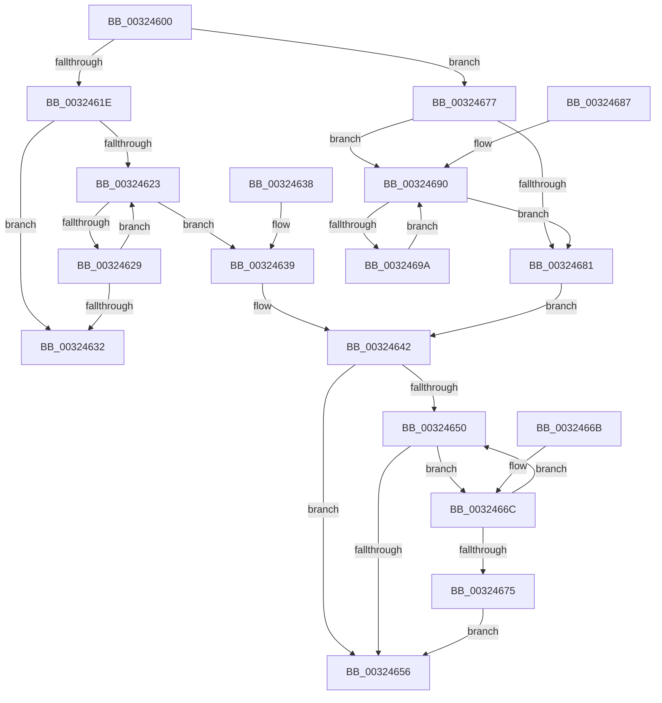

# RtlpHpLfhSubsegmentFindEmptyUnits

- RVA: `0x00324600`–`0x0032469C` (길이 `156` bytes)
- VA: `0x0000000140324600`
- 실행 섹션: `.text`
- PDB 이름 있음: `예`; PDB Function 태그: `아니요`
- unwind 정보 RVA: `0x000DB714`
- 디코드: `51`개 명령, `156/156` bytes 표시
- 미해석 바이트: `0` (있으면 어셈블리에 `.byte`로 보존)

> 이 문서는 커널 이미지의 기계어와 PDB 기호를 분석해 생성했습니다. 4번과 5번은 함수 원형과 자료형을 바이너리 사용 방식에서 추정한 C 해석이며 원본 소스 복구 결과는 아닙니다.

## 1. Dependencies

- 직접 호출 지점: **0**; 고유 호출 대상: **0**
- 직접 호출자로 확인된 함수: **3**
- RIP 상대 이미지 참조: **0**

### Outgoing calls
- 직접 디코드된 call 명령이 없습니다.

### Direct callers
- [RtlpHpLfhSubsegmentCountEmptyUnits](../2E/RtlpHpLfhSubsegmentCountEmptyUnits_function_002E7D48.md) at `0x002E7D70`
- [RtlpHpLfhOwnerListCompact](RtlpHpLfhOwnerListCompact_function_00323BA8.md) at `0x00323BF6`
- [RtlpHpLfhSubsegmentDelayFreeListProcess](RtlpHpLfhSubsegmentDelayFreeListProcess_function_00323CE0.md) at `0x00323FBF`

### Static image references
- 디코드된 RIP-relative 메모리 참조가 없습니다.

## 2. Other-region calls and transfers

- 다른 실행 섹션으로 향하는 call: **0**
- 별도 외부 분기/꼬리 이동을 확인하지 못했습니다.

## 3. Assembly (complete function range)

```asm
00324600  0F B6 41 18                     movzx eax, byte ptr [rcx + 0x18]
00324604  4C 8D 14 C1                     lea r10, [rcx + rax*8]
00324608  0F B6 41 27                     movzx eax, byte ptr [rcx + 0x27]
0032460C  4D 8D 0C 42                     lea r9, [r10 + rax*2]
00324610  8B C2                           mov eax, edx
00324612  66 41 83 3C 42 00               cmp word ptr [r10 + rax*2], 0
00324618  49 8D 04 42                     lea rax, [r10 + rax*2]
0032461C  74 59                           je 0x140324677
0032461E  49 3B C1                        cmp rax, r9
00324621  73 0F                           jae 0x140324632
00324623  66 83 38 00                     cmp word ptr [rax], 0
00324627  74 10                           je 0x140324639
00324629  48 83 C0 02                     add rax, 2
0032462D  49 3B C1                        cmp rax, r9
00324630  72 F1                           jb 0x140324623
00324632  B8 FF FF FF FF                  mov eax, 0xffffffff
00324637  C3                              ret
00324638  CC                              int3
00324639  48 8B D0                        mov rdx, rax
0032463C  49 2B D2                        sub rdx, r10
0032463F  48 D1 FA                        sar rdx, 1
00324642  8B D2                           mov edx, edx
00324644  48 FF C2                        inc rdx
00324647  49 8D 14 52                     lea rdx, [r10 + rdx*2]
0032464B  49 3B D1                        cmp rdx, r9
0032464E  73 06                           jae 0x140324656
00324650  66 83 3A 00                     cmp word ptr [rdx], 0
00324654  74 16                           je 0x14032466c
00324656  48 8B C8                        mov rcx, rax
00324659  48 2B D0                        sub rdx, rax
0032465C  49 2B CA                        sub rcx, r10
0032465F  48 D1 FA                        sar rdx, 1
00324662  48 D1 F9                        sar rcx, 1
00324665  8B C1                           mov eax, ecx
00324667  41 89 10                        mov dword ptr [r8], edx
0032466A  C3                              ret
0032466B  CC                              int3
0032466C  48 83 C2 02                     add rdx, 2
00324670  49 3B D1                        cmp rdx, r9
00324673  72 DB                           jb 0x140324650
00324675  EB DF                           jmp 0x140324656
00324677  48 83 E8 02                     sub rax, 2
0032467B  66 83 38 00                     cmp word ptr [rax], 0
0032467F  74 0F                           je 0x140324690
00324681  48 83 C0 02                     add rax, 2
00324685  EB BB                           jmp 0x140324642
00324687  66 0F 1F 84 00 00 00 00 00      nop word ptr [rax + rax]
00324690  48 83 E8 02                     sub rax, 2
00324694  66 83 38 00                     cmp word ptr [rax], 0
00324698  75 E7                           jne 0x140324681
0032469A  EB F4                           jmp 0x140324690
```

## 4. C-style interpretation (structured pseudocode)

```c
__int64 __fastcall RtlpHpLfhSubsegmentFindEmptyUnits(__int64 a1, int a2, __int64 a3)
{
    __int64 result;

    if ((*(unsigned __int16 *)(a1 + *(unsigned __int8 *)(a1 + 24) * 8 + (unsigned int)(a2) * 2)) == 0) goto loc_00324677;
    if ((a1 + *(unsigned __int8 *)(a1 + 24) * 8 + (unsigned int)(a2) * 2) >= (a1 + *(unsigned __int8 *)(a1 + 24) * 8 + *(unsigned __int8 *)(a1 + 39) * 2)) goto loc_00324632;
loc_00324623:
    if ((*(unsigned __int16 *)(a1 + *(unsigned __int8 *)(a1 + 24) * 8 + (unsigned int)(a2) * 2)) == 0) goto loc_00324639;
    result = (a1 + *(unsigned __int8 *)(a1 + 24) * 8 + (unsigned int)(a2) * 2) + (2);
    if (result < (a1 + *(unsigned __int8 *)(a1 + 24) * 8 + *(unsigned __int8 *)(a1 + 39) * 2)) goto loc_00324623;
loc_00324632:
    return (unsigned int)(0xFFFFFFFFULL);
loc_00324639:
    a2 = ((unsigned int)(0xFFFFFFFFULL)) - (a1 + *(unsigned __int8 *)(a1 + 24) * 8);
    a2 = (a2) >> (1);
loc_00324642:
    a2 = ((unsigned int)(a2)) + 1;
    if ((a1 + *(unsigned __int8 *)(a1 + 24) * 8 + a2 * 2) >= (a1 + *(unsigned __int8 *)(a1 + 24) * 8 + *(unsigned __int8 *)(a1 + 39) * 2)) goto loc_00324656;
loc_00324650:
    if ((*(unsigned __int16 *)(a1 + *(unsigned __int8 *)(a1 + 24) * 8 + a2 * 2)) == 0) goto loc_0032466C;
loc_00324656:
    a2 = (a1 + *(unsigned __int8 *)(a1 + 24) * 8 + a2 * 2) - ((unsigned int)(0xFFFFFFFFULL));
    a1 = ((unsigned int)(0xFFFFFFFFULL)) - (a1 + *(unsigned __int8 *)(a1 + 24) * 8);
    a2 = (a2) >> (1);
    a1 = (a1) >> (1);
    *(unsigned int *)(a3) = a2;
    return (unsigned int)((unsigned int)(a1));
loc_0032466C:
    a2 = (a2) + (2);
    if (a2 < (a1 + *(unsigned __int8 *)(a1 + 24) * 8 + *(unsigned __int8 *)(a1 + 39) * 2)) goto loc_00324650;
    goto loc_00324656;
loc_00324677:
    result = ((unsigned int)((unsigned int)(a1))) - (2);
    if ((*(unsigned __int16 *)(result)) == 0) goto loc_00324690;
loc_00324681:
    result = (result) + (2);
    goto loc_00324642;
loc_00324690:
    result = (result) - (2);
    if ((*(unsigned __int16 *)(result)) != 0) goto loc_00324681;
    goto loc_00324690;
}
```

## 5. (Beta) C Style

```c
int64_t RtlpHpLfhSubsegmentFindEmptyUnits(void *Arg1, int32_t Arg2, void *Arg3)
{
    uint8_t *arg1 = (uint8_t *)Arg1;
    uint8_t *arg3 = (uint8_t *)Arg3;

    int64_t result;

    if ((*(uint16_t *)(arg1 + *(uint8_t *)(arg1 + 0x18) * 8 + (uint32_t)(Arg2) * 2)) == 0) goto loc_00324677;
    if ((Arg1 + *(uint8_t *)(arg1 + 0x18) * 8 + (uint32_t)(Arg2) * 2) >= (Arg1 + *(uint8_t *)(arg1 + 0x18) * 8 + *(uint8_t *)(arg1 + 0x27) * 2)) goto loc_00324632;
loc_00324623:
    if ((*(uint16_t *)(arg1 + *(uint8_t *)(arg1 + 0x18) * 8 + (uint32_t)(Arg2) * 2)) == 0) goto loc_00324639;
    result = (Arg1 + *(uint8_t *)(arg1 + 0x18) * 8 + (uint32_t)(Arg2) * 2) + (2);
    if (result < (Arg1 + *(uint8_t *)(arg1 + 0x18) * 8 + *(uint8_t *)(arg1 + 0x27) * 2)) goto loc_00324623;
loc_00324632:
    return (uint32_t)(0xFFFFFFFFULL);
loc_00324639:
    Arg2 = ((uint32_t)(0xFFFFFFFFULL)) - (Arg1 + *(uint8_t *)(arg1 + 0x18) * 8);
    Arg2 = (Arg2) >> (1);
loc_00324642:
    Arg2 = ((uint32_t)(Arg2)) + 1;
    if ((Arg1 + *(uint8_t *)(arg1 + 0x18) * 8 + Arg2 * 2) >= (Arg1 + *(uint8_t *)(arg1 + 0x18) * 8 + *(uint8_t *)(arg1 + 0x27) * 2)) goto loc_00324656;
loc_00324650:
    if ((*(uint16_t *)(arg1 + *(uint8_t *)(arg1 + 0x18) * 8 + Arg2 * 2)) == 0) goto loc_0032466C;
loc_00324656:
    Arg2 = (Arg1 + *(uint8_t *)(arg1 + 0x18) * 8 + Arg2 * 2) - ((uint32_t)(0xFFFFFFFFULL));
    Arg1 = ((uint32_t)(0xFFFFFFFFULL)) - (Arg1 + *(uint8_t *)(arg1 + 0x18) * 8);
    Arg2 = (Arg2) >> (1);
    Arg1 = (Arg1) >> (1);
    *(uint32_t *)(arg3) = Arg2;
    return (uint32_t)((uint32_t)(Arg1));
loc_0032466C:
    Arg2 = (Arg2) + (2);
    if (Arg2 < (Arg1 + *(uint8_t *)(arg1 + 0x18) * 8 + *(uint8_t *)(arg1 + 0x27) * 2)) goto loc_00324650;
    goto loc_00324656;
loc_00324677:
    result = ((uint32_t)((uint32_t)(Arg1))) - (2);
    if ((*(uint16_t *)(result)) == 0) goto loc_00324690;
loc_00324681:
    result = (result) + (2);
    goto loc_00324642;
loc_00324690:
    result = (result) - (2);
    if ((*(uint16_t *)(result)) != 0) goto loc_00324681;
    goto loc_00324690;
}
```

### 관측된 메모리 오프셋

구조체 형식이 확인되지 않은 접근은 인자 기준의 오프셋으로만 기록했습니다.

| 기준 인자 | 오프셋 표현 | 폭 (bit) | 접근 |
|---|---:|---:|---|
| `Arg1` | `+ 0x0` | `16` | `R` |
| `Arg1` | `+ 0x0 + rax*2` | `16` | `R` |
| `Arg1` | `+ 0x0 + rax*2` | `64` | `R` |
| `Arg1` | `+ 0x0 + rax*8` | `64` | `R` |
| `Arg1` | `+ 0x0 + rdx*2` | `64` | `R` |
| `Arg1` | `+ 0x18` | `8` | `R` |
| `Arg1` | `+ 0x27` | `8` | `R` |
| `Arg3` | `+ 0x0` | `32` | `W` |

## 6. Execution-region graph

[열기: 2D/3D 그래프와 함수 탐색 컨트롤 패널](../../../control-panel.html?section=text&rva=0x00324600&view=graph)

- 2D 그래프는 위에서 아래로 흐르고, 3D 그래프는 빈 공간을 드래그해 회전합니다. Shift+드래그는 이동, 휠은 확대·축소, 함수 노드 선택은 대상 보고서 이동입니다.

### Static fallback


