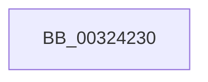

# RtlpHpReleaseLockExclusive

- RVA: `0x00324230`–`0x00324249` (길이 `25` bytes)
- VA: `0x0000000140324230`
- 실행 섹션: `.text`
- PDB 이름 있음: `예`; PDB Function 태그: `아니요`
- unwind 정보 RVA: `0x000759F0`
- 디코드: `7`개 명령, `25/25` bytes 표시
- 미해석 바이트: `0` (있으면 어셈블리에 `.byte`로 보존)

> 이 문서는 커널 이미지의 기계어와 PDB 기호를 분석해 생성했습니다. 4번과 5번은 함수 원형과 자료형을 바이너리 사용 방식에서 추정한 C 해석이며 원본 소스 복구 결과는 아닙니다.

## 1. Dependencies

- 직접 호출 지점: **0**; 고유 호출 대상: **0**
- 직접 호출자로 확인된 함수: **27**
- RIP 상대 이미지 참조: **0**

### Outgoing calls
- 직접 디코드된 call 명령이 없습니다.

### Direct callers
- [RtlpHpLfhOwnerCompact](../2E/RtlpHpLfhOwnerCompact_function_002E785C.md) at `0x002E79D3`
- [RtlpHpLfhOwnerCompact](../2E/RtlpHpLfhOwnerCompact_function_002E785C.md) at `0x002E7A44`
- [RtlpHpLfhBucketGetSubsegment](../2E/RtlpHpLfhBucketGetSubsegment_function_002E8474.md) at `0x002E84F3`
- [RtlpHpLfhBucketGetSubsegment](../2E/RtlpHpLfhBucketGetSubsegment_function_002E8474.md) at `0x002E85BF`
- [RtlpHpLfhBucketAddSubsegment](../2E/RtlpHpLfhBucketAddSubsegment_function_002E8CD8.md) at `0x002E8D72`
- [RtlpHpLfhSlotAllocateSlow](../2E/RtlpHpLfhSlotAllocateSlow_function_002E8FBC.md) at `0x002E91D5`
- [RtlpHpLfhSlotAllocateSlow](../2E/RtlpHpLfhSlotAllocateSlow_function_002E8FBC.md) at `0x002E94AD`
- [RtlpHpLfhSlotAllocateSlow](../2E/RtlpHpLfhSlotAllocateSlow_function_002E8FBC.md) at `0x002E9548`
- [RtlpHpLfhSlotAllocateSlow](../2E/RtlpHpLfhSlotAllocateSlow_function_002E8FBC.md) at `0x002E9826`
- [RtlpHpLfhSubsegmentCommitBlock](../2E/RtlpHpLfhSubsegmentCommitBlock_function_002EA630.md) at `0x002EA783`
- [RtlpHpLfhSubsegmentCommitBlock](../2E/RtlpHpLfhSubsegmentCommitBlock_function_002EA630.md) at `0x002EA932`
- [RtlpHpLfhSubsegmentIncBlockCounts](../2E/RtlpHpLfhSubsegmentIncBlockCounts_function_002EB4A0.md) at `0x002EB58F`
- [RtlpHpLargeLockRelease](../2E/RtlpHpLargeLockRelease_function_002ECBCC.md) at `0x002ECBDF`
- [RtlpHpSegMgrUnlock](../2E/RtlpHpSegMgrUnlock_function_002ED6E8.md) at `0x002ED6FC`
- [RtlpHpVaMgrCtxFree](../2E/RtlpHpVaMgrCtxFree_function_002ED734.md) at `0x002ED919`
- [RtlpHpVaMgrAlloc](../2E/RtlpHpVaMgrAlloc_function_002EDB1C.md) at `0x002EDC04`
- [RtlpHpVaMgrAlloc](../2E/RtlpHpVaMgrAlloc_function_002EDB1C.md) at `0x002EDC2E`
- [RtlpHpLfhOwnerListCompact](RtlpHpLfhOwnerListCompact_function_00323BA8.md) at `0x00323C46`
- [RtlpHpLfhSubsegmentDelayFreeListProcess](RtlpHpLfhSubsegmentDelayFreeListProcess_function_00323CE0.md) at `0x0032401C`
- [sub_003267E9](Unknown_function_003267E9.md) at `0x0032688B`
- [sub_003267E9](Unknown_function_003267E9.md) at `0x0032694C`
- [RtlpHpSegMgrCommitInitiate](RtlpHpSegMgrCommitInitiate_function_003271DC.md) at `0x003272B8`
- [RtlpHpFixedVsAllocate](../3B/RtlpHpFixedVsAllocate_function_003B47F0.md) at `0x003B48C6`
- [RtlpHpSegLockRelease](../47/RtlpHpSegLockRelease_function_004711B4.md) at `0x004711C8`
- [RtlpHpSegMgrCommitComplete](../48/RtlpHpSegMgrCommitComplete_function_00484C14.md) at `0x00484C99`
- [RtlpHpFixedVsFree](../4A/RtlpHpFixedVsFree_function_004A7FE0.md) at `0x004A8174`
- [RtlpHpHeapExtendContext](../4B/RtlpHpHeapExtendContext_function_004B1EFC.md) at `0x004B1FA5`
- [RtlpHpHeapExtendContext](../4B/RtlpHpHeapExtendContext_function_004B1EFC.md) at `0x004B206D`
- [RtlpHpCustomVaCallbacksRegistrarRegister](../60/RtlpHpCustomVaCallbacksRegistrarRegister_function_00602804.md) at `0x00602B68`
- [RtlpHpCustomVaCallbacksRegistrarUnregister](../60/RtlpHpCustomVaCallbacksRegistrarUnregister_function_00602B9C.md) at `0x00602CD3`
- [RtlpHpRegisterEnvironment](../60/RtlpHpRegisterEnvironment_function_006036C0.md) at `0x0060381C`
- [RtlpHpVaMgrCtxAllocatorReference](../60/RtlpHpVaMgrCtxAllocatorReference_function_00603BC0.md) at `0x00603D13`
- [RtlpHpLfhContextUnlockExtension](../60/RtlpHpLfhContextUnlockExtension_function_00604C1C.md) at `0x00604C2B`
- [RtlpHpLfhPrivateSlotCreate](../60/RtlpHpLfhPrivateSlotCreate_function_00604D50.md) at `0x00604EDD`
- [RtlpHpLfhPrivateSlotListCompact](../60/RtlpHpLfhPrivateSlotListCompact_function_00604F1C.md) at `0x00605006`
- [RtlpHpLfhPrivateSlotShutdown](../60/RtlpHpLfhPrivateSlotShutdown_function_0060502C.md) at `0x006051EF`

### Static image references
- 디코드된 RIP-relative 메모리 참조가 없습니다.

## 2. Other-region calls and transfers

- 다른 실행 섹션으로 향하는 call: **0**
- call이 아닌 외부 분기/꼬리 이동: **1**
  - `0x00324243` → [sub_003242D8](Unknown_function_003242D8.md) (`tail-transfer`)

## 3. Assembly (complete function range)

```asm
00324230  48 89 5C 24 10                  mov qword ptr [rsp + 0x10], rbx
00324235  57                              push rdi
00324236  48 83 EC 30                     sub rsp, 0x30
0032423A  41 0F B6 D8                     movzx ebx, r8b
0032423E  48 8B F9                        mov rdi, rcx
00324241  85 D2                           test edx, edx
00324243  0F 85 8F 00 00 00               jne 0x1403242d8
```

## 4. C-style interpretation (structured pseudocode)

```c
void __fastcall RtlpHpReleaseLockExclusive(__int64 a1, int a2, unsigned __int8 a3)
{
    __int64 v_rsp;
    unsigned __int64 v_stack_p10;

    v_stack_p10 = v_rbx;
    v_rsp = (v_rsp) - (48);
}
```

## 5. (Beta) C Style

```c
void RtlpHpReleaseLockExclusive(int64_t Arg1, int32_t Arg2, uint8_t Arg3)
{
    int64_t local_rsp;
    uint64_t v_stack_p10;

    v_stack_p10 = local_rbx;
    local_rsp = (local_rsp) - (48);
}
```

## 6. Execution-region graph

[열기: 2D/3D 그래프와 함수 탐색 컨트롤 패널](../../../control-panel.html?section=text&rva=0x00324230&view=graph)

- 2D 그래프는 위에서 아래로 흐르고, 3D 그래프는 빈 공간을 드래그해 회전합니다. Shift+드래그는 이동, 휠은 확대·축소, 함수 노드 선택은 대상 보고서 이동입니다.

### Static fallback


