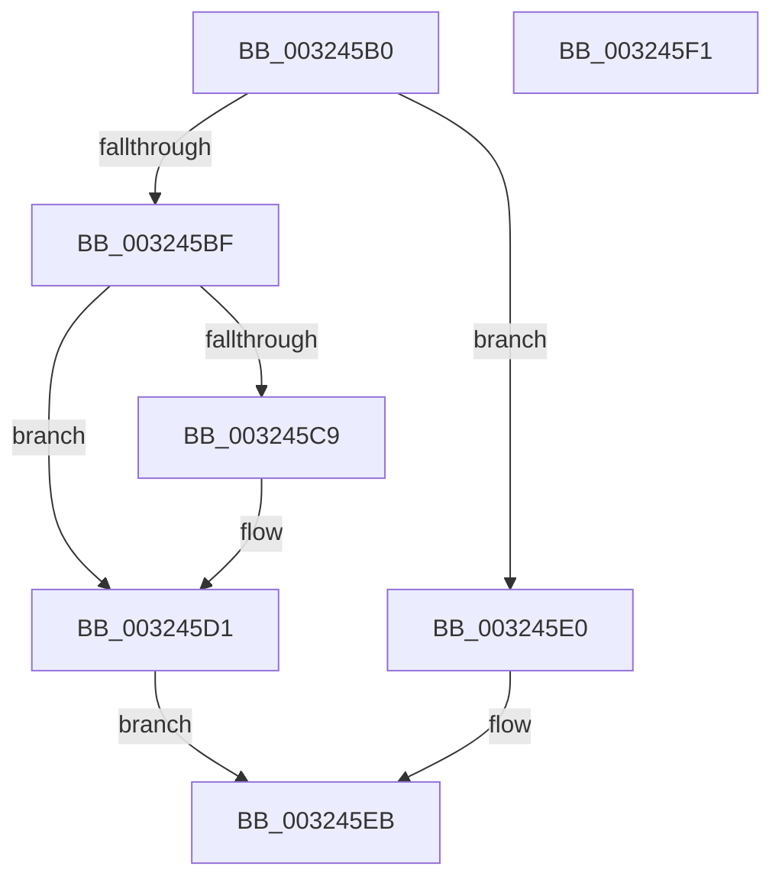

# RtlpHpReleaseLockShared

- RVA: `0x003245B0`–`0x003245F2` (길이 `66` bytes)
- VA: `0x00000001403245B0`
- 실행 섹션: `.text`
- PDB 이름 있음: `예`; PDB Function 태그: `아니요`
- unwind 정보 RVA: `0x0005CF00`
- 디코드: `22`개 명령, `66/66` bytes 표시
- 미해석 바이트: `0` (있으면 어셈블리에 `.byte`로 보존)

> 이 문서는 커널 이미지의 기계어와 PDB 기호를 분석해 생성했습니다. 4번과 5번은 함수 원형과 자료형을 바이너리 사용 방식에서 추정한 C 해석이며 원본 소스 복구 결과는 아닙니다.

## 1. Dependencies

- 직접 호출 지점: **4**; 고유 호출 대상: **4**
- 직접 호출자로 확인된 함수: **7**
- RIP 상대 이미지 참조: **0**

### Outgoing calls
- `0x003245CC` → [ExfReleasePushLockShared](../26/ExfReleasePushLockShared_function_00263440.md) (function, `0x00263440`)
- `0x003245D4` → [KeAbPostRelease](../2E/KeAbPostRelease_function_002E1600.md) (function, `0x002E1600`)
- `0x003245D9` → [KeLeaveGuardedRegion](../2E/KeLeaveGuardedRegion_function_002E2C40.md) (function, `0x002E2C40`)
- `0x003245E6` → [ExReleaseSpinLockShared](../2F/ExReleaseSpinLockShared_function_002F0EF0.md) (function, `0x002F0EF0`)

### Direct callers
- [RtlpHpLfhOwnerCompact](../2E/RtlpHpLfhOwnerCompact_function_002E785C.md) at `0x002E7A76`
- [RtlpHpLfhSlotAllocateSlow](../2E/RtlpHpLfhSlotAllocateSlow_function_002E8FBC.md) at `0x002E948E`
- [RtlpHpLfhSlotAllocateSlow](../2E/RtlpHpLfhSlotAllocateSlow_function_002E8FBC.md) at `0x002E963A`
- [RtlpHpLfhSlotAllocateSlow](../2E/RtlpHpLfhSlotAllocateSlow_function_002E8FBC.md) at `0x002E96A3`
- [RtlpHpLfhOwnerListCompact](RtlpHpLfhOwnerListCompact_function_00323BA8.md) at `0x00323C69`
- [RtlpHpLfhSubsegmentDelayFreeListProcess](RtlpHpLfhSubsegmentDelayFreeListProcess_function_00323CE0.md) at `0x0032403C`
- [RtlpHpLfhSubsegmentReformatCheck](../46/RtlpHpLfhSubsegmentReformatCheck_function_00461EA4.md) at `0x00461FCB`
- [RtlpHpLargeLockReleaseShared](../4F/RtlpHpLargeLockReleaseShared_function_004FC518.md) at `0x004FC52B`
- [sub_006DE040](../6D/Unknown_function_006DE040.md) at `0x006DE424`

### Static image references
- 디코드된 RIP-relative 메모리 참조가 없습니다.

## 2. Other-region calls and transfers

- 다른 실행 섹션으로 향하는 call: **0**
- 별도 외부 분기/꼬리 이동을 확인하지 못했습니다.

## 3. Assembly (complete function range)

```asm
003245B0  40 53                           push rbx
003245B2  48 83 EC 20                     sub rsp, 0x20
003245B6  48 8B D9                        mov rbx, rcx
003245B9  33 C9                           xor ecx, ecx
003245BB  85 D2                           test edx, edx
003245BD  75 21                           jne 0x1403245e0
003245BF  8D 41 11                        lea eax, [rcx + 0x11]
003245C2  F0 48 0F B1 0B                  lock cmpxchg qword ptr [rbx], rcx
003245C7  74 08                           je 0x1403245d1
003245C9  48 8B CB                        mov rcx, rbx
003245CC  E8 6F EE F3 FF                  call 0x140263440
003245D1  48 8B CB                        mov rcx, rbx
003245D4  E8 27 D0 FB FF                  call 0x1402e1600
003245D9  E8 62 E6 FB FF                  call 0x1402e2c40
003245DE  EB 0B                           jmp 0x1403245eb
003245E0  41 8A D0                        mov dl, r8b
003245E3  48 8B CB                        mov rcx, rbx
003245E6  E8 05 C9 FC FF                  call 0x1402f0ef0
003245EB  48 83 C4 20                     add rsp, 0x20
003245EF  5B                              pop rbx
003245F0  C3                              ret
003245F1  CC                              int3
```

## 4. C-style interpretation (structured pseudocode)

```c
__int64 __fastcall RtlpHpReleaseLockShared(__int64 a1, int a2, unsigned __int8 a3)
{
    __int64 result;
    __int64 v_rsp;

    v_rsp = (v_rsp) - (32);
    a1 = 0;
    if (a2 != 0) goto loc_003245E0;
    result = a1 + 17;
    if (a2 != 0) {
        a1 = 0;
        result = ExfReleasePushLockShared(a1, a2, a3, a4);
    }
    result = KeAbPostRelease(a1, a2, a3, a4);
    result = KeLeaveGuardedRegion(a1, a2, a3, a4);
    goto loc_003245EB;
loc_003245E0:
    result = ExReleaseSpinLockShared(a1, a3, a3, a4);
loc_003245EB:
    v_rsp = (v_rsp) + (32);
    return result;
}
```

## 5. (Beta) C Style

```c
int64_t RtlpHpReleaseLockShared(void *Arg1, int32_t Arg2, uint8_t Arg3)
{
    uint8_t *arg1 = (uint8_t *)Arg1;

    int64_t result;
    int64_t local_rsp;

    local_rsp = (local_rsp) - (32);
    Arg1 = 0;
    if (Arg2 != 0) goto loc_003245E0;
    result = Arg1 + 17;
    if (Arg2 != 0) {
        Arg1 = 0;
        result = ExfReleasePushLockShared(Arg1, Arg2, Arg3, a4);
    }
    result = KeAbPostRelease(Arg1, Arg2, Arg3, a4);
    result = KeLeaveGuardedRegion(Arg1, Arg2, Arg3, a4);
    goto loc_003245EB;
loc_003245E0:
    result = ExReleaseSpinLockShared(Arg1, Arg3, Arg3, a4);
loc_003245EB:
    local_rsp = (local_rsp) + (32);
    return result;
}
```

### 관측된 메모리 오프셋

구조체 형식이 확인되지 않은 접근은 인자 기준의 오프셋으로만 기록했습니다.

| 기준 인자 | 오프셋 표현 | 폭 (bit) | 접근 |
|---|---:|---:|---|
| `Arg1` | `+ 0x0` | `64` | `R` |

## 6. Execution-region graph

[열기: 2D/3D 그래프와 함수 탐색 컨트롤 패널](../../../control-panel.html?section=text&rva=0x003245B0&view=graph)

- 2D 그래프는 위에서 아래로 흐르고, 3D 그래프는 빈 공간을 드래그해 회전합니다. Shift+드래그는 이동, 휠은 확대·축소, 함수 노드 선택은 대상 보고서 이동입니다.

### Static fallback


