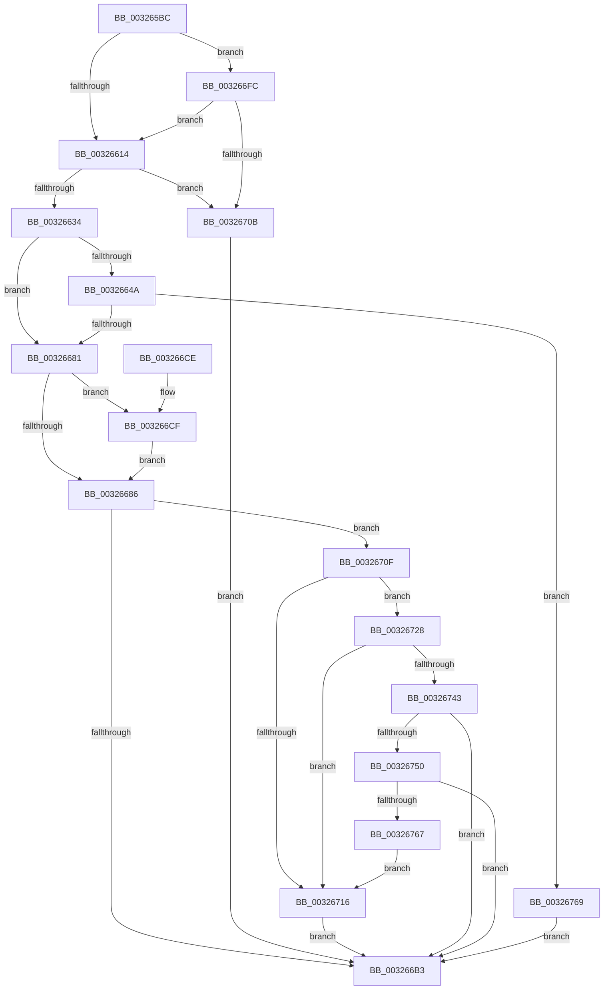

# RtlpHpSegAlloc

- RVA: `0x003265BC`–`0x0032677D` (길이 `449` bytes)
- VA: `0x00000001403265BC`
- 실행 섹션: `.text`
- PDB 이름 있음: `예`; PDB Function 태그: `아니요`
- unwind 정보 RVA: `0x00075CA8`
- 디코드: `121`개 명령, `449/449` bytes 표시
- 미해석 바이트: `0` (있으면 어셈블리에 `.byte`로 보존)

> 이 문서는 커널 이미지의 기계어와 PDB 기호를 분석해 생성했습니다. 4번과 5번은 함수 원형과 자료형을 바이너리 사용 방식에서 추정한 C 해석이며 원본 소스 복구 결과는 아닙니다.

## 1. Dependencies

- 직접 호출 지점: **6**; 고유 호출 대상: **5**
- 직접 호출자로 확인된 함수: **4**
- RIP 상대 이미지 참조: **1**

### Outgoing calls
- `0x0032661E` → [RtlpHpSegPageRangeAllocate](RtlpHpSegPageRangeAllocate_function_00326790.md) (function, `0x00326790`)
- `0x00326674` → [RtlpHpSegPageRangeCommit](RtlpHpSegPageRangeCommit_function_00325D0C.md) (function, `0x00325D0C`)
- `0x003266F5` → [RtlpHpSegPageRangeCommit](RtlpHpSegPageRangeCommit_function_00325D0C.md) (function, `0x00325D0C`)
- `0x00326721` → [RtlHeapZero](../6B/RtlHeapZero_function_006BBC10.md) (function, `0x006BBC10`)
- `0x00326759` → [RtlpHpSegPageRangeComputeLargePageCost](../41/RtlpHpSegPageRangeComputeLargePageCost_function_0041D6C0.md) (function, `0x0041D6C0`)
- `0x00326773` → [RtlpHpSegPageRangeShrink](../2E/RtlpHpSegPageRangeShrink_function_002E2FA0.md) (function, `0x002E2FA0`)

### Direct callers
- [RtlpHpSegSubAllocate](../2E/RtlpHpSegSubAllocate_function_002EB344.md) at `0x002EB37C`
- [RtlpHpMetadataAlloc](../2E/RtlpHpMetadataAlloc_function_002EC180.md) at `0x002EC50F`
- [RtlpHpAllocateHeapBackend](RtlpHpAllocateHeapBackend_function_00326580.md) at `0x003265A8`
- [ExAllocateHeapPool](../35/ExAllocateHeapPool_function_0035BA30.md) at `0x0035ED2E`

### Static image references
- `0x0032672C` → RVA `0x0001A920` (`.rdata`; read)

## 2. Other-region calls and transfers

- 다른 실행 섹션으로 향하는 call: **0**
- 별도 외부 분기/꼬리 이동을 확인하지 못했습니다.

## 3. Assembly (complete function range)

```asm
003265BC  48 89 5C 24 08                  mov qword ptr [rsp + 8], rbx
003265C1  48 89 74 24 10                  mov qword ptr [rsp + 0x10], rsi
003265C6  57                              push rdi
003265C7  41 54                           push r12
003265C9  41 55                           push r13
003265CB  41 56                           push r14
003265CD  41 57                           push r15
003265CF  48 83 EC 30                     sub rsp, 0x30
003265D3  44 8B A4 24 80 00 00 00         mov r12d, dword ptr [rsp + 0x80]
003265DB  4D 8D B9 FF 0F 00 00            lea r15, [r9 + 0xfff]
003265E2  49 81 C0 FF 0F 00 00            add r8, 0xfff
003265E9  49 C1 EF 0C                     shr r15, 0xc
003265ED  49 C1 E8 0C                     shr r8, 0xc
003265F1  4C 8B EA                        mov r13, rdx
003265F4  41 83 E4 04                     and r12d, 4
003265F8  48 8B F9                        mov rdi, rcx
003265FB  41 8D 70 01                     lea esi, [r8 + 1]
003265FF  41 0F 44 F0                     cmove esi, r8d
00326603  F7 84 24 80 00 00 00 00 00 80 00  test dword ptr [rsp + 0x80], 0x800000
0032660E  0F 85 E8 00 00 00               jne 0x1403266fc
00326614  44 8B 84 24 80 00 00 00         mov r8d, dword ptr [rsp + 0x80]
0032661C  8B D6                           mov edx, esi
0032661E  E8 6D 01 00 00                  call 0x140326790
00326623  48 89 44 24 78                  mov qword ptr [rsp + 0x78], rax
00326628  48 8B D8                        mov rbx, rax
0032662B  48 85 C0                        test rax, rax
0032662E  0F 84 D7 00 00 00               je 0x14032670b
00326634  44 0F B6 70 1F                  movzx r14d, byte ptr [rax + 0x1f]
00326639  8B 40 1C                        mov eax, dword ptr [rax + 0x1c]
0032663C  F7 D0                           not eax
0032663E  0F B7 C8                        movzx ecx, ax
00326641  89 4C 24 70                     mov dword ptr [rsp + 0x70], ecx
00326645  45 85 FF                        test r15d, r15d
00326648  74 37                           je 0x140326681
0032664A  8B 84 24 80 00 00 00            mov eax, dword ptr [rsp + 0x80]
00326651  45 8B CF                        mov r9d, r15d
00326654  83 E0 FD                        and eax, 0xfffffffd
00326657  48 8B D3                        mov rdx, rbx
0032665A  85 C9                           test ecx, ecx
0032665C  48 8B CF                        mov rcx, rdi
0032665F  0F 44 84 24 80 00 00 00         cmove eax, dword ptr [rsp + 0x80]
00326667  45 33 C0                        xor r8d, r8d
0032666A  48 83 64 24 28 00               and qword ptr [rsp + 0x28], 0
00326670  89 44 24 20                     mov dword ptr [rsp + 0x20], eax
00326674  E8 93 F6 FF FF                  call 0x140325d0c
00326679  85 C0                           test eax, eax
0032667B  0F 88 E8 00 00 00               js 0x140326769
00326681  45 85 E4                        test r12d, r12d
00326684  75 49                           jne 0x1403266cf
00326686  8A 4F 08                        mov cl, byte ptr [rdi + 8]
00326689  41 D3 E6                        shl r14d, cl
0032668C  45 2B F5                        sub r14d, r13d
0032668F  44 89 73 04                     mov dword ptr [rbx + 4], r14d
00326693  48 8B 07                        mov rax, qword ptr [rdi]
00326696  8A 4F 08                        mov cl, byte ptr [rdi + 8]
00326699  48 23 C3                        and rax, rbx
0032669C  48 2B D8                        sub rbx, rax
0032669F  48 C1 FB 05                     sar rbx, 5
003266A3  48 D3 E3                        shl rbx, cl
003266A6  48 03 D8                        add rbx, rax
003266A9  F6 84 24 80 00 00 00 02         test byte ptr [rsp + 0x80], 2
003266B1  75 5C                           jne 0x14032670f
003266B3  48 8B 74 24 68                  mov rsi, qword ptr [rsp + 0x68]
003266B8  48 8B C3                        mov rax, rbx
003266BB  48 8B 5C 24 60                  mov rbx, qword ptr [rsp + 0x60]
003266C0  48 83 C4 30                     add rsp, 0x30
003266C4  41 5F                           pop r15
003266C6  41 5E                           pop r14
003266C8  41 5D                           pop r13
003266CA  41 5C                           pop r12
003266CC  5F                              pop rdi
003266CD  C3                              ret
003266CE  CC                              int3
003266CF  8A 4F 09                        mov cl, byte ptr [rdi + 9]
003266D2  44 8D 46 FF                     lea r8d, [rsi - 1]
003266D6  48 83 64 24 28 00               and qword ptr [rsp + 0x28], 0
003266DC  41 8B C6                        mov eax, r14d
003266DF  83 64 24 20 00                  and dword ptr [rsp + 0x20], 0
003266E4  44 8B CE                        mov r9d, esi
003266E7  D3 E0                           shl eax, cl
003266E9  48 8B D3                        mov rdx, rbx
003266EC  44 2B C8                        sub r9d, eax
003266EF  48 8B CF                        mov rcx, rdi
003266F2  41 FF C9                        dec r9d
003266F5  E8 12 F6 FF FF                  call 0x140325d0c
003266FA  EB 8A                           jmp 0x140326686
003266FC  8B 01                           mov eax, dword ptr [rcx]
003266FE  F7 D8                           neg eax
00326700  3D 00 00 20 00                  cmp eax, 0x200000
00326705  0F 86 09 FF FF FF               jbe 0x140326614
0032670B  33 DB                           xor ebx, ebx
0032670D  EB A4                           jmp 0x1403266b3
0032670F  83 7C 24 70 00                  cmp dword ptr [rsp + 0x70], 0
00326714  74 12                           je 0x140326728
00326716  49 8D 55 0F                     lea rdx, [r13 + 0xf]
0032671A  48 8B CB                        mov rcx, rbx
0032671D  48 83 E2 F0                     and rdx, 0xfffffffffffffff0
00326721  E8 EA 54 39 00                  call 0x1406bbc10
00326726  EB 8B                           jmp 0x1403266b3
00326728  48 8B 47 28                     mov rax, qword ptr [rdi + 0x28]
0032672C  48 8D 0D ED 41 CF FF            lea rcx, [rip - 0x30be13]
00326733  48 C1 E8 08                     shr rax, 8
00326737  0F B6 C0                        movzx eax, al
0032673A  81 3C 81 00 00 10 00            cmp dword ptr [rcx + rax*4], 0x100000
00326741  77 D3                           ja 0x140326716
00326743  8A 47 0D                        mov al, byte ptr [rdi + 0xd]
00326746  24 07                           and al, 7
00326748  3C 01                           cmp al, 1
0032674A  0F 82 63 FF FF FF               jb 0x1403266b3
00326750  45 8B C5                        mov r8d, r13d
00326753  48 8B D3                        mov rdx, rbx
00326756  48 8B CF                        mov rcx, rdi
00326759  E8 62 6F 0F 00                  call 0x14041d6c0
0032675E  83 F8 02                        cmp eax, 2
00326761  0F 8F 4C FF FF FF               jg 0x1403266b3
00326767  EB AD                           jmp 0x140326716
00326769  48 8B 54 24 78                  mov rdx, qword ptr [rsp + 0x78]
0032676E  33 DB                           xor ebx, ebx
00326770  48 8B CF                        mov rcx, rdi
00326773  E8 28 C8 FB FF                  call 0x1402e2fa0
00326778  E9 36 FF FF FF                  jmp 0x1403266b3
```

## 4. C-style interpretation (structured pseudocode)

```c
__int64 __fastcall RtlpHpSegAlloc(__int64 a1, __int64 a2, __int64 a3, __int64 a4, unsigned __int8 a5)
{
    __int64 result;
    __int64 v_r12;
    __int64 v_r14;
    __int64 v_r15;
    __int64 v_rbx;
    __int64 v_rsi;
    __int64 v_rsp;
    unsigned __int64 v_stack_m30;
    unsigned int v_stack_m38;
    unsigned __int64 v_stack_p10;
    unsigned int v_stack_p18;
    unsigned __int64 v_stack_p20;
    unsigned __int64 v_stack_p28;
    unsigned int v_stack_p70;
    unsigned __int64 v_stack_p78;
    unsigned __int64 v_stack_p8;

    v_stack_p8 = v_rbx;
    v_stack_p10 = v_rsi;
    v_rsp = (v_rsp) - (48);
    a3 = (a3) + (0xFFFULL);
    v_r15 = (a4 + 4095) >> (12);
    a3 = (a3) >> (12);
    v_r12 = (unsigned int)(((unsigned int)(a5)) & (4));
    v_rsi = a3 + 1;
    if (condition_is_equal) { v_rsi = (unsigned int)(a3); }
    if (((a5) & (0x800000ULL)) != 0) goto loc_003266FC;
loc_00326614:
    result = RtlpHpSegPageRangeAllocate(a1, (unsigned int)((unsigned int)(v_rsi)), (unsigned int)(a5), a4);
    v_stack_p20 = result;
    if (result == 0) goto loc_0032670B;
    result = (unsigned int)(~((unsigned int)(*(unsigned int *)(result + 28))));
    v_stack_p18 = (unsigned int)((unsigned __int16)(result));
    if ((unsigned int)(v_r15) == 0) goto loc_00326681;
    result = (unsigned int)(((unsigned int)(a5)) & (0xFFFFFFFDULL));
    if ((unsigned int)((unsigned __int16)(result)) == 0) { result = a5; }
    a3 = 0;
    v_stack_m38 = (unsigned int)(result);
    result = RtlpHpSegPageRangeCommit(a1, result, a3, (unsigned int)((unsigned int)(v_r15)));
    if (sign_flag) goto loc_00326769;
loc_00326681:
    if ((unsigned int)(v_r12) != 0) goto loc_003266CF;
loc_00326686:
    v_r14 = (unsigned int)((*(unsigned __int8 *)(result + 31)) << ((unsigned __int8)(*(unsigned __int8 *)(a1 + 8))));
    v_r14 = (unsigned int)((v_r14) - ((unsigned int)(a2)));
    *(unsigned int *)(result + 4) = (unsigned int)(v_r14);
    result = (*(unsigned __int64 *)(a1)) & (result);
    v_rbx = (result) - (result);
    v_rbx = (v_rbx) >> (5);
    v_rbx = (v_rbx) << ((unsigned __int8)(*(unsigned __int8 *)(a1 + 8)));
    v_rbx = (v_rbx) + (result);
    if (((a5) & (2)) != 0) goto loc_0032670F;
loc_003266B3:
    v_rsp = (v_rsp) + (48);
    return v_rbx;
loc_003266CF:
    result = (unsigned int)(((unsigned int)((unsigned int)(v_r14))) << ((unsigned __int8)(*(unsigned __int8 *)(a1 + 9))));
    a4 = (unsigned int)(((unsigned int)((unsigned int)(v_stack_p10))) - ((unsigned int)(result)));
    a4 = (unsigned int)((a4) - 1);
    result = RtlpHpSegPageRangeCommit(a1, v_stack_p8, v_stack_p10 - 1, a4);
    goto loc_00326686;
loc_003266FC:
    result = (unsigned int)(-((unsigned int)(*(unsigned int *)(a1))));
    if (((unsigned int)(result)) <= 0x200000ULL) goto loc_00326614;
loc_0032670B:
    v_rbx = 0;
    goto loc_003266B3;
loc_0032670F:
    if (v_stack_p70 == 0) goto loc_00326728;
loc_00326716:
    a2 = (a2 + 15) & (-16);
    result = RtlHeapZero(0, a2, v_stack_p10 - 1, a4);
    goto loc_003266B3;
loc_00326728:
    result = (*(unsigned __int64 *)(a1 + 40)) >> (8);
    if ((*(unsigned int *)(v_rip - 3194387 + (unsigned __int8)(result) * 4)) > 0x100000ULL) goto loc_00326716;
    result = (unsigned __int8)((*(unsigned __int8 *)(a1 + 13)) & (7));
    if (((unsigned __int8)(result)) < 1) goto loc_003266B3;
    result = RtlpHpSegPageRangeComputeLargePageCost(a1, 0, (unsigned int)((unsigned int)(a2)), a4);
    if (((unsigned int)(result)) > 2) goto loc_003266B3;
    goto loc_00326716;
loc_00326769:
    v_rbx = 0;
    result = RtlpHpSegPageRangeShrink(a1, v_stack_p78, (unsigned int)((unsigned int)(a2)), a4);
    goto loc_003266B3;
}
```

## 5. (Beta) C Style

```c
int64_t RtlpHpSegAlloc(void *Arg1, void *Arg2, int64_t Arg3, void *Arg4, uint8_t Arg5)
{
    uint8_t *arg1 = (uint8_t *)Arg1;
    uint8_t *arg2 = (uint8_t *)Arg2;
    uint8_t *arg4 = (uint8_t *)Arg4;

    int64_t result;
    int64_t local_r12;
    int64_t local_r14;
    int64_t local_r15;
    int64_t local_rbx;
    int64_t local_rsi;
    int64_t local_rsp;
    uint64_t v_stack_m30;
    uint32_t v_stack_m38;
    uint64_t v_stack_p10;
    uint32_t v_stack_p18;
    uint64_t v_stack_p20;
    uint64_t v_stack_p28;
    uint32_t v_stack_p70;
    uint64_t v_stack_p78;
    uint64_t v_stack_p8;

    v_stack_p8 = local_rbx;
    v_stack_p10 = local_rsi;
    local_rsp = (local_rsp) - (48);
    Arg3 = (Arg3) + (0xFFFULL);
    local_r15 = (Arg4 + 4095) >> (12);
    Arg3 = (Arg3) >> (12);
    local_r12 = (uint32_t)(((uint32_t)(Arg5)) & (4));
    local_rsi = Arg3 + 1;
    if (condition_is_equal) { local_rsi = (uint32_t)(Arg3); }
    if (((Arg5) & (0x800000ULL)) != 0) goto loc_003266FC;
loc_00326614:
    result = RtlpHpSegPageRangeAllocate(Arg1, (uint32_t)((uint32_t)(local_rsi)), (uint32_t)(Arg5), Arg4);
    v_stack_p20 = result;
    if (result == 0) goto loc_0032670B;
    result = (uint32_t)(~((uint32_t)(*(uint32_t *)(result + 0x1C))));
    v_stack_p18 = (uint32_t)((uint16_t)(result));
    if ((uint32_t)(local_r15) == 0) goto loc_00326681;
    result = (uint32_t)(((uint32_t)(Arg5)) & (0xFFFFFFFDULL));
    if ((uint32_t)((uint16_t)(result)) == 0) { result = Arg5; }
    Arg3 = 0;
    v_stack_m38 = (uint32_t)(result);
    result = RtlpHpSegPageRangeCommit(Arg1, result, Arg3, (uint32_t)((uint32_t)(local_r15)));
    if (sign_flag) goto loc_00326769;
loc_00326681:
    if ((uint32_t)(local_r12) != 0) goto loc_003266CF;
loc_00326686:
    local_r14 = (uint32_t)((*(uint8_t *)(result + 0x1F)) << ((uint8_t)(*(uint8_t *)(arg1 + 0x8))));
    local_r14 = (uint32_t)((local_r14) - ((uint32_t)(Arg2)));
    *(uint32_t *)(result + 0x4) = (uint32_t)(local_r14);
    result = (*(uint64_t *)(arg1)) & (result);
    local_rbx = (result) - (result);
    local_rbx = (local_rbx) >> (5);
    local_rbx = (local_rbx) << ((uint8_t)(*(uint8_t *)(arg1 + 0x8)));
    local_rbx = (local_rbx) + (result);
    if (((Arg5) & (2)) != 0) goto loc_0032670F;
loc_003266B3:
    local_rsp = (local_rsp) + (48);
    return local_rbx;
loc_003266CF:
    result = (uint32_t)(((uint32_t)((uint32_t)(local_r14))) << ((uint8_t)(*(uint8_t *)(arg1 + 0x9))));
    Arg4 = (uint32_t)(((uint32_t)((uint32_t)(v_stack_p10))) - ((uint32_t)(result)));
    Arg4 = (uint32_t)((Arg4) - 1);
    result = RtlpHpSegPageRangeCommit(Arg1, v_stack_p8, v_stack_p10 - 1, Arg4);
    goto loc_00326686;
loc_003266FC:
    result = (uint32_t)(-((uint32_t)(*(uint32_t *)(arg1))));
    if (((uint32_t)(result)) <= 0x200000ULL) goto loc_00326614;
loc_0032670B:
    local_rbx = 0;
    goto loc_003266B3;
loc_0032670F:
    if (v_stack_p70 == 0) goto loc_00326728;
loc_00326716:
    Arg2 = (Arg2 + 15) & (-16);
    result = RtlHeapZero(0, Arg2, v_stack_p10 - 1, Arg4);
    goto loc_003266B3;
loc_00326728:
    result = (*(uint64_t *)(arg1 + 0x28)) >> (8);
    if ((*(uint32_t *)(v_rip - 0x30BE13 + (uint8_t)(result) * 4)) > 0x100000ULL) goto loc_00326716;
    result = (uint8_t)((*(uint8_t *)(arg1 + 0xD)) & (7));
    if (((uint8_t)(result)) < 1) goto loc_003266B3;
    result = RtlpHpSegPageRangeComputeLargePageCost(Arg1, 0, (uint32_t)((uint32_t)(Arg2)), Arg4);
    if (((uint32_t)(result)) > 2) goto loc_003266B3;
    goto loc_00326716;
loc_00326769:
    local_rbx = 0;
    result = RtlpHpSegPageRangeShrink(Arg1, v_stack_p78, (uint32_t)((uint32_t)(Arg2)), Arg4);
    goto loc_003266B3;
}
```

### 관측된 메모리 오프셋

구조체 형식이 확인되지 않은 접근은 인자 기준의 오프셋으로만 기록했습니다.

| 기준 인자 | 오프셋 표현 | 폭 (bit) | 접근 |
|---|---:|---:|---|
| `Arg1` | `+ 0x0` | `32` | `R` |
| `Arg1` | `+ 0x0` | `64` | `R` |
| `Arg1` | `+ 0x8` | `8` | `R` |
| `Arg1` | `+ 0x9` | `8` | `R` |
| `Arg1` | `+ 0xD` | `8` | `R` |
| `Arg1` | `+ 0x28` | `64` | `R` |
| `Arg2` | `+ 0xF` | `64` | `R` |
| `Arg4` | `+ 0xFFF` | `64` | `R` |

## 6. Execution-region graph

[열기: 2D/3D 그래프와 함수 탐색 컨트롤 패널](../../../control-panel.html?section=text&rva=0x003265BC&view=graph)

- 2D 그래프는 위에서 아래로 흐르고, 3D 그래프는 빈 공간을 드래그해 회전합니다. Shift+드래그는 이동, 휠은 확대·축소, 함수 노드 선택은 대상 보고서 이동입니다.

### Static fallback


