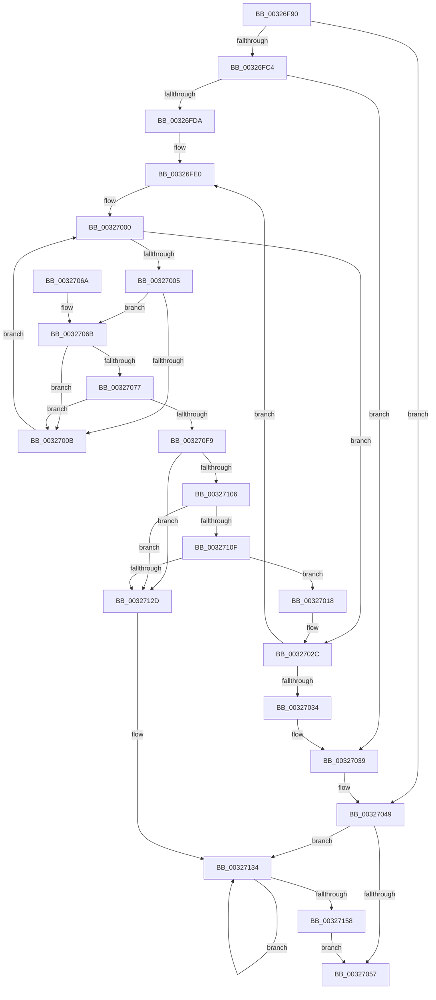

# RtlpHpSegContextCompact

- RVA: `0x00326F90`–`0x0032715D` (길이 `461` bytes)
- VA: `0x0000000140326F90`
- 실행 섹션: `.text`
- PDB 이름 있음: `예`; PDB Function 태그: `아니요`
- unwind 정보 RVA: `0x00075D5C`
- 디코드: `125`개 명령, `461/461` bytes 표시
- 미해석 바이트: `0` (있으면 어셈블리에 `.byte`로 보존)

> 이 문서는 커널 이미지의 기계어와 PDB 기호를 분석해 생성했습니다. 4번과 5번은 함수 원형과 자료형을 바이너리 사용 방식에서 추정한 C 해석이며 원본 소스 복구 결과는 아닙니다.

## 1. Dependencies

- 직접 호출 지점: **6**; 고유 호출 대상: **6**
- 직접 호출자로 확인된 함수: **1**
- RIP 상대 이미지 참조: **0**

### Outgoing calls
- `0x00326FC4` → [RtlpHpSegLockAcquire](../2E/RtlpHpSegLockAcquire_function_002E34A0.md) (function, `0x002E34A0`)
- `0x0032703F` → [RtlpHpSegLockRelease](../47/RtlpHpSegLockRelease_function_004711B4.md) (function, `0x004711B4`)
- `0x0032707E` → [RtlRbRemoveNode](../2E/RtlRbRemoveNode_function_002E4C10.md) (function, `0x002E4C10`)
- `0x003270DA` → [RtlpHpSegPageRangeCoalesce](RtlpHpSegPageRangeCoalesce_function_00325860.md) (function, `0x00325860`)
- `0x003270EB` → [RtlpHpSegFreeRangeInsert](../2E/RtlpHpSegFreeRangeInsert_function_002E4380.md) (function, `0x002E4380`)
- `0x00327149` → [RtlpHpSegSegmentFree](../47/RtlpHpSegSegmentFree_function_00471328.md) (function, `0x00471328`)

### Direct callers
- [RtlpHpHeapCompact](../2E/RtlpHpHeapCompact_function_002E7654.md) at `0x002E767C`
- [RtlpHpHeapCompact](../2E/RtlpHpHeapCompact_function_002E7654.md) at `0x002E7688`

### Static image references
- 디코드된 RIP-relative 메모리 참조가 없습니다.

## 2. Other-region calls and transfers

- 다른 실행 섹션으로 향하는 call: **0**
- 별도 외부 분기/꼬리 이동을 확인하지 못했습니다.

## 3. Assembly (complete function range)

```asm
00326F90  48 89 5C 24 10                  mov qword ptr [rsp + 0x10], rbx
00326F95  48 89 6C 24 18                  mov qword ptr [rsp + 0x18], rbp
00326F9A  56                              push rsi
00326F9B  57                              push rdi
00326F9C  41 56                           push r14
00326F9E  48 83 EC 30                     sub rsp, 0x30
00326FA2  48 83 79 58 00                  cmp qword ptr [rcx + 0x58], 0
00326FA7  48 8D 44 24 20                  lea rax, [rsp + 0x20]
00326FAC  48 8D 5C 24 20                  lea rbx, [rsp + 0x20]
00326FB1  48 89 44 24 28                  mov qword ptr [rsp + 0x28], rax
00326FB6  48 89 5C 24 20                  mov qword ptr [rsp + 0x20], rbx
00326FBB  48 8B E9                        mov rbp, rcx
00326FBE  0F 84 85 00 00 00               je 0x140327049
00326FC4  E8 D7 C4 FB FF                  call 0x1402e34a0
00326FC9  48 8B 75 48                     mov rsi, qword ptr [rbp + 0x48]
00326FCD  4C 8D 75 48                     lea r14, [rbp + 0x48]
00326FD1  88 44 24 50                     mov byte ptr [rsp + 0x50], al
00326FD5  49 3B F6                        cmp rsi, r14
00326FD8  74 5F                           je 0x140327039
00326FDA  66 0F 1F 44 00 00               nop word ptr [rax + rax]
00326FE0  0F B6 45 0A                     movzx eax, byte ptr [rbp + 0xa]
00326FE4  48 C1 E0 05                     shl rax, 5
00326FE8  48 8D 1C 30                     lea rbx, [rax + rsi]
00326FEC  48 8B FB                        mov rdi, rbx
00326FEF  48 2B F8                        sub rdi, rax
00326FF2  48 81 C7 00 20 00 00            add rdi, 0x2000
00326FF9  0F 1F 80 00 00 00 00            nop dword ptr [rax]
00327000  48 3B DF                        cmp rbx, rdi
00327003  73 27                           jae 0x14032702c
00327005  F6 43 18 01                     test byte ptr [rbx + 0x18], 1
00327009  74 60                           je 0x14032706b
0032700B  0F B6 43 1F                     movzx eax, byte ptr [rbx + 0x1f]
0032700F  48 C1 E0 05                     shl rax, 5
00327013  48 03 D8                        add rbx, rax
00327016  EB E8                           jmp 0x140327000
00327018  48 89 48 08                     mov qword ptr [rax + 8], rcx
0032701C  48 8D 54 24 20                  lea rdx, [rsp + 0x20]
00327021  48 89 10                        mov qword ptr [rax], rdx
00327024  48 89 01                        mov qword ptr [rcx], rax
00327027  48 89 44 24 28                  mov qword ptr [rsp + 0x28], rax
0032702C  48 8B 36                        mov rsi, qword ptr [rsi]
0032702F  49 3B F6                        cmp rsi, r14
00327032  75 AC                           jne 0x140326fe0
00327034  0F B6 44 24 50                  movzx eax, byte ptr [rsp + 0x50]
00327039  0F B6 D0                        movzx edx, al
0032703C  48 8B CD                        mov rcx, rbp
0032703F  E8 70 A1 14 00                  call 0x1404711b4
00327044  48 8B 5C 24 20                  mov rbx, qword ptr [rsp + 0x20]
00327049  48 8D 44 24 20                  lea rax, [rsp + 0x20]
0032704E  48 3B D8                        cmp rbx, rax
00327051  0F 85 DD 00 00 00               jne 0x140327134
00327057  48 8B 5C 24 58                  mov rbx, qword ptr [rsp + 0x58]
0032705C  48 8B 6C 24 60                  mov rbp, qword ptr [rsp + 0x60]
00327061  48 83 C4 30                     add rsp, 0x30
00327065  41 5E                           pop r14
00327067  5F                              pop rdi
00327068  5E                              pop rsi
00327069  C3                              ret
0032706A  CC                              int3
0032706B  8B 43 1C                        mov eax, dword ptr [rbx + 0x1c]
0032706E  F7 D0                           not eax
00327070  0F B7 C0                        movzx eax, ax
00327073  85 C0                           test eax, eax
00327075  74 94                           je 0x14032700b
00327077  48 8D 4D 60                     lea rcx, [rbp + 0x60]
0032707B  48 8B D3                        mov rdx, rbx
0032707E  E8 8D DB FB FF                  call 0x1402e4c10
00327083  33 C0                           xor eax, eax
00327085  0F 57 C0                        xorps xmm0, xmm0
00327088  0F 11 03                        movups xmmword ptr [rbx], xmm0
0032708B  48 89 43 10                     mov qword ptr [rbx + 0x10], rax
0032708F  8B 43 1C                        mov eax, dword ptr [rbx + 0x1c]
00327092  F7 D0                           not eax
00327094  C7 03 DD CC DD CC               mov dword ptr [rbx], 0xccddccdd
0032709A  0F B7 C8                        movzx ecx, ax
0032709D  48 0F BF 45 16                  movsx rax, word ptr [rbp + 0x16]
003270A2  48 F7 D9                        neg rcx
003270A5  F0 48 01 4C 28 10               lock add qword ptr [rax + rbp + 0x10], rcx
003270AB  0F B6 43 18                     movzx eax, byte ptr [rbx + 0x18]
003270AF  4C 8D 4C 24 50                  lea r9, [rsp + 0x50]
003270B4  0C 01                           or al, 1
003270B6  41 B8 01 00 00 00               mov r8d, 1
003270BC  88 43 18                        mov byte ptr [rbx + 0x18], al
003270BF  48 8B D3                        mov rdx, rbx
003270C2  0F B6 4B 1F                     movzx ecx, byte ptr [rbx + 0x1f]
003270C6  FF C9                           dec ecx
003270C8  48 C1 E1 05                     shl rcx, 5
003270CC  0F B6 44 19 18                  movzx eax, byte ptr [rcx + rbx + 0x18]
003270D1  0C 01                           or al, 1
003270D3  88 44 19 18                     mov byte ptr [rcx + rbx + 0x18], al
003270D7  48 8B CD                        mov rcx, rbp
003270DA  E8 81 E7 FF FF                  call 0x140325860
003270DF  45 33 C0                        xor r8d, r8d
003270E2  48 8B D0                        mov rdx, rax
003270E5  48 8B CD                        mov rcx, rbp
003270E8  48 8B D8                        mov rbx, rax
003270EB  E8 90 D2 FB FF                  call 0x1402e4380
003270F0  48 85 C0                        test rax, rax
003270F3  0F 84 12 FF FF FF               je 0x14032700b
003270F9  48 8B 08                        mov rcx, qword ptr [rax]
003270FC  48 8B 76 08                     mov rsi, qword ptr [rsi + 8]
00327100  48 39 41 08                     cmp qword ptr [rcx + 8], rax
00327104  75 27                           jne 0x14032712d
00327106  48 8B 50 08                     mov rdx, qword ptr [rax + 8]
0032710A  48 39 02                        cmp qword ptr [rdx], rax
0032710D  75 1E                           jne 0x14032712d
0032710F  48 89 0A                        mov qword ptr [rdx], rcx
00327112  48 89 51 08                     mov qword ptr [rcx + 8], rdx
00327116  48 8D 54 24 20                  lea rdx, [rsp + 0x20]
0032711B  48 8B 4C 24 28                  mov rcx, qword ptr [rsp + 0x28]
00327120  48 FF 4D 58                     dec qword ptr [rbp + 0x58]
00327124  48 39 11                        cmp qword ptr [rcx], rdx
00327127  0F 84 EB FE FF FF               je 0x140327018
0032712D  B9 03 00 00 00                  mov ecx, 3
00327132  CD 29                           int 0x29
00327134  48 8B D3                        mov rdx, rbx
00327137  41 B9 01 00 00 00               mov r9d, 1
0032713D  48 8B 1B                        mov rbx, qword ptr [rbx]
00327140  41 B8 FF FF FF 7F               mov r8d, 0x7fffffff
00327146  48 8B CD                        mov rcx, rbp
00327149  E8 DA A1 14 00                  call 0x140471328
0032714E  48 8D 44 24 20                  lea rax, [rsp + 0x20]
00327153  48 3B D8                        cmp rbx, rax
00327156  75 DC                           jne 0x140327134
00327158  E9 FA FE FF FF                  jmp 0x140327057
```

## 4. C-style interpretation (structured pseudocode)

```c
__int64 __fastcall RtlpHpSegContextCompact(__int64 a1)
{
    __int64 result;
    __int64 v_rbx;
    __int64 v_rdi;
    __int64 v_rsp;
    unsigned __int64 v_stack_m20;
    unsigned __int64 v_stack_m28;
    unsigned __int64 v_stack_p10;
    unsigned __int64 v_stack_p18;
    unsigned __int64 v_stack_p20;
    unsigned __int64 v_stack_p28;
    unsigned __int64 v_stack_p50;
    unsigned __int8 v_stack_p8;

    v_stack_p10 = v_rbx;
    v_stack_p18 = v_rbp;
    v_rsp = (v_rsp) - (48);
    v_stack_m20 = v_stack_m28;
    v_stack_m28 = v_stack_m28;
    if ((*(unsigned __int64 *)(a1 + 88)) == 0) goto loc_00327049;
    result = RtlpHpSegLockAcquire(a1, a2, a3, a4);
    v_stack_p8 = (unsigned __int8)(result);
    if ((*(unsigned __int64 *)(a1 + 72)) == (a1 + 72)) goto loc_00327039;
loc_00326FE0:
    result = (*(unsigned __int8 *)(a1 + 10)) << (5);
    v_rdi = (result + *(unsigned __int64 *)(a1 + 72) * 1) - (result);
    v_rdi = (v_rdi) + (0x2000ULL);
loc_00327000:
    if ((result + *(unsigned __int64 *)(a1 + 72) * 1) >= v_rdi) goto loc_0032702C;
    if (((*(unsigned __int8 *)(result + *(unsigned __int64 *)(a1 + 72) * 1 + 24)) & (1)) == 0) goto loc_0032706B;
loc_0032700B:
    result = (*(unsigned __int8 *)(result + *(unsigned __int64 *)(a1 + 72) * 1 + 31)) << (5);
    v_rbx = (result + *(unsigned __int64 *)(a1 + 72) * 1) + (result);
    goto loc_00327000;
loc_00327018:
    *(unsigned __int64 *)(result + 8) = a1;
    *(unsigned __int64 *)(result) = v_stack_m28;
    *(unsigned __int64 *)(a1) = result;
    v_stack_m20 = result;
loc_0032702C:
    if ((*(unsigned __int64 *)(*(unsigned __int64 *)(a1 + 72))) != (a1 + 72)) goto loc_00326FE0;
loc_00327039:
    result = RtlpHpSegLockRelease(a1, (unsigned __int8)(v_stack_p8), a3, a4);
loc_00327049:
    if (v_stack_m28 != v_stack_m28) goto loc_00327134;
loc_00327057:
    v_rsp = (v_rsp) + (48);
    return v_stack_m28;
loc_0032706B:
    result = (unsigned int)(~((unsigned int)(*(unsigned int *)(v_stack_p10 + 28))));
    if ((unsigned int)((unsigned __int16)(result)) == 0) goto loc_0032700B;
    result = RtlRbRemoveNode(v_stack_p18 + 96, v_stack_p10, a3, a4);
    result = 0;
    *(unsigned __int64 *)(v_stack_p10) = v_xmm0;
    *(unsigned __int64 *)(v_stack_p10 + 16) = 0;
    result = (unsigned int)(~((unsigned int)(*(unsigned int *)(v_stack_p10 + 28))));
    *(unsigned int *)(v_stack_p10) = 0xCCDDCCDDULL;
    a1 = -((unsigned __int16)(result));
    result = (unsigned __int8)((*(unsigned __int8 *)(v_stack_p10 + 24)) | (1));
    *(unsigned __int8 *)(v_stack_p10 + 24) = (unsigned __int8)(result);
    a1 = (unsigned int)((*(unsigned __int8 *)(v_stack_p10 + 31)) - 1);
    a1 = (a1) << (5);
    result = (unsigned __int8)((*(unsigned __int8 *)(a1 + v_stack_p10 * 1 + 24)) | (1));
    *(unsigned __int8 *)(a1 + v_stack_p10 * 1 + 24) = (unsigned __int8)(result);
    result = RtlpHpSegPageRangeCoalesce(v_stack_p18, v_stack_p10, 1, v_stack_p50);
    a3 = 0;
    result = RtlpHpSegFreeRangeInsert(v_stack_p18, result, a3, v_stack_p50);
    if (result == 0) goto loc_0032700B;
    if ((*(unsigned __int64 *)(*(unsigned __int64 *)(result) + 8)) != result) goto loc_0032712D;
    if ((*(unsigned __int64 *)(*(unsigned __int64 *)(result + 8))) != result) goto loc_0032712D;
    *(unsigned __int64 *)(*(unsigned __int64 *)(result + 8)) = *(unsigned __int64 *)(result);
    *(unsigned __int64 *)(*(unsigned __int64 *)(result) + 8) = *(unsigned __int64 *)(result + 8);
    if ((*(unsigned __int64 *)(v_stack_p28)) == v_stack_p20) goto loc_00327018;
loc_0032712D:
loc_00327134:
    result = RtlpHpSegSegmentFree(v_stack_p18, result, (unsigned int)(0x7FFFFFFFULL), 1);
    if ((*(unsigned __int64 *)(result)) != v_stack_p20) goto loc_00327134;
    goto loc_00327057;
}
```

## 5. (Beta) C Style

```c
int64_t RtlpHpSegContextCompact(void *Arg1)
{
    uint8_t *arg1 = (uint8_t *)Arg1;

    int64_t result;
    int64_t local_rbx;
    int64_t local_rdi;
    int64_t local_rsp;
    uint64_t v_stack_m20;
    uint64_t v_stack_m28;
    uint64_t v_stack_p10;
    uint64_t v_stack_p18;
    uint64_t v_stack_p20;
    uint64_t v_stack_p28;
    uint64_t v_stack_p50;
    uint8_t v_stack_p8;

    v_stack_p10 = local_rbx;
    v_stack_p18 = local_rbp;
    local_rsp = (local_rsp) - (48);
    v_stack_m20 = v_stack_m28;
    v_stack_m28 = v_stack_m28;
    if ((*(uint64_t *)(arg1 + 0x58)) == 0) goto loc_00327049;
    result = RtlpHpSegLockAcquire(Arg1, a2, a3, a4);
    v_stack_p8 = (uint8_t)(result);
    if ((*(uint64_t *)(arg1 + 0x48)) == (Arg1 + 72)) goto loc_00327039;
loc_00326FE0:
    result = (*(uint8_t *)(arg1 + 0xA)) << (5);
    local_rdi = (result + *(uint64_t *)(arg1 + 0x48) * 1) - (result);
    local_rdi = (local_rdi) + (0x2000ULL);
loc_00327000:
    if ((result + *(uint64_t *)(arg1 + 0x48) * 1) >= local_rdi) goto loc_0032702C;
    if (((*(uint8_t *)(result + *(uint64_t *)(arg1 + 0x48) * 1 + 0x18)) & (1)) == 0) goto loc_0032706B;
loc_0032700B:
    result = (*(uint8_t *)(result + *(uint64_t *)(arg1 + 0x48) * 1 + 0x1F)) << (5);
    local_rbx = (result + *(uint64_t *)(arg1 + 0x48) * 1) + (result);
    goto loc_00327000;
loc_00327018:
    *(void **)(result + 0x8) = Arg1;
    *(uint64_t *)(result) = v_stack_m28;
    *(uint64_t *)(arg1) = result;
    v_stack_m20 = result;
loc_0032702C:
    if ((*(uint64_t *)(*(uint64_t *)(arg1 + 0x48))) != (Arg1 + 72)) goto loc_00326FE0;
loc_00327039:
    result = RtlpHpSegLockRelease(Arg1, (uint8_t)(v_stack_p8), a3, a4);
loc_00327049:
    if (v_stack_m28 != v_stack_m28) goto loc_00327134;
loc_00327057:
    local_rsp = (local_rsp) + (48);
    return v_stack_m28;
loc_0032706B:
    result = (uint32_t)(~((uint32_t)(*(uint32_t *)(v_stack_p10 + 0x1C))));
    if ((uint32_t)((uint16_t)(result)) == 0) goto loc_0032700B;
    result = RtlRbRemoveNode(v_stack_p18 + 96, v_stack_p10, a3, a4);
    result = 0;
    *(uint64_t *)(v_stack_p10) = v_xmm0;
    *(uint64_t *)(v_stack_p10 + 0x10) = 0;
    result = (uint32_t)(~((uint32_t)(*(uint32_t *)(v_stack_p10 + 0x1C))));
    *(uint32_t *)(v_stack_p10) = 0xCCDDCCDDULL;
    Arg1 = -((uint16_t)(result));
    result = (uint8_t)((*(uint8_t *)(v_stack_p10 + 0x18)) | (1));
    *(uint8_t *)(v_stack_p10 + 0x18) = (uint8_t)(result);
    Arg1 = (uint32_t)((*(uint8_t *)(v_stack_p10 + 0x1F)) - 1);
    Arg1 = (Arg1) << (5);
    result = (uint8_t)((*(uint8_t *)(arg1 + v_stack_p10 * 1 + 0x18)) | (1));
    *(uint8_t *)(arg1 + v_stack_p10 * 1 + 0x18) = (uint8_t)(result);
    result = RtlpHpSegPageRangeCoalesce(v_stack_p18, v_stack_p10, 1, v_stack_p50);
    a3 = 0;
    result = RtlpHpSegFreeRangeInsert(v_stack_p18, result, a3, v_stack_p50);
    if (result == 0) goto loc_0032700B;
    if ((*(uint64_t *)(*(uint64_t *)(result) + 0x8)) != result) goto loc_0032712D;
    if ((*(uint64_t *)(*(uint64_t *)(result + 0x8))) != result) goto loc_0032712D;
    *(uint64_t *)(*(uint64_t *)(result + 0x8)) = *(uint64_t *)(result);
    *(uint64_t *)(*(uint64_t *)(result) + 0x8) = *(uint64_t *)(result + 0x8);
    if ((*(uint64_t *)(v_stack_p28)) == v_stack_p20) goto loc_00327018;
loc_0032712D:
loc_00327134:
    result = RtlpHpSegSegmentFree(v_stack_p18, result, (uint32_t)(0x7FFFFFFFULL), 1);
    if ((*(uint64_t *)(result)) != v_stack_p20) goto loc_00327134;
    goto loc_00327057;
}
```

### 관측된 메모리 오프셋

구조체 형식이 확인되지 않은 접근은 인자 기준의 오프셋으로만 기록했습니다.

| 기준 인자 | 오프셋 표현 | 폭 (bit) | 접근 |
|---|---:|---:|---|
| `Arg1` | `+ 0xA` | `8` | `R` |
| `Arg1` | `+ 0x16` | `16` | `R` |
| `Arg1` | `+ 0x48` | `64` | `R` |
| `Arg1` | `+ 0x58` | `64` | `R` |
| `Arg1` | `+ 0x58` | `64` | `R/W` |
| `Arg1` | `+ 0x60` | `64` | `R` |

## 6. Execution-region graph

[열기: 2D/3D 그래프와 함수 탐색 컨트롤 패널](../../../control-panel.html?section=text&rva=0x00326F90&view=graph)

- 2D 그래프는 위에서 아래로 흐르고, 3D 그래프는 빈 공간을 드래그해 회전합니다. Shift+드래그는 이동, 휠은 확대·축소, 함수 노드 선택은 대상 보고서 이동입니다.

### Static fallback


