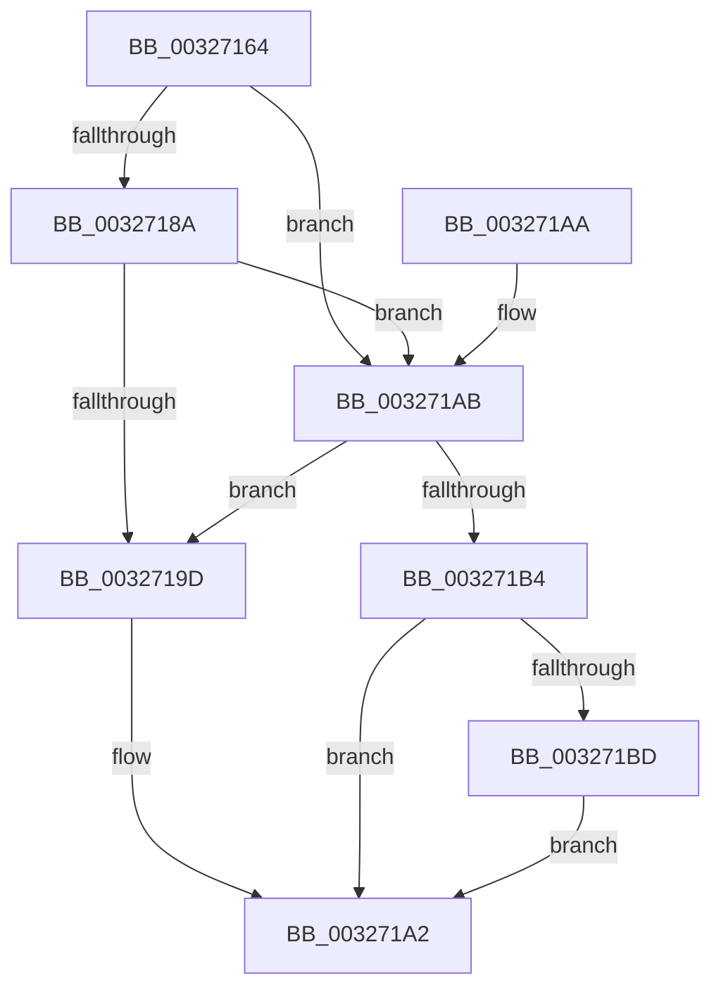

# RtlpHpSegHeapCheckCommitLimit

- RVA: `0x00327164`–`0x003271D5` (길이 `113` bytes)
- VA: `0x0000000140327164`
- 실행 섹션: `.text`
- PDB 이름 있음: `예`; PDB Function 태그: `아니요`
- unwind 정보 RVA: `0x00075D74`
- 디코드: `33`개 명령, `113/113` bytes 표시
- 미해석 바이트: `0` (있으면 어셈블리에 `.byte`로 보존)

> 이 문서는 커널 이미지의 기계어와 PDB 기호를 분석해 생성했습니다. 4번과 5번은 함수 원형과 자료형을 바이너리 사용 방식에서 추정한 C 해석이며 원본 소스 복구 결과는 아닙니다.

## 1. Dependencies

- 직접 호출 지점: **1**; 고유 호출 대상: **1**
- 직접 호출자로 확인된 함수: **2**
- RIP 상대 이미지 참조: **1**

### Outgoing calls
- `0x003271CE` → [RtlpLogHeapFailure](../35/RtlpLogHeapFailure_function_0035B7BC.md) (function, `0x0035B7BC`)

### Direct callers
- [RtlpHpLargeAlloc](../2E/RtlpHpLargeAlloc_function_002EBD5C.md) at `0x002EBF32`
- [RtlpHpSegMgrCommit](RtlpHpSegMgrCommit_function_00326BE4.md) at `0x00326C47`

### Static image references
- `0x0032718A` → RVA `0x00E28318` (`.data`; read)

## 2. Other-region calls and transfers

- 다른 실행 섹션으로 향하는 call: **0**
- 별도 외부 분기/꼬리 이동을 확인하지 못했습니다.

## 3. Assembly (complete function range)

```asm
00327164  40 53                           push rbx
00327166  48 83 EC 30                     sub rsp, 0x30
0032716A  4C 8B 82 88 00 00 00            mov r8, qword ptr [rdx + 0x88]
00327171  4C 8D 4A 20                     lea r9, [rdx + 0x20]
00327175  4C 8B 52 60                     mov r10, qword ptr [rdx + 0x60]
00327179  33 DB                           xor ebx, ebx
0032717B  4D 03 D0                        add r10, r8
0032717E  4D 8B 01                        mov r8, qword ptr [r9]
00327181  49 C1 E2 0C                     shl r10, 0xc
00327185  4D 85 C0                        test r8, r8
00327188  75 21                           jne 0x1403271ab
0032718A  4C 8B 05 87 11 B0 00            mov r8, qword ptr [rip + 0xb01187]
00327191  4C 8D 0D 80 11 B0 00            lea r9, [rip + 0xb01180]
00327198  4D 85 C0                        test r8, r8
0032719B  75 0E                           jne 0x1403271ab
0032719D  BB 01 00 00 00                  mov ebx, 1
003271A2  8B C3                           mov eax, ebx
003271A4  48 83 C4 30                     add rsp, 0x30
003271A8  5B                              pop rbx
003271A9  C3                              ret
003271AA  CC                              int3
003271AB  49 8D 04 0A                     lea rax, [r10 + rcx]
003271AF  49 3B C0                        cmp rax, r8
003271B2  76 E9                           jbe 0x14032719d
003271B4  4D 8B 49 08                     mov r9, qword ptr [r9 + 8]
003271B8  4D 85 C9                        test r9, r9
003271BB  74 E5                           je 0x1403271a2
003271BD  45 33 C0                        xor r8d, r8d
003271C0  4C 89 54 24 28                  mov qword ptr [rsp + 0x28], r10
003271C5  48 89 4C 24 20                  mov qword ptr [rsp + 0x20], rcx
003271CA  41 8D 48 15                     lea ecx, [r8 + 0x15]
003271CE  E8 E9 45 03 00                  call 0x14035b7bc
003271D3  EB CD                           jmp 0x1403271a2
```

## 4. C-style interpretation (structured pseudocode)

```c
__int64 __fastcall RtlpHpSegHeapCheckCommitLimit(__int64 a1, __int64 a2)
{
    __int64 result;
    __int64 v_r10;
    __int64 v_rbx;
    __int64 v_rsp;
    unsigned __int64 v_stack_p20;
    unsigned __int64 v_stack_p28;

    v_rsp = (v_rsp) - (48);
    v_rbx = 0;
    v_r10 = (*(unsigned __int64 *)(a2 + 96)) + (*(unsigned __int64 *)(a2 + 136));
    v_r10 = (v_r10) << (12);
    if (*(unsigned __int64 *)(a2 + 32) != 0) goto loc_003271AB;
    if (*(unsigned __int64 *)(v_rip + 11538823) != 0) goto loc_003271AB;
loc_0032719D:
loc_003271A2:
    v_rsp = (v_rsp) + (48);
    return 1;
loc_003271AB:
    if ((v_r10 + a1 * 1) <= (*(unsigned __int64 *)(v_rip + 11538823))) goto loc_0032719D;
    if (*(unsigned __int64 *)(v_rip + 11538816 + 8) == 0) goto loc_003271A2;
    a3 = 0;
    v_stack_p28 = v_r10;
    v_stack_p20 = a1;
    result = RtlpLogHeapFailure(a3 + 21, a2, a3, *(unsigned __int64 *)(v_rip + 11538816 + 8));
    goto loc_003271A2;
}
```

## 5. (Beta) C Style

```c
int64_t RtlpHpSegHeapCheckCommitLimit(int64_t Arg1, void *Arg2)
{
    uint8_t *arg2 = (uint8_t *)Arg2;

    int64_t result;
    int64_t local_r10;
    int64_t local_rbx;
    int64_t local_rsp;
    uint64_t v_stack_p20;
    uint64_t v_stack_p28;

    local_rsp = (local_rsp) - (48);
    local_rbx = 0;
    local_r10 = (*(uint64_t *)(arg2 + 0x60)) + (*(uint64_t *)(arg2 + 0x88));
    local_r10 = (local_r10) << (12);
    if (*(uint64_t *)(arg2 + 0x20) != 0) goto loc_003271AB;
    if (*(uint64_t *)(v_rip + 0xB01187) != 0) goto loc_003271AB;
loc_0032719D:
loc_003271A2:
    local_rsp = (local_rsp) + (48);
    return 1;
loc_003271AB:
    if ((local_r10 + Arg1 * 1) <= (*(uint64_t *)(v_rip + 0xB01187))) goto loc_0032719D;
    if (*(uint64_t *)(v_rip + 0xB01180 + 0x8) == 0) goto loc_003271A2;
    a3 = 0;
    v_stack_p28 = local_r10;
    v_stack_p20 = Arg1;
    result = RtlpLogHeapFailure(a3 + 21, Arg2, a3, *(uint64_t *)(v_rip + 0xB01180 + 0x8));
    goto loc_003271A2;
}
```

### 관측된 메모리 오프셋

구조체 형식이 확인되지 않은 접근은 인자 기준의 오프셋으로만 기록했습니다.

| 기준 인자 | 오프셋 표현 | 폭 (bit) | 접근 |
|---|---:|---:|---|
| `Arg2` | `+ 0x0` | `64` | `R` |
| `Arg2` | `+ 0x20` | `64` | `R` |
| `Arg2` | `+ 0x60` | `64` | `R` |
| `Arg2` | `+ 0x88` | `64` | `R` |

## 6. Execution-region graph

[열기: 2D/3D 그래프와 함수 탐색 컨트롤 패널](../../../control-panel.html?section=text&rva=0x00327164&view=graph)

- 2D 그래프는 위에서 아래로 흐르고, 3D 그래프는 빈 공간을 드래그해 회전합니다. Shift+드래그는 이동, 휠은 확대·축소, 함수 노드 선택은 대상 보고서 이동입니다.

### Static fallback


