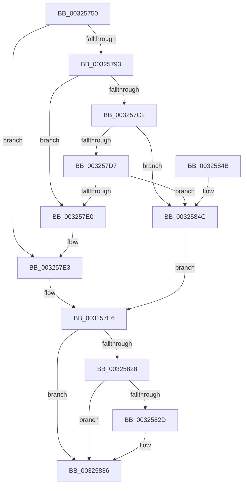

# RtlpHpSegLfhVsCommit

- RVA: `0x00325750`–`0x00325851` (길이 `257` bytes)
- VA: `0x0000000140325750`
- 실행 섹션: `.text`
- PDB 이름 있음: `예`; PDB Function 태그: `아니요`
- unwind 정보 RVA: `0x00075BE0`
- 디코드: `80`개 명령, `257/257` bytes 표시
- 미해석 바이트: `0` (있으면 어셈블리에 `.byte`로 보존)

> 이 문서는 커널 이미지의 기계어와 PDB 기호를 분석해 생성했습니다. 4번과 5번은 함수 원형과 자료형을 바이너리 사용 방식에서 추정한 C 해석이며 원본 소스 복구 결과는 아닙니다.

## 1. Dependencies

- 직접 호출 지점: **1**; 고유 호출 대상: **1**
- 직접 호출자로 확인된 함수: **6**
- RIP 상대 이미지 참조: **1**

### Outgoing calls
- `0x0032581F` → [RtlpHpSegPageRangeCommit](RtlpHpSegPageRangeCommit_function_00325D0C.md) (function, `0x00325D0C`)

### Direct callers
- [RtlpHpVsChunkSplit](../2E/RtlpHpVsChunkSplit_function_002E5C80.md) at `0x002E6916`
- [RtlpHpVsSubsegmentCommitPages](../2E/RtlpHpVsSubsegmentCommitPages_function_002E6C74.md) at `0x002E6D1F`
- [RtlpHpLfhSubsegmentCommitBlock](../2E/RtlpHpLfhSubsegmentCommitBlock_function_002EA630.md) at `0x002EA846`
- [RtlpHpVsSubsegmentCreate](../2E/RtlpHpVsSubsegmentCreate_function_002EAE30.md) at `0x002EAF04`
- [RtlpHpLfhSubsegmentCreate](../2E/RtlpHpLfhSubsegmentCreate_function_002EC5A0.md) at `0x002EC6EE`
- [RtlpHpLfhSubsegmentReformatAsSingle](../46/RtlpHpLfhSubsegmentReformatAsSingle_function_00461D88.md) at `0x00461E60`

### Static image references
- `0x00325784` → RVA `0x00E28300` (`.data`; read)

## 2. Other-region calls and transfers

- 다른 실행 섹션으로 향하는 call: **0**
- 별도 외부 분기/꼬리 이동을 확인하지 못했습니다.

## 3. Assembly (complete function range)

```asm
00325750  48 8B C4                        mov rax, rsp
00325753  48 89 58 08                     mov qword ptr [rax + 8], rbx
00325757  48 89 68 10                     mov qword ptr [rax + 0x10], rbp
0032575B  48 89 70 20                     mov qword ptr [rax + 0x20], rsi
0032575F  57                              push rdi
00325760  48 83 EC 30                     sub rsp, 0x30
00325764  83 60 18 00                     and dword ptr [rax + 0x18], 0
00325768  41 8B E8                        mov ebp, r8d
0032576B  48 8B 31                        mov rsi, qword ptr [rcx]
0032576E  49 8B F9                        mov rdi, r9
00325771  4C 8B DE                        mov r11, rsi
00325774  48 8B D9                        mov rbx, rcx
00325777  4C 23 DA                        and r11, rdx
0032577A  41 B8 08 00 00 00               mov r8d, 8
00325780  49 8B 43 10                     mov rax, qword ptr [r11 + 0x10]
00325784  48 33 05 75 2B B0 00            xor rax, qword ptr [rip + 0xb02b75]
0032578B  49 33 C3                        xor rax, r11
0032578E  48 3B C1                        cmp rax, rcx
00325791  75 50                           jne 0x1403257e3
00325793  8A 49 08                        mov cl, byte ptr [rcx + 8]
00325796  44 8B D2                        mov r10d, edx
00325799  45 2B D3                        sub r10d, r11d
0032579C  49 D3 EA                        shr r10, cl
0032579F  49 C1 E2 05                     shl r10, 5
003257A3  4D 03 D3                        add r10, r11
003257A6  41 0F B6 42 1A                  movzx eax, byte ptr [r10 + 0x1a]
003257AB  48 F7 D8                        neg rax
003257AE  48 C1 E0 05                     shl rax, 5
003257B2  4C 03 D0                        add r10, rax
003257B5  45 8A 4A 18                     mov r9b, byte ptr [r10 + 0x18]
003257B9  41 8A C1                        mov al, r9b
003257BC  24 03                           and al, 3
003257BE  3C 03                           cmp al, 3
003257C0  75 1E                           jne 0x1403257e0
003257C2  49 8B C2                        mov rax, r10
003257C5  49 2B C3                        sub rax, r11
003257C8  48 C1 F8 05                     sar rax, 5
003257CC  48 D3 E0                        shl rax, cl
003257CF  49 03 C3                        add rax, r11
003257D2  48 3B C2                        cmp rax, rdx
003257D5  74 75                           je 0x14032584c
003257D7  41 80 E1 0C                     and r9b, 0xc
003257DB  45 3A C8                        cmp r9b, r8b
003257DE  73 6C                           jae 0x14032584c
003257E0  48 8B CB                        mov rcx, rbx
003257E3  45 33 D2                        xor r10d, r10d
003257E6  41 8A 0C 08                     mov cl, byte ptr [r8 + rcx]
003257EA  49 23 F2                        and rsi, r10
003257ED  49 8B C2                        mov rax, r10
003257F0  C1 ED 0C                        shr ebp, 0xc
003257F3  48 2B C6                        sub rax, rsi
003257F6  44 8B CD                        mov r9d, ebp
003257F9  48 C1 F8 05                     sar rax, 5
003257FD  48 D3 E0                        shl rax, cl
00325800  48 8B CB                        mov rcx, rbx
00325803  2B D0                           sub edx, eax
00325805  48 8D 44 24 50                  lea rax, [rsp + 0x50]
0032580A  2B D6                           sub edx, esi
0032580C  48 89 44 24 28                  mov qword ptr [rsp + 0x28], rax
00325811  83 64 24 20 00                  and dword ptr [rsp + 0x20], 0
00325816  C1 EA 0C                        shr edx, 0xc
00325819  44 8B C2                        mov r8d, edx
0032581C  49 8B D2                        mov rdx, r10
0032581F  E8 E8 04 00 00                  call 0x140325d0c
00325824  85 C0                           test eax, eax
00325826  78 0E                           js 0x140325836
00325828  48 85 FF                        test rdi, rdi
0032582B  74 09                           je 0x140325836
0032582D  8B 4C 24 50                     mov ecx, dword ptr [rsp + 0x50]
00325831  C1 E1 0C                        shl ecx, 0xc
00325834  89 0F                           mov dword ptr [rdi], ecx
00325836  48 8B 5C 24 40                  mov rbx, qword ptr [rsp + 0x40]
0032583B  48 8B 6C 24 48                  mov rbp, qword ptr [rsp + 0x48]
00325840  48 8B 74 24 58                  mov rsi, qword ptr [rsp + 0x58]
00325845  48 83 C4 30                     add rsp, 0x30
00325849  5F                              pop rdi
0032584A  C3                              ret
0032584B  CC                              int3
0032584C  48 8B CB                        mov rcx, rbx
0032584F  EB 95                           jmp 0x1403257e6
```

## 4. C-style interpretation (structured pseudocode)

```c
__int64 __fastcall RtlpHpSegLfhVsCommit(__int64 a1, __int64 a2, int a3, __int64 a4)
{
    __int64 result;
    __int64 v_r10;
    __int64 v_r11;
    __int64 v_rbp;
    __int64 v_rsi;
    __int64 v_rsp;
    unsigned __int64 v_stack_m10;
    unsigned int v_stack_m18;
    unsigned __int64 v_stack_p10;
    unsigned __int64 v_stack_p18;
    unsigned __int64 v_stack_p20;
    unsigned __int64 v_stack_p8;

    *(unsigned __int64 *)(v_rsp + 8) = v_rbx;
    *(unsigned __int64 *)(v_rsp + 16) = v_rbp;
    *(unsigned __int64 *)(v_rsp + 32) = v_rsi;
    v_rsp = (v_rsp) - (48);
    v_r11 = (*(unsigned __int64 *)(a1)) & (a2);
    result = (*(unsigned __int64 *)(v_r11 + 16)) ^ (*(unsigned __int64 *)(v_rip + 11545461));
    result = (result) ^ (v_r11);
    if (result != a1) goto loc_003257E3;
    v_r10 = (unsigned int)(((unsigned int)((unsigned int)(a2))) - ((unsigned int)(v_r11)));
    v_r10 = (v_r10) >> ((unsigned __int8)(*(unsigned __int8 *)(a1 + 8)));
    v_r10 = (v_r10) << (5);
    v_r10 = (v_r10) + (v_r11);
    result = -(*(unsigned __int8 *)(v_r10 + 26));
    result = (result) << (5);
    v_r10 = (v_r10) + (result);
    result = (unsigned __int8)(((unsigned __int8)(*(unsigned __int8 *)(v_r10 + 24))) & (3));
    if (((unsigned __int8)(result)) != 3) goto loc_003257E0;
    result = (v_r10) - (v_r11);
    result = (result) >> (5);
    result = (result) << ((unsigned __int8)(*(unsigned __int8 *)(a1 + 8)));
    result = (result) + (v_r11);
    if (result == a2) goto loc_0032584C;
    a4 = (unsigned __int8)((*(unsigned __int8 *)(v_r10 + 24)) & (12));
    if (((unsigned __int8)(a4)) >= 8) goto loc_0032584C;
loc_003257E0:
loc_003257E3:
    v_r10 = 0;
loc_003257E6:
    v_rsi = (*(unsigned __int64 *)(a1)) & (0);
    v_rbp = (unsigned int)(((unsigned int)(a3)) >> (12));
    result = (0) - (v_rsi);
    result = (result) >> (5);
    result = (result) << ((unsigned __int8)(*(unsigned __int8 *)(8 + a1 * 1)));
    a2 = (unsigned int)((a2) - ((unsigned int)(result)));
    a2 = (unsigned int)((a2) - ((unsigned int)(v_rsi)));
    v_stack_m10 = v_stack_p18;
    a2 = (unsigned int)((a2) >> (12));
    result = RtlpHpSegPageRangeCommit(a1, 0, (unsigned int)((unsigned int)(a2)), (unsigned int)((unsigned int)(v_rbp)));
    if (sign_flag) goto loc_00325836;
    if (a4 != 0) {
        a1 = v_stack_p18;
        a1 = (unsigned int)((a1) << (12));
        *(unsigned int *)(a4) = (unsigned int)(a1);
    }
    v_rsp = (v_rsp) + (48);
    return result;
loc_0032584C:
    goto loc_003257E6;
}
```

## 5. (Beta) C Style

```c
int64_t RtlpHpSegLfhVsCommit(void *Arg1, int64_t Arg2, int32_t Arg3, int64_t Arg4)
{
    uint8_t *arg1 = (uint8_t *)Arg1;

    int64_t result;
    int64_t local_r10;
    int64_t local_r11;
    int64_t local_rbp;
    int64_t local_rsi;
    int64_t local_rsp;
    uint64_t v_stack_m10;
    uint32_t v_stack_m18;
    uint64_t v_stack_p10;
    uint64_t v_stack_p18;
    uint64_t v_stack_p20;
    uint64_t v_stack_p8;

    *(uint64_t *)(local_rsp + 0x8) = local_rbx;
    *(uint64_t *)(local_rsp + 0x10) = local_rbp;
    *(uint64_t *)(local_rsp + 0x20) = local_rsi;
    local_rsp = (local_rsp) - (48);
    local_r11 = (*(uint64_t *)(arg1)) & (Arg2);
    result = (*(uint64_t *)(local_r11 + 0x10)) ^ (*(uint64_t *)(v_rip + 0xB02B75));
    result = (result) ^ (local_r11);
    if (result != Arg1) goto loc_003257E3;
    local_r10 = (uint32_t)(((uint32_t)((uint32_t)(Arg2))) - ((uint32_t)(local_r11)));
    local_r10 = (local_r10) >> ((uint8_t)(*(uint8_t *)(arg1 + 0x8)));
    local_r10 = (local_r10) << (5);
    local_r10 = (local_r10) + (local_r11);
    result = -(*(uint8_t *)(local_r10 + 0x1A));
    result = (result) << (5);
    local_r10 = (local_r10) + (result);
    result = (uint8_t)(((uint8_t)(*(uint8_t *)(local_r10 + 0x18))) & (3));
    if (((uint8_t)(result)) != 3) goto loc_003257E0;
    result = (local_r10) - (local_r11);
    result = (result) >> (5);
    result = (result) << ((uint8_t)(*(uint8_t *)(arg1 + 0x8)));
    result = (result) + (local_r11);
    if (result == Arg2) goto loc_0032584C;
    Arg4 = (uint8_t)((*(uint8_t *)(local_r10 + 0x18)) & (12));
    if (((uint8_t)(Arg4)) >= 8) goto loc_0032584C;
loc_003257E0:
loc_003257E3:
    local_r10 = 0;
loc_003257E6:
    local_rsi = (*(uint64_t *)(arg1)) & (0);
    local_rbp = (uint32_t)(((uint32_t)(Arg3)) >> (12));
    result = (0) - (local_rsi);
    result = (result) >> (5);
    result = (result) << ((uint8_t)(*(uint8_t *)(8 + arg1 * 1)));
    Arg2 = (uint32_t)((Arg2) - ((uint32_t)(result)));
    Arg2 = (uint32_t)((Arg2) - ((uint32_t)(local_rsi)));
    v_stack_m10 = v_stack_p18;
    Arg2 = (uint32_t)((Arg2) >> (12));
    result = RtlpHpSegPageRangeCommit(Arg1, 0, (uint32_t)((uint32_t)(Arg2)), (uint32_t)((uint32_t)(local_rbp)));
    if (sign_flag) goto loc_00325836;
    if (Arg4 != 0) {
        Arg1 = v_stack_p18;
        Arg1 = (uint32_t)((Arg1) << (12));
        *(uint32_t *)(Arg4) = (uint32_t)(Arg1);
    }
    local_rsp = (local_rsp) + (48);
    return result;
loc_0032584C:
    goto loc_003257E6;
}
```

### 관측된 메모리 오프셋

구조체 형식이 확인되지 않은 접근은 인자 기준의 오프셋으로만 기록했습니다.

| 기준 인자 | 오프셋 표현 | 폭 (bit) | 접근 |
|---|---:|---:|---|
| `Arg1` | `+ 0x0` | `64` | `R` |
| `Arg1` | `+ 0x8` | `8` | `R` |

## 6. Execution-region graph

[열기: 2D/3D 그래프와 함수 탐색 컨트롤 패널](../../../control-panel.html?section=text&rva=0x00325750&view=graph)

- 2D 그래프는 위에서 아래로 흐르고, 3D 그래프는 빈 공간을 드래그해 회전합니다. Shift+드래그는 이동, 휠은 확대·축소, 함수 노드 선택은 대상 보고서 이동입니다.

### Static fallback


