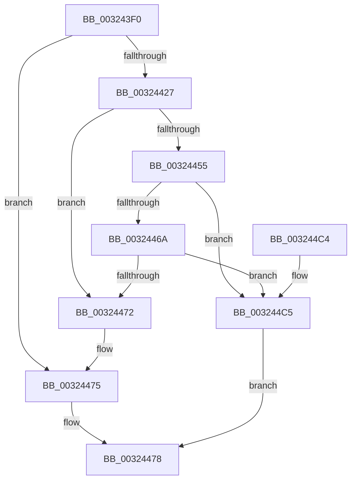

# RtlpHpSegLfhVsDecommit

- RVA: `0x003243F0`–`0x003244CA` (길이 `218` bytes)
- VA: `0x00000001403243F0`
- 실행 섹션: `.text`
- PDB 이름 있음: `예`; PDB Function 태그: `아니요`
- unwind 정보 RVA: `0x00075A84`
- 디코드: `68`개 명령, `218/218` bytes 표시
- 미해석 바이트: `0` (있으면 어셈블리에 `.byte`로 보존)

> 이 문서는 커널 이미지의 기계어와 PDB 기호를 분석해 생성했습니다. 4번과 5번은 함수 원형과 자료형을 바이너리 사용 방식에서 추정한 C 해석이며 원본 소스 복구 결과는 아닙니다.

## 1. Dependencies

- 직접 호출 지점: **1**; 고유 호출 대상: **1**
- 직접 호출자로 확인된 함수: **3**
- RIP 상대 이미지 참조: **1**

### Outgoing calls
- `0x003244AF` → [RtlpHpSegPageRangeCommit](RtlpHpSegPageRangeCommit_function_00325D0C.md) (function, `0x00325D0C`)

### Direct callers
- [RtlpHpVsSubsegmentCommitPages](../2E/RtlpHpVsSubsegmentCommitPages_function_002E6C74.md) at `0x002E6D80`
- [RtlpHpLfhOwnerListCompact](RtlpHpLfhOwnerListCompact_function_00323BA8.md) at `0x00323CB0`
- [RtlpHpLfhSubsegmentDelayFreeListProcess](RtlpHpLfhSubsegmentDelayFreeListProcess_function_00323CE0.md) at `0x003240C6`

### Static image references
- `0x00324418` → RVA `0x00E28300` (`.data`; read)

## 2. Other-region calls and transfers

- 다른 실행 섹션으로 향하는 call: **0**
- 별도 외부 분기/꼬리 이동을 확인하지 못했습니다.

## 3. Assembly (complete function range)

```asm
003243F0  48 89 5C 24 08                  mov qword ptr [rsp + 8], rbx
003243F5  48 89 74 24 10                  mov qword ptr [rsp + 0x10], rsi
003243FA  57                              push rdi
003243FB  48 83 EC 30                     sub rsp, 0x30
003243FF  48 8B 39                        mov rdi, qword ptr [rcx]
00324402  41 8B F0                        mov esi, r8d
00324405  4C 8B CF                        mov r9, rdi
00324408  4C 8B D9                        mov r11, rcx
0032440B  4C 23 CA                        and r9, rdx
0032440E  41 B8 08 00 00 00               mov r8d, 8
00324414  49 8B 41 10                     mov rax, qword ptr [r9 + 0x10]
00324418  48 33 05 E1 3E B0 00            xor rax, qword ptr [rip + 0xb03ee1]
0032441F  49 33 C1                        xor rax, r9
00324422  48 3B C1                        cmp rax, rcx
00324425  75 4E                           jne 0x140324475
00324427  8A 49 08                        mov cl, byte ptr [rcx + 8]
0032442A  44 8B D2                        mov r10d, edx
0032442D  45 2B D1                        sub r10d, r9d
00324430  49 D3 EA                        shr r10, cl
00324433  49 C1 E2 05                     shl r10, 5
00324437  4D 03 D1                        add r10, r9
0032443A  41 0F B6 42 1A                  movzx eax, byte ptr [r10 + 0x1a]
0032443F  48 F7 D8                        neg rax
00324442  48 C1 E0 05                     shl rax, 5
00324446  4C 03 D0                        add r10, rax
00324449  41 8A 5A 18                     mov bl, byte ptr [r10 + 0x18]
0032444D  8A C3                           mov al, bl
0032444F  24 03                           and al, 3
00324451  3C 03                           cmp al, 3
00324453  75 1D                           jne 0x140324472
00324455  49 8B C2                        mov rax, r10
00324458  49 2B C1                        sub rax, r9
0032445B  48 C1 F8 05                     sar rax, 5
0032445F  48 D3 E0                        shl rax, cl
00324462  49 03 C1                        add rax, r9
00324465  48 3B C2                        cmp rax, rdx
00324468  74 5B                           je 0x1403244c5
0032446A  80 E3 0C                        and bl, 0xc
0032446D  41 3A D8                        cmp bl, r8b
00324470  73 53                           jae 0x1403244c5
00324472  49 8B CB                        mov rcx, r11
00324475  45 33 D2                        xor r10d, r10d
00324478  41 8A 0C 08                     mov cl, byte ptr [r8 + rcx]
0032447C  49 23 FA                        and rdi, r10
0032447F  48 83 64 24 28 00               and qword ptr [rsp + 0x28], 0
00324485  49 8B C2                        mov rax, r10
00324488  83 64 24 20 00                  and dword ptr [rsp + 0x20], 0
0032448D  48 2B C7                        sub rax, rdi
00324490  48 C1 F8 05                     sar rax, 5
00324494  48 D3 E0                        shl rax, cl
00324497  49 8B CB                        mov rcx, r11
0032449A  2B D0                           sub edx, eax
0032449C  C1 EE 0C                        shr esi, 0xc
0032449F  2B D7                           sub edx, edi
003244A1  F7 DE                           neg esi
003244A3  C1 EA 0C                        shr edx, 0xc
003244A6  44 8B CE                        mov r9d, esi
003244A9  44 8B C2                        mov r8d, edx
003244AC  49 8B D2                        mov rdx, r10
003244AF  E8 58 18 00 00                  call 0x140325d0c
003244B4  48 8B 5C 24 40                  mov rbx, qword ptr [rsp + 0x40]
003244B9  48 8B 74 24 48                  mov rsi, qword ptr [rsp + 0x48]
003244BE  48 83 C4 30                     add rsp, 0x30
003244C2  5F                              pop rdi
003244C3  C3                              ret
003244C4  CC                              int3
003244C5  49 8B CB                        mov rcx, r11
003244C8  EB AE                           jmp 0x140324478
```

## 4. C-style interpretation (structured pseudocode)

```c
__int64 __fastcall RtlpHpSegLfhVsDecommit(__int64 a1, __int64 a2, int a3)
{
    __int64 result;
    __int64 v_r10;
    __int64 v_rbx;
    __int64 v_rdi;
    __int64 v_rsi;
    __int64 v_rsp;
    unsigned __int64 v_stack_m10;
    unsigned int v_stack_m18;
    unsigned __int64 v_stack_p10;
    unsigned __int64 v_stack_p8;

    v_stack_p8 = v_rbx;
    v_stack_p10 = v_rsi;
    v_rsp = (v_rsp) - (48);
    a4 = (*(unsigned __int64 *)(a1)) & (a2);
    result = (*(unsigned __int64 *)(a4 + 16)) ^ (*(unsigned __int64 *)(v_rip + 11550433));
    result = (result) ^ (a4);
    if (result != a1) goto loc_00324475;
    v_r10 = (unsigned int)(((unsigned int)((unsigned int)(a2))) - ((unsigned int)(a4)));
    v_r10 = (v_r10) >> ((unsigned __int8)(*(unsigned __int8 *)(a1 + 8)));
    v_r10 = (v_r10) << (5);
    v_r10 = (v_r10) + (a4);
    result = -(*(unsigned __int8 *)(v_r10 + 26));
    result = (result) << (5);
    v_r10 = (v_r10) + (result);
    result = (unsigned __int8)(((unsigned __int8)(*(unsigned __int8 *)(v_r10 + 24))) & (3));
    if (((unsigned __int8)(result)) != 3) goto loc_00324472;
    result = (v_r10) - (a4);
    result = (result) >> (5);
    result = (result) << ((unsigned __int8)(*(unsigned __int8 *)(a1 + 8)));
    result = (result) + (a4);
    if (result == a2) goto loc_003244C5;
    v_rbx = (unsigned __int8)((*(unsigned __int8 *)(v_r10 + 24)) & (12));
    if (((unsigned __int8)(v_rbx)) >= 8) goto loc_003244C5;
loc_00324472:
loc_00324475:
    v_r10 = 0;
loc_00324478:
    v_rdi = (*(unsigned __int64 *)(a1)) & (0);
    result = (0) - (v_rdi);
    result = (result) >> (5);
    result = (result) << ((unsigned __int8)(*(unsigned __int8 *)(8 + a1 * 1)));
    a2 = (unsigned int)((a2) - ((unsigned int)(result)));
    v_rsi = (unsigned int)(((unsigned int)(a3)) >> (12));
    a2 = (unsigned int)((a2) - ((unsigned int)(v_rdi)));
    v_rsi = (unsigned int)(-(v_rsi));
    a2 = (unsigned int)((a2) >> (12));
    result = RtlpHpSegPageRangeCommit(a1, 0, (unsigned int)((unsigned int)(a2)), (unsigned int)((unsigned int)(v_rsi)));
    v_rsp = (v_rsp) + (48);
    return result;
loc_003244C5:
    goto loc_00324478;
}
```

## 5. (Beta) C Style

```c
int64_t RtlpHpSegLfhVsDecommit(void *Arg1, int64_t Arg2, int32_t Arg3)
{
    uint8_t *arg1 = (uint8_t *)Arg1;

    int64_t result;
    int64_t local_r10;
    int64_t local_rbx;
    int64_t local_rdi;
    int64_t local_rsi;
    int64_t local_rsp;
    uint64_t v_stack_m10;
    uint32_t v_stack_m18;
    uint64_t v_stack_p10;
    uint64_t v_stack_p8;

    v_stack_p8 = local_rbx;
    v_stack_p10 = local_rsi;
    local_rsp = (local_rsp) - (48);
    a4 = (*(uint64_t *)(arg1)) & (Arg2);
    result = (*(uint64_t *)(a4 + 0x10)) ^ (*(uint64_t *)(v_rip + 0xB03EE1));
    result = (result) ^ (a4);
    if (result != Arg1) goto loc_00324475;
    local_r10 = (uint32_t)(((uint32_t)((uint32_t)(Arg2))) - ((uint32_t)(a4)));
    local_r10 = (local_r10) >> ((uint8_t)(*(uint8_t *)(arg1 + 0x8)));
    local_r10 = (local_r10) << (5);
    local_r10 = (local_r10) + (a4);
    result = -(*(uint8_t *)(local_r10 + 0x1A));
    result = (result) << (5);
    local_r10 = (local_r10) + (result);
    result = (uint8_t)(((uint8_t)(*(uint8_t *)(local_r10 + 0x18))) & (3));
    if (((uint8_t)(result)) != 3) goto loc_00324472;
    result = (local_r10) - (a4);
    result = (result) >> (5);
    result = (result) << ((uint8_t)(*(uint8_t *)(arg1 + 0x8)));
    result = (result) + (a4);
    if (result == Arg2) goto loc_003244C5;
    local_rbx = (uint8_t)((*(uint8_t *)(local_r10 + 0x18)) & (12));
    if (((uint8_t)(local_rbx)) >= 8) goto loc_003244C5;
loc_00324472:
loc_00324475:
    local_r10 = 0;
loc_00324478:
    local_rdi = (*(uint64_t *)(arg1)) & (0);
    result = (0) - (local_rdi);
    result = (result) >> (5);
    result = (result) << ((uint8_t)(*(uint8_t *)(8 + arg1 * 1)));
    Arg2 = (uint32_t)((Arg2) - ((uint32_t)(result)));
    local_rsi = (uint32_t)(((uint32_t)(Arg3)) >> (12));
    Arg2 = (uint32_t)((Arg2) - ((uint32_t)(local_rdi)));
    local_rsi = (uint32_t)(-(local_rsi));
    Arg2 = (uint32_t)((Arg2) >> (12));
    result = RtlpHpSegPageRangeCommit(Arg1, 0, (uint32_t)((uint32_t)(Arg2)), (uint32_t)((uint32_t)(local_rsi)));
    local_rsp = (local_rsp) + (48);
    return result;
loc_003244C5:
    goto loc_00324478;
}
```

### 관측된 메모리 오프셋

구조체 형식이 확인되지 않은 접근은 인자 기준의 오프셋으로만 기록했습니다.

| 기준 인자 | 오프셋 표현 | 폭 (bit) | 접근 |
|---|---:|---:|---|
| `Arg1` | `+ 0x0` | `64` | `R` |
| `Arg1` | `+ 0x8` | `8` | `R` |

## 6. Execution-region graph

[열기: 2D/3D 그래프와 함수 탐색 컨트롤 패널](../../../control-panel.html?section=text&rva=0x003243F0&view=graph)

- 2D 그래프는 위에서 아래로 흐르고, 3D 그래프는 빈 공간을 드래그해 회전합니다. Shift+드래그는 이동, 휠은 확대·축소, 함수 노드 선택은 대상 보고서 이동입니다.

### Static fallback


