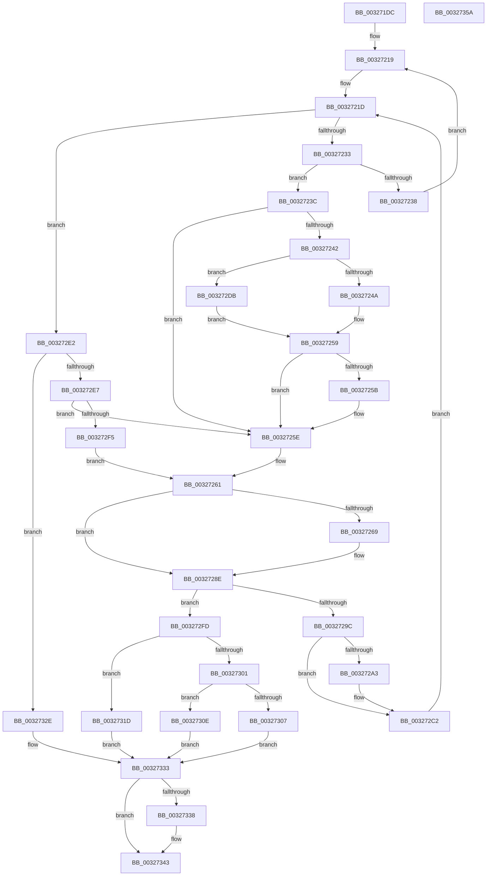

# RtlpHpSegMgrCommitInitiate

- RVA: `0x003271DC`–`0x0032735B` (길이 `383` bytes)
- VA: `0x00000001403271DC`
- 실행 섹션: `.text`
- PDB 이름 있음: `예`; PDB Function 태그: `아니요`
- unwind 정보 RVA: `0x00075D80`
- 디코드: `116`개 명령, `383/383` bytes 표시
- 미해석 바이트: `0` (있으면 어셈블리에 `.byte`로 보존)

> 이 문서는 커널 이미지의 기계어와 PDB 기호를 분석해 생성했습니다. 4번과 5번은 함수 원형과 자료형을 바이너리 사용 방식에서 추정한 C 해석이며 원본 소스 복구 결과는 아닙니다.

## 1. Dependencies

- 직접 호출 지점: **3**; 고유 호출 대상: **3**
- 직접 호출자로 확인된 함수: **1**
- RIP 상대 이미지 참조: **0**

### Outgoing calls
- `0x0032724D` → [RtlpHpSegMgrApplyLargePagePolicy](../48/RtlpHpSegMgrApplyLargePagePolicy_function_0048C6BC.md) (function, `0x0048C6BC`)
- `0x00327281` → [RtlpHpAcquireLockExclusive](RtlpHpAcquireLockExclusive_function_003246B0.md) (function, `0x003246B0`)
- `0x003272B8` → [RtlpHpReleaseLockExclusive](RtlpHpReleaseLockExclusive_function_00324230.md) (function, `0x00324230`)

### Direct callers
- [RtlpHpSegMgrCommit](RtlpHpSegMgrCommit_function_00326BE4.md) at `0x00326CF8`

### Static image references
- 디코드된 RIP-relative 메모리 참조가 없습니다.

## 2. Other-region calls and transfers

- 다른 실행 섹션으로 향하는 call: **0**
- 별도 외부 분기/꼬리 이동을 확인하지 못했습니다.

## 3. Assembly (complete function range)

```asm
003271DC  48 89 5C 24 10                  mov qword ptr [rsp + 0x10], rbx
003271E1  44 89 4C 24 20                  mov dword ptr [rsp + 0x20], r9d
003271E6  48 89 4C 24 08                  mov qword ptr [rsp + 8], rcx
003271EB  55                              push rbp
003271EC  56                              push rsi
003271ED  57                              push rdi
003271EE  41 54                           push r12
003271F0  41 55                           push r13
003271F2  41 56                           push r14
003271F4  41 57                           push r15
003271F6  48 83 EC 20                     sub rsp, 0x20
003271FA  4C 8B FA                        mov r15, rdx
003271FD  41 8B E8                        mov ebp, r8d
00327200  33 D2                           xor edx, edx
00327202  4C 8B D9                        mov r11, rcx
00327205  44 8B F2                        mov r14d, edx
00327208  44 8A E2                        mov r12b, dl
0032720B  41 8B C1                        mov eax, r9d
0032720E  B9 00 40 00 00                  mov ecx, 0x4000
00327213  41 B8 FF 07 00 00               mov r8d, 0x7ff
00327219  41 0F B7 3F                     movzx edi, word ptr [r15]
0032721D  66 89 7C 24 70                  mov word ptr [rsp + 0x70], di
00327222  44 0F B7 EF                     movzx r13d, di
00327226  0F B7 5C 24 70                  movzx ebx, word ptr [rsp + 0x70]
0032722B  85 ED                           test ebp, ebp
0032722D  0F 8E AF 00 00 00               jle 0x1403272e2
00327233  66 85 F9                        test cx, di
00327236  74 04                           je 0x14032723c
00327238  F3 90                           pause
0032723A  EB DD                           jmp 0x140327219
0032723C  66 41 85 F8                     test r8w, di
00327240  75 1C                           jne 0x14032725e
00327242  A8 03                           test al, 3
00327244  0F 85 91 00 00 00               jne 0x1403272db
0032724A  49 8B CB                        mov rcx, r11
0032724D  E8 6A 54 16 00                  call 0x14048c6bc
00327252  B9 00 40 00 00                  mov ecx, 0x4000
00327257  85 C0                           test eax, eax
00327259  74 03                           je 0x14032725e
0032725B  66 0B D9                        or bx, cx
0032725E  66 03 DD                        add bx, bp
00327261  0F B7 F3                        movzx esi, bx
00327264  66 23 F1                        and si, cx
00327267  74 25                           je 0x14032728e
00327269  41 8B 43 28                     mov eax, dword ptr [r11 + 0x28]
0032726D  41 BE 01 00 00 00               mov r14d, 1
00327273  48 8B 8C 24 80 00 00 00         mov rcx, qword ptr [rsp + 0x80]
0032727B  0F B6 D0                        movzx edx, al
0032727E  41 23 D6                        and edx, r14d
00327281  E8 2A D4 FF FF                  call 0x1403246b0
00327286  4C 8B 5C 24 60                  mov r11, qword ptr [rsp + 0x60]
0032728B  44 8A E0                        mov r12b, al
0032728E  0F B7 C7                        movzx eax, di
00327291  66 F0 41 0F B1 1F               lock cmpxchg word ptr [r15], bx
00327297  0F B7 F8                        movzx edi, ax
0032729A  74 61                           je 0x1403272fd
0032729C  33 D2                           xor edx, edx
0032729E  45 85 F6                        test r14d, r14d
003272A1  74 1F                           je 0x1403272c2
003272A3  41 8B 43 28                     mov eax, dword ptr [r11 + 0x28]
003272A7  45 8A C4                        mov r8b, r12b
003272AA  48 8B 8C 24 80 00 00 00         mov rcx, qword ptr [rsp + 0x80]
003272B2  0F B6 D0                        movzx edx, al
003272B5  83 E2 01                        and edx, 1
003272B8  E8 73 CF FF FF                  call 0x140324230
003272BD  33 D2                           xor edx, edx
003272BF  44 8B F2                        mov r14d, edx
003272C2  8B 44 24 78                     mov eax, dword ptr [rsp + 0x78]
003272C6  B9 00 40 00 00                  mov ecx, 0x4000
003272CB  4C 8B 5C 24 60                  mov r11, qword ptr [rsp + 0x60]
003272D0  41 B8 FF 07 00 00               mov r8d, 0x7ff
003272D6  E9 42 FF FF FF                  jmp 0x14032721d
003272DB  A8 02                           test al, 2
003272DD  E9 77 FF FF FF                  jmp 0x140327259
003272E2  66 85 FF                        test di, di
003272E5  79 47                           jns 0x14032732e
003272E7  0F B7 C7                        movzx eax, di
003272EA  41 23 C0                        and eax, r8d
003272ED  03 C5                           add eax, ebp
003272EF  0F 85 69 FF FF FF               jne 0x14032725e
003272F5  66 0B D9                        or bx, cx
003272F8  E9 64 FF FF FF                  jmp 0x140327261
003272FD  85 ED                           test ebp, ebp
003272FF  7E 1C                           jle 0x14032731d
00327301  66 45 85 ED                     test r13w, r13w
00327305  79 07                           jns 0x14032730e
00327307  BA 00 01 00 C0                  mov edx, 0xc0000100
0032730C  EB 25                           jmp 0x140327333
0032730E  66 F7 DE                        neg si
00327311  1B D2                           sbb edx, edx
00327313  F7 DA                           neg edx
00327315  81 C2 01 01 00 C0               add edx, 0xc0000101
0032731B  EB 16                           jmp 0x140327333
0032731D  66 F7 DE                        neg si
00327320  BA 00 01 00 C0                  mov edx, 0xc0000100
00327325  1B C0                           sbb eax, eax
00327327  83 E0 02                        and eax, 2
0032732A  03 D0                           add edx, eax
0032732C  EB 05                           jmp 0x140327333
0032732E  BA 01 01 00 C0                  mov edx, 0xc0000101
00327333  45 85 F6                        test r14d, r14d
00327336  74 0B                           je 0x140327343
00327338  48 8B 8C 24 88 00 00 00         mov rcx, qword ptr [rsp + 0x88]
00327340  44 88 21                        mov byte ptr [rcx], r12b
00327343  48 8B 5C 24 68                  mov rbx, qword ptr [rsp + 0x68]
00327348  8B C2                           mov eax, edx
0032734A  48 83 C4 20                     add rsp, 0x20
0032734E  41 5F                           pop r15
00327350  41 5E                           pop r14
00327352  41 5D                           pop r13
00327354  41 5C                           pop r12
00327356  5F                              pop rdi
00327357  5E                              pop rsi
00327358  5D                              pop rbp
00327359  C3                              ret
0032735A  CC                              int3
```

## 4. C-style interpretation (structured pseudocode)

```c
__int64 __fastcall RtlpHpSegMgrCommitInitiate(__int64 a1, __int64 a2, int a3, int a4, __int64 a5, __int64 a6)
{
    __int64 result;
    __int64 v_r11;
    __int64 v_r12;
    __int64 v_r14;
    __int64 v_rbx;
    __int64 v_rsi;
    __int64 v_rsp;
    unsigned __int64 v_stack_p10;
    unsigned __int16 v_stack_p18;
    unsigned int v_stack_p20;
    unsigned __int64 v_stack_p8;

    v_stack_p10 = v_rbx;
    v_stack_p20 = a4;
    v_stack_p8 = a1;
    v_rsp = (v_rsp) - (32);
    a2 = 0;
loc_00327219:
loc_0032721D:
    v_stack_p18 = (unsigned __int16)(*(unsigned __int16 *)(a2));
    if (condition_is_less_or_equal) goto loc_003272E2;
    if ((((unsigned __int16)((unsigned int)(0x4000ULL))) & ((unsigned __int16)(*(unsigned __int16 *)(a2)))) == 0) goto loc_0032723C;
    goto loc_00327219;
loc_0032723C:
    if ((((unsigned __int16)((unsigned int)(0x7FFULL))) & ((unsigned __int16)(*(unsigned __int16 *)(a2)))) != 0) goto loc_0032725E;
    if ((((unsigned __int8)((unsigned int)(a4))) & (3)) != 0) goto loc_003272DB;
    result = RtlpHpSegMgrApplyLargePagePolicy(a1, a2, (unsigned int)(0x7FFULL), a4);
loc_00327259:
    v_rbx = v_stack_p18;
    if ((unsigned int)(result) != 0) {
        v_rbx = (unsigned __int16)((v_stack_p18) | ((unsigned __int16)((unsigned int)(0x4000ULL))));
    }
    v_rbx = (unsigned __int16)((v_rbx) + ((unsigned __int16)((unsigned int)(a3))));
loc_00327261:
    v_rsi = (unsigned __int16)(((unsigned __int16)(v_rbx)) & ((unsigned __int16)((unsigned int)(0x4000ULL))));
    v_r11 = a1;
    v_r12 = 0;
    v_r14 = 0;
    if (!(condition_is_equal)) {
        result = *(unsigned int *)(a1 + 40);
        v_r14 = 1;
        a1 = a5;
        a2 = (unsigned __int8)(result);
        a2 = (unsigned int)((a2) & ((unsigned int)(v_r14)));
        result = RtlpHpAcquireLockExclusive(a1, a2, (unsigned int)(0x7FFULL), a4);
        v_r11 = v_stack_p8;
        v_r12 = (unsigned __int8)(result);
    }
    if (condition_is_equal) goto loc_003272FD;
    a2 = 0;
    result = (unsigned __int16)(*(unsigned __int16 *)(a2));
    if ((unsigned int)(v_r14) != 0) {
        result = *(unsigned int *)(v_r11 + 40);
        a3 = (unsigned __int8)(v_r12);
        a1 = a5;
        a2 = (unsigned __int8)(result);
        a2 = (unsigned int)((a2) & (1));
        result = RtlpHpReleaseLockExclusive(a1, a2, a3, a4);
        a2 = 0;
        v_r14 = 0;
    }
    goto loc_0032721D;
loc_003272DB:
    goto loc_00327259;
loc_003272E2:
    if (!sign_flag) goto loc_0032732E;
    result = (unsigned int)(((unsigned __int16)((unsigned __int16)((unsigned __int16)(*(unsigned __int16 *)(a2))))) & ((unsigned int)((unsigned int)(0x7FFULL))));
    result = (unsigned int)((result) + ((unsigned int)((unsigned int)(a3))));
    if (condition_is_not_equal) goto loc_0032725E;
    v_rbx = (unsigned __int16)((v_rbx) | ((unsigned __int16)((unsigned int)(0x4000ULL))));
    goto loc_00327261;
loc_003272FD:
    if (condition_is_less_or_equal) goto loc_0032731D;
    if (!sign_flag) goto loc_0032730E;
    goto loc_00327333;
loc_0032730E:
    v_rsi = (unsigned __int16)(-(v_rsi));
    a2 = (unsigned int)(-((unsigned int)(0xC0000100ULL)));
    a2 = (unsigned int)((a2) + (0xC0000101ULL));
    goto loc_00327333;
loc_0032731D:
    v_rsi = (unsigned __int16)(-(v_rsi));
    result = (unsigned int)((result) & (2));
    a2 = (unsigned int)(((unsigned int)(0xC0000100ULL)) + ((unsigned int)(result)));
    goto loc_00327333;
loc_0032732E:
loc_00327333:
    if ((unsigned int)(v_r14) != 0) {
        a1 = a6;
        *(unsigned __int8 *)(a1) = (unsigned __int8)(v_r12);
    }
    v_rsp = (v_rsp) + (32);
    return (unsigned int)((unsigned int)((unsigned int)(0xC0000101ULL)));
}
```

## 5. (Beta) C Style

```c
int64_t RtlpHpSegMgrCommitInitiate(int64_t Arg1, void *Arg2, int32_t Arg3, int32_t Arg4, int64_t Arg5, void *Arg6)
{
    uint8_t *arg2 = (uint8_t *)Arg2;
    uint8_t *arg6 = (uint8_t *)Arg6;

    int64_t result;
    int64_t local_r11;
    int64_t local_r12;
    int64_t local_r14;
    int64_t local_rbx;
    int64_t local_rsi;
    int64_t local_rsp;
    uint64_t v_stack_p10;
    uint16_t v_stack_p18;
    uint32_t v_stack_p20;
    uint64_t v_stack_p8;

    v_stack_p10 = local_rbx;
    v_stack_p20 = Arg4;
    v_stack_p8 = Arg1;
    local_rsp = (local_rsp) - (32);
    Arg2 = 0;
loc_00327219:
loc_0032721D:
    v_stack_p18 = (uint16_t)(*(uint16_t *)(arg2));
    if (condition_is_less_or_equal) goto loc_003272E2;
    if ((((uint16_t)((uint32_t)(0x4000ULL))) & ((uint16_t)(*(uint16_t *)(arg2)))) == 0) goto loc_0032723C;
    goto loc_00327219;
loc_0032723C:
    if ((((uint16_t)((uint32_t)(0x7FFULL))) & ((uint16_t)(*(uint16_t *)(arg2)))) != 0) goto loc_0032725E;
    if ((((uint8_t)((uint32_t)(Arg4))) & (3)) != 0) goto loc_003272DB;
    result = RtlpHpSegMgrApplyLargePagePolicy(Arg1, Arg2, (uint32_t)(0x7FFULL), Arg4);
loc_00327259:
    local_rbx = v_stack_p18;
    if ((uint32_t)(result) != 0) {
        local_rbx = (uint16_t)((v_stack_p18) | ((uint16_t)((uint32_t)(0x4000ULL))));
    }
    local_rbx = (uint16_t)((local_rbx) + ((uint16_t)((uint32_t)(Arg3))));
loc_00327261:
    local_rsi = (uint16_t)(((uint16_t)(local_rbx)) & ((uint16_t)((uint32_t)(0x4000ULL))));
    local_r11 = Arg1;
    local_r12 = 0;
    local_r14 = 0;
    if (!(condition_is_equal)) {
        result = *(uint32_t *)(Arg1 + 0x28);
        local_r14 = 1;
        Arg1 = Arg5;
        Arg2 = (uint8_t)(result);
        Arg2 = (uint32_t)((Arg2) & ((uint32_t)(local_r14)));
        result = RtlpHpAcquireLockExclusive(Arg1, Arg2, (uint32_t)(0x7FFULL), Arg4);
        local_r11 = v_stack_p8;
        local_r12 = (uint8_t)(result);
    }
    if (condition_is_equal) goto loc_003272FD;
    Arg2 = 0;
    result = (uint16_t)(*(uint16_t *)(arg2));
    if ((uint32_t)(local_r14) != 0) {
        result = *(uint32_t *)(local_r11 + 0x28);
        Arg3 = (uint8_t)(local_r12);
        Arg1 = Arg5;
        Arg2 = (uint8_t)(result);
        Arg2 = (uint32_t)((Arg2) & (1));
        result = RtlpHpReleaseLockExclusive(Arg1, Arg2, Arg3, Arg4);
        Arg2 = 0;
        local_r14 = 0;
    }
    goto loc_0032721D;
loc_003272DB:
    goto loc_00327259;
loc_003272E2:
    if (!sign_flag) goto loc_0032732E;
    result = (uint32_t)(((uint16_t)((uint16_t)((uint16_t)(*(uint16_t *)(arg2))))) & ((uint32_t)((uint32_t)(0x7FFULL))));
    result = (uint32_t)((result) + ((uint32_t)((uint32_t)(Arg3))));
    if (condition_is_not_equal) goto loc_0032725E;
    local_rbx = (uint16_t)((local_rbx) | ((uint16_t)((uint32_t)(0x4000ULL))));
    goto loc_00327261;
loc_003272FD:
    if (condition_is_less_or_equal) goto loc_0032731D;
    if (!sign_flag) goto loc_0032730E;
    goto loc_00327333;
loc_0032730E:
    local_rsi = (uint16_t)(-(local_rsi));
    Arg2 = (uint32_t)(-((uint32_t)(0xC0000100ULL)));
    Arg2 = (uint32_t)((Arg2) + (0xC0000101ULL));
    goto loc_00327333;
loc_0032731D:
    local_rsi = (uint16_t)(-(local_rsi));
    result = (uint32_t)((result) & (2));
    Arg2 = (uint32_t)(((uint32_t)(0xC0000100ULL)) + ((uint32_t)(result)));
    goto loc_00327333;
loc_0032732E:
loc_00327333:
    if ((uint32_t)(local_r14) != 0) {
        Arg1 = Arg6;
        *(uint8_t *)(Arg1) = (uint8_t)(local_r12);
    }
    local_rsp = (local_rsp) + (32);
    return (uint32_t)((uint32_t)((uint32_t)(0xC0000101ULL)));
}
```

### 관측된 메모리 오프셋

구조체 형식이 확인되지 않은 접근은 인자 기준의 오프셋으로만 기록했습니다.

| 기준 인자 | 오프셋 표현 | 폭 (bit) | 접근 |
|---|---:|---:|---|
| `Arg2` | `+ 0x0` | `16` | `R` |
| `Arg6` | `+ 0x0` | `8` | `W` |

## 6. Execution-region graph

[열기: 2D/3D 그래프와 함수 탐색 컨트롤 패널](../../../control-panel.html?section=text&rva=0x003271DC&view=graph)

- 2D 그래프는 위에서 아래로 흐르고, 3D 그래프는 빈 공간을 드래그해 회전합니다. Shift+드래그는 이동, 휠은 확대·축소, 함수 노드 선택은 대상 보고서 이동입니다.

### Static fallback


