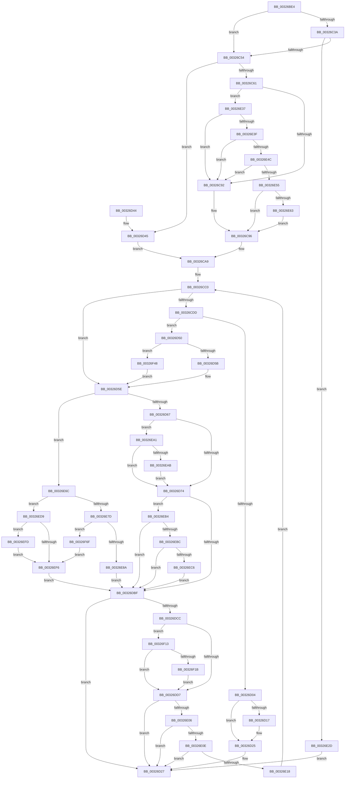

# RtlpHpSegMgrCommit

- RVA: `0x00326BE4`–`0x00326F86` (길이 `930` bytes)
- VA: `0x0000000140326BE4`
- 실행 섹션: `.text`
- PDB 이름 있음: `예`; PDB Function 태그: `아니요`
- unwind 정보 RVA: `0x00075D3C`
- 디코드: `239`개 명령, `930/930` bytes 표시
- 미해석 바이트: `0` (있으면 어셈블리에 `.byte`로 보존)

> 이 문서는 커널 이미지의 기계어와 PDB 기호를 분석해 생성했습니다. 4번과 5번은 함수 원형과 자료형을 바이너리 사용 방식에서 추정한 C 해석이며 원본 소스 복구 결과는 아닙니다.

## 1. Dependencies

- 직접 호출 지점: **10**; 고유 호출 대상: **9**
- 직접 호출자로 확인된 함수: **3**
- RIP 상대 이미지 참조: **1**

### Outgoing calls
- `0x00326C47` → [RtlpHpSegHeapCheckCommitLimit](RtlpHpSegHeapCheckCommitLimit_function_00327164.md) (function, `0x00327164`)
- `0x00326C84` → [RtlpHpVaMgrCtxQuery](RtlpHpVaMgrCtxQuery_function_003273C0.md) (function, `0x003273C0`)
- `0x00326CF8` → [RtlpHpSegMgrCommitInitiate](RtlpHpSegMgrCommitInitiate_function_003271DC.md) (function, `0x003271DC`)
- `0x00326D20` → [memset](../6C/memset_function_006C6C40.md) (function, `0x006C6C40`)
- `0x00326DAF` → [RtlpHpAllocVA](RtlpHpAllocVA_function_003276A0.md) (function, `0x003276A0`)
- `0x00326DF7` → [RtlpHpSegMgrCommitComplete](../48/RtlpHpSegMgrCommitComplete_function_00484C14.md) (function, `0x00484C14`)
- `0x00326E95` → [MmFreePoolMemory](../2C/MmFreePoolMemory_function_002C1578.md) (function, `0x002C1578`)
- `0x00326ECF` → [memset](../6C/memset_function_006C6C40.md) (function, `0x006C6C40`)
- `0x00326F0C` → [RtlpHpVaMgrCtxFree](../2E/RtlpHpVaMgrCtxFree_function_002ED734.md) (function, `0x002ED734`)
- `0x00326F7C` → [RtlpHpVaMgrCtxDecommit](../60/RtlpHpVaMgrCtxDecommit_function_00603DC0.md) (function, `0x00603DC0`)

### Direct callers
- [RtlpHpSegMgrRelease](../2E/RtlpHpSegMgrRelease_function_002E37FC.md) at `0x002E3859`
- [RtlpHpSegMgrRelease](../2E/RtlpHpSegMgrRelease_function_002E37FC.md) at `0x002E3968`
- [RtlpHpSegMgrAllocate](../2E/RtlpHpSegMgrAllocate_function_002ED130.md) at `0x002ED193`
- [RtlpHpSegPageRangeCommit](RtlpHpSegPageRangeCommit_function_00325D0C.md) at `0x00325F72`

### Static image references
- `0x00326C6B` → RVA `0x00E68658` (`.data`; read)

## 2. Other-region calls and transfers

- 다른 실행 섹션으로 향하는 call: **0**
- 별도 외부 분기/꼬리 이동을 확인하지 못했습니다.

## 3. Assembly (complete function range)

```asm
00326BE4  48 89 5C 24 10                  mov qword ptr [rsp + 0x10], rbx
00326BE9  44 89 4C 24 20                  mov dword ptr [rsp + 0x20], r9d
00326BEE  55                              push rbp
00326BEF  56                              push rsi
00326BF0  57                              push rdi
00326BF1  41 54                           push r12
00326BF3  41 55                           push r13
00326BF5  41 56                           push r14
00326BF7  41 57                           push r15
00326BF9  48 8D 6C 24 F1                  lea rbp, [rsp - 0xf]
00326BFE  48 81 EC A0 00 00 00            sub rsp, 0xa0
00326C05  8B 7D 77                        mov edi, dword ptr [rbp + 0x77]
00326C08  45 8B F9                        mov r15d, r9d
00326C0B  4C 63 65 6F                     movsxd r12, dword ptr [rbp + 0x6f]
00326C0F  8B C7                           mov eax, edi
00326C11  44 8B 31                        mov r14d, dword ptr [rcx]
00326C14  25 00 00 00 40                  and eax, 0x40000000
00326C19  48 83 65 BF 00                  and qword ptr [rbp - 0x41], 0
00326C1E  0F BA F7 1E                     btr edi, 0x1e
00326C22  41 F7 DE                        neg r14d
00326C25  41 8B D8                        mov ebx, r8d
00326C28  C6 45 6F 00                     mov byte ptr [rbp + 0x6f], 0
00326C2C  4C 8B EA                        mov r13, rdx
00326C2F  89 45 77                        mov dword ptr [rbp + 0x77], eax
00326C32  48 8B F1                        mov rsi, rcx
00326C35  45 85 E4                        test r12d, r12d
00326C38  7E 1A                           jle 0x140326c54
00326C3A  48 8B 56 38                     mov rdx, qword ptr [rsi + 0x38]
00326C3E  41 8B C4                        mov eax, r12d
00326C41  C1 E0 0C                        shl eax, 0xc
00326C44  48 63 C8                        movsxd rcx, eax
00326C47  E8 18 05 00 00                  call 0x140327164
00326C4C  85 C0                           test eax, eax
00326C4E  0F 84 D9 01 00 00               je 0x140326e2d
00326C54  8A 46 0D                        mov al, byte ptr [rsi + 0xd]
00326C57  24 07                           and al, 7
00326C59  3C 01                           cmp al, 1
00326C5B  0F 82 E4 00 00 00               jb 0x140326d45
00326C61  0F 57 C0                        xorps xmm0, xmm0
00326C64  4C 8D 45 EF                     lea r8, [rbp - 0x11]
00326C68  4D 8B FD                        mov r15, r13
00326C6B  48 8D 0D E6 19 B4 00            lea rcx, [rip + 0xb419e6]
00326C72  49 81 E7 00 00 E0 FF            and r15, 0xffffffffffe00000
00326C79  49 8B D7                        mov rdx, r15
00326C7C  0F 11 45 EF                     movups xmmword ptr [rbp - 0x11], xmm0
00326C80  0F 11 45 FF                     movups xmmword ptr [rbp - 1], xmm0
00326C84  E8 37 07 00 00                  call 0x1403273c0
00326C89  45 85 E4                        test r12d, r12d
00326C8C  0F 8F A5 01 00 00               jg 0x140326e37
00326C92  44 8B 75 7F                     mov r14d, dword ptr [rbp + 0x7f]
00326C96  48 8B 45 FF                     mov rax, qword ptr [rbp - 1]
00326C9A  48 8B CB                        mov rcx, rbx
00326C9D  44 8B 7D 67                     mov r15d, dword ptr [rbp + 0x67]
00326CA1  48 C1 E9 09                     shr rcx, 9
00326CA5  48 8D 14 48                     lea rdx, [rax + rcx*2]
00326CA9  C1 E3 0C                        shl ebx, 0xc
00326CAC  8B C3                           mov eax, ebx
00326CAE  4C 03 E8                        add r13, rax
00326CB1  48 89 55 AF                     mov qword ptr [rbp - 0x51], rdx
00326CB5  41 C1 E7 0C                     shl r15d, 0xc
00326CB9  41 8B C7                        mov eax, r15d
00326CBC  48 89 45 B7                     mov qword ptr [rbp - 0x49], rax
00326CC0  89 7D 4F                        mov dword ptr [rbp + 0x4f], edi
00326CC3  4D 8B FD                        mov r15, r13
00326CC6  4C 89 6D A7                     mov qword ptr [rbp - 0x59], r13
00326CCA  48 8B D8                        mov rbx, rax
00326CCD  48 89 45 9F                     mov qword ptr [rbp - 0x61], rax
00326CD1  49 8B CD                        mov rcx, r13
00326CD4  48 85 D2                        test rdx, rdx
00326CD7  0F 84 81 00 00 00               je 0x140326d5e
00326CDD  48 8D 45 6F                     lea rax, [rbp + 0x6f]
00326CE1  45 8B CE                        mov r9d, r14d
00326CE4  48 89 44 24 28                  mov qword ptr [rsp + 0x28], rax
00326CE9  45 8B C4                        mov r8d, r12d
00326CEC  48 8D 45 BF                     lea rax, [rbp - 0x41]
00326CF0  48 8B CE                        mov rcx, rsi
00326CF3  48 89 44 24 20                  mov qword ptr [rsp + 0x20], rax
00326CF8  E8 DF 04 00 00                  call 0x1403271dc
00326CFD  3D 00 01 00 C0                  cmp eax, 0xc0000100
00326D02  75 4C                           jne 0x140326d50
00326D04  48 0F BF 46 14                  movsx rax, word ptr [rsi + 0x14]
00326D09  49 8B D4                        mov rdx, r12
00326D0C  F0 48 01 14 30                  lock add qword ptr [rax + rsi], rdx
00326D11  83 7D 77 00                     cmp dword ptr [rbp + 0x77], 0
00326D15  74 0E                           je 0x140326d25
00326D17  4C 8B 45 B7                     mov r8, qword ptr [rbp - 0x49]
00326D1B  33 D2                           xor edx, edx
00326D1D  49 8B CD                        mov rcx, r13
00326D20  E8 1B FF 39 00                  call 0x1406c6c40
00326D25  33 DB                           xor ebx, ebx
00326D27  8B C3                           mov eax, ebx
00326D29  48 8B 9C 24 E8 00 00 00         mov rbx, qword ptr [rsp + 0xe8]
00326D31  48 81 C4 A0 00 00 00            add rsp, 0xa0
00326D38  41 5F                           pop r15
00326D3A  41 5E                           pop r14
00326D3C  41 5D                           pop r13
00326D3E  41 5C                           pop r12
00326D40  5F                              pop rdi
00326D41  5E                              pop rsi
00326D42  5D                              pop rbp
00326D43  C3                              ret
00326D44  CC                              int3
00326D45  44 8B 75 7F                     mov r14d, dword ptr [rbp + 0x7f]
00326D49  33 D2                           xor edx, edx
00326D4B  E9 59 FF FF FF                  jmp 0x140326ca9
00326D50  3D 02 01 00 C0                  cmp eax, 0xc0000102
00326D55  0F 84 ED 01 00 00               je 0x140326f48
00326D5B  49 8B CD                        mov rcx, r13
00326D5E  45 85 E4                        test r12d, r12d
00326D61  0F 8E 05 01 00 00               jle 0x140326e6c
00326D67  44 8B 7D 77                     mov r15d, dword ptr [rbp + 0x77]
00326D6B  45 85 FF                        test r15d, r15d
00326D6E  0F 85 2D 01 00 00               jne 0x140326ea1
00326D74  48 8B 46 38                     mov rax, qword ptr [rsi + 0x38]
00326D78  0F 10 46 28                     movups xmm0, xmmword ptr [rsi + 0x28]
00326D7C  8B 48 14                        mov ecx, dword ptr [rax + 0x14]
00326D7F  81 E1 00 00 00 40               and ecx, 0x40000000
00326D85  F7 D9                           neg ecx
00326D87  F3 0F 7F 45 CF                  movdqu xmmword ptr [rbp - 0x31], xmm0
00326D8C  1B C0                           sbb eax, eax
00326D8E  83 E0 3C                        and eax, 0x3c
00326D91  83 C0 04                        add eax, 4
00326D94  48 8D 4D CF                     lea rcx, [rbp - 0x31]
00326D98  44 8B CF                        mov r9d, edi
00326D9B  48 89 4C 24 28                  mov qword ptr [rsp + 0x28], rcx
00326DA0  48 8D 55 9F                     lea rdx, [rbp - 0x61]
00326DA4  48 8D 4D A7                     lea rcx, [rbp - 0x59]
00326DA8  89 44 24 20                     mov dword ptr [rsp + 0x20], eax
00326DAC  45 33 C0                        xor r8d, r8d
00326DAF  E8 EC 08 00 00                  call 0x1403276a0
00326DB4  8B D8                           mov ebx, eax
00326DB6  45 85 FF                        test r15d, r15d
00326DB9  0F 85 F5 00 00 00               jne 0x140326eb4
00326DBF  48 8B 55 AF                     mov rdx, qword ptr [rbp - 0x51]
00326DC3  48 85 D2                        test rdx, rdx
00326DC6  0F 84 5B FF FF FF               je 0x140326d27
00326DCC  66 0F BA 22 0E                  bt word ptr [rdx], 0xe
00326DD1  0F 82 3C 01 00 00               jb 0x140326f13
00326DD7  8A 45 6F                        mov al, byte ptr [rbp + 0x6f]
00326DDA  44 8B CB                        mov r9d, ebx
00326DDD  88 44 24 28                     mov byte ptr [rsp + 0x28], al
00326DE1  41 F7 D1                        not r9d
00326DE4  48 8D 45 BF                     lea rax, [rbp - 0x41]
00326DE8  41 C1 E9 1F                     shr r9d, 0x1f
00326DEC  45 8B C4                        mov r8d, r12d
00326DEF  48 89 44 24 20                  mov qword ptr [rsp + 0x20], rax
00326DF4  48 8B CE                        mov rcx, rsi
00326DF7  E8 18 DE 15 00                  call 0x140484c14
00326DFC  0F BA E7 1D                     bt edi, 0x1d
00326E00  0F 83 21 FF FF FF               jae 0x140326d27
00326E06  85 DB                           test ebx, ebx
00326E08  0F 89 19 FF FF FF               jns 0x140326d27
00326E0E  41 F6 C6 02                     test r14b, 2
00326E12  0F 85 0F FF FF FF               jne 0x140326d27
00326E18  48 8B 55 AF                     mov rdx, qword ptr [rbp - 0x51]
00326E1C  41 83 CE 01                     or r14d, 1
00326E20  48 8B 45 B7                     mov rax, qword ptr [rbp - 0x49]
00326E24  0F BA F7 1D                     btr edi, 0x1d
00326E28  E9 93 FE FF FF                  jmp 0x140326cc0
00326E2D  BB 2D 01 00 C0                  mov ebx, 0xc000012d
00326E32  E9 F0 FE FF FF                  jmp 0x140326d27
00326E37  85 DB                           test ebx, ebx
00326E39  0F 85 53 FE FF FF               jne 0x140326c92
00326E3F  41 81 FE 00 00 20 00            cmp r14d, 0x200000
00326E46  0F 83 46 FE FF FF               jae 0x140326c92
00326E4C  4D 3B EF                        cmp r13, r15
00326E4F  0F 86 3D FE FF FF               jbe 0x140326c92
00326E55  44 8B 75 7F                     mov r14d, dword ptr [rbp + 0x7f]
00326E59  41 F6 C6 02                     test r14b, 2
00326E5D  0F 85 33 FE FF FF               jne 0x140326c96
00326E63  41 83 CE 01                     or r14d, 1
00326E67  E9 2A FE FF FF                  jmp 0x140326c96
00326E6C  0F 10 46 28                     movups xmm0, xmmword ptr [rsi + 0x28]
00326E70  F3 0F 7F 45 DF                  movdqu xmmword ptr [rbp - 0x21], xmm0
00326E75  81 FF 00 80 00 00               cmp edi, 0x8000
00326E7B  74 5C                           je 0x140326ed9
00326E7D  8A 45 E0                        mov al, byte ptr [rbp - 0x20]
00326E80  2C 02                           sub al, 2
00326E82  3C 02                           cmp al, 2
00326E84  0F 86 E5 00 00 00               jbe 0x140326f6f
00326E8A  44 8B C7                        mov r8d, edi
00326E8D  48 8D 55 9F                     lea rdx, [rbp - 0x61]
00326E91  48 8D 4D A7                     lea rcx, [rbp - 0x59]
00326E95  E8 DE A6 F9 FF                  call 0x1402c1578
00326E9A  8B D8                           mov ebx, eax
00326E9C  E9 1E FF FF FF                  jmp 0x140326dbf
00326EA1  0F BA E7 1D                     bt edi, 0x1d
00326EA5  0F 82 C9 FE FF FF               jb 0x140326d74
00326EAB  0F BA EF 1E                     bts edi, 0x1e
00326EAF  E9 C0 FE FF FF                  jmp 0x140326d74
00326EB4  85 C0                           test eax, eax
00326EB6  0F 88 03 FF FF FF               js 0x140326dbf
00326EBC  0F BA E7 1E                     bt edi, 0x1e
00326EC0  0F 82 F9 FE FF FF               jb 0x140326dbf
00326EC6  4C 8B 45 B7                     mov r8, qword ptr [rbp - 0x49]
00326ECA  33 D2                           xor edx, edx
00326ECC  49 8B CD                        mov rcx, r13
00326ECF  E8 6C FD 39 00                  call 0x1406c6c40
00326ED4  E9 E6 FE FF FF                  jmp 0x140326dbf
00326ED9  48 8D 81 FF FF 0F 00            lea rax, [rcx + 0xfffff]
00326EE0  48 25 00 00 F0 FF               and rax, 0xfffffffffff00000
00326EE6  48 2B C8                        sub rcx, rax
00326EE9  48 89 45 A7                     mov qword ptr [rbp - 0x59], rax
00326EED  48 03 D9                        add rbx, rcx
00326EF0  48 89 5D 9F                     mov qword ptr [rbp - 0x61], rbx
00326EF4  75 07                           jne 0x140326efd
00326EF6  33 DB                           xor ebx, ebx
00326EF8  E9 C2 FE FF FF                  jmp 0x140326dbf
00326EFD  4C 8D 45 9F                     lea r8, [rbp - 0x61]
00326F01  48 8D 55 A7                     lea rdx, [rbp - 0x59]
00326F05  48 8D 0D 4C 17 B4 00            lea rcx, [rip + 0xb4174c]
00326F0C  E8 23 68 FC FF                  call 0x1402ed734
00326F11  EB E3                           jmp 0x140326ef6
00326F13  85 DB                           test ebx, ebx
00326F15  0F 88 BC FE FF FF               js 0x140326dd7
00326F1B  48 83 C8 FF                     or rax, 0xffffffffffffffff
00326F1F  B9 01 00 00 00                  mov ecx, 1
00326F24  45 85 E4                        test r12d, r12d
00326F27  48 0F 4E C8                     cmovle rcx, rax
00326F2B  48 0F BF 46 14                  movsx rax, word ptr [rsi + 0x14]
00326F30  F0 48 01 4C 30 08               lock add qword ptr [rax + rsi + 8], rcx
00326F36  48 0F BF 46 14                  movsx rax, word ptr [rsi + 0x14]
00326F3B  49 8B CC                        mov rcx, r12
00326F3E  F0 48 01 0C 30                  lock add qword ptr [rax + rsi], rcx
00326F43  E9 8F FE FF FF                  jmp 0x140326dd7
00326F48  49 81 E7 00 00 E0 FF            and r15, 0xffffffffffe00000
00326F4F  0F BA EF 1D                     bts edi, 0x1d
00326F53  4C 89 7D A7                     mov qword ptr [rbp - 0x59], r15
00326F57  45 85 E4                        test r12d, r12d
00326F5A  BB 00 00 20 00                  mov ebx, 0x200000
00326F5F  48 89 5D 9F                     mov qword ptr [rbp - 0x61], rbx
00326F63  49 8B CF                        mov rcx, r15
00326F66  0F 4E 7D 4F                     cmovle edi, dword ptr [rbp + 0x4f]
00326F6A  E9 EF FD FF FF                  jmp 0x140326d5e
00326F6F  4C 8B C3                        mov r8, rbx
00326F72  48 8D 0D DF 16 B4 00            lea rcx, [rip + 0xb416df]
00326F79  49 8B D7                        mov rdx, r15
00326F7C  E8 3F CE 2D 00                  call 0x140603dc0
00326F81  E9 70 FF FF FF                  jmp 0x140326ef6
```

## 4. C-style interpretation (structured pseudocode)

```c
__int64 __fastcall RtlpHpSegMgrCommit(__int64 a1, __int64 a2, int a3, int a4, unsigned __int8 a5, unsigned int a6, unsigned int a7)
{
    __int64 result;
    __int64 v_r13;
    __int64 v_r14;
    __int64 v_r15;
    __int64 v_rbx;
    __int64 v_rdi;
    __int64 v_rsp;
    unsigned __int64 v_stack_m47;
    unsigned __int64 v_stack_m48;
    unsigned __int64 v_stack_m58;
    unsigned __int8 v_stack_m67;
    unsigned __int64 v_stack_m68;
    unsigned __int64 v_stack_m78;
    unsigned __int64 v_stack_m88;
    unsigned __int64 v_stack_m90;
    unsigned __int64 v_stack_m98;
    unsigned __int64 v_stack_mA0;
    unsigned __int64 v_stack_mA8;
    unsigned __int64 v_stack_mB0;
    unsigned __int64 v_stack_mB8;
    unsigned __int64 v_stack_p10;
    unsigned int v_stack_p20;
    unsigned __int8 v_stack_p28;
    unsigned int v_stack_p30;
    unsigned int v_stack_p8;

    v_stack_p10 = v_rbx;
    v_stack_p20 = a4;
    v_rsp = (v_rsp) - (160);
    result = (unsigned int)(((unsigned int)((unsigned int)((unsigned int)(a6)))) & (0x40000000ULL));
    v_r14 = (unsigned int)(-((unsigned int)(*(unsigned int *)(a1))));
    v_stack_p28 = 0;
    v_stack_p30 = (unsigned int)(result);
    if (condition_is_less_or_equal) goto loc_00326C54;
    result = (unsigned int)(((unsigned int)((unsigned int)((int)(a5)))) << (12));
    result = RtlpHpSegHeapCheckCommitLimit((int)((unsigned int)(result)), *(unsigned __int64 *)(a1 + 56), a3, a4);
    if ((unsigned int)(result) == 0) goto loc_00326E2D;
loc_00326C54:
    result = (unsigned __int8)((*(unsigned __int8 *)(a1 + 13)) & (7));
    if (((unsigned __int8)(result)) < 1) goto loc_00326D45;
    v_r15 = (a2) & (0xFFFFFFFFFFE00000ULL);
    v_stack_m58 = v_xmm0;
    v_stack_m48 = v_xmm0;
    result = RtlpHpVaMgrCtxQuery(v_rip + 11803110, v_r15, v_stack_m58, a4);
    if (condition_is_greater) goto loc_00326E37;
loc_00326C92:
loc_00326C96:
    a1 = ((unsigned int)(a3)) >> (9);
loc_00326CA9:
    v_rbx = (unsigned int)(((unsigned int)(a3)) << (12));
    v_r13 = (a2) + ((unsigned int)((unsigned int)(v_rbx)));
    v_stack_m98 = v_stack_m48 + a1 * 2;
    v_r15 = (unsigned int)(((unsigned int)(v_stack_p20)) << (12));
    v_stack_m90 = (unsigned int)((unsigned int)(v_r15));
loc_00326CC0:
    v_stack_p8 = (unsigned int)((unsigned int)(a6));
    v_stack_mA0 = v_r13;
    v_stack_mA8 = (unsigned int)((unsigned int)(v_r15));
    if (v_stack_m48 + a1 * 2 == 0) goto loc_00326D5E;
    v_stack_mB0 = a5;
    v_stack_mB8 = v_stack_m88;
    result = RtlpHpSegMgrCommitInitiate(a1, v_stack_m48 + a1 * 2, (unsigned int)((unsigned int)((int)(a5))), (unsigned int)((unsigned int)((unsigned int)(a7))));
    if (((unsigned int)(result)) != 0xC0000100ULL) goto loc_00326D50;
    result = (__int16)(*(unsigned __int16 *)(a1 + 20));
    if (a6 != 0) {
        a3 = v_stack_m90;
        a2 = 0;
        a1 = v_r13;
        result = memset(a1, a2, a3, (unsigned int)((unsigned int)((unsigned int)(a7))));
    }
    v_rbx = 0;
loc_00326D27:
    v_rsp = (v_rsp) + (160);
    return 0;
loc_00326D45:
    a2 = 0;
    goto loc_00326CA9;
loc_00326D50:
    if (0 == 0xC0000102ULL) goto loc_00326F48;
loc_00326D5E:
    if (condition_is_less_or_equal) goto loc_00326E6C;
    if ((unsigned int)((unsigned int)(a6)) != 0) goto loc_00326EA1;
loc_00326D74:
    a1 = (unsigned int)(((unsigned int)(*(unsigned int *)(*(unsigned __int64 *)(a1 + 56) + 20))) & (0x40000000ULL));
    a1 = (unsigned int)(-(a1));
    v_stack_m78 = v_xmm0;
    result = (unsigned int)((*(unsigned __int64 *)(a1 + 56)) & (60));
    result = (unsigned int)((result) + (4));
    v_stack_p28 = v_stack_m78;
    v_stack_p20 = (unsigned int)(result);
    a3 = 0;
    result = RtlpHpAllocVA(v_stack_mA0, v_stack_mA8, a3, (unsigned int)((unsigned int)((unsigned int)(a6))));
    if ((unsigned int)((unsigned int)(a6)) != 0) goto loc_00326EB4;
loc_00326DBF:
    if (v_stack_m98 == 0) goto loc_00326D27;
    if (condition_is_below) goto loc_00326F13;
loc_00326DD7:
    v_stack_p28 = a5;
    a4 = (unsigned int)(~((unsigned int)((unsigned int)((unsigned int)((unsigned int)(result))))));
    a4 = (unsigned int)((a4) >> (31));
    v_stack_p20 = v_stack_m88;
    result = RtlpHpSegMgrCommitComplete(a1, v_stack_m98, (unsigned int)((unsigned int)((int)(a5))), a4);
    if (condition_is_above_or_equal) goto loc_00326D27;
    if (!sign_flag) goto loc_00326D27;
    if ((((unsigned __int8)((unsigned int)(a7))) & (2)) != 0) goto loc_00326D27;
    v_r14 = (unsigned int)(((unsigned int)(a7)) | (1));
    goto loc_00326CC0;
loc_00326E2D:
    goto loc_00326D27;
loc_00326E37:
    if ((unsigned int)((unsigned int)(0xC000012DULL)) != 0) goto loc_00326C92;
    if (((unsigned int)(v_r14)) >= 0x200000ULL) goto loc_00326C92;
    if (v_r13 <= ((unsigned int)(a6))) goto loc_00326C92;
    if ((((unsigned __int8)((unsigned int)(a7))) & (2)) != 0) goto loc_00326C96;
    v_r14 = (unsigned int)(((unsigned int)(a7)) | (1));
    goto loc_00326C96;
loc_00326E6C:
    v_stack_m68 = v_xmm0;
    if (((unsigned int)((unsigned int)(a6))) == 0x8000ULL) goto loc_00326ED9;
    result = (unsigned __int8)((v_stack_m67) - (2));
    if (((unsigned __int8)(result)) <= 2) goto loc_00326F6F;
    result = MmFreePoolMemory(v_stack_mA0, v_stack_mA8, (unsigned int)((unsigned int)((unsigned int)(a6))), a4);
    goto loc_00326DBF;
loc_00326EA1:
    if (((unsigned __int8)(result)) < 2) goto loc_00326D74;
    goto loc_00326D74;
loc_00326EB4:
    if (sign_flag) goto loc_00326DBF;
    if (condition_is_below) goto loc_00326DBF;
    a2 = 0;
    result = memset(v_r13, a2, v_stack_m90, a4);
    goto loc_00326DBF;
loc_00326ED9:
    result = (v_r13 + 1048575) & (0xFFFFFFFFFFF00000ULL);
    a1 = (v_r13) - (result);
    v_stack_mA0 = result;
    v_rbx = ((unsigned int)((unsigned int)(result))) + (a1);
    v_stack_mA8 = v_rbx;
    if (condition_is_not_equal) goto loc_00326EFD;
loc_00326EF6:
    v_rbx = 0;
    goto loc_00326DBF;
loc_00326EFD:
    result = RtlpHpVaMgrCtxFree(v_rip + 11802444, v_stack_mA0, v_stack_mA8, a4);
    goto loc_00326EF6;
loc_00326F13:
    if (sign_flag) goto loc_00326DD7;
    result = (result) | (-1);
    a1 = 1;
    if (condition_is_less_or_equal) { a1 = result; }
    goto loc_00326DD7;
loc_00326F48:
    v_r15 = ((unsigned int)(a6)) & (0xFFFFFFFFFFE00000ULL);
    v_stack_mA0 = v_r15;
    v_stack_mA8 = (unsigned int)(0x200000ULL);
    v_rdi = (unsigned int)(a6);
    if (condition_is_less_or_equal) { v_rdi = v_stack_p8; }
    goto loc_00326D5E;
loc_00326F6F:
    result = RtlpHpVaMgrCtxDecommit(v_rip + 11802335, v_r15, (unsigned int)(0x200000ULL), a4);
    goto loc_00326EF6;
}
```

## 5. (Beta) C Style

```c
int64_t RtlpHpSegMgrCommit(void *Arg1, int64_t Arg2, int32_t Arg3, int32_t Arg4, uint8_t Arg5, uint32_t Arg6, uint32_t Arg7)
{
    uint8_t *arg1 = (uint8_t *)Arg1;

    int64_t result;
    int64_t local_r13;
    int64_t local_r14;
    int64_t local_r15;
    int64_t local_rbx;
    int64_t local_rdi;
    int64_t local_rsp;
    uint64_t v_stack_m47;
    uint64_t v_stack_m48;
    uint64_t v_stack_m58;
    uint8_t v_stack_m67;
    uint64_t v_stack_m68;
    uint64_t v_stack_m78;
    uint64_t v_stack_m88;
    uint64_t v_stack_m90;
    uint64_t v_stack_m98;
    uint64_t v_stack_mA0;
    uint64_t v_stack_mA8;
    uint64_t v_stack_mB0;
    uint64_t v_stack_mB8;
    uint64_t v_stack_p10;
    uint32_t v_stack_p20;
    uint8_t v_stack_p28;
    uint32_t v_stack_p30;
    uint32_t v_stack_p8;

    v_stack_p10 = local_rbx;
    v_stack_p20 = Arg4;
    local_rsp = (local_rsp) - (160);
    result = (uint32_t)(((uint32_t)((uint32_t)((uint32_t)(Arg6)))) & (0x40000000ULL));
    local_r14 = (uint32_t)(-((uint32_t)(*(uint32_t *)(arg1))));
    v_stack_p28 = 0;
    v_stack_p30 = (uint32_t)(result);
    if (condition_is_less_or_equal) goto loc_00326C54;
    result = (uint32_t)(((uint32_t)((uint32_t)((int32_t)(Arg5)))) << (12));
    result = RtlpHpSegHeapCheckCommitLimit((int32_t)((uint32_t)(result)), *(uint64_t *)(arg1 + 0x38), Arg3, Arg4);
    if ((uint32_t)(result) == 0) goto loc_00326E2D;
loc_00326C54:
    result = (uint8_t)((*(uint8_t *)(arg1 + 0xD)) & (7));
    if (((uint8_t)(result)) < 1) goto loc_00326D45;
    local_r15 = (Arg2) & (0xFFFFFFFFFFE00000ULL);
    v_stack_m58 = v_xmm0;
    v_stack_m48 = v_xmm0;
    result = RtlpHpVaMgrCtxQuery(v_rip + 11803110, local_r15, v_stack_m58, Arg4);
    if (condition_is_greater) goto loc_00326E37;
loc_00326C92:
loc_00326C96:
    Arg1 = ((uint32_t)(Arg3)) >> (9);
loc_00326CA9:
    local_rbx = (uint32_t)(((uint32_t)(Arg3)) << (12));
    local_r13 = (Arg2) + ((uint32_t)((uint32_t)(local_rbx)));
    v_stack_m98 = v_stack_m48 + Arg1 * 2;
    local_r15 = (uint32_t)(((uint32_t)(v_stack_p20)) << (12));
    v_stack_m90 = (uint32_t)((uint32_t)(local_r15));
loc_00326CC0:
    v_stack_p8 = (uint32_t)((uint32_t)(Arg6));
    v_stack_mA0 = local_r13;
    v_stack_mA8 = (uint32_t)((uint32_t)(local_r15));
    if (v_stack_m48 + Arg1 * 2 == 0) goto loc_00326D5E;
    v_stack_mB0 = Arg5;
    v_stack_mB8 = v_stack_m88;
    result = RtlpHpSegMgrCommitInitiate(Arg1, v_stack_m48 + Arg1 * 2, (uint32_t)((uint32_t)((int32_t)(Arg5))), (uint32_t)((uint32_t)((uint32_t)(Arg7))));
    if (((uint32_t)(result)) != 0xC0000100ULL) goto loc_00326D50;
    result = (int16_t)(*(uint16_t *)(arg1 + 0x14));
    if (Arg6 != 0) {
        Arg3 = v_stack_m90;
        Arg2 = 0;
        Arg1 = local_r13;
        result = memset(Arg1, Arg2, Arg3, (uint32_t)((uint32_t)((uint32_t)(Arg7))));
    }
    local_rbx = 0;
loc_00326D27:
    local_rsp = (local_rsp) + (160);
    return 0;
loc_00326D45:
    Arg2 = 0;
    goto loc_00326CA9;
loc_00326D50:
    if (0 == 0xC0000102ULL) goto loc_00326F48;
loc_00326D5E:
    if (condition_is_less_or_equal) goto loc_00326E6C;
    if ((uint32_t)((uint32_t)(Arg6)) != 0) goto loc_00326EA1;
loc_00326D74:
    Arg1 = (uint32_t)(((uint32_t)(*(uint32_t *)(*(uint64_t *)(arg1 + 0x38) + 0x14))) & (0x40000000ULL));
    Arg1 = (uint32_t)(-(Arg1));
    v_stack_m78 = v_xmm0;
    result = (uint32_t)((*(uint64_t *)(arg1 + 0x38)) & (60));
    result = (uint32_t)((result) + (4));
    v_stack_p28 = v_stack_m78;
    v_stack_p20 = (uint32_t)(result);
    Arg3 = 0;
    result = RtlpHpAllocVA(v_stack_mA0, v_stack_mA8, Arg3, (uint32_t)((uint32_t)((uint32_t)(Arg6))));
    if ((uint32_t)((uint32_t)(Arg6)) != 0) goto loc_00326EB4;
loc_00326DBF:
    if (v_stack_m98 == 0) goto loc_00326D27;
    if (condition_is_below) goto loc_00326F13;
loc_00326DD7:
    v_stack_p28 = Arg5;
    Arg4 = (uint32_t)(~((uint32_t)((uint32_t)((uint32_t)((uint32_t)(result))))));
    Arg4 = (uint32_t)((Arg4) >> (31));
    v_stack_p20 = v_stack_m88;
    result = RtlpHpSegMgrCommitComplete(Arg1, v_stack_m98, (uint32_t)((uint32_t)((int32_t)(Arg5))), Arg4);
    if (condition_is_above_or_equal) goto loc_00326D27;
    if (!sign_flag) goto loc_00326D27;
    if ((((uint8_t)((uint32_t)(Arg7))) & (2)) != 0) goto loc_00326D27;
    local_r14 = (uint32_t)(((uint32_t)(Arg7)) | (1));
    goto loc_00326CC0;
loc_00326E2D:
    goto loc_00326D27;
loc_00326E37:
    if ((uint32_t)((uint32_t)(0xC000012DULL)) != 0) goto loc_00326C92;
    if (((uint32_t)(local_r14)) >= 0x200000ULL) goto loc_00326C92;
    if (local_r13 <= ((uint32_t)(Arg6))) goto loc_00326C92;
    if ((((uint8_t)((uint32_t)(Arg7))) & (2)) != 0) goto loc_00326C96;
    local_r14 = (uint32_t)(((uint32_t)(Arg7)) | (1));
    goto loc_00326C96;
loc_00326E6C:
    v_stack_m68 = v_xmm0;
    if (((uint32_t)((uint32_t)(Arg6))) == 0x8000ULL) goto loc_00326ED9;
    result = (uint8_t)((v_stack_m67) - (2));
    if (((uint8_t)(result)) <= 2) goto loc_00326F6F;
    result = MmFreePoolMemory(v_stack_mA0, v_stack_mA8, (uint32_t)((uint32_t)((uint32_t)(Arg6))), Arg4);
    goto loc_00326DBF;
loc_00326EA1:
    if (((uint8_t)(result)) < 2) goto loc_00326D74;
    goto loc_00326D74;
loc_00326EB4:
    if (sign_flag) goto loc_00326DBF;
    if (condition_is_below) goto loc_00326DBF;
    Arg2 = 0;
    result = memset(local_r13, Arg2, v_stack_m90, Arg4);
    goto loc_00326DBF;
loc_00326ED9:
    result = (local_r13 + 1048575) & (0xFFFFFFFFFFF00000ULL);
    Arg1 = (local_r13) - (result);
    v_stack_mA0 = result;
    local_rbx = ((uint32_t)((uint32_t)(result))) + (Arg1);
    v_stack_mA8 = local_rbx;
    if (condition_is_not_equal) goto loc_00326EFD;
loc_00326EF6:
    local_rbx = 0;
    goto loc_00326DBF;
loc_00326EFD:
    result = RtlpHpVaMgrCtxFree(v_rip + 11802444, v_stack_mA0, v_stack_mA8, Arg4);
    goto loc_00326EF6;
loc_00326F13:
    if (sign_flag) goto loc_00326DD7;
    result = (result) | (-1);
    Arg1 = 1;
    if (condition_is_less_or_equal) { Arg1 = result; }
    goto loc_00326DD7;
loc_00326F48:
    local_r15 = ((uint32_t)(Arg6)) & (0xFFFFFFFFFFE00000ULL);
    v_stack_mA0 = local_r15;
    v_stack_mA8 = (uint32_t)(0x200000ULL);
    local_rdi = (uint32_t)(Arg6);
    if (condition_is_less_or_equal) { local_rdi = v_stack_p8; }
    goto loc_00326D5E;
loc_00326F6F:
    result = RtlpHpVaMgrCtxDecommit(v_rip + 11802335, local_r15, (uint32_t)(0x200000ULL), Arg4);
    goto loc_00326EF6;
}
```

### 관측된 메모리 오프셋

구조체 형식이 확인되지 않은 접근은 인자 기준의 오프셋으로만 기록했습니다.

| 기준 인자 | 오프셋 표현 | 폭 (bit) | 접근 |
|---|---:|---:|---|
| `Arg1` | `+ 0x0` | `32` | `R` |
| `Arg1` | `+ 0xD` | `8` | `R` |
| `Arg1` | `+ 0x14` | `16` | `R` |
| `Arg1` | `+ 0x28` | `128` | `R` |
| `Arg1` | `+ 0x38` | `64` | `R` |

## 6. Execution-region graph

[열기: 2D/3D 그래프와 함수 탐색 컨트롤 패널](../../../control-panel.html?section=text&rva=0x00326BE4&view=graph)

- 2D 그래프는 위에서 아래로 흐르고, 3D 그래프는 빈 공간을 드래그해 회전합니다. Shift+드래그는 이동, 휠은 확대·축소, 함수 노드 선택은 대상 보고서 이동입니다.

### Static fallback


