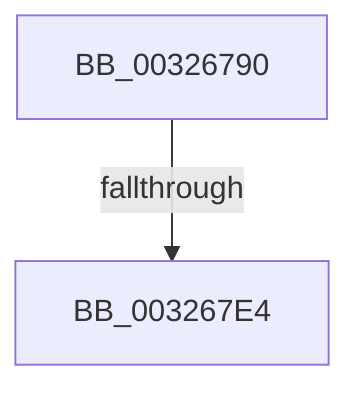

# RtlpHpSegPageRangeAllocate

- RVA: `0x00326790`–`0x003267E9` (길이 `89` bytes)
- VA: `0x0000000140326790`
- 실행 섹션: `.text`
- PDB 이름 있음: `예`; PDB Function 태그: `아니요`
- unwind 정보 RVA: `0x00075CC4`
- 디코드: `28`개 명령, `89/89` bytes 표시
- 미해석 바이트: `0` (있으면 어셈블리에 `.byte`로 보존)

> 이 문서는 커널 이미지의 기계어와 PDB 기호를 분석해 생성했습니다. 4번과 5번은 함수 원형과 자료형을 바이너리 사용 방식에서 추정한 C 해석이며 원본 소스 복구 결과는 아닙니다.

## 1. Dependencies

- 직접 호출 지점: **1**; 고유 호출 대상: **1**
- 직접 호출자로 확인된 함수: **1**
- RIP 상대 이미지 참조: **0**

### Outgoing calls
- `0x003267C1` → [RtlpHpSegLockAcquire](../2E/RtlpHpSegLockAcquire_function_002E34A0.md) (function, `0x002E34A0`)

### Direct callers
- [RtlpHpSegAlloc](RtlpHpSegAlloc_function_003265BC.md) at `0x0032661E`

### Static image references
- 디코드된 RIP-relative 메모리 참조가 없습니다.

## 2. Other-region calls and transfers

- 다른 실행 섹션으로 향하는 call: **0**
- call이 아닌 외부 분기/꼬리 이동: **1**
  - `0x003267DE` → [sub_00326A3F](Unknown_function_00326A3F.md) (`tail-transfer`)

## 3. Assembly (complete function range)

```asm
00326790  48 89 5C 24 18                  mov qword ptr [rsp + 0x18], rbx
00326795  55                              push rbp
00326796  56                              push rsi
00326797  41 54                           push r12
00326799  41 55                           push r13
0032679B  41 57                           push r15
0032679D  48 83 EC 20                     sub rsp, 0x20
003267A1  4C 8B F9                        mov r15, rcx
003267A4  FF CA                           dec edx
003267A6  0F B6 49 09                     movzx ecx, byte ptr [rcx + 9]
003267AA  BD 01 00 00 00                  mov ebp, 1
003267AF  44 8B ED                        mov r13d, ebp
003267B2  41 8B F0                        mov esi, r8d
003267B5  41 D3 E5                        shl r13d, cl
003267B8  44 03 EA                        add r13d, edx
003267BB  41 D3 ED                        shr r13d, cl
003267BE  49 8B CF                        mov rcx, r15
003267C1  E8 DA CC FB FF                  call 0x1402e34a0
003267C6  49 8B 57 68                     mov rdx, qword ptr [r15 + 0x68]
003267CA  4D 8D 4F 60                     lea r9, [r15 + 0x60]
003267CE  49 8B 19                        mov rbx, qword ptr [r9]
003267D1  41 8B CD                        mov ecx, r13d
003267D4  C1 E1 18                        shl ecx, 0x18
003267D7  44 0F B6 E0                     movzx r12d, al
003267DB  40 84 D5                        test bpl, dl
003267DE  0F 85 5B 02 00 00               jne 0x140326a3f
003267E4  0F B6 D2                        movzx edx, dl
003267E7  23 D5                           and edx, ebp
```

## 4. C-style interpretation (structured pseudocode)

```c
__int64 __fastcall RtlpHpSegPageRangeAllocate(__int64 a1, int a2, int a3)
{
    __int64 result;
    __int64 v_r13;
    __int64 v_rsp;
    unsigned __int64 v_stack_p18;

    v_stack_p18 = v_rbx;
    v_rsp = (v_rsp) - (32);
    a2 = (unsigned int)((a2) - 1);
    v_r13 = (unsigned int)((1) << ((unsigned __int8)(*(unsigned __int8 *)(a1 + 9))));
    v_r13 = (unsigned int)((v_r13) + (a2));
    v_r13 = (unsigned int)((v_r13) >> ((unsigned __int8)(*(unsigned __int8 *)(a1 + 9))));
    result = RtlpHpSegLockAcquire(a1, a2, a3, a4);
    a1 = (unsigned int)(((unsigned int)((unsigned int)(v_r13))) << (24));
    a2 = (unsigned int)(((unsigned __int8)(*(unsigned __int64 *)(a1 + 104))) & (1));
    return result;
}
```

## 5. (Beta) C Style

```c
int64_t RtlpHpSegPageRangeAllocate(void *Arg1, int32_t Arg2, int32_t Arg3)
{
    uint8_t *arg1 = (uint8_t *)Arg1;

    int64_t result;
    int64_t local_r13;
    int64_t local_rsp;
    uint64_t v_stack_p18;

    v_stack_p18 = local_rbx;
    local_rsp = (local_rsp) - (32);
    Arg2 = (uint32_t)((Arg2) - 1);
    local_r13 = (uint32_t)((1) << ((uint8_t)(*(uint8_t *)(arg1 + 0x9))));
    local_r13 = (uint32_t)((local_r13) + (Arg2));
    local_r13 = (uint32_t)((local_r13) >> ((uint8_t)(*(uint8_t *)(arg1 + 0x9))));
    result = RtlpHpSegLockAcquire(Arg1, Arg2, Arg3, a4);
    Arg1 = (uint32_t)(((uint32_t)((uint32_t)(local_r13))) << (24));
    Arg2 = (uint32_t)(((uint8_t)(*(uint64_t *)(arg1 + 0x68))) & (1));
    return result;
}
```

### 관측된 메모리 오프셋

구조체 형식이 확인되지 않은 접근은 인자 기준의 오프셋으로만 기록했습니다.

| 기준 인자 | 오프셋 표현 | 폭 (bit) | 접근 |
|---|---:|---:|---|
| `Arg1` | `+ 0x0` | `64` | `R` |
| `Arg1` | `+ 0x9` | `8` | `R` |
| `Arg1` | `+ 0x60` | `64` | `R` |
| `Arg1` | `+ 0x68` | `64` | `R` |

## 6. Execution-region graph

[열기: 2D/3D 그래프와 함수 탐색 컨트롤 패널](../../../control-panel.html?section=text&rva=0x00326790&view=graph)

- 2D 그래프는 위에서 아래로 흐르고, 3D 그래프는 빈 공간을 드래그해 회전합니다. Shift+드래그는 이동, 휠은 확대·축소, 함수 노드 선택은 대상 보고서 이동입니다.

### Static fallback


