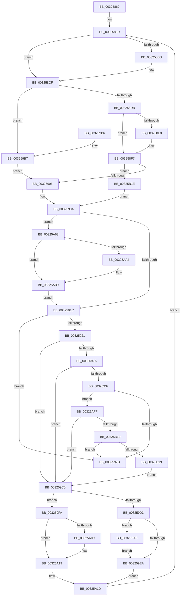

# RtlpHpSegPageRangeCoalesce

- RVA: `0x00325860`–`0x00325BB4` (길이 `852` bytes)
- VA: `0x0000000140325860`
- 실행 섹션: `.text`
- PDB 이름 있음: `예`; PDB Function 태그: `아니요`
- unwind 정보 RVA: `0x00075BF8`
- 디코드: `235`개 명령, `852/852` bytes 표시
- 미해석 바이트: `0` (있으면 어셈블리에 `.byte`로 보존)

> 이 문서는 커널 이미지의 기계어와 PDB 기호를 분석해 생성했습니다. 4번과 5번은 함수 원형과 자료형을 바이너리 사용 방식에서 추정한 C 해석이며 원본 소스 복구 결과는 아닙니다.

## 1. Dependencies

- 직접 호출 지점: **10**; 고유 호출 대상: **9**
- 직접 호출자로 확인된 함수: **2**
- RIP 상대 이미지 참조: **1**

### Outgoing calls
- `0x003259EE` → [KeAbPostRelease](../2E/KeAbPostRelease_function_002E1600.md) (function, `0x002E1600`)
- `0x003259F3` → [KeLeaveGuardedRegion](../2E/KeLeaveGuardedRegion_function_002E2C40.md) (function, `0x002E2C40`)
- `0x003259FE` → [ExReleaseSpinLockExclusiveFromDpcLevel](../24/ExReleaseSpinLockExclusiveFromDpcLevel_function_002497E0.md) (function, `0x002497E0`)
- `0x00325A14` → [KiLowerIrqlProcessIrqlFlags](../4F/KiLowerIrqlProcessIrqlFlags_function_004F5698.md) (function, `0x004F5698`)
- `0x00325A47` → [RtlpHpSegPageRangeCommit](RtlpHpSegPageRangeCommit_function_00325D0C.md) (function, `0x00325D0C`)
- `0x00325A4F` → [RtlpHpSegLockAcquire](../2E/RtlpHpSegLockAcquire_function_002E34A0.md) (function, `0x002E34A0`)
- `0x00325A6E` → [RtlRbRemoveNode](../2E/RtlRbRemoveNode_function_002E4C10.md) (function, `0x002E4C10`)
- `0x00325B03` → [RtlpHpEnvCompactionSchedule](RtlpHpEnvCompactionSchedule_function_003264A0.md) (function, `0x003264A0`)
- `0x00325B24` → [RtlRbRemoveNode](../2E/RtlRbRemoveNode_function_002E4C10.md) (function, `0x002E4C10`)
- `0x00325BAA` → [ExfTryToWakePushLock](../26/ExfTryToWakePushLock_function_00265DD0.md) (function, `0x00265DD0`)

### Direct callers
- [RtlpHpSegPageRangeShrink](../2E/RtlpHpSegPageRangeShrink_function_002E2FA0.md) at `0x002E3036`
- [RtlpHpSegContextCompact](RtlpHpSegContextCompact_function_00326F90.md) at `0x003270DA`

### Static image references
- `0x00325A03` → RVA `0x00FC6D20` (`ALMOSTRO`; read)

## 2. Other-region calls and transfers

- 다른 실행 섹션으로 향하는 call: **0**
- 별도 외부 분기/꼬리 이동을 확인하지 못했습니다.

## 3. Assembly (complete function range)

```asm
00325860  4C 89 4C 24 20                  mov qword ptr [rsp + 0x20], r9
00325865  53                              push rbx
00325866  56                              push rsi
00325867  57                              push rdi
00325868  41 55                           push r13
0032586A  41 56                           push r14
0032586C  41 57                           push r15
0032586E  48 83 EC 38                     sub rsp, 0x38
00325872  45 33 C9                        xor r9d, r9d
00325875  48 89 6C 24 78                  mov qword ptr [rsp + 0x78], rbp
0032587A  44 89 4C 24 70                  mov dword ptr [rsp + 0x70], r9d
0032587F  45 8B E8                        mov r13d, r8d
00325882  48 8B DA                        mov rbx, rdx
00325885  4C 89 64 24 30                  mov qword ptr [rsp + 0x30], r12
0032588A  48 8B F9                        mov rdi, rcx
0032588D  8B 4B 1C                        mov ecx, dword ptr [rbx + 0x1c]
00325890  48 8B D3                        mov rdx, rbx
00325893  48 8B 07                        mov rax, qword ptr [rdi]
00325896  49 8B F1                        mov rsi, r9
00325899  48 23 C3                        and rax, rbx
0032589C  48 2B D0                        sub rdx, rax
0032589F  8B C1                           mov eax, ecx
003258A1  C1 E8 18                        shr eax, 0x18
003258A4  F7 D1                           not ecx
003258A6  48 C1 FA 05                     sar rdx, 5
003258AA  44 0F B6 C0                     movzx r8d, al
003258AE  44 0F B7 F1                     movzx r14d, cx
003258B2  42 8D 04 02                     lea eax, [rdx + r8]
003258B6  3D 00 01 00 00                  cmp eax, 0x100
003258BB  73 12                           jae 0x1403258cf
003258BD  41 8B F0                        mov esi, r8d
003258C0  48 C1 E6 05                     shl rsi, 5
003258C4  48 03 F3                        add rsi, rbx
003258C7  F6 46 18 01                     test byte ptr [rsi + 0x18], 1
003258CB  49 0F 45 F1                     cmovne rsi, r9
003258CF  0F B6 47 0A                     movzx eax, byte ptr [rdi + 0xa]
003258D3  3B D0                           cmp edx, eax
003258D5  0F 86 DC 00 00 00               jbe 0x1403259b7
003258DB  F6 43 F8 02                     test byte ptr [rbx - 8], 2
003258DF  4C 8D 7B E0                     lea r15, [rbx - 0x20]
003258E3  48 8B EF                        mov rbp, rdi
003258E6  75 0F                           jne 0x1403258f7
003258E8  41 0F B6 47 1A                  movzx eax, byte ptr [r15 + 0x1a]
003258ED  48 F7 D8                        neg rax
003258F0  48 C1 E0 05                     shl rax, 5
003258F4  4C 03 F8                        add r15, rax
003258F7  48 83 C5 60                     add rbp, 0x60
003258FB  41 F6 47 18 01                  test byte ptr [r15 + 0x18], 1
00325900  0F 84 18 02 00 00               je 0x140325b1e
00325906  4C 8D 67 16                     lea r12, [rdi + 0x16]
0032590A  0F B6 43 18                     movzx eax, byte ptr [rbx + 0x18]
0032590E  0C 11                           or al, 0x11
00325910  88 43 18                        mov byte ptr [rbx + 0x18], al
00325913  48 85 F6                        test rsi, rsi
00325916  0F 85 4C 01 00 00               jne 0x140325a68
0032591C  45 85 F6                        test r14d, r14d
0032591F  74 5C                           je 0x14032597d
00325921  45 85 ED                        test r13d, r13d
00325924  0F 85 96 00 00 00               jne 0x1403259c0
0032592A  F6 47 0D 08                     test byte ptr [rdi + 0xd], 8
0032592E  45 8B C6                        mov r8d, r14d
00325931  0F 85 89 00 00 00               jne 0x1403259c0
00325937  49 0F BF 04 24                  movsx rax, word ptr [r12]
0032593C  41 B9 08 00 00 00               mov r9d, 8
00325942  0F B6 4F 0B                     movzx ecx, byte ptr [rdi + 0xb]
00325946  48 8B 6C 38 18                  mov rbp, qword ptr [rax + rdi + 0x18]
0032594B  48 03 6C 38 10                  add rbp, qword ptr [rax + rdi + 0x10]
00325950  48 8B 74 38 08                  mov rsi, qword ptr [rax + rdi + 8]
00325955  48 8B C6                        mov rax, rsi
00325958  48 D3 E8                        shr rax, cl
0032595B  0F B6 4F 0C                     movzx ecx, byte ptr [rdi + 0xc]
0032595F  48 83 F8 08                     cmp rax, 8
00325963  49 0F 46 C1                     cmovbe rax, r9
00325967  48 D3 EE                        shr rsi, cl
0032596A  49 3B F1                        cmp rsi, r9
0032596D  49 0F 46 F1                     cmovbe rsi, r9
00325971  49 03 E8                        add rbp, r8
00325974  48 3B E8                        cmp rbp, rax
00325977  0F 87 82 01 00 00               ja 0x140325aff
0032597D  0F B6 4B 1F                     movzx ecx, byte ptr [rbx + 0x1f]
00325981  4C 8B 64 24 30                  mov r12, qword ptr [rsp + 0x30]
00325986  FF C9                           dec ecx
00325988  48 8B 6C 24 78                  mov rbp, qword ptr [rsp + 0x78]
0032598D  48 C1 E1 05                     shl rcx, 5
00325991  0F B6 44 19 18                  movzx eax, byte ptr [rcx + rbx + 0x18]
00325996  24 FE                           and al, 0xfe
00325998  88 44 19 18                     mov byte ptr [rcx + rbx + 0x18], al
0032599C  0F B6 43 18                     movzx eax, byte ptr [rbx + 0x18]
003259A0  24 EE                           and al, 0xee
003259A2  88 43 18                        mov byte ptr [rbx + 0x18], al
003259A5  48 8B C3                        mov rax, rbx
003259A8  48 83 C4 38                     add rsp, 0x38
003259AC  41 5F                           pop r15
003259AE  41 5E                           pop r14
003259B0  41 5D                           pop r13
003259B2  5F                              pop rdi
003259B3  5E                              pop rsi
003259B4  5B                              pop rbx
003259B5  C3                              ret
003259B6  CC                              int3
003259B7  48 8D 6F 60                     lea rbp, [rdi + 0x60]
003259BB  E9 46 FF FF FF                  jmp 0x140325906
003259C0  4C 8B BC 24 88 00 00 00         mov r15, qword ptr [rsp + 0x88]
003259C8  8B 47 28                        mov eax, dword ptr [rdi + 0x28]
003259CB  41 0F B6 2F                     movzx ebp, byte ptr [r15]
003259CF  A8 01                           test al, 1
003259D1  75 27                           jne 0x1403259fa
003259D3  48 C7 C0 FF FF FF FF            mov rax, 0xffffffffffffffff
003259DA  F0 48 0F C1 47 40               lock xadd qword ptr [rdi + 0x40], rax
003259E0  24 06                           and al, 6
003259E2  3C 02                           cmp al, 2
003259E4  0F 84 BC 01 00 00               je 0x140325ba6
003259EA  48 8D 4F 40                     lea rcx, [rdi + 0x40]
003259EE  E8 0D BC FB FF                  call 0x1402e1600
003259F3  E8 48 D2 FB FF                  call 0x1402e2c40
003259F8  EB 23                           jmp 0x140325a1d
003259FA  48 8D 4F 40                     lea rcx, [rdi + 0x40]
003259FE  E8 DD 3D F2 FF                  call 0x1402497e0
00325A03  83 3D 16 13 CA 00 00            cmp dword ptr [rip + 0xca1316], 0
00325A0A  74 0D                           je 0x140325a19
00325A0C  44 0F 20 C1                     mov rcx, cr8
00325A10  40 0F B6 D5                     movzx edx, bpl
00325A14  E8 7F FC 1C 00                  call 0x1404f5698
00325A19  44 0F 22 C5                     mov cr8, rbp
00325A1D  0F B6 4F 09                     movzx ecx, byte ptr [rdi + 9]
00325A21  48 8D 44 24 70                  lea rax, [rsp + 0x70]
00325A26  44 0F B6 4B 1F                  movzx r9d, byte ptr [rbx + 0x1f]
00325A2B  45 33 C0                        xor r8d, r8d
00325A2E  41 D3 E1                        shl r9d, cl
00325A31  48 8B D3                        mov rdx, rbx
00325A34  48 89 44 24 28                  mov qword ptr [rsp + 0x28], rax
00325A39  41 F7 D9                        neg r9d
00325A3C  48 8B CF                        mov rcx, rdi
00325A3F  C7 44 24 20 00 00 00 00         mov dword ptr [rsp + 0x20], 0
00325A47  E8 C0 02 00 00                  call 0x140325d0c
00325A4C  48 8B CF                        mov rcx, rdi
00325A4F  E8 4C DA FB FF                  call 0x1402e34a0
00325A54  41 88 07                        mov byte ptr [r15], al
00325A57  0F B6 43 18                     movzx eax, byte ptr [rbx + 0x18]
00325A5B  24 EF                           and al, 0xef
00325A5D  88 43 18                        mov byte ptr [rbx + 0x18], al
00325A60  45 33 C9                        xor r9d, r9d
00325A63  E9 25 FE FF FF                  jmp 0x14032588d
00325A68  48 8B D6                        mov rdx, rsi
00325A6B  48 8B CD                        mov rcx, rbp
00325A6E  E8 9D F1 FB FF                  call 0x1402e4c10
00325A73  33 C0                           xor eax, eax
00325A75  0F 57 C0                        xorps xmm0, xmm0
00325A78  0F 11 06                        movups xmmword ptr [rsi], xmm0
00325A7B  48 89 46 10                     mov qword ptr [rsi + 0x10], rax
00325A7F  8B 46 1C                        mov eax, dword ptr [rsi + 0x1c]
00325A82  F7 D0                           not eax
00325A84  C7 06 DD CC DD CC               mov dword ptr [rsi], 0xccddccdd
00325A8A  0F B7 C8                        movzx ecx, ax
00325A8D  49 0F BF 04 24                  movsx rax, word ptr [r12]
00325A92  48 F7 D9                        neg rcx
00325A95  F0 48 01 4C 38 10               lock add qword ptr [rax + rdi + 0x10], rcx
00325A9B  0F B6 43 1F                     movzx eax, byte ptr [rbx + 0x1f]
00325A9F  83 E8 01                        sub eax, 1
00325AA2  74 15                           je 0x140325ab9
00325AA4  8B C8                           mov ecx, eax
00325AA6  4C 8D 67 16                     lea r12, [rdi + 0x16]
00325AAA  48 C1 E1 05                     shl rcx, 5
00325AAE  0F B6 44 19 18                  movzx eax, byte ptr [rcx + rbx + 0x18]
00325AB3  24 FE                           and al, 0xfe
00325AB5  88 44 19 18                     mov byte ptr [rcx + rbx + 0x18], al
00325AB9  0F B6 46 1F                     movzx eax, byte ptr [rsi + 0x1f]
00325ABD  00 43 1F                        add byte ptr [rbx + 0x1f], al
00325AC0  8B 46 1C                        mov eax, dword ptr [rsi + 0x1c]
00325AC3  F7 D0                           not eax
00325AC5  0F B7 C0                        movzx eax, ax
00325AC8  44 03 F0                        add r14d, eax
00325ACB  41 0F B7 C6                     movzx eax, r14w
00325ACF  66 F7 D0                        not ax
00325AD2  66 89 43 1C                     mov word ptr [rbx + 0x1c], ax
00325AD6  0F B6 46 18                     movzx eax, byte ptr [rsi + 0x18]
00325ADA  24 FD                           and al, 0xfd
00325ADC  88 46 18                        mov byte ptr [rsi + 0x18], al
00325ADF  0F B6 53 1F                     movzx edx, byte ptr [rbx + 0x1f]
00325AE3  FF CA                           dec edx
00325AE5  8B CA                           mov ecx, edx
00325AE7  48 C1 E1 05                     shl rcx, 5
00325AEB  0F B6 44 19 18                  movzx eax, byte ptr [rcx + rbx + 0x18]
00325AF0  0C 01                           or al, 1
00325AF2  88 44 19 18                     mov byte ptr [rcx + rbx + 0x18], al
00325AF6  88 54 19 1A                     mov byte ptr [rcx + rbx + 0x1a], dl
00325AFA  E9 1D FE FF FF                  jmp 0x14032591c
00325AFF  48 8B 4F 38                     mov rcx, qword ptr [rdi + 0x38]
00325B03  E8 98 09 00 00                  call 0x1403264a0
00325B08  85 C0                           test eax, eax
00325B0A  0F 88 B0 FE FF FF               js 0x1403259c0
00325B10  48 3B EE                        cmp rbp, rsi
00325B13  0F 86 64 FE FF FF               jbe 0x14032597d
00325B19  E9 A2 FE FF FF                  jmp 0x1403259c0
00325B1E  49 8B D7                        mov rdx, r15
00325B21  48 8B CD                        mov rcx, rbp
00325B24  E8 E7 F0 FB FF                  call 0x1402e4c10
00325B29  33 C0                           xor eax, eax
00325B2B  4C 8D 67 16                     lea r12, [rdi + 0x16]
00325B2F  0F 57 C0                        xorps xmm0, xmm0
00325B32  41 0F 11 07                     movups xmmword ptr [r15], xmm0
00325B36  49 89 47 10                     mov qword ptr [r15 + 0x10], rax
00325B3A  41 8B 47 1C                     mov eax, dword ptr [r15 + 0x1c]
00325B3E  F7 D0                           not eax
00325B40  41 C7 07 DD CC DD CC            mov dword ptr [r15], 0xccddccdd
00325B47  0F B7 C8                        movzx ecx, ax
00325B4A  49 0F BF 04 24                  movsx rax, word ptr [r12]
00325B4F  48 F7 D9                        neg rcx
00325B52  F0 48 01 4C 38 10               lock add qword ptr [rax + rdi + 0x10], rcx
00325B58  0F B6 4B 1F                     movzx ecx, byte ptr [rbx + 0x1f]
00325B5C  41 00 4F 1F                     add byte ptr [r15 + 0x1f], cl
00325B60  41 8B 47 1C                     mov eax, dword ptr [r15 + 0x1c]
00325B64  F7 D0                           not eax
00325B66  0F B7 C0                        movzx eax, ax
00325B69  44 03 F0                        add r14d, eax
00325B6C  41 0F B7 C6                     movzx eax, r14w
00325B70  66 F7 D0                        not ax
00325B73  66 41 89 47 1C                  mov word ptr [r15 + 0x1c], ax
00325B78  0F B6 43 1F                     movzx eax, byte ptr [rbx + 0x1f]
00325B7C  0F B6 4B 18                     movzx ecx, byte ptr [rbx + 0x18]
00325B80  3C 01                           cmp al, 1
00325B82  0F 96 C0                        setbe al
00325B85  04 FC                           add al, 0xfc
00325B87  22 C1                           and al, cl
00325B89  88 43 18                        mov byte ptr [rbx + 0x18], al
00325B8C  49 8B DF                        mov rbx, r15
00325B8F  41 0F B6 4F 1F                  movzx ecx, byte ptr [r15 + 0x1f]
00325B94  FF C9                           dec ecx
00325B96  8B C1                           mov eax, ecx
00325B98  48 C1 E0 05                     shl rax, 5
00325B9C  42 88 4C 38 1A                  mov byte ptr [rax + r15 + 0x1a], cl
00325BA1  E9 64 FD FF FF                  jmp 0x14032590a
00325BA6  48 8D 4F 40                     lea rcx, [rdi + 0x40]
00325BAA  E8 21 02 F4 FF                  call 0x140265dd0
00325BAF  E9 36 FE FF FF                  jmp 0x1403259ea
```

## 4. C-style interpretation (structured pseudocode)

```c
__int64 __fastcall RtlpHpSegPageRangeCoalesce(__int64 a1, __int64 a2, int a3, __int64 a4)
{
    __int64 result;
    __int64 v_r12;
    __int64 v_r14;
    __int64 v_r15;
    __int64 v_rbp;
    __int64 v_rsi;
    __int64 v_rsp;
    unsigned __int64 v_stack_m38;
    unsigned __int64 v_stack_p10;
    unsigned __int64 v_stack_p20;
    unsigned __int64 v_stack_p28;
    unsigned __int64 v_stack_p70;
    unsigned int v_stack_p8;
    unsigned __int64 v_stack_p88;

    v_stack_p20 = a4;
    v_rsp = (v_rsp) - (56);
    a4 = 0;
    v_stack_p10 = v_rbp;
    v_stack_p8 = 0;
    v_stack_m38 = v_r12;
loc_0032588D:
    result = (*(unsigned __int64 *)(a1)) & (a2);
    a2 = (a2) - (result);
    result = (unsigned int)(((unsigned int)((unsigned int)((unsigned int)(*(unsigned int *)(a2 + 28))))) >> (24));
    a1 = (unsigned int)(~((unsigned int)(*(unsigned int *)(a2 + 28))));
    a2 = (a2) >> (5);
    v_rsi = 0;
    if (((unsigned int)(a2 + (unsigned __int8)(result) * 1)) < 256) {
        v_rsi = (unsigned int)((unsigned __int8)(result));
        v_rsi = (v_rsi) << (5);
        v_rsi = (v_rsi) + (a2);
        if (((*(unsigned __int8 *)(v_rsi + 24)) & (1)) != 0) { v_rsi = 0; }
    }
    if (((unsigned int)(a2)) <= ((unsigned int)(*(unsigned __int8 *)(a1 + 10)))) goto loc_003259B7;
    result = *(unsigned __int8 *)(a1 + 10);
    v_r15 = a2 - 32;
    if (((*(unsigned __int8 *)(a2 - 8)) & (2)) == 0) {
        result = *(unsigned __int8 *)(a2 - 32 + 26);
        result = -(result);
        result = (result) << (5);
        v_r15 = (a2 - 32) + (result);
    }
    v_rbp = (a1) + (96);
    if (((*(unsigned __int8 *)(v_r15 + 24)) & (1)) == 0) goto loc_00325B1E;
loc_00325906:
loc_0032590A:
    result = (unsigned __int8)((*(unsigned __int8 *)(a2 + 24)) | (17));
    *(unsigned __int8 *)(a2 + 24) = (unsigned __int8)(result);
    if (v_rsi != 0) goto loc_00325A68;
loc_0032591C:
    if ((unsigned int)((unsigned __int16)(a1)) == 0) goto loc_0032597D;
    if ((unsigned int)((unsigned int)(a3)) != 0) goto loc_003259C0;
    if (((*(unsigned __int8 *)(a1 + 13)) & (8)) != 0) goto loc_003259C0;
    v_rbp = (*(unsigned __int64 *)((__int16)(*(unsigned __int16 *)(a1 + 22)) + a1 * 1 + 24)) + (*(unsigned __int64 *)((__int16)(*(unsigned __int16 *)(a1 + 22)) + a1 * 1 + 16));
    result = (*(unsigned __int64 *)((__int16)(*(unsigned __int16 *)(a1 + 22)) + a1 * 1 + 8)) >> ((unsigned __int8)(*(unsigned __int8 *)(a1 + 11)));
    if (result <= 8) { result = 8; }
    v_rsi = (*(unsigned __int64 *)((__int16)(*(unsigned __int16 *)(a1 + 22)) + a1 * 1 + 8)) >> ((unsigned __int8)(*(unsigned __int8 *)(a1 + 12)));
    if (v_rsi <= 8) { v_rsi = 8; }
    v_rbp = (v_rbp) + ((unsigned int)((unsigned int)((unsigned __int16)(a1))));
    if (v_rbp > result) goto loc_00325AFF;
loc_0032597D:
    a1 = (unsigned int)((*(unsigned __int8 *)(a2 + 31)) - 1);
    a1 = (a1) << (5);
    result = (unsigned __int8)((*(unsigned __int8 *)(a1 + a2 * 1 + 24)) & (254));
    *(unsigned __int8 *)(a1 + a2 * 1 + 24) = (unsigned __int8)(result);
    result = (unsigned __int8)((*(unsigned __int8 *)(a2 + 24)) & (238));
    *(unsigned __int8 *)(a2 + 24) = (unsigned __int8)(result);
    v_rsp = (v_rsp) + (56);
    return a2;
loc_003259B7:
    goto loc_00325906;
loc_003259C0:
    if ((((unsigned __int8)((unsigned int)(*(unsigned int *)(a1 + 40)))) & (1)) != 0) goto loc_003259FA;
    result = (unsigned __int8)((-1) & (6));
    if (((unsigned __int8)(result)) == 2) goto loc_00325BA6;
loc_003259EA:
    result = KeAbPostRelease(a1 + 64, a2, (unsigned int)((unsigned int)((unsigned __int16)(a1))), 8);
    result = KeLeaveGuardedRegion(a1 + 64, a2, (unsigned int)((unsigned int)((unsigned __int16)(a1))), 8);
    goto loc_00325A1D;
loc_003259FA:
    result = ExReleaseSpinLockExclusiveFromDpcLevel(a1 + 64, a2, (unsigned int)((unsigned int)((unsigned __int16)(a1))), 8);
    if ((*(unsigned int *)(v_rip + 13243158)) != 0) {
        a1 = v_cr8;
        a2 = (unsigned __int8)(*(unsigned __int8 *)(v_stack_p88));
        result = KiLowerIrqlProcessIrqlFlags(a1, a2, (unsigned int)((unsigned int)((unsigned __int16)(a1))), 8);
    }
loc_00325A1D:
    a3 = 0;
    a4 = (unsigned int)((*(unsigned __int8 *)(a2 + 31)) << ((unsigned __int8)(*(unsigned __int8 *)(a1 + 9))));
    v_stack_p28 = v_stack_p70;
    a4 = (unsigned int)(-(a4));
    v_stack_p20 = 0;
    result = RtlpHpSegPageRangeCommit(a1, a2, a3, a4);
    result = RtlpHpSegLockAcquire(a1, a2, a3, a4);
    *(unsigned __int8 *)(v_stack_p88) = (unsigned __int8)(result);
    result = (unsigned __int8)((*(unsigned __int8 *)(a2 + 24)) & (239));
    *(unsigned __int8 *)(a2 + 24) = (unsigned __int8)(result);
    a4 = 0;
    goto loc_0032588D;
loc_00325A68:
    result = RtlRbRemoveNode(*(unsigned __int8 *)(v_stack_p88), v_rsi, a3, a4);
    result = 0;
    *(unsigned __int64 *)(v_rsi) = v_xmm0;
    *(unsigned __int64 *)(v_rsi + 16) = 0;
    result = (unsigned int)(~((unsigned int)(*(unsigned int *)(v_rsi + 28))));
    *(unsigned int *)(v_rsi) = 0xCCDDCCDDULL;
    a1 = -((unsigned __int16)(result));
    result = (unsigned int)((*(unsigned __int8 *)(a2 + 31)) - (1));
    v_r12 = v_stack_m38;
    if (!(condition_is_equal)) {
        a1 = (unsigned int)(result);
        v_r12 = a1 + 22;
        a1 = (a1) << (5);
        result = *(unsigned __int8 *)(a1 + a2 * 1 + 24);
        result = (unsigned __int8)((result) & (254));
        *(unsigned __int8 *)(a1 + a2 * 1 + 24) = (unsigned __int8)(result);
    }
    result = (unsigned int)(~((unsigned int)(*(unsigned int *)(v_rsi + 28))));
    v_r14 = (unsigned int)(((unsigned __int16)(a1)) + ((unsigned int)((unsigned __int16)(result))));
    result = (unsigned __int16)(~((unsigned __int16)(v_r14)));
    *(unsigned __int16 *)(a2 + 28) = (unsigned __int16)(result);
    result = (unsigned __int8)((*(unsigned __int8 *)(v_rsi + 24)) & (253));
    *(unsigned __int8 *)(v_rsi + 24) = (unsigned __int8)(result);
    a2 = (unsigned int)((*(unsigned __int8 *)(a2 + 31)) - 1);
    a1 = ((unsigned int)((unsigned int)(a2))) << (5);
    result = (unsigned __int8)((*(unsigned __int8 *)(a1 + a2 * 1 + 24)) | (1));
    *(unsigned __int8 *)(a1 + a2 * 1 + 24) = (unsigned __int8)(result);
    *(unsigned __int8 *)(a1 + a2 * 1 + 26) = (unsigned __int8)(a2);
    goto loc_0032591C;
loc_00325AFF:
    result = RtlpHpEnvCompactionSchedule(*(unsigned __int64 *)(a1 + 56), a2, a3, a4);
    if (sign_flag) goto loc_003259C0;
    if ((*(unsigned __int8 *)(v_stack_p88)) <= v_rsi) goto loc_0032597D;
    goto loc_003259C0;
loc_00325B1E:
    result = RtlRbRemoveNode(*(unsigned __int8 *)(v_stack_p88), v_stack_p88, a3, a4);
    result = 0;
    *(unsigned __int64 *)(v_stack_p88) = v_xmm0;
    *(unsigned __int64 *)(v_stack_p88 + 16) = 0;
    result = (unsigned int)(~((unsigned int)(*(unsigned int *)(v_stack_p88 + 28))));
    *(unsigned int *)(v_stack_p88) = 0xCCDDCCDDULL;
    a1 = -((unsigned __int16)(result));
    result = (unsigned int)(~((unsigned int)(*(unsigned int *)(v_stack_p88 + 28))));
    v_r14 = (unsigned int)((v_r14) + ((unsigned int)((unsigned __int16)(result))));
    result = (unsigned __int16)(~((unsigned __int16)(v_r14)));
    *(unsigned __int16 *)(v_stack_p88 + 28) = (unsigned __int16)(result);
    result = (((unsigned __int8)(*(unsigned __int8 *)(a2 + 31))) <= 1) ? 1 : 0;
    result = (unsigned __int8)((result) + (252));
    result = (unsigned __int8)((result) & ((unsigned __int8)(*(unsigned __int8 *)(a2 + 24))));
    *(unsigned __int8 *)(a2 + 24) = (unsigned __int8)(result);
    a1 = (unsigned int)((*(unsigned __int8 *)(v_stack_p88 + 31)) - 1);
    result = ((unsigned int)((unsigned int)(a1))) << (5);
    *(unsigned __int8 *)(result + v_stack_p88 * 1 + 26) = (unsigned __int8)(a1);
    goto loc_0032590A;
loc_00325BA6:
    result = ExfTryToWakePushLock(a1 + 64, v_stack_p88, a3, a4);
    goto loc_003259EA;
}
```

## 5. (Beta) C Style

```c
void *RtlpHpSegPageRangeCoalesce(void *Arg1, void *Arg2, int32_t Arg3, int64_t Arg4)
{
    uint8_t *arg1 = (uint8_t *)Arg1;
    uint8_t *arg2 = (uint8_t *)Arg2;

    int64_t result;
    int64_t local_r12;
    int64_t local_r14;
    int64_t local_r15;
    int64_t local_rbp;
    int64_t local_rsi;
    int64_t local_rsp;
    uint64_t v_stack_m38;
    uint64_t v_stack_p10;
    uint64_t v_stack_p20;
    uint64_t v_stack_p28;
    uint64_t v_stack_p70;
    uint32_t v_stack_p8;
    uint64_t v_stack_p88;

    v_stack_p20 = Arg4;
    local_rsp = (local_rsp) - (56);
    Arg4 = 0;
    v_stack_p10 = local_rbp;
    v_stack_p8 = 0;
    v_stack_m38 = local_r12;
loc_0032588D:
    result = (*(uint64_t *)(arg1)) & (Arg2);
    Arg2 = (Arg2) - (result);
    result = (uint32_t)(((uint32_t)((uint32_t)((uint32_t)(*(uint32_t *)(arg2 + 0x1C))))) >> (24));
    Arg1 = (uint32_t)(~((uint32_t)(*(uint32_t *)(arg2 + 0x1C))));
    Arg2 = (Arg2) >> (5);
    local_rsi = 0;
    if (((uint32_t)(Arg2 + (uint8_t)(result) * 1)) < 256) {
        local_rsi = (uint32_t)((uint8_t)(result));
        local_rsi = (local_rsi) << (5);
        local_rsi = (local_rsi) + (Arg2);
        if (((*(uint8_t *)(local_rsi + 0x18)) & (1)) != 0) { local_rsi = 0; }
    }
    if (((uint32_t)(Arg2)) <= ((uint32_t)(*(uint8_t *)(arg1 + 0xA)))) goto loc_003259B7;
    result = *(uint8_t *)(arg1 + 0xA);
    local_r15 = Arg2 - 32;
    if (((*(uint8_t *)(arg2 - 0x8)) & (2)) == 0) {
        result = *(uint8_t *)(arg2 - 0x20 + 0x1A);
        result = -(result);
        result = (result) << (5);
        local_r15 = (Arg2 - 32) + (result);
    }
    local_rbp = (Arg1) + (96);
    if (((*(uint8_t *)(local_r15 + 0x18)) & (1)) == 0) goto loc_00325B1E;
loc_00325906:
loc_0032590A:
    result = (uint8_t)((*(uint8_t *)(arg2 + 0x18)) | (17));
    *(uint8_t *)(arg2 + 0x18) = (uint8_t)(result);
    if (local_rsi != 0) goto loc_00325A68;
loc_0032591C:
    if ((uint32_t)((uint16_t)(Arg1)) == 0) goto loc_0032597D;
    if ((uint32_t)((uint32_t)(Arg3)) != 0) goto loc_003259C0;
    if (((*(uint8_t *)(arg1 + 0xD)) & (8)) != 0) goto loc_003259C0;
    local_rbp = (*(uint64_t *)((int16_t)(*(uint16_t *)(arg1 + 0x16)) + arg1 * 1 + 0x18)) + (*(uint64_t *)((int16_t)(*(uint16_t *)(arg1 + 0x16)) + arg1 * 1 + 0x10));
    result = (*(uint64_t *)((int16_t)(*(uint16_t *)(arg1 + 0x16)) + arg1 * 1 + 0x8)) >> ((uint8_t)(*(uint8_t *)(arg1 + 0xB)));
    if (result <= 8) { result = 8; }
    local_rsi = (*(uint64_t *)((int16_t)(*(uint16_t *)(arg1 + 0x16)) + arg1 * 1 + 0x8)) >> ((uint8_t)(*(uint8_t *)(arg1 + 0xC)));
    if (local_rsi <= 8) { local_rsi = 8; }
    local_rbp = (local_rbp) + ((uint32_t)((uint32_t)((uint16_t)(Arg1))));
    if (local_rbp > result) goto loc_00325AFF;
loc_0032597D:
    Arg1 = (uint32_t)((*(uint8_t *)(arg2 + 0x1F)) - 1);
    Arg1 = (Arg1) << (5);
    result = (uint8_t)((*(uint8_t *)(arg1 + arg2 * 1 + 0x18)) & (254));
    *(uint8_t *)(arg1 + arg2 * 1 + 0x18) = (uint8_t)(result);
    result = (uint8_t)((*(uint8_t *)(arg2 + 0x18)) & (238));
    *(uint8_t *)(arg2 + 0x18) = (uint8_t)(result);
    local_rsp = (local_rsp) + (56);
    return Arg2;
loc_003259B7:
    goto loc_00325906;
loc_003259C0:
    if ((((uint8_t)((uint32_t)(*(uint32_t *)(arg1 + 0x28)))) & (1)) != 0) goto loc_003259FA;
    result = (uint8_t)((-1) & (6));
    if (((uint8_t)(result)) == 2) goto loc_00325BA6;
loc_003259EA:
    result = KeAbPostRelease(Arg1 + 64, Arg2, (uint32_t)((uint32_t)((uint16_t)(Arg1))), 8);
    result = KeLeaveGuardedRegion(Arg1 + 64, Arg2, (uint32_t)((uint32_t)((uint16_t)(Arg1))), 8);
    goto loc_00325A1D;
loc_003259FA:
    result = ExReleaseSpinLockExclusiveFromDpcLevel(Arg1 + 64, Arg2, (uint32_t)((uint32_t)((uint16_t)(Arg1))), 8);
    if ((*(uint32_t *)(v_rip + 0xCA1316)) != 0) {
        Arg1 = v_cr8;
        Arg2 = (uint8_t)(*(uint8_t *)(v_stack_p88));
        result = KiLowerIrqlProcessIrqlFlags(Arg1, Arg2, (uint32_t)((uint32_t)((uint16_t)(Arg1))), 8);
    }
loc_00325A1D:
    Arg3 = 0;
    Arg4 = (uint32_t)((*(uint8_t *)(arg2 + 0x1F)) << ((uint8_t)(*(uint8_t *)(arg1 + 0x9))));
    v_stack_p28 = v_stack_p70;
    Arg4 = (uint32_t)(-(Arg4));
    v_stack_p20 = 0;
    result = RtlpHpSegPageRangeCommit(Arg1, Arg2, Arg3, Arg4);
    result = RtlpHpSegLockAcquire(Arg1, Arg2, Arg3, Arg4);
    *(uint8_t *)(v_stack_p88) = (uint8_t)(result);
    result = (uint8_t)((*(uint8_t *)(arg2 + 0x18)) & (239));
    *(uint8_t *)(arg2 + 0x18) = (uint8_t)(result);
    Arg4 = 0;
    goto loc_0032588D;
loc_00325A68:
    result = RtlRbRemoveNode(*(uint8_t *)(v_stack_p88), local_rsi, Arg3, Arg4);
    result = 0;
    *(uint64_t *)(local_rsi) = v_xmm0;
    *(uint64_t *)(local_rsi + 0x10) = 0;
    result = (uint32_t)(~((uint32_t)(*(uint32_t *)(local_rsi + 0x1C))));
    *(uint32_t *)(local_rsi) = 0xCCDDCCDDULL;
    Arg1 = -((uint16_t)(result));
    result = (uint32_t)((*(uint8_t *)(arg2 + 0x1F)) - (1));
    local_r12 = v_stack_m38;
    if (!(condition_is_equal)) {
        Arg1 = (uint32_t)(result);
        local_r12 = Arg1 + 22;
        Arg1 = (Arg1) << (5);
        result = *(uint8_t *)(arg1 + arg2 * 1 + 0x18);
        result = (uint8_t)((result) & (254));
        *(uint8_t *)(arg1 + arg2 * 1 + 0x18) = (uint8_t)(result);
    }
    result = (uint32_t)(~((uint32_t)(*(uint32_t *)(local_rsi + 0x1C))));
    local_r14 = (uint32_t)(((uint16_t)(Arg1)) + ((uint32_t)((uint16_t)(result))));
    result = (uint16_t)(~((uint16_t)(local_r14)));
    *(uint16_t *)(arg2 + 0x1C) = (uint16_t)(result);
    result = (uint8_t)((*(uint8_t *)(local_rsi + 0x18)) & (253));
    *(uint8_t *)(local_rsi + 0x18) = (uint8_t)(result);
    Arg2 = (uint32_t)((*(uint8_t *)(arg2 + 0x1F)) - 1);
    Arg1 = ((uint32_t)((uint32_t)(Arg2))) << (5);
    result = (uint8_t)((*(uint8_t *)(arg1 + arg2 * 1 + 0x18)) | (1));
    *(uint8_t *)(arg1 + arg2 * 1 + 0x18) = (uint8_t)(result);
    *(uint8_t *)(arg1 + arg2 * 1 + 0x1A) = (uint8_t)(Arg2);
    goto loc_0032591C;
loc_00325AFF:
    result = RtlpHpEnvCompactionSchedule(*(uint64_t *)(arg1 + 0x38), Arg2, Arg3, Arg4);
    if (sign_flag) goto loc_003259C0;
    if ((*(uint8_t *)(v_stack_p88)) <= local_rsi) goto loc_0032597D;
    goto loc_003259C0;
loc_00325B1E:
    result = RtlRbRemoveNode(*(uint8_t *)(v_stack_p88), v_stack_p88, Arg3, Arg4);
    result = 0;
    *(uint64_t *)(v_stack_p88) = v_xmm0;
    *(uint64_t *)(v_stack_p88 + 0x10) = 0;
    result = (uint32_t)(~((uint32_t)(*(uint32_t *)(v_stack_p88 + 0x1C))));
    *(uint32_t *)(v_stack_p88) = 0xCCDDCCDDULL;
    Arg1 = -((uint16_t)(result));
    result = (uint32_t)(~((uint32_t)(*(uint32_t *)(v_stack_p88 + 0x1C))));
    local_r14 = (uint32_t)((local_r14) + ((uint32_t)((uint16_t)(result))));
    result = (uint16_t)(~((uint16_t)(local_r14)));
    *(uint16_t *)(v_stack_p88 + 0x1C) = (uint16_t)(result);
    result = (((uint8_t)(*(uint8_t *)(arg2 + 0x1F))) <= 1) ? 1 : 0;
    result = (uint8_t)((result) + (252));
    result = (uint8_t)((result) & ((uint8_t)(*(uint8_t *)(arg2 + 0x18))));
    *(uint8_t *)(arg2 + 0x18) = (uint8_t)(result);
    Arg1 = (uint32_t)((*(uint8_t *)(v_stack_p88 + 0x1F)) - 1);
    result = ((uint32_t)((uint32_t)(Arg1))) << (5);
    *(uint8_t *)(result + v_stack_p88 * 1 + 0x1A) = (uint8_t)(Arg1);
    goto loc_0032590A;
loc_00325BA6:
    result = ExfTryToWakePushLock(Arg1 + 64, v_stack_p88, Arg3, Arg4);
    goto loc_003259EA;
}
```

### 관측된 메모리 오프셋

구조체 형식이 확인되지 않은 접근은 인자 기준의 오프셋으로만 기록했습니다.

| 기준 인자 | 오프셋 표현 | 폭 (bit) | 접근 |
|---|---:|---:|---|
| `Arg1` | `+ 0x0` | `16` | `R` |
| `Arg1` | `+ 0x0` | `64` | `R` |
| `Arg1` | `+ 0x9` | `8` | `R` |
| `Arg1` | `+ 0xA` | `8` | `R` |
| `Arg1` | `+ 0xB` | `8` | `R` |
| `Arg1` | `+ 0xC` | `8` | `R` |
| `Arg1` | `+ 0xD` | `8` | `R` |
| `Arg1` | `+ 0x16` | `64` | `R` |
| `Arg1` | `+ 0x28` | `32` | `R` |
| `Arg1` | `+ 0x38` | `64` | `R` |
| `Arg1` | `+ 0x40` | `64` | `R` |
| `Arg1` | `+ 0x40` | `64` | `R/W` |
| `Arg1` | `+ 0x60` | `64` | `R` |
| `Arg2` | `- 0x20` | `64` | `R` |
| `Arg2` | `- 0x8` | `8` | `R` |
| `Arg2` | `+ 0x0` | `32` | `W` |
| `Arg2` | `+ 0x0` | `128` | `R` |
| `Arg2` | `+ 0x10` | `64` | `W` |
| `Arg2` | `+ 0x18` | `8` | `R` |
| `Arg2` | `+ 0x18` | `8` | `W` |
| `Arg2` | `+ 0x1A` | `8` | `R` |
| `Arg2` | `+ 0x1C` | `16` | `W` |
| `Arg2` | `+ 0x1C` | `32` | `R` |
| `Arg2` | `+ 0x1F` | `8` | `R` |
| `Arg2` | `+ 0x1F` | `8` | `R/W` |

## 6. Execution-region graph

[열기: 2D/3D 그래프와 함수 탐색 컨트롤 패널](../../../control-panel.html?section=text&rva=0x00325860&view=graph)

- 2D 그래프는 위에서 아래로 흐르고, 3D 그래프는 빈 공간을 드래그해 회전합니다. Shift+드래그는 이동, 휠은 확대·축소, 함수 노드 선택은 대상 보고서 이동입니다.

### Static fallback


